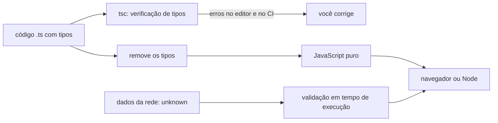

# TypeScript

## Por que isso importa

`Cannot read properties of undefined (reading 'nome')` é provavelmente o erro mais visto da história do JavaScript. Ele acontece porque nada impede você de chamar uma função com o objeto errado, esquecer um campo ou digitar `usuario.nmoe`. O **TypeScript** acrescenta **tipos** ao JavaScript e encontra esses erros **enquanto você digita**, antes de o código rodar. Em projetos grandes, ele vira documentação viva e torna refatorações seguras: mude o nome de um campo e o editor mostra todos os lugares que quebraram. A maioria das vagas de front-end e muitas de back-end com Node pedem TypeScript.

## Intuição

Pense no **encaixe das peças** de um brinquedo de montar. Uma peça redonda não entra num buraco quadrado: você percebe na hora, sem precisar montar tudo e ver desabar. Os tipos são o formato dos buracos: a função `enviarEmail(usuario: Usuario)` só aceita peças com o formato de `Usuario`.

Mas atenção: o TypeScript confere as peças **na fábrica** (na compilação). Depois disso, os tipos são **apagados** e o que roda é JavaScript puro. Se uma peça chega de fora, pela rede (uma resposta de API, um formulário), ninguém confere o formato dela na hora de rodar, a não ser que você confira.

## Visual



O que o compilador pega:

```text
interface Usuario { nome: string; email: string; idade?: number }

function saudar(u: Usuario) { return `Olá, ${u.nome}`; }

saudar({ nome: 'Ana' });
       ~~~~~~~~~~~~~~~ erro: falta a propriedade 'email'
saudar({ nome: 'Ana', email: 'a@x.com' }).toUpperCase();   ok, devolve string
const u: Usuario = buscar();
u.idade.toFixed(1);
~~~~~~~ erro: 'u.idade' pode ser 'undefined'
```

## Conceito técnico

### Tipos básicos

```typescript
let titulo: string = 'Aula';            // normalmente a inferência dispensa a anotação
const quantidade = 3;                    // inferido: 3 (literal), pois é const
const precos: number[] = [10, 20];
const par: [string, number] = ['ana', 31];   // tupla

function somar(a: number, b: number): number {
  return a + b;
}

const dobrar = (x: number) => x * 2;     // retorno inferido: number
```

- `string`, `number`, `boolean`, `null`, `undefined`, `bigint`, `symbol`.
- Anote **parâmetros** e as fronteiras públicas (funções exportadas); deixe a **inferência** cuidar do resto.
- Ligue o modo **`strict`** no `tsconfig.json`: sem ele, `null` e `undefined` passam por qualquer tipo e metade do valor se perde.

### Objetos: type e interface

```typescript
interface Produto {
  readonly id: number;
  nome: string;
  preco: number;
  tags?: string[];          // opcional
}

type Id = number | string;   // type também nomeia uniões, tuplas, funções
type Handler = (evento: MouseEvent) => void;
```

`interface` e `type` se sobrepõem bastante para objetos; escolha um padrão no projeto. A tipagem é **estrutural**: qualquer objeto com o formato certo serve, não importa de onde veio.

### Uniões, literais e estreitamento

```typescript
type Status = 'pendente' | 'pago' | 'cancelado';

function rotulo(valor: string | number) {
  if (typeof valor === 'string') {
    return valor.toUpperCase();      // aqui valor é string
  }
  return valor.toFixed(2);           // aqui valor é number
}
```

O compilador **estreita** o tipo depois de checagens como `typeof`, `===`, `in`, `instanceof`, `Array.isArray` e testes de `null`.

### Uniões discriminadas

A ferramenta mais útil para modelar estados:

```typescript
type Requisicao =
  | { estado: 'carregando' }
  | { estado: 'sucesso'; dados: Produto[] }
  | { estado: 'erro'; mensagem: string };

function render(r: Requisicao) {
  switch (r.estado) {
    case 'carregando': return 'Carregando...';
    case 'sucesso': return `${r.dados.length} produtos`;   // dados só existe aqui
    case 'erro': return r.mensagem;
    default: {
      const impossivel: never = r;   // se surgir um estado novo, isto vira erro de compilação
      return impossivel;
    }
  }
}
```

Estados impossíveis (sucesso sem dados, erro sem mensagem) deixam de ser representáveis.

### Genéricos

```typescript
function primeiro<T>(itens: T[]): T | undefined {
  return itens[0];
}
const n = primeiro([1, 2, 3]);        // T = number, n: number | undefined
const s = primeiro(['a', 'b']);       // T = string

interface Pagina<T> { itens: T[]; proximo: string | null }
```

Genéricos ligam tipos de entrada e saída sem perder a informação (o que `any` faria).

### Tipos utilitários e operadores

- `Partial<T>` (tudo opcional), `Required<T>`, `Readonly<T>`, `Pick<T, 'a' | 'b'>`, `Omit<T, 'senha'>`, `Record<K, V>`, `ReturnType<typeof f>`.
- `keyof T` (as chaves como união), `typeof valor` (o tipo de um valor), `T['campo']`.
- `as const` congela literais: `const PAPEIS = ['admin', 'cliente'] as const; type Papel = typeof PAPEIS[number];`.

### any, unknown e a fronteira com o mundo

- **`any`** desliga a verificação. Cada `any` é um buraco por onde os bugs voltam.
- **`unknown`** é o tipo honesto para o que vem de fora: você só pode usá-lo depois de **estreitar**.
- `JSON.parse` e `resposta.json()` devolvem `any`; trate como `unknown` e **valide** (à mão ou com Zod, Valibot). `as Usuario` não valida nada: é você dizendo ao compilador "confia em mim".
- O `!` (non-null assertion) também é uma promessa sem verificação; use com parcimônia.

### Na prática

- `tsc --noEmit` no CI (SD-07) verifica os tipos; ferramentas como Vite, esbuild e o Node atual só **removem** os tipos para rodar rápido.
- Bibliotecas trazem tipos próprios ou via `@types/nome`.
- Comece um projeto JavaScript existente renomeando arquivos aos poucos, com `allowJs`.

## Código

Uma união discriminada para o estado de uma busca e a validação de um dado externo.

```typescript
type Produto = { id: number; nome: string; preco: number };

type Estado =
  | { tipo: 'vazio' }
  | { tipo: 'carregando' }
  | { tipo: 'pronto'; produtos: Produto[] }
  | { tipo: 'falhou'; erro: string };

function descrever(e: Estado): string {
  switch (e.tipo) {
    case 'vazio': return 'Busque algo';
    case 'carregando': return 'Carregando...';
    case 'pronto': return `${e.produtos.length} resultado(s), o mais barato custa ${Math.min(...e.produtos.map((p) => p.preco))}`;
    case 'falhou': return `Erro: ${e.erro}`;
  }
}

function ehProduto(x: unknown): x is Produto {
  return typeof x === 'object' && x !== null
    && typeof (x as Produto).id === 'number'
    && typeof (x as Produto).nome === 'string'
    && typeof (x as Produto).preco === 'number';
}

const vindoDaApi: unknown = JSON.parse('[{"id":1,"nome":"Caderno","preco":30},{"id":2,"nome":"Caneta"}]');
const lista = Array.isArray(vindoDaApi) ? vindoDaApi.filter(ehProduto) : [];

const estados: Estado[] = [
  { tipo: 'vazio' },
  { tipo: 'carregando' },
  { tipo: 'pronto', produtos: lista },
  { tipo: 'falhou', erro: 'timeout' },
];
for (const e of estados) console.log(descrever(e));
```

Repare que a caneta sem preço foi descartada pela validação: o tipo `Produto[]` agora é verdade, e não uma promessa.

## Erros comuns

- **Sem `strict`**, com `null` passando por todo lugar.
- **`any` para calar o compilador**, em vez de modelar o tipo.
- **`as Tipo` em dados da rede** achando que isso valida.
- **Anotar tudo**, inclusive o que a inferência já sabe, poluindo o código.
- **Campos opcionais demais** (`dados?`, `erro?`, `carregando?`) em vez de uma união discriminada.
- **Confiar que tipos existem em tempo de execução**: não dá para fazer `if (x instanceof Usuario)` com uma interface.
- **Duplicar tipos à mão** em vez de derivar (`Pick`, `Omit`, `typeof`, `ReturnType`).

## Pratique

```quiz
id: WB-03-q1
tipo: multipla_escolha
pergunta: "O que acontece com as anotações de tipo do TypeScript quando o código roda no navegador?"
opcoes: ["Viram verificações automáticas em tempo de execução", "São removidas: o navegador roda JavaScript puro", "O navegador lê os tipos para otimizar", "Ficam como comentários que lançam erro se violados"]
resposta: 1
explicacao: "A verificação acontece antes, no editor e no tsc. Depois os tipos são apagados. Por isso dados vindos de fora precisam de validação em tempo de execução."
dificuldade: 1
```

```quiz
id: WB-03-q2
tipo: multipla_escolha
pergunta: "Qual tipo representa melhor um valor vindo de JSON.parse antes de ser validado?"
opcoes: ["any", "unknown", "object", "never"]
resposta: 1
explicacao: "unknown obriga você a estreitar (typeof, Array.isArray, um type guard ou Zod) antes de usar. any aceita qualquer operação e esconde os erros que o TypeScript existe para pegar."
dificuldade: 1
```

```quiz
id: WB-03-q3
tipo: verdadeiro_falso
pergunta: "const u = await resposta.json() as Usuario garante que u tem os campos de Usuario."
resposta: false
explicacao: "A asserção 'as' só diz ao compilador para acreditar em você; nenhum código verifica nada. Se a API mudar ou devolver um erro, o programa quebra mais adiante, longe da causa. Valide na fronteira."
dificuldade: 1
```

```quiz
id: WB-03-q4
tipo: multipla_escolha
pergunta: "Qual a vantagem de type Estado = { tipo: 'ok'; dados: X } | { tipo: 'erro'; msg: string } sobre { ok: boolean; dados?: X; msg?: string }?"
opcoes: ["Ocupa menos memória", "Estados impossíveis (ok sem dados, erro sem mensagem) não podem ser representados, e o compilador estreita o tipo pelo campo tipo", "É mais rápido em tempo de execução", "Não há vantagem"]
resposta: 1
explicacao: "Com a união discriminada, dentro de um if (e.tipo === 'ok') o compilador sabe que dados existe. Com campos opcionais, você precisa checar tudo sempre e nada impede combinações sem sentido."
dificuldade: 2
```

```quiz
id: WB-03-q5
tipo: resposta_curta
pergunta: "Para que serve um tipo genérico como function primeiro<T>(itens: T[]): T | undefined, em comparação com function primeiro(itens: any[]): any?"
resposta: "O genérico preserva a ligação entre entrada e saída: com um array de number, o retorno é number | undefined, e o compilador continua verificando o uso. Com any, a informação de tipo se perde e qualquer uso errado do resultado passa sem aviso."
palavras_chave: ["entrada", "saída", "any", "perde"]
dificuldade: 2
```

```quiz
id: WB-03-q6
tipo: codigo
linguagem: typescript
pergunta: |
  **União discriminada.** Complete `area(f: Forma)` para as três formas, usando `switch` em `f.tipo`. Mantenha o `default` com `never`, que faz o compilador avisar se uma forma nova for criada sem tratamento. O triângulo usa base e altura.
codigo_inicial: |
  type Circulo = { tipo: 'circulo'; raio: number };
  type Retangulo = { tipo: 'retangulo'; largura: number; altura: number };
  type Triangulo = { tipo: 'triangulo'; base: number; altura: number };
  type Forma = Circulo | Retangulo | Triangulo;

  function area(f: Forma): number {
    switch (f.tipo) {
      default: {
        const impossivel: never = f;
        return impossivel;
      }
    }
  }
usa: [switch, case, never, return]
testes:
  - chamada: "area({ tipo: 'retangulo', largura: 3, altura: 4 })"
    saida: "12"
  - chamada: "area({ tipo: 'triangulo', base: 10, altura: 5 })"
    saida: "25"
  - chamada: "Math.round(area({ tipo: 'circulo', raio: 2 }) * 100) / 100"
    saida: "12.57"
  - chamada: "area({ tipo: 'circulo', raio: 0 })"
    visivel: false
    saida: "0"
  - chamada: "[area({ tipo: 'retangulo', largura: 2.5, altura: 2 }), area({ tipo: 'triangulo', base: 3, altura: 3 })]"
    visivel: false
    saida: "[ 5, 4.5 ]"
dica: "Um case por forma: Math.PI * f.raio ** 2, f.largura * f.altura e f.base * f.altura / 2. Dentro de cada case, o TypeScript já sabe quais campos f tem."
solucao: |
  type Circulo = { tipo: 'circulo'; raio: number };
  type Retangulo = { tipo: 'retangulo'; largura: number; altura: number };
  type Triangulo = { tipo: 'triangulo'; base: number; altura: number };
  type Forma = Circulo | Retangulo | Triangulo;

  function area(f: Forma): number {
    switch (f.tipo) {
      case 'circulo':
        return Math.PI * f.raio ** 2;
      case 'retangulo':
        return f.largura * f.altura;
      case 'triangulo':
        return f.base * f.altura / 2;
      default: {
        const impossivel: never = f;
        return impossivel;
      }
    }
  }
explicacao: "No código inicial, o compilador já reclama: f não é never no default, porque nenhuma forma foi tratada. Conforme você adiciona os cases, o erro some. Se alguém criar { tipo: 'hexagono' } amanhã, o erro volta exatamente aqui, em vez de a função devolver undefined em produção. Tentar f.raio no case 'retangulo' também seria erro de compilação."
dificuldade: 1
```

```quiz
id: WB-03-q7
tipo: codigo
linguagem: typescript
pergunta: |
  **Um genérico útil.** Escreva `agrupar<T>(itens: T[], chave: (item: T) => string): Record<string, T[]>`, que agrupa os itens pelo valor que `chave` devolve, mantendo a ordem original dentro de cada grupo e a ordem de aparição dos grupos.
codigo_inicial: |
  function agrupar<T>(itens: T[], chave: (item: T) => string): Record<string, T[]> {
    return { todos: itens };
  }
usa: [function, for, return]
testes:
  - chamada: "agrupar([1, 2, 3, 4, 5], (n) => (n % 2 === 0 ? 'par' : 'impar'))"
    saida: "{ impar: [ 1, 3, 5 ], par: [ 2, 4 ] }"
  - chamada: "agrupar(['ana', 'bruno', 'alice'], (s) => s[0])"
    saida: "{ a: [ 'ana', 'alice' ], b: [ 'bruno' ] }"
  - chamada: "agrupar([], (x) => String(x))"
    visivel: false
    saida: "{}"
  - chamada: "agrupar([{ n: 'x', c: 'b' }, { n: 'y', c: 'a' }, { n: 'z', c: 'b' }], (o) => o.c)"
    visivel: false
    saida: "{ b: [ { n: 'x', c: 'b' }, { n: 'z', c: 'b' } ], a: [ { n: 'y', c: 'a' } ] }"
dica: "Comece com const grupos: Record<string, T[]> = {}. Para cada item, calcule k = chave(item); se grupos[k] não existir, crie []; depois faça push."
solucao: |
  function agrupar<T>(itens: T[], chave: (item: T) => string): Record<string, T[]> {
    const grupos: Record<string, T[]> = {};
    for (const item of itens) {
      const k = chave(item);
      if (!grupos[k]) grupos[k] = [];
      grupos[k].push(item);
    }
    return grupos;
  }
explicacao: "Graças ao T, quem chama agrupar com uma lista de Produto recebe Record<string, Produto[]>, e o editor completa os campos dentro de cada grupo. Com any no lugar de T, essa informação se perderia. A versão nativa disso chegou ao JavaScript como Object.groupBy, e o TypeScript a tipa exatamente assim."
dificuldade: 2
```

```quiz
id: WB-03-q8
tipo: codigo
linguagem: typescript
pergunta: |
  **Validando dados de fora.** Escreva `validarUsuario(dado: unknown): Usuario | string[]`. Devolva o próprio objeto (como `Usuario`) se ele for válido, ou a lista, em ordem, dos campos com problema:

  - `'objeto'` (sozinho) se `dado` não for um objeto não nulo e que não é array;
  - `'nome'`: precisa ser string não vazia (depois de `trim`);
  - `'idade'`: precisa ser um número **inteiro** maior ou igual a 0;
  - `'email'`: precisa ser string contendo `@`;
  - `'tags'`: é opcional, mas se existir precisa ser um array de strings.
codigo_inicial: |
  type Usuario = { nome: string; idade: number; email: string; tags?: string[] };

  function validarUsuario(dado: unknown): Usuario | string[] {
    return dado as Usuario;
  }
usa: [unknown, typeof, if, return]
testes:
  - chamada: "validarUsuario({ nome: 'Ana', idade: 31, email: 'ana@x.com' })"
    saida: "{ nome: 'Ana', idade: 31, email: 'ana@x.com' }"
  - chamada: "validarUsuario({ nome: '  ', idade: '31', email: 'ana' })"
    saida: "[ 'nome', 'idade', 'email' ]"
  - chamada: "validarUsuario(null)"
    saida: "[ 'objeto' ]"
  - chamada: "validarUsuario({ nome: 'Bia', idade: 2.5, email: 'b@y', tags: ['a', 3] })"
    visivel: false
    saida: "[ 'idade', 'tags' ]"
  - chamada: "validarUsuario([1, 2])"
    visivel: false
    saida: "[ 'objeto' ]"
  - chamada: "validarUsuario({ nome: 'Caio', idade: 0, email: 'c@z', tags: [] })"
    visivel: false
    saida: "{ nome: 'Caio', idade: 0, email: 'c@z', tags: [] }"
  - chamada: "validarUsuario({ idade: -1, email: 'x@y', tags: 'adm' })"
    visivel: false
    saida: "[ 'nome', 'idade', 'tags' ]"
dica: "Depois de conferir typeof dado === 'object', dado !== null e !Array.isArray(dado), trate-o como Record<string, unknown> e teste cada campo com typeof, Number.isInteger, includes('@') e every((t) => typeof t === 'string')."
solucao: |
  type Usuario = { nome: string; idade: number; email: string; tags?: string[] };

  function validarUsuario(dado: unknown): Usuario | string[] {
    if (typeof dado !== 'object' || dado === null || Array.isArray(dado)) return ['objeto'];
    const o = dado as Record<string, unknown>;
    const erros: string[] = [];
    if (typeof o.nome !== 'string' || o.nome.trim() === '') erros.push('nome');
    if (typeof o.idade !== 'number' || !Number.isInteger(o.idade) || o.idade < 0) erros.push('idade');
    if (typeof o.email !== 'string' || !o.email.includes('@')) erros.push('email');
    if (o.tags !== undefined) {
      if (!Array.isArray(o.tags) || !o.tags.every((t) => typeof t === 'string')) erros.push('tags');
    }
    if (erros.length > 0) return erros;
    return o as Usuario;
  }
explicacao: "Repare como o TypeScript acompanha cada typeof: depois de typeof o.nome !== 'string' ||, ele sabe que o.nome é string e libera o .trim(). O código inicial, com 'as Usuario', compila sem reclamar e deixa passar idade '31' (string) e null, o que quebraria o programa mais tarde. Bibliotecas como Zod fazem isso declarando o esquema uma vez e gerando o tipo a partir dele, para os dois nunca divergirem."
dificuldade: 2
```

## Resumo

- TypeScript = JavaScript + **tipos verificados antes de rodar**; em execução os tipos **somem**.
- Ligue o **`strict`**; anote parâmetros e fronteiras, deixe a **inferência** trabalhar.
- `type`/`interface`, uniões, literais e **estreitamento** com `typeof`, `in`, `===`.
- **Uniões discriminadas** + `never` modelam estados sem combinações impossíveis.
- **Genéricos** preservam tipos; utilitários (`Partial`, `Pick`, `Omit`, `Record`) derivam em vez de duplicar.
- Dados de fora são **`unknown`** e precisam de **validação**; `any` e `as` desligam a segurança.

## Para ir além

- Converta um projeto JavaScript seu para TypeScript com `strict`, arquivo por arquivo.
- Faça os exercícios do Total TypeScript para iniciantes.
- Use Zod para validar as respostas de uma API num projeto seu.
- **Próximo módulo**: WB-04 Back-end: servidor HTTP, rotas, middlewares.
