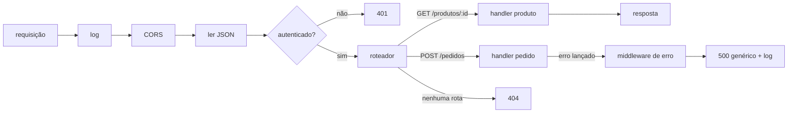

# Back-end: servidor HTTP, rotas, middlewares

## Por que isso importa

Cada clique num app chama, em algum momento, um **servidor**: alguém precisa guardar os dados, verificar a senha, calcular o frete, cobrar o cartão. O back-end é onde vivem as regras que não podem ficar no navegador (porque o usuário controla o navegador) e onde ficam os dados de todos. Saber montar um servidor HTTP, com rotas organizadas, validação, autenticação e tratamento de erros, é a base de qualquer vaga de back-end ou full stack, seja em Node, Python, Java ou Go: os conceitos são os mesmos.

## Intuição

Um servidor é como a **cozinha de um restaurante** com uma **linha de produção**:

- O **pedido** (requisição) chega com o que se quer (`GET /cardapio`, `POST /pedidos`) e detalhes (cabeçalhos, corpo).
- Antes de chegar ao cozinheiro, ele passa por **estações**: alguém anota o horário (log), alguém confere se o cliente está na lista (autenticação), alguém confere se o pedido faz sentido (validação). Essas estações são os **middlewares**. Qualquer uma pode **devolver o pedido** ("cliente não identificado") sem chamar a próxima.
- O **roteador** decide qual cozinheiro atende: a pizza vai para o pizzaiolo, a sobremesa para o confeiteiro. Cada cozinheiro é um **handler**.
- A **resposta** volta com um status (200 deu certo, 404 não temos isso, 500 a cozinha pegou fogo) e o prato (o corpo).

## Visual



Uma requisição e a resposta, como trafegam (RD-05):

```text
POST /api/pedidos?cupom=PRIMEIRA HTTP/1.1          ← método, caminho e query
Host: loja.com
Content-Type: application/json                    ← cabeçalhos
Cookie: sid=9f8a7c...

{"itens": [{"produto": 42, "quantidade": 2}]}      ← corpo

HTTP/1.1 201 Created
Content-Type: application/json
Location: /api/pedidos/1001

{"id": 1001, "total": 59.80}
```

## Conceito técnico

### O servidor mais simples

```javascript
import http from 'node:http';

const servidor = http.createServer((req, res) => {
  res.writeHead(200, { 'Content-Type': 'text/plain; charset=utf-8' });
  res.end(`Você pediu ${req.method} ${req.url}`);
});

servidor.listen(3000, () => console.log('ouvindo em http://localhost:3000'));
```

O processo abre uma porta (SO, RD-04), e para cada requisição o Node chama a função com `req` (o que chegou) e `res` (o que você devolve). Tudo o mais (Express, Fastify, Nest) é organização em cima disso. Como o Node tem uma thread só (WB-02), nunca bloqueie: use as APIs assíncronas de arquivos, banco e rede.

### Rotas

```javascript
import express from 'express';
const app = express();
app.use(express.json());                         // middleware: lê o corpo JSON

app.get('/api/produtos', async (req, res) => {
  const pagina = Number(req.query.pagina ?? 1);  // query string: ?pagina=2
  res.json(await produtos.listar({ pagina }));
});

app.get('/api/produtos/:id', async (req, res) => {
  const produto = await produtos.buscar(Number(req.params.id));   // parâmetro de rota
  if (!produto) return res.status(404).json({ erro: 'produto não encontrado' });
  res.json(produto);
});

app.post('/api/pedidos', exigirLogin, async (req, res) => {
  const pedido = await pedidos.criar(req.usuario.id, req.body);
  res.status(201).location(`/api/pedidos/${pedido.id}`).json(pedido);
});
```

Siga o desenho de API do AS-03: recursos no plural, métodos com significado, status corretos.

### Middlewares

Funções `(req, res, next)` que rodam em sequência. Cada uma pode:

- **fazer algo e passar adiante** com `next()` (log, medir tempo, ler cookies);
- **enriquecer** a requisição (`req.usuario = ...` depois de validar a sessão);
- **encerrar** a resposta sem chamar `next()` (401, 429, 400);
- sinalizar um **erro** com `next(erro)`, que pula para o middleware de erro.

```javascript
function exigirLogin(req, res, next) {
  const usuario = sessoes.get(req.cookies?.sid);
  if (!usuario) return res.status(401).json({ erro: 'faça login' });
  req.usuario = usuario;
  next();
}

app.use((erro, req, res, next) => {               // 4 parâmetros: middleware de erro
  console.error({ erro: erro.message, rota: req.path, stack: erro.stack });
  res.status(500).json({ erro: 'erro interno' });  // detalhes só no log (SE-04)
});
```

A **ordem** importa: o log antes de tudo, a leitura do corpo antes das rotas, o tratamento de erro por último.

### Validação

Nunca confie no corpo da requisição (SE-04). Valide **tipos, formatos, limites e permissões** antes de usar, e devolva **400** com a lista do que está errado. Bibliotecas como Zod (WB-03), Joi ou o Pydantic do FastAPI declaram o esquema uma vez. Limite também o **tamanho** do corpo.

### Cookies, CORS e cabeçalhos

- Cookies de sessão com `HttpOnly; Secure; SameSite=Lax; Path=/` e expiração (SE-03).
- **CORS**: por padrão, um site em `app.com` não lê respostas de `api.com`. O servidor da API libera origens específicas com `Access-Control-Allow-Origin`. Para métodos e cabeçalhos não simples, o navegador manda antes um **preflight** `OPTIONS`. Nunca libere `*` junto com credenciais.
- Cabeçalhos de segurança (CSP, HSTS, nosniff) com um middleware como o `helmet`.

### Arquivos estáticos

Servir `public/` parece trivial, mas `GET /../../etc/passwd` é um ataque clássico (**path traversal**). Normalize o caminho, garanta que ele continua **dentro** da pasta pública, defina o `Content-Type` certo e devolva `index.html` para pastas. Em produção, deixe isso com o nginx ou uma CDN (SD-03).

### Estrutura de um projeto

- **Configuração por variáveis de ambiente** (porta, URL do banco, segredos), nunca no código (SD-05).
- Camadas (AS-01): rotas finas que chamam **serviços** com as regras, que usam **repositórios** para o banco (BD-07).
- **Pool de conexões** com o banco, criado uma vez na inicialização.
- **Logs estruturados** com um id por requisição (SD-08).
- **Desligamento gracioso**: ao receber SIGTERM, pare de aceitar conexões, termine as em andamento e feche o banco (SO-02, SD-06).
- **Testes de integração** que sobem o app e fazem requisições de verdade (supertest, httpx).

## Código

Um servidor completo com o módulo `http` do Node, sem bibliotecas: roteador com parâmetros, middlewares (log, JSON, autenticação), validação e tratamento de erro. Rode com `node servidor.mjs` no terminal e teste com `curl`.

```javascript
import http from 'node:http';

const produtos = new Map([[1, { id: 1, nome: 'Caderno', preco: 30 }]]);
let proximoId = 2;

const rotas = [
  ['GET', '/produtos', (req, res) => enviar(res, 200, [...produtos.values()])],
  ['GET', '/produtos/:id', (req, res) => {
    const p = produtos.get(Number(req.params.id));
    return p ? enviar(res, 200, p) : enviar(res, 404, { erro: 'não encontrado' });
  }],
  ['POST', '/produtos', (req, res) => {
    const { nome, preco } = req.corpo ?? {};
    const erros = [];
    if (typeof nome !== 'string' || !nome.trim()) erros.push('nome');
    if (typeof preco !== 'number' || preco < 0) erros.push('preco');
    if (erros.length) return enviar(res, 400, { erros });
    const p = { id: proximoId++, nome: nome.trim(), preco };
    produtos.set(p.id, p);
    enviar(res, 201, p);
  }],
];

function enviar(res, status, dados) {
  res.writeHead(status, { 'Content-Type': 'application/json; charset=utf-8' });
  res.end(JSON.stringify(dados));
}

function casar(padrao, caminho) {
  const a = padrao.split('/');
  const b = caminho.split('/');
  if (a.length !== b.length) return null;
  const params = {};
  for (let i = 0; i < a.length; i++) {
    if (a[i].startsWith(':')) params[a[i].slice(1)] = decodeURIComponent(b[i]);
    else if (a[i] !== b[i]) return null;
  }
  return params;
}

const middlewares = [
  async (req, res, next) => {                       // log com duração
    const inicio = Date.now();
    await next();
    console.log(`${req.method} ${req.url} ${res.statusCode} ${Date.now() - inicio}ms`);
  },
  async (req, res, next) => {                       // autenticação para escrita
    if (req.method !== 'GET' && req.headers.authorization !== 'Bearer segredo-de-teste') {
      return enviar(res, 401, { erro: 'não autenticado' });
    }
    await next();
  },
  async (req, res, next) => {                       // lê o corpo JSON
    let texto = '';
    for await (const pedaco of req) texto += pedaco;
    try {
      req.corpo = texto ? JSON.parse(texto) : undefined;
    } catch {
      return enviar(res, 400, { erro: 'JSON inválido' });
    }
    await next();
  },
  async (req, res) => {                             // roteador
    const caminho = new URL(req.url, 'http://x').pathname;
    for (const [metodo, padrao, handler] of rotas) {
      const params = metodo === req.method && casar(padrao, caminho);
      if (params) {
        req.params = params;
        return handler(req, res);
      }
    }
    enviar(res, 404, { erro: 'rota não encontrada' });
  },
];

http.createServer(async (req, res) => {
  const executar = (i) => middlewares[i](req, res, () => executar(i + 1));
  try {
    await executar(0);
  } catch (erro) {
    console.error(erro);
    if (!res.headersSent) enviar(res, 500, { erro: 'erro interno' });
  }
}).listen(3000, () => console.log('http://localhost:3000/produtos'));

// curl localhost:3000/produtos/1
// curl -X POST localhost:3000/produtos -H 'Authorization: Bearer segredo-de-teste' -d '{"nome":"Caneta","preco":5}'
```

## Erros comuns

- **Regras de negócio no front-end** apenas (preço, permissão, estoque): o usuário controla o navegador.
- **Não validar o corpo** ou confiar no `Content-Type`.
- **Stack trace na resposta** de erro.
- **Esquecer o `return`** depois de responder, e tentar responder duas vezes ("headers already sent").
- **Operações síncronas e lentas** (ler arquivo grande, criptografia pesada) na thread do Node.
- **Uma conexão de banco por requisição**, em vez de um pool.
- **`Access-Control-Allow-Origin: *`** para "resolver o CORS" com cookies.
- **Servir arquivos com o caminho do usuário** sem normalizar (path traversal).
- **Segredos no código** e configuração diferente escondida em `if (producao)`.
- **Não tratar o SIGTERM**, derrubando requisições a cada deploy.

## Pratique

```quiz
id: WB-04-q1
tipo: multipla_escolha
pergunta: "Um middleware de autenticação percebe que não há sessão válida. O que ele deve fazer?"
opcoes: ["Chamar next() e deixar a rota decidir", "Responder 401 e não chamar next()", "Lançar uma exceção para derrubar o servidor", "Redirecionar para /admin"]
resposta: 1
explicacao: "Um middleware pode encerrar a cadeia respondendo. Se chamasse next(), o handler rodaria sem usuário e cada rota teria de repetir a checagem, que é exatamente o que o middleware existe para evitar."
dificuldade: 1
```

```quiz
id: WB-04-q2
tipo: multipla_escolha
pergunta: "O front-end em https://app.loja.com chama https://api.loja.com e o navegador mostra um erro de CORS. Onde se resolve?"
opcoes: ["No front-end, com mode: 'no-cors'", "No servidor da API, devolvendo Access-Control-Allow-Origin: https://app.loja.com (e tratando o preflight OPTIONS)", "Desligando o CORS no navegador", "Trocando fetch por XMLHttpRequest"]
resposta: 1
explicacao: "CORS é o servidor dizendo quais outras origens podem ler suas respostas. Quem decide é a API. 'no-cors' só devolve uma resposta opaca, que o código não consegue ler."
dificuldade: 2
```

```quiz
id: WB-04-q3
tipo: verdadeiro_falso
pergunta: "No Express, a ordem em que os middlewares são registrados com app.use não importa."
resposta: false
explicacao: "Eles rodam na ordem de registro. Se o express.json() vier depois das rotas, req.body será undefined nelas; se o middleware de erro vier antes das rotas, nunca recebe os erros delas."
dificuldade: 1
```

```quiz
id: WB-04-q4
tipo: multipla_escolha
pergunta: "Qual status devolver quando o corpo de um POST /pedidos vem com quantidade: -3?"
opcoes: ["200 com { ok: false }", "400 Bad Request (ou 422) com a lista de campos inválidos", "404 Not Found", "500 Internal Server Error"]
resposta: 1
explicacao: "O problema está na requisição do cliente, então é um 4xx: 400 (ou 422, Unprocessable Content) com detalhes para o front-end mostrar. 500 diz que o servidor falhou, o que dispararia alertas à toa (SD-08)."
dificuldade: 1
```

```quiz
id: WB-04-q5
tipo: resposta_curta
pergunta: "Por que o servidor deve tratar o sinal SIGTERM em vez de simplesmente morrer?"
resposta: "Porque o orquestrador (Kubernetes, Docker, a plataforma) envia SIGTERM a cada deploy ou redução de réplicas. Tratando o sinal, o servidor para de aceitar conexões novas, termina as requisições em andamento e fecha o pool do banco; morrendo na hora, ele corta requisições pela metade e gera erros para os usuários."
palavras_chave: ["deploy", "conexões", "andamento", "banco"]
dificuldade: 2
```

```quiz
id: WB-04-q6
tipo: codigo
linguagem: javascript
pergunta: |
  **A cadeia de middlewares.** Escreva `compor(middlewares)`, que devolve uma função `(req, res) => void` que executa os middlewares em ordem. Cada middleware recebe `(req, res, next)`: quando chama `next()`, o próximo roda; quando não chama, a cadeia para ali. Código escrito **depois** do `next()` roda na volta, como no Koa (o modelo "cebola"). Os testes usam `req.log` para registrar a ordem.
codigo_inicial: |
  function compor(middlewares) {
    return function (req, res) {
      for (const mw of middlewares) mw(req, res, () => {});
    };
  }

  // não mude: os testes usam esta função
  function testar(middlewares) {
    const req = { log: [] };
    compor(middlewares)(req, {});
    return req.log;
  }
usa: [function, return]
testes:
  - chamada: "testar([(req, res, next) => { req.log.push('a'); next(); }, (req, res, next) => { req.log.push('b'); next(); }])"
    saida: "[ 'a', 'b' ]"
  - chamada: "testar([(req, res, next) => { req.log.push('auth falhou'); }, (req, res, next) => { req.log.push('rota'); }])"
    saida: "[ 'auth falhou' ]"
  - chamada: "testar([(req, res, next) => { req.log.push('log: início'); next(); req.log.push('log: fim'); }, (req, res, next) => { req.log.push('rota'); }])"
    saida: "[ 'log: início', 'rota', 'log: fim' ]"
  - chamada: "testar([])"
    visivel: false
    saida: "[]"
  - chamada: "testar([(req, res, next) => { req.log.push(1); next(); req.log.push(5); }, (req, res, next) => { req.log.push(2); next(); req.log.push(4); }, (req, res, next) => { req.log.push(3); next(); }])"
    visivel: false
    saida: "[ 1, 2, 3, 4, 5 ]"
dica: "Crie uma função interna executar(i): se i chegou ao fim da lista, não faz nada; senão chama middlewares[i](req, res, () => executar(i + 1)). Comece com executar(0)."
solucao: |
  function compor(middlewares) {
    return function (req, res) {
      function executar(i) {
        if (i >= middlewares.length) return;
        middlewares[i](req, res, () => executar(i + 1));
      }
      executar(0);
    };
  }

  // não mude: os testes usam esta função
  function testar(middlewares) {
    const req = { log: [] };
    compor(middlewares)(req, {});
    return req.log;
  }
explicacao: "O next de cada middleware é uma função que chama o próximo índice. Por isso não chamar next() interrompe a cadeia (o 401 do segundo teste), e o código depois do next() roda na volta, depois que todo o resto terminou (o log com duração do terceiro teste). Express, Koa, Fastify e até os interceptadores do Axios seguem esse desenho; nos reais, o next devolve uma Promise para funcionar com código assíncrono."
dificuldade: 2
```

```quiz
id: WB-04-q7
tipo: codigo
linguagem: python
pergunta: |
  **Servindo arquivos sem path traversal.** `arquivos` é o conjunto de caminhos existentes dentro da pasta pública (ex.: `{'index.html', 'css/site.css', 'docs/index.html'}`). Escreva `servir(caminho, arquivos)`, que recebe o caminho da URL (já sem a query) e devolve `(status, tipo)`:

  - normalize: separe por `/`, ignore partes vazias e `.`, e para `..` volte uma pasta; se o `..` tentar sair da raiz, devolva `(403, None)`;
  - se o caminho normalizado for vazio ou terminar com `/` na URL, procure o `index.html` daquela pasta;
  - se o arquivo não existir, `(404, None)`;
  - senão `(200, tipo)`, com o tipo pela extensão: `.html` → `'text/html'`, `.css` → `'text/css'`, `.js` → `'text/javascript'`, `.png` → `'image/png'`, outras → `'application/octet-stream'`.
codigo_inicial: |
  def servir(caminho, arquivos):
      nome = caminho.lstrip('/')
      if nome in arquivos:
          return (200, 'text/html')
      return (404, None)
usa: [def, for, if, return]
testes:
  - chamada: "servir('/css/site.css', {'index.html', 'css/site.css'})"
    saida: "(200, 'text/css')"
  - chamada: "servir('/', {'index.html'})"
    saida: "(200, 'text/html')"
  - chamada: "servir('/../../etc/passwd', {'index.html'})"
    saida: "(403, None)"
  - chamada: "servir('/foto.jpg', {'index.html'})"
    saida: "(404, None)"
  - chamada: "servir('/docs/', {'index.html', 'docs/index.html'})"
    visivel: false
    saida: "(200, 'text/html')"
  - chamada: "servir('/css/../js/./app.js', {'js/app.js'})"
    visivel: false
    saida: "(200, 'text/javascript')"
  - chamada: "servir('/css/../../segredo.env', {'segredo.env'})"
    visivel: false
    saida: "(403, None)"
  - chamada: "servir('/baixar/manual.pdf', {'baixar/manual.pdf'})"
    visivel: false
    saida: "(200, 'application/octet-stream')"
  - chamada: "servir('//img///logo.png', {'img/logo.png'})"
    visivel: false
    saida: "(200, 'image/png')"
dica: "Use uma lista partes como pilha: para cada pedaço de caminho.split('/'), ignore '' e '.', faça pop() no '..' (se a pilha estiver vazia, é 403) e append() no resto. Se a pilha estiver vazia ou o caminho terminar com '/', acrescente 'index.html'. Junte com '/'."
solucao: |
  TIPOS = {'.html': 'text/html', '.css': 'text/css', '.js': 'text/javascript', '.png': 'image/png'}

  def servir(caminho, arquivos):
      partes = []
      for p in caminho.split('/'):
          if p in ('', '.'):
              continue
          if p == '..':
              if not partes:
                  return (403, None)
              partes.pop()
          else:
              partes.append(p)
      if not partes or caminho.endswith('/'):
          partes.append('index.html')
      nome = '/'.join(partes)
      if nome not in arquivos:
          return (404, None)
      for ext, tipo in TIPOS.items():
          if nome.endswith(ext):
              return (200, tipo)
      return (200, 'application/octet-stream')
explicacao: "A normalização com pilha é a mesma do SO-07. O ponto de segurança é decidir com o caminho normalizado, nunca com o texto cru: '/css/../js/app.js' é legítimo, enquanto '/css/../../segredo.env' tenta sair da pasta pública, e um servidor ingênuo que fizesse open('public' + caminho) entregaria o arquivo. Servidores reais também decodificam %2e%2e antes de normalizar e recusam links simbólicos que apontam para fora."
dificuldade: 2
```

```quiz
id: WB-04-q8
tipo: codigo
linguagem: javascript
pergunta: |
  **Cookies dos dois lados.** Escreva:

  - `lerCookies(cabecalho)`: recebe o cabeçalho `Cookie` (`'a=1; sid=xyz'`) e devolve um objeto `{ a: '1', sid: 'xyz' }`. Ignore pedaços sem `=`, tire espaços das pontas, e separe só no **primeiro** `=` (valores podem ter `=`). Cabeçalho vazio ou `undefined` dá `{}`.
  - `criarCookie(nome, valor, opcoes)`: monta o `Set-Cookie`, nesta ordem: `nome=valor`, depois `Max-Age=N` (se `opcoes.maxAge` existir), `Path=/` (sempre), `HttpOnly` (se `opcoes.httpOnly`), `Secure` (se `opcoes.secure`) e `SameSite=X` (se `opcoes.sameSite`), separados por `'; '`.
codigo_inicial: |
  function lerCookies(cabecalho) {
    return {};
  }

  function criarCookie(nome, valor, opcoes) {
    return nome + '=' + valor;
  }
usa: [function, for, if, return]
testes:
  - chamada: "lerCookies('tema=escuro; sid=abc123')"
    saida: "{ tema: 'escuro', sid: 'abc123' }"
  - chamada: "criarCookie('sid', 'abc123', { maxAge: 3600, httpOnly: true, secure: true, sameSite: 'Lax' })"
    saida: "'sid=abc123; Max-Age=3600; Path=/; HttpOnly; Secure; SameSite=Lax'"
  - chamada: "lerCookies(undefined)"
    saida: "{}"
  - chamada: "lerCookies(' token=a=b==; lixo ;x=1')"
    visivel: false
    saida: "{ token: 'a=b==', x: '1' }"
  - chamada: "criarCookie('tema', 'claro', {})"
    visivel: false
    saida: "'tema=claro; Path=/'"
  - chamada: "criarCookie('sid', '', { maxAge: 0, httpOnly: true })"
    visivel: false
    saida: "'sid=; Max-Age=0; Path=/; HttpOnly'"
  - chamada: "lerCookies('')"
    visivel: false
    saida: "{}"
dica: "Em lerCookies, percorra (cabecalho || '').split(';'), use indexOf('=') e slice. Em criarCookie, monte um array de partes e junte com join('; '). Cuidado: maxAge pode ser 0, então teste opcoes.maxAge !== undefined."
solucao: |
  function lerCookies(cabecalho) {
    const cookies = {};
    for (const pedaco of (cabecalho || '').split(';')) {
      const pos = pedaco.indexOf('=');
      if (pos === -1) continue;
      cookies[pedaco.slice(0, pos).trim()] = pedaco.slice(pos + 1).trim();
    }
    return cookies;
  }

  function criarCookie(nome, valor, opcoes) {
    const partes = [`${nome}=${valor}`];
    if (opcoes.maxAge !== undefined) partes.push(`Max-Age=${opcoes.maxAge}`);
    partes.push('Path=/');
    if (opcoes.httpOnly) partes.push('HttpOnly');
    if (opcoes.secure) partes.push('Secure');
    if (opcoes.sameSite) partes.push(`SameSite=${opcoes.sameSite}`);
    return partes.join('; ');
  }
explicacao: "O último teste oculto é o logout: um cookie vazio com Max-Age=0 manda o navegador apagá-lo. Se o teste fosse if (opcoes.maxAge), o 0 seria ignorado e a sessão continuaria no navegador, um bug real e comum. Valores de tokens em base64 têm '=' no fim, por isso separar só no primeiro '='. Na prática, bibliotecas como cookie-parser fazem isso, também decodificando caracteres especiais."
dificuldade: 2
```

## Resumo

- Um servidor recebe **requisições** e devolve **respostas**; frameworks organizam isso em **rotas** e **middlewares**.
- Rotas com **parâmetros** e **query**; status corretos (201, 400, 401, 404, 500).
- **Middlewares** em cadeia: log, CORS, corpo JSON, autenticação, validação; o de **erro** por último, com resposta genérica.
- **Valide tudo** que chega; cookies `HttpOnly; Secure; SameSite`; CORS com origens específicas.
- Arquivos estáticos com caminho **normalizado** (sem path traversal).
- Configuração por ambiente, camadas, pool de banco, logs estruturados, desligamento gracioso, testes de integração.

## Para ir além

- Faça a parte 3 do Full Stack Open, construindo uma API com Express e MongoDB ou PostgreSQL.
- Reescreva o servidor do exemplo em FastAPI e compare a validação automática.
- Adicione testes de integração com supertest (Node) ou httpx (Python).
- **Próximo módulo**: WB-05 Front-end com framework (React): componentes, estado, hooks.
