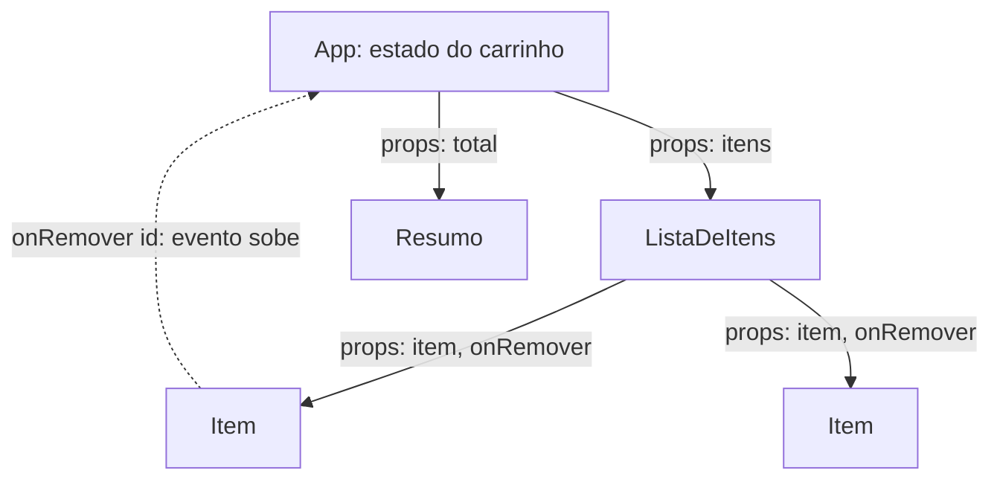

# Front-end com framework (React): componentes, estado, hooks

## Por que isso importa

No WB-02 você atualizou a tela à mão: mudou o estado, depois procurou o elemento e trocou o texto. Com três botões é fácil. Com um painel de pedidos em que um filtro muda a lista, o contador, o gráfico e o botão de exportar ao mesmo tempo, esquecer uma atualização vira um bug a cada semana. **React** (e frameworks parecidos, como Vue, Svelte e Angular) inverte o problema: você descreve **como a tela deve ser para cada estado**, e o framework atualiza o DOM sozinho. React é o framework de front-end mais usado do mercado, base também do React Native para apps móveis, e o que o Full Stack Open, projeto final do OSSU, ensina.

## Intuição

Pense numa **planilha**. Você não escreve "quando A1 mudar, apague C1 e escreva o novo total". Você escreve a **fórmula** `C1 = A1 + B1` uma vez, e a planilha recalcula sempre que algo muda.

Um componente React é uma fórmula: `tela = f(estado)`. Você muda o estado (`setQuantidade(3)`), o React chama a função de novo, compara o resultado novo com o anterior e aplica no DOM **só o que mudou**. Você nunca mais procura elementos com `querySelector`.

## Visual



Dados descem por **props**; eventos sobem por **funções** passadas como props. O ciclo de uma atualização:

```text
clique em "remover"
  → setItens(novaLista)          o estado muda (nunca mutado: uma lista nova)
  → React chama App() de novo     render: a função devolve a nova descrição da tela
  → compara com a anterior        reconciliação (usa as keys das listas)
  → altera só o <li> removido     commit no DOM
  → roda os efeitos afetados      useEffect cujas dependências mudaram
```

## Conceito técnico

### Componentes e JSX

```jsx
function Produto({ nome, preco, emPromocao }) {
  return (
    <article className="produto">
      <h2>{nome}</h2>
      <p>{preco.toLocaleString('pt-BR', { style: 'currency', currency: 'BRL' })}</p>
      {emPromocao && <span className="selo">Promoção</span>}
    </article>
  );
}

function Vitrine({ produtos }) {
  return (
    <section>
      {produtos.length === 0 ? <p>Nada por aqui.</p> : produtos.map((p) => (
        <Produto key={p.id} nome={p.nome} preco={p.preco} emPromocao={p.promo} />
      ))}
    </section>
  );
}
```

- Um componente é uma **função** que recebe **props** e devolve JSX (que vira chamadas a `React.createElement`).
- `{}` insere expressões JavaScript; `className` em vez de `class`; condicionais com `&&` e `? :`.
- Texto em `{}` é **escapado** automaticamente (sem XSS, SE-04); `dangerouslySetInnerHTML` é a exceção, com o nome que merece.
- Listas precisam de **`key` estável e única** (o id do item, não o índice), para o React saber qual item é qual entre renders.
- Componentes devem ser **puros**: mesmas props e estado, mesma saída, sem efeitos durante o render.

### Estado com useState

```jsx
function Contador() {
  const [n, setN] = useState(0);
  return <button onClick={() => setN(n + 1)}>Cliques: {n}</button>;
}
```

- `setN` **agenda** um novo render; `n` só muda no próximo render (dentro deste, continua o valor antigo).
- Quando o novo valor depende do anterior, use a forma de função: `setN((atual) => atual + 1)`.
- **Nunca mute** o estado: `itens.push(x)` não avisa o React. Crie valores novos: `setItens([...itens, x])`, `setItens(itens.filter((i) => i.id !== id))`, `setUsuario({ ...usuario, nome })`.
- Guarde o **mínimo**: o que pode ser calculado a partir de outro estado (o total, a lista filtrada) é calculado no render, não guardado.
- **Levante o estado** para o ancestral comum quando dois componentes precisam dele.

### useReducer

Quando as atualizações são muitas e relacionadas, concentre-as num **reducer**: uma função pura `(estado, ação) => novoEstado`.

```jsx
function carrinho(estado, acao) {
  switch (acao.tipo) {
    case 'adicionar': return [...estado, acao.item];
    case 'remover': return estado.filter((i) => i.id !== acao.id);
    default: return estado;
  }
}
const [itens, despachar] = useReducer(carrinho, []);
// despachar({ tipo: 'remover', id: 3 })
```

### Regras dos hooks

Hooks (`useState`, `useEffect`, ...) só podem ser chamados **no topo** do componente, **sempre na mesma ordem**: nunca dentro de `if`, laços ou funções internas. O React identifica cada estado pela **posição** da chamada (você vai implementar isso no último desafio).

### useEffect: sincronizar com o mundo externo

```jsx
useEffect(() => {
  const controle = new AbortController();
  fetch(`/api/produtos?busca=${encodeURIComponent(busca)}`, { signal: controle.signal })
    .then((r) => r.json())
    .then(setProdutos)
    .catch(() => {});
  return () => controle.abort();     // limpeza: cancela a busca anterior
}, [busca]);                          // roda de novo quando busca mudar
```

- Um efeito roda **depois** do render, para sincronizar com algo **fora** do React: rede, timers, assinaturas, APIs do navegador.
- A lista de **dependências** precisa conter tudo o que o efeito usa; o linter `react-hooks/exhaustive-deps` confere.
- A função de **limpeza** desfaz o que o efeito fez (cancelar, remover ouvinte, limpar intervalo). Em desenvolvimento, o Strict Mode roda os efeitos duas vezes justamente para revelar limpezas faltando.
- **Você provavelmente não precisa de um efeito** para calcular dados derivados (calcule no render), para reagir a um evento (faça no handler) ou para "resetar estado quando a prop muda" (use `key`).
- Para dados do servidor, bibliotecas como **TanStack Query** ou o framework (Next.js, React Router) cuidam de cache, carregamento, erro e corridas melhor do que um `useEffect` à mão.

### Formulários

**Componentes controlados**: o valor do input vem do estado e cada digitação atualiza o estado (`value={nome} onChange={(e) => setNome(e.target.value)}`). Isso permite validar e formatar enquanto o usuário digita. Para formulários grandes, bibliotecas como React Hook Form reduzem o trabalho.

### Outros hooks e o ecossistema

- `useRef`: um valor que persiste entre renders sem causar render (referência a um elemento do DOM, um id de timer).
- `useMemo` / `useCallback`: memorizam cálculos e funções caros; use quando medir um problema, não por padrão.
- `useContext`: passa dados para muitos níveis sem "perfurar" props (tema, usuário logado).
- **Hooks personalizados**: funções `useAlgo()` que combinam hooks e reaproveitam lógica.
- Frameworks: **Next.js** e **React Router** (rotas, renderização no servidor, carregamento de dados); **Vite** para projetos só de cliente.
- Testes com **Testing Library**: teste o que o usuário vê e faz, não detalhes internos.

## Código

Um carrinho completo com estado derivado, reducer, lista com keys e formulário controlado. Cole num projeto criado com `npm create vite@latest` (modelo React) para rodar.

```jsx
import { useReducer, useState } from 'react';

function carrinho(itens, acao) {
  switch (acao.tipo) {
    case 'adicionar': {
      const existe = itens.find((i) => i.nome === acao.nome);
      if (existe) return itens.map((i) => (i.nome === acao.nome ? { ...i, qtd: i.qtd + 1 } : i));
      return [...itens, { id: crypto.randomUUID(), nome: acao.nome, preco: acao.preco, qtd: 1 }];
    }
    case 'remover':
      return itens.filter((i) => i.id !== acao.id);
    default:
      return itens;
  }
}

function Item({ item, onRemover }) {
  return (
    <li>
      {item.qtd}x {item.nome} = R$ {(item.qtd * item.preco).toFixed(2)}
      <button onClick={() => onRemover(item.id)} aria-label={`Remover ${item.nome}`}>×</button>
    </li>
  );
}

export default function App() {
  const [itens, despachar] = useReducer(carrinho, []);
  const [nome, setNome] = useState('');
  const [preco, setPreco] = useState('');

  const total = itens.reduce((s, i) => s + i.qtd * i.preco, 0);   // derivado: não é estado
  const valido = nome.trim() !== '' && Number(preco) > 0;

  function enviar(evento) {
    evento.preventDefault();
    despachar({ tipo: 'adicionar', nome: nome.trim(), preco: Number(preco) });
    setNome('');
    setPreco('');
  }

  return (
    <main>
      <form onSubmit={enviar}>
        <input value={nome} onChange={(e) => setNome(e.target.value)} placeholder="Produto" />
        <input value={preco} onChange={(e) => setPreco(e.target.value)} placeholder="Preço" type="number" />
        <button disabled={!valido}>Adicionar</button>
      </form>
      {itens.length === 0 ? <p>Carrinho vazio.</p> : (
        <ul>
          {itens.map((i) => <Item key={i.id} item={i} onRemover={(id) => despachar({ tipo: 'remover', id })} />)}
        </ul>
      )}
      <p>Total: R$ {total.toFixed(2)}</p>
    </main>
  );
}
```

## Erros comuns

- **Mutar o estado** (`push`, `item.qtd++`, `obj.campo = x`) e a tela não atualizar.
- **`key` com o índice** em listas que mudam de ordem ou perdem itens: o React confunde os itens e o estado deles (o texto digitado vai parar no item errado).
- **Guardar estado derivado** (total, lista filtrada) e esquecer de atualizá-lo.
- **useEffect para tudo**: calcular dados, reagir a cliques, encadear estados, gerando renders extras e bugs.
- **Dependências faltando** no useEffect (valores velhos) ou objetos novos a cada render nas dependências (laço infinito).
- **Esquecer a limpeza** de timers, ouvintes e buscas.
- **Corridas na busca**: a resposta da busca antiga chega depois da nova e sobrescreve.
- **Hooks dentro de `if`** ou laços.
- **Componente gigante** com tudo dentro, em vez de componentes pequenos e focados.

## Pratique

```quiz
id: WB-05-q1
tipo: multipla_escolha
pergunta: "O código itens.push(novo); setItens(itens); não atualiza a tela. Por quê?"
opcoes: ["push é lento demais", "O array é o mesmo objeto: o React compara a referência, vê que não mudou e não renderiza de novo", "setItens só aceita strings", "Falta um useEffect"]
resposta: 1
explicacao: "O React decide se precisa renderizar comparando o estado novo com o antigo por referência (Object.is). Mutar e passar o mesmo array parece 'nada mudou'. O certo é setItens([...itens, novo])."
dificuldade: 1
```

```quiz
id: WB-05-q2
tipo: multipla_escolha
pergunta: "Numa lista de tarefas em que é possível apagar itens do meio, qual key usar?"
opcoes: ["O índice do array", "Math.random()", "Um id estável e único de cada tarefa", "O texto da tarefa, mesmo que possa se repetir"]
resposta: 2
explicacao: "A key diz ao React qual elemento é qual entre renders. Com o índice, apagar o item 0 faz todos os outros 'virarem' o anterior, e estados internos (inputs, checkboxes) ficam no item errado. Math.random cria keys novas a cada render e recria tudo."
dificuldade: 1
```

```quiz
id: WB-05-q3
tipo: verdadeiro_falso
pergunta: "Para mostrar o total do carrinho, o ideal é ter um estado total e um useEffect que o recalcula quando os itens mudam."
resposta: false
explicacao: "O total é derivado dos itens: calcule durante o render (const total = itens.reduce(...)). Um estado extra com useEffect causa um render a mais, mostra por um instante o valor velho e é mais uma coisa para ficar dessincronizada."
dificuldade: 2
```

```quiz
id: WB-05-q4
tipo: multipla_escolha
pergunta: "Dentro de um handler, você chama setN(n + 1) três vezes seguidas, com n valendo 0. Qual é o valor depois do render?"
opcoes: ["3", "1", "0", "Depende do navegador"]
resposta: 1
explicacao: "Durante aquele render, n é sempre 0, então as três chamadas pedem 0 + 1. Para somar 3, use a forma de função: setN((atual) => atual + 1), que recebe o valor mais recente a cada chamada."
dificuldade: 2
```

```quiz
id: WB-05-q5
tipo: resposta_curta
pergunta: "Para que serve a função de limpeza devolvida por um useEffect? Dê um exemplo."
resposta: "Ela desfaz o que o efeito fez, e roda antes da próxima execução do efeito e quando o componente sai da tela. Exemplos: clearInterval de um timer criado no efeito, removeEventListener de um ouvinte, abort() de um fetch em andamento para que uma resposta antiga não sobrescreva a nova."
palavras_chave: ["desfaz", "clearInterval", "abort", "sai da tela"]
dificuldade: 2
```

```quiz
id: WB-05-q6
tipo: codigo
linguagem: javascript
pergunta: |
  **Um reducer sem mutação.** Escreva `carrinho(estado, acao)`. O estado é uma lista de `{ id, nome, qtd }`. Ações:

  - `{ tipo: 'adicionar', id, nome }`: se o id já existe, soma 1 à `qtd`; senão acrescenta `{ id, nome, qtd: 1 }` no fim;
  - `{ tipo: 'diminuir', id }`: subtrai 1; se chegar a 0, remove o item;
  - `{ tipo: 'limpar' }`: lista vazia;
  - qualquer outra: devolve o **mesmo** estado.

  **Nunca altere** o estado nem os objetos recebidos: crie novos.
codigo_inicial: |
  function carrinho(estado, acao) {
    if (acao.tipo === 'adicionar') {
      estado.push({ id: acao.id, nome: acao.nome, qtd: 1 });
    }
    return estado;
  }
usa: [function, if, return]
testes:
  - chamada: "carrinho([], { tipo: 'adicionar', id: 1, nome: 'Caderno' })"
    saida: "[ { id: 1, nome: 'Caderno', qtd: 1 } ]"
  - chamada: "carrinho([{ id: 1, nome: 'Caderno', qtd: 1 }], { tipo: 'adicionar', id: 1, nome: 'Caderno' })"
    saida: "[ { id: 1, nome: 'Caderno', qtd: 2 } ]"
  - chamada: "carrinho([{ id: 1, nome: 'A', qtd: 1 }, { id: 2, nome: 'B', qtd: 3 }], { tipo: 'diminuir', id: 1 })"
    saida: "[ { id: 2, nome: 'B', qtd: 3 } ]"
  - chamada: "(() => { const e = [{ id: 1, nome: 'A', qtd: 1 }]; const n = carrinho(e, { tipo: 'adicionar', id: 1, nome: 'A' }); return [e[0].qtd, n[0].qtd, e === n]; })()"
    visivel: false
    saida: "[ 1, 2, false ]"
  - chamada: "(() => { const e = [{ id: 1, nome: 'A', qtd: 2 }]; const n = carrinho(e, { tipo: 'diminuir', id: 1 }); return [e[0].qtd, n[0].qtd]; })()"
    visivel: false
    saida: "[ 2, 1 ]"
  - chamada: "(() => { const e = [{ id: 1, nome: 'A', qtd: 1 }]; return [carrinho(e, { tipo: 'xyz' }) === e, carrinho(e, { tipo: 'limpar' })]; })()"
    visivel: false
    saida: "[ true, [] ]"
  - chamada: "(() => { const e = [{ id: 1, nome: 'A', qtd: 1 }]; const n = carrinho(e, { tipo: 'adicionar', id: 2, nome: 'B' }); return [e.length, n.length]; })()"
    visivel: false
    saida: "[ 1, 2 ]"
dica: "Trate cada acao.tipo com um if. Em adicionar, confira com some se o id existe; se sim, map devolvendo { ...i, qtd: i.qtd + 1 } só para o item certo; se não, [...estado, novo]. Em diminuir, map para subtrair e depois filter para tirar os com qtd 0."
solucao: |
  function carrinho(estado, acao) {
    if (acao.tipo === 'adicionar') {
      if (estado.some((i) => i.id === acao.id)) {
        return estado.map((i) => (i.id === acao.id ? { ...i, qtd: i.qtd + 1 } : i));
      }
      return [...estado, { id: acao.id, nome: acao.nome, qtd: 1 }];
    }
    if (acao.tipo === 'diminuir') {
      const novos = estado.map((i) => (i.id === acao.id ? { ...i, qtd: i.qtd - 1 } : i));
      return novos.filter((i) => i.qtd > 0);
    }
    if (acao.tipo === 'limpar') return [];
    return estado;
  }
explicacao: "Os testes ocultos conferem a imutabilidade: o estado original continua com qtd 1 e a lista devolvida é outro objeto. É isso que permite ao React (e ao Redux) detectar mudanças só comparando referências, e o que torna possível desfazer ações e inspecionar o histórico. Devolver o mesmo estado numa ação desconhecida também importa: sem mudança de referência, o React pula o render."
dificuldade: 2
```

```quiz
id: WB-05-q7
tipo: codigo
linguagem: javascript
pergunta: |
  **Por que a key importa.** Na reconciliação, o React compara a lista anterior com a nova pelas keys. Escreva `reconciliar(antes, depois)`, que recebe duas listas de keys e devolve `{ remover, criar, manter }`:

  - `remover`: keys que estavam em `antes` e não estão em `depois` (na ordem de `antes`);
  - `criar`: keys novas em `depois` (na ordem de `depois`);
  - `manter`: keys presentes nas duas (na ordem de `depois`). Esses elementos do DOM, e o estado deles, são reaproveitados.
codigo_inicial: |
  function reconciliar(antes, depois) {
    return { remover: antes, criar: depois, manter: [] };
  }
usa: [function, for, if, return]
testes:
  - chamada: "reconciliar(['a', 'b', 'c'], ['a', 'c', 'd'])"
    saida: "{ remover: [ 'b' ], criar: [ 'd' ], manter: [ 'a', 'c' ] }"
  - chamada: "reconciliar([1, 2, 3], [3, 2, 1])"
    saida: "{ remover: [], criar: [], manter: [ 3, 2, 1 ] }"
  - chamada: "reconciliar([0, 1, 2], [0, 1])"
    saida: "{ remover: [ 2 ], criar: [], manter: [ 0, 1 ] }"
  - chamada: "reconciliar([], ['x'])"
    visivel: false
    saida: "{ remover: [], criar: [ 'x' ], manter: [] }"
  - chamada: "reconciliar(['p', 'q'], [])"
    visivel: false
    saida: "{ remover: [ 'p', 'q' ], criar: [], manter: [] }"
dica: "Monte dois Set, um de antes e um de depois. Percorra antes procurando quem não está em depois; percorra depois separando entre criar e manter."
solucao: |
  function reconciliar(antes, depois) {
    const a = new Set(antes);
    const d = new Set(depois);
    const remover = [];
    const criar = [];
    const manter = [];
    for (const k of antes) {
      if (!d.has(k)) remover.push(k);
    }
    for (const k of depois) {
      if (a.has(k)) manter.push(k);
      else criar.push(k);
    }
    return { remover, criar, manter };
  }
explicacao: "Compare o primeiro teste com o terceiro. Com keys estáveis (ids), apagar 'b' remove exatamente o elemento de 'b'. Com o índice como key, apagar o primeiro de três itens vira as keys [0, 1, 2] → [0, 1]: o React mantém os elementos 0 e 1 e remove o 2, ou seja, o último elemento do DOM some e os outros recebem os dados deslocados. Se o primeiro tinha um checkbox marcado, a marcação passa para o item errado. Esse é o bug clássico da key com índice."
dificuldade: 2
```

```quiz
id: WB-05-q8
tipo: codigo
linguagem: javascript
pergunta: |
  **Implemente o useState.** O React guarda os estados de cada componente numa lista e identifica cada `useState` pela **ordem** da chamada. Escreva `useState(inicial)` e `montar(componente)`:

  - `montar` cria um registro `{ hooks: [], indice: 0 }` e devolve `{ render() }`;
  - `render()` marca o registro como o atual, zera o índice, chama `componente()` e devolve o resultado;
  - `useState(inicial)` usa o registro atual: pega a posição `indice` (e avança), guarda `inicial` se a posição ainda não existir, e devolve `[valor, set]`. O `set` aceita um valor ou uma função `(anterior) => novo`, e só altera o valor guardado (o novo valor aparece no próximo `render()`).

  Os componentes de teste já estão prontos.
codigo_inicial: |
  let atual = null;

  function useState(inicial) {
    return [inicial, () => {}];
  }

  function montar(componente) {
    return { render: () => componente() };
  }

  // não mude: os testes usam estes componentes
  function Contador() {
    const [n, setN] = useState(0);
    const [nome, setNome] = useState('ana');
    return { n, nome, somar: () => setN(n + 1), somarDuas: () => { setN((x) => x + 1); setN((x) => x + 1); }, renomear: (x) => setNome(x) };
  }

  function testar(acoes) {
    const app = montar(Contador);
    let r = app.render();
    for (const a of acoes) {
      if (a === 'somar') r.somar();
      else if (a === 'somarDuas') r.somarDuas();
      else r.renomear(a);
      r = app.render();
    }
    return [r.n, r.nome];
  }
usa: [function, if, return]
testes:
  - chamada: "testar([])"
    saida: "[ 0, 'ana' ]"
  - chamada: "testar(['somar', 'somar'])"
    saida: "[ 2, 'ana' ]"
  - chamada: "testar(['somar', 'bia', 'somar'])"
    saida: "[ 2, 'bia' ]"
  - chamada: "testar(['somarDuas', 'somar'])"
    visivel: false
    saida: "[ 3, 'ana' ]"
  - chamada: "(() => { const a = montar(Contador); const b = montar(Contador); a.render().somar(); return [a.render().n, b.render().n]; })()"
    visivel: false
    saida: "[ 1, 0 ]"
  - chamada: "(() => { const a = montar(Contador); const r = a.render(); r.somar(); r.somar(); return a.render().n; })()"
    visivel: false
    saida: "1"
dica: "Em useState: const c = atual; const i = c.indice; c.indice += 1; if (i >= c.hooks.length) c.hooks.push(inicial). O set é (v) => { c.hooks[i] = typeof v === 'function' ? v(c.hooks[i]) : v; }. Em render: atual = registro; registro.indice = 0; chame o componente."
solucao: |
  let atual = null;

  function useState(inicial) {
    const c = atual;
    const i = c.indice;
    c.indice += 1;
    if (i >= c.hooks.length) c.hooks.push(inicial);
    const set = (v) => { c.hooks[i] = typeof v === 'function' ? v(c.hooks[i]) : v; };
    return [c.hooks[i], set];
  }

  function montar(componente) {
    const registro = { hooks: [], indice: 0 };
    return {
      render() {
        atual = registro;
        registro.indice = 0;
        const resultado = componente();
        atual = null;
        return resultado;
      },
    };
  }

  // não mude: os testes usam estes componentes
  function Contador() {
    const [n, setN] = useState(0);
    const [nome, setNome] = useState('ana');
    return { n, nome, somar: () => setN(n + 1), somarDuas: () => { setN((x) => x + 1); setN((x) => x + 1); }, renomear: (x) => setNome(x) };
  }

  function testar(acoes) {
    const app = montar(Contador);
    let r = app.render();
    for (const a of acoes) {
      if (a === 'somar') r.somar();
      else if (a === 'somarDuas') r.somarDuas();
      else r.renomear(a);
      r = app.render();
    }
    return [r.n, r.nome];
  }
explicacao: "O estado não fica 'dentro' da função Contador: fica no registro, na posição 0 (n) e 1 (nome). Por isso as regras dos hooks existem: se um useState estivesse dentro de um if, num render ele ocuparia a posição 1 e no outro não, e os estados trocariam de lugar. O último teste oculto mostra o valor 'congelado' do render: somar duas vezes com o mesmo n dá 1, enquanto a forma de função (somarDuas) dá 2. O React real é parecido, com uma lista ligada de hooks por componente e renders agendados em vez de manuais."
dificuldade: 3
```

## Resumo

- React é **declarativo**: `tela = f(estado)`; o framework calcula e aplica as mudanças no DOM.
- **Componentes** são funções puras com **props**; JSX escapa texto; listas com **key estável**.
- **useState**/**useReducer** com **atualizações imutáveis**; estado mínimo, o resto é **derivado** no render.
- **Regras dos hooks**: no topo, sempre na mesma ordem.
- **useEffect** só para sincronizar com o mundo externo, com dependências completas e **limpeza**; para dados do servidor, prefira bibliotecas.
- Formulários **controlados**, `useRef`, `useContext`, hooks personalizados; teste o que o usuário vê.

## Para ir além

- Faça o tutorial "Pensando em React" do react.dev e as partes 1, 2 e 5 do Full Stack Open.
- Leia "You Might Not Need an Effect" e procure efeitos desnecessários num projeto seu.
- Construa um front-end para a API do WB-04 com Vite + React + TypeScript, buscando os dados com TanStack Query.
- **Próximo módulo**: WB-06 Acessibilidade e performance web.
