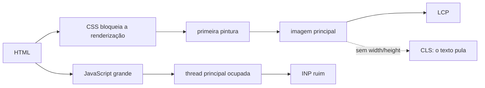

# Acessibilidade e performance web

## Por que isso importa

No Brasil, cerca de **18 milhões de pessoas** têm alguma deficiência (IBGE). Pessoas cegas usam leitores de tela; pessoas com deficiência motora navegam só pelo teclado ou por voz; pessoas com baixa visão ampliam a tela; idosos têm mais dificuldade com contraste e alvos pequenos. A **Lei Brasileira de Inclusão** (13.146/2015) exige sites acessíveis, e empresas já foram processadas por isso. E acessibilidade beneficia todos: legendas no ônibus, contraste no sol, teclado para quem tem pressa.

**Performance** também é inclusão: muita gente acessa a internet por celulares modestos e conexões 4G instáveis. Cada segundo a mais de carregamento derruba conversões, e o Google usa as Core Web Vitals no ranqueamento. As duas áreas aparecem juntas porque são medidas pelas mesmas ferramentas (Lighthouse) e cobradas no mesmo code review.

## Intuição

Pense num **prédio**. Uma rampa, um elevador com botões em braile e portas largas não atrapalham ninguém e permitem que todos entrem. Construir assim desde a planta é barato; quebrar a escada depois para pôr uma rampa é caro. Acessibilidade na web é igual: usar `<button>` em vez de `<div onclick>` custa zero no começo e dá teclado, foco e leitor de tela de graça.

Performance é o **tempo de espera na porta**. Ninguém se importa se o prédio tem 50 andares; importa quanto tempo leva para entrar, se a porta responde quando você empurra e se o chão não se mexe enquanto você anda. É exatamente o que as três Core Web Vitals medem.

## Visual

Os quatro princípios das WCAG (POUR):

```text
Perceptível     a informação chega a todos os sentidos      alt em imagens, legendas, contraste
Operável        dá para usar com qualquer dispositivo       teclado, tempo suficiente, alvos grandes
Compreensível   o conteúdo e a interface são claros         idioma, rótulos, mensagens de erro
Robusto         funciona com tecnologias assistivas         HTML válido e semântico, ARIA correto
```

As Core Web Vitals e seus limites (medidos no percentil 75 dos usuários reais):

```text
                         bom          precisa melhorar      ruim
LCP  maior conteúdo      ≤ 2,5 s      ≤ 4 s                 > 4 s       carregamento
INP  resposta a input    ≤ 200 ms     ≤ 500 ms              > 500 ms    interatividade
CLS  mudança de layout   ≤ 0,1        ≤ 0,25                > 0,25      estabilidade visual
```



## Conceito técnico

### HTML semântico primeiro

A regra número um do ARIA é: **não use ARIA** se um elemento nativo resolve. Um `<button>` já é focável, responde a Enter e Espaço e é anunciado como "botão". Um `<div onclick>` não faz nada disso.

- Use `button` para ações e `a href` para navegação.
- Estrutura com `header`, `nav`, `main`, `footer` e títulos em ordem (`h1` → `h2` → `h3`), que leitores de tela usam para pular (WB-01).
- `<html lang="pt-BR">`: o leitor de tela escolhe a pronúncia certa.
- Tabelas de dados com `th` e `caption`; listas com `ul`/`ol`.

### Textos alternativos

- Toda `img` tem `alt`. Imagem informativa: descreva o que importa ("Gráfico: vendas subiram 30% em março"). Imagem decorativa: `alt=""` (o leitor pula).
- Ícones que são botões precisam de nome: `<button aria-label="Fechar">×</button>`.
- Vídeos com **legendas**; áudios com transcrição.

### Formulários

- Cada campo com um `<label for>` visível (placeholder não é rótulo: some ao digitar).
- Agrupe opções com `fieldset` e `legend`.
- Erros em texto, perto do campo, ligados por `aria-describedby`, e anunciados (`aria-live` ou foco no resumo de erros). Nunca só pela cor vermelha.
- Tipos certos (`type="email"`, `inputmode="numeric"`) e `autocomplete` ajudam todo mundo.

### Teclado e foco

- Tudo que o mouse faz, o teclado faz: Tab avança, Shift+Tab volta, Enter/Espaço ativam, Esc fecha.
- **Nunca remova o contorno de foco** (`outline: none`) sem pôr outro visível; use `:focus-visible`.
- A ordem de Tab segue a ordem do DOM; evite `tabindex` positivo.
- Modais: foco vai para dentro ao abrir, fica preso nele, Esc fecha e o foco volta ao botão que abriu. O elemento `<dialog>` com `showModal()` faz quase tudo isso.
- Um link "Pular para o conteúdo" no topo poupa dezenas de Tabs.

### ARIA, quando necessário

Para componentes que o HTML não tem (abas, menus, árvores), ARIA informa **papéis** (`role="tab"`), **estados** (`aria-expanded`, `aria-selected`, `aria-checked`) e **propriedades** (`aria-controls`, `aria-labelledby`). Siga os padrões do **ARIA Authoring Practices Guide**, incluindo o comportamento de teclado esperado. ARIA errado é pior que nenhum: ele promete ao leitor de tela algo que o componente não cumpre.

### Contraste, cor e movimento

- Texto normal: contraste mínimo de **4,5:1** com o fundo (nível AA); texto grande (≥ 24px, ou 18,66px em negrito): **3:1**. AAA pede 7:1.
- Não transmita informação **só pela cor** (campo inválido com ícone e texto, gráfico com padrões ou rótulos).
- Respeite `prefers-reduced-motion` para animações; nada piscando mais de 3 vezes por segundo.
- Alvos de toque com pelo menos 24×24 px (WCAG 2.2), idealmente 44×44.
- A página deve funcionar com zoom de 200% e sem rolagem horizontal em telas estreitas.

### Testando acessibilidade

Ferramentas automáticas (Lighthouse, axe, WAVE) pegam só uns **30 a 40%** dos problemas. Complete com: navegar a página inteira **só pelo teclado**, usar um **leitor de tela** (NVDA no Windows, VoiceOver no Mac e iPhone, TalkBack no Android) e, quando possível, testes com pessoas com deficiência.

### Performance: as Core Web Vitals

- **LCP** (Largest Contentful Paint): quando o maior elemento visível (normalmente a imagem principal ou o título) aparece. Piora com servidor lento (TTFB), CSS e fontes que bloqueiam, imagem principal pesada ou descoberta tarde.
- **INP** (Interaction to Next Paint): quanto tempo entre um clique ou tecla e a próxima atualização da tela, no pior caso típico. Piora com JavaScript longo na thread principal (WB-02).
- **CLS** (Cumulative Layout Shift): quanto o conteúdo pula sozinho (imagem sem tamanho, anúncio que entra, fonte que troca).
- Meça com **dados de campo** (usuários reais: Chrome UX Report, a biblioteca `web-vitals`) e de **laboratório** (Lighthouse, DevTools) para investigar. O laboratório num notebook rápido mente sobre o celular do usuário.

### As otimizações que mais importam

- **Imagens**: formatos modernos (AVIF, WebP), tamanhos responsivos (`srcset`, `sizes`), `width` e `height` sempre (evita CLS), `loading="lazy"` abaixo da dobra, e `fetchpriority="high"` na imagem do LCP (que nunca deve ser lazy).
- **JavaScript**: mande menos. Divida em pedaços (code splitting, `import()` dinâmico), remova dependências pesadas, adie o que não é crítico (`defer`), quebre tarefas longas, considere renderização no servidor para a primeira tela.
- **CSS e fontes**: CSS crítico pequeno, `font-display: swap`, poucas variações de fonte, `preload` do essencial.
- **Rede**: compressão (Brotli/gzip), HTTP/2 ou 3, **CDN** (SD-03), cache longo para arquivos com hash no nome (`Cache-Control: max-age=31536000, immutable`), `preconnect` para origens de terceiros.
- **Terceiros** (analytics, chat, anúncios) costumam ser os maiores vilões: meça e corte.
- Tenha um **orçamento de performance** (ex.: 170 KB de JS comprimido) checado no CI (SD-07).

## Código

Uma página com os padrões de acessibilidade e performance aplicados: idioma, link para pular, rótulos, erro anunciado, botão nativo, `dialog`, imagem com tamanho e prioridade, foco visível e respeito a movimento reduzido. Clique em **▶ Experimentar** e navegue só com Tab, Enter e Esc.

```html
<!DOCTYPE html>
<html lang="pt-BR">
<head>
  <meta charset="UTF-8">
  <meta name="viewport" content="width=device-width, initial-scale=1">
  <title>Newsletter</title>
  <style>
    body { font-family: system-ui, sans-serif; max-width: 40rem; margin: auto; padding: 1rem; color: #1a1a1a; }
    .pular { position: absolute; left: -999px; }
    .pular:focus { left: 1rem; top: 1rem; background: #fff; padding: .5rem; }
    :focus-visible { outline: 3px solid #1d4ed8; outline-offset: 2px; }
    .erro { color: #b91c1c; }
    button { min-height: 44px; padding: 0 1rem; }
    img { max-width: 100%; height: auto; }
    @media (prefers-reduced-motion: no-preference) { dialog[open] { animation: surgir .2s; } }
    @keyframes surgir { from { opacity: 0; } }
  </style>
</head>
<body>
  <a class="pular" href="#principal">Pular para o conteúdo</a>
  <header><nav aria-label="Principal"><a href="#">Início</a> · <a href="#">Aulas</a></nav></header>
  <main id="principal">
    <h1>Receba as novidades</h1>
    
    <form id="form" novalidate>
      <label for="email">E-mail</label>
      <input id="email" type="email" autocomplete="email" required aria-describedby="erro-email">
      <p id="erro-email" class="erro" aria-live="polite"></p>
      <button>Inscrever</button>
    </form>
    <dialog id="ok" aria-labelledby="titulo-ok">
      <h2 id="titulo-ok">Inscrição feita!</h2>
      <p>Confira sua caixa de entrada.</p>
      <button id="fechar">Fechar</button>
    </dialog>
  </main>
  <script>
    const form = document.querySelector('#form');
    const email = document.querySelector('#email');
    const erro = document.querySelector('#erro-email');
    const dialogo = document.querySelector('#ok');
    form.addEventListener('submit', (e) => {
      e.preventDefault();
      if (!email.validity.valid) {
        erro.textContent = 'Digite um e-mail válido, como nome@exemplo.com.';
        email.setAttribute('aria-invalid', 'true');
        email.focus();
        return;
      }
      erro.textContent = '';
      email.removeAttribute('aria-invalid');
      dialogo.showModal();
    });
    document.querySelector('#fechar').addEventListener('click', () => dialogo.close());
  </script>
</body>
</html>
```

## Erros comuns

- **`div` e `span` clicáveis** no lugar de `button` e `a`.
- **`outline: none`** sem substituto: quem usa teclado se perde.
- **Imagens sem `alt`**, ou com `alt="imagem"`; ícones-botão sem nome.
- **Placeholder como rótulo** e erros indicados só pela cor.
- **Contraste baixo** (cinza claro em branco é a moda que exclui).
- **ARIA sobrando** ou errado (`role="button"` sem teclado, `aria-hidden` em conteúdo focável).
- **Modais que não prendem o foco** e não fecham com Esc.
- **Confiar só no Lighthouse** para acessibilidade, ou medir performance só no seu notebook com fibra.
- **Imagem do LCP com `loading="lazy"`** ou sem tamanho; **imagens gigantes** para exibir em 300px.
- **Megabytes de JavaScript** para uma página de conteúdo; scripts de terceiros sem controle.

## Pratique

```quiz
id: WB-06-q1
tipo: multipla_escolha
pergunta: "Qual é a forma mais acessível de criar um botão que abre o menu?"
opcoes: ["<div class='botao' onclick='abrir()'>Menu</div>", "<button type='button' aria-expanded='false' aria-controls='menu'>Menu</button>", "<span role='button'>Menu</span>", "<a onclick='abrir()'>Menu</a>"]
resposta: 1
explicacao: "O button nativo é focável e funciona com Enter e Espaço sem código extra; aria-expanded informa se o menu está aberto e aria-controls aponta qual elemento ele controla. A div e o span não recebem foco nem teclado; o link sem href também não."
dificuldade: 1
```

```quiz
id: WB-06-q2
tipo: multipla_escolha
pergunta: "Uma imagem puramente decorativa (um enfeite de fundo num card) deve ter:"
opcoes: ["alt='imagem decorativa'", "alt='' (vazio), para o leitor de tela ignorá-la", "Nenhum atributo alt", "alt com o nome do arquivo"]
resposta: 1
explicacao: "alt vazio diz explicitamente 'ignore'. Sem o atributo, muitos leitores leem o nome do arquivo ('fundo_card_v2 ponto png'). Descrever um enfeite só polui a navegação."
dificuldade: 1
```

```quiz
id: WB-06-q3
tipo: verdadeiro_falso
pergunta: "Se o Lighthouse dá nota 100 em acessibilidade, a página está acessível."
resposta: false
explicacao: "Ferramentas automáticas só detectam parte dos problemas: não sabem se o alt descreve bem a imagem, se a ordem do foco faz sentido ou se o modal prende o foco. É preciso testar com teclado e leitor de tela."
dificuldade: 1
```

```quiz
id: WB-06-q4
tipo: multipla_escolha
pergunta: "Ao carregar uma página de notícia, o texto pula para baixo quando a foto termina de carregar. Qual métrica é afetada e qual a correção?"
opcoes: ["LCP; usar loading='lazy' na foto", "CLS; definir width e height (ou aspect-ratio) na imagem para o navegador reservar o espaço", "INP; dividir o JavaScript", "TTFB; usar uma CDN"]
resposta: 1
explicacao: "Sem as dimensões, o navegador não sabe o tamanho da imagem até baixá-la e empurra o conteúdo depois. Com width e height, ele reserva o espaço de antemão e o layout não pula."
dificuldade: 2
```

```quiz
id: WB-06-q5
tipo: resposta_curta
pergunta: "Um botão demora 800 ms para reagir ao clique num celular simples, porque o handler processa uma lista grande. Que métrica isso piora e o que fazer?"
resposta: "Piora o INP (Interaction to Next Paint). É preciso liberar a thread principal: dar um retorno visual imediato e dividir o trabalho em pedaços (cedendo ao event loop com setTimeout ou scheduler.yield), processar menos dados, ou mover o cálculo para um Web Worker."
palavras_chave: ["INP", "thread principal", "dividir", "Worker"]
dificuldade: 2
```

```quiz
id: WB-06-q6
tipo: codigo
linguagem: html
pergunta: |
  **Corrigindo a acessibilidade.** O trecho tem quatro problemas: a imagem não tem texto alternativo, o campo não tem rótulo, o "botão" é uma `div` e o ícone de fechar não tem nome. Corrija mantendo os ids: dê `alt` descritivo à imagem, ligue um `<label>` ao campo `#cupom`, troque a div por um `<button>` com id `aplicar` e dê ao botão `#fechar` um `aria-label`.
codigo_inicial: |
  
  <input id="cupom" placeholder="Cupom de desconto">
  <div id="aplicar" class="botao" onclick="aplicar()">Aplicar</div>
  <button id="fechar">×</button>
usa: [alt, label, button, aria-label]
testes:
  - verifica: "(document.querySelector('#foto').getAttribute('alt') || '').trim().length >= 5"
    descricao: "a imagem tem um alt descritivo"
  - verifica: "document.querySelector('#cupom').labels.length === 1 && document.querySelector('#cupom').labels[0].textContent.trim().length > 0"
    descricao: "o campo tem um label com texto"
  - verifica: "document.querySelector('#aplicar')?.tagName === 'BUTTON'"
    descricao: "Aplicar é um button de verdade"
  - verifica: "(document.querySelector('#fechar').getAttribute('aria-label') || '').trim().length > 0"
    descricao: "o botão de fechar tem nome acessível"
  - verifica: "document.querySelector('#aplicar').textContent.trim() === 'Aplicar' && document.querySelectorAll('div[onclick]').length === 0"
    descricao: "o texto do botão continua e não sobra div clicável"
    visivel: false
dica: "Use <label for=\"cupom\">Cupom de desconto</label> antes do input, <button id=\"aplicar\" type=\"button\" onclick=\"aplicar()\">Aplicar</button> e aria-label=\"Fechar\" no ×."
solucao: |
  
  <label for="cupom">Cupom de desconto</label>
  <input id="cupom" placeholder="Ex.: PRIMEIRA10">
  <button id="aplicar" type="button" onclick="aplicar()">Aplicar</button>
  <button id="fechar" aria-label="Fechar">×</button>
explicacao: "Cada correção é pequena e resolve um grupo de pessoas: o alt para quem não vê a foto, o label para o leitor de tela anunciar o campo (e ampliar a área clicável), o button para quem usa teclado, e o aria-label para o × não ser lido como 'vezes'. Repare que o placeholder virou exemplo, e não rótulo."
dificuldade: 1
```

```quiz
id: WB-06-q7
tipo: codigo
linguagem: javascript
pergunta: |
  **Calculando o contraste (WCAG).** Escreva `contraste(cor1, cor2)`, com cores em hexadecimal (`'#rrggbb'`), que devolve `{ razao, nivel }`:

  - para cada cor, converta cada canal para 0..1 (`c / 255`), linearize (`c <= 0.04045 ? c / 12.92 : ((c + 0.055) / 1.055) ** 2.4`) e calcule a luminância `L = 0.2126 R + 0.7152 G + 0.0722 B`;
  - `razao = (Lclara + 0.05) / (Lescura + 0.05)`, arredondada a 2 casas (`Math.round(x * 100) / 100`);
  - `nivel`: `'AAA'` se razão >= 7, `'AA'` se >= 4.5, `'AA texto grande'` se >= 3, senão `'falha'` (use a razão já arredondada).
codigo_inicial: |
  function contraste(cor1, cor2) {
    return { razao: 1, nivel: 'falha' };
  }
usa: [function, return]
testes:
  - chamada: "contraste('#000000', '#ffffff')"
    saida: "{ razao: 21, nivel: 'AAA' }"
  - chamada: "contraste('#777777', '#ffffff')"
    saida: "{ razao: 4.48, nivel: 'AA texto grande' }"
  - chamada: "contraste('#ffffff', '#1d4ed8')"
    saida: "{ razao: 6.7, nivel: 'AA' }"
  - chamada: "contraste('#aaaaaa', '#ffffff')"
    visivel: false
    saida: "{ razao: 2.32, nivel: 'falha' }"
  - chamada: "contraste('#336699', '#336699')"
    visivel: false
    saida: "{ razao: 1, nivel: 'falha' }"
  - chamada: "contraste('#595959', '#ffffff')"
    visivel: false
    saida: "{ razao: 7, nivel: 'AAA' }"
dica: "Faça uma função luminancia(hex) que lê os canais com parseInt(hex.slice(1, 3), 16), (3, 5) e (5, 7). A cor mais clara é a de maior luminância: use Math.max e Math.min."
solucao: |
  function luminancia(hex) {
    const canais = [1, 3, 5].map((i) => parseInt(hex.slice(i, i + 2), 16) / 255);
    const [r, g, b] = canais.map((c) => (c <= 0.04045 ? c / 12.92 : ((c + 0.055) / 1.055) ** 2.4));
    return 0.2126 * r + 0.7152 * g + 0.0722 * b;
  }

  function contraste(cor1, cor2) {
    const l1 = luminancia(cor1);
    const l2 = luminancia(cor2);
    const razao = Math.round(((Math.max(l1, l2) + 0.05) / (Math.min(l1, l2) + 0.05)) * 100) / 100;
    let nivel = 'falha';
    if (razao >= 7) nivel = 'AAA';
    else if (razao >= 4.5) nivel = 'AA';
    else if (razao >= 3) nivel = 'AA texto grande';
    return { razao, nivel };
  }
explicacao: "O segundo teste é famoso: o cinza #777 em branco parece legível, mas fica em 4,48, logo abaixo do 4,5 exigido para texto normal. O olho humano percebe o verde muito mais que o azul, por isso os pesos 0.7152 e 0.0722; e a linearização desfaz a curva gama do sRGB. As ferramentas de contraste do DevTools e do WebAIM fazem exatamente essa conta."
dificuldade: 2
```

```quiz
id: WB-06-q8
tipo: codigo
linguagem: python
pergunta: |
  **Avaliando as Core Web Vitals.** `medicoes` é um dicionário com listas de medições reais de usuários: `{'LCP': [ms...], 'INP': [ms...], 'CLS': [valores...]}`. Escreva `avaliar(medicoes)`, que devolve para cada métrica presente (na ordem LCP, INP, CLS) uma tupla `(p75, classificacao)`:

  - **p75**: ordene os valores e pegue o de índice `ceil(0.75 * n) - 1`;
  - limites (bom se `<=` o primeiro, "melhorar" se `<=` o segundo, senão ruim): LCP 2500 / 4000, INP 200 / 500, CLS 0.1 / 0.25;
  - classificações: `'bom'`, `'melhorar'`, `'ruim'`.

  Métricas sem medições (lista vazia ou ausente) não aparecem no resultado.
codigo_inicial: |
  import math

  def avaliar(medicoes):
      return {m: (max(v), 'bom') for m, v in medicoes.items()}
usa: [def, for, if, return]
testes:
  - chamada: "avaliar({'LCP': [1200, 1800, 2100, 5000]})"
    saida: "{'LCP': (2100, 'bom')}"
  - chamada: "avaliar({'INP': [80, 120, 300, 350, 900], 'CLS': [0.0, 0.02, 0.3, 0.05]})"
    saida: "{'INP': (350, 'melhorar'), 'CLS': (0.05, 'bom')}"
  - chamada: "avaliar({'CLS': [0.3, 0.4, 0.26, 0.1], 'LCP': [4200, 3900, 4100], 'INP': []})"
    saida: "{'LCP': (4200, 'ruim'), 'CLS': (0.3, 'ruim')}"
  - chamada: "avaliar({})"
    visivel: false
    saida: "{}"
  - chamada: "avaliar({'LCP': [2500], 'INP': [500], 'CLS': [0.25]})"
    visivel: false
    saida: "{'LCP': (2500, 'bom'), 'INP': (500, 'melhorar'), 'CLS': (0.25, 'melhorar')}"
dica: "Guarde os limites num dicionário LIMITES = {'LCP': (2500, 4000), ...} e percorra suas chaves em ordem. Para cada métrica com valores, ordene com sorted, pegue o p75 e compare com os limites."
solucao: |
  import math

  LIMITES = {'LCP': (2500, 4000), 'INP': (200, 500), 'CLS': (0.1, 0.25)}

  def avaliar(medicoes):
      resultado = {}
      for metrica, (bom, ruim) in LIMITES.items():
          valores = medicoes.get(metrica)
          if not valores:
              continue
          ordenados = sorted(valores)
          p75 = ordenados[math.ceil(0.75 * len(ordenados)) - 1]
          if p75 <= bom:
              classe = 'bom'
          elif p75 <= ruim:
              classe = 'melhorar'
          else:
              classe = 'ruim'
          resultado[metrica] = (p75, classe)
      return resultado
explicacao: "O Google usa o percentil 75 de propósito: a média esconde quem sofre (SD-01), e o p75 garante que a maioria tem uma boa experiência sem ser dominado por casos extremos. No primeiro teste, um usuário com 5 s não derruba a nota, mas se um quarto dos usuários estiver lento, ela cai. É o mesmo cálculo que o Chrome UX Report e o Search Console mostram."
dificuldade: 2
```

## Resumo

- Acessibilidade é **lei** e **inclusão**; as WCAG se organizam em **POUR** (perceptível, operável, compreensível, robusto); mire o nível **AA**.
- **HTML semântico** primeiro; ARIA só para o que o HTML não tem, seguindo os padrões.
- **alt** certo, **labels** de verdade, erros em texto, **teclado** completo, **foco visível**, modais que prendem o foco.
- **Contraste** de 4,5:1 (3:1 para texto grande); nada só pela cor; respeite movimento reduzido.
- Teste com **teclado e leitor de tela**, não só com ferramentas automáticas.
- **Core Web Vitals** no p75: **LCP** ≤ 2,5 s, **INP** ≤ 200 ms, **CLS** ≤ 0,1.
- Imagens otimizadas com tamanho, menos JavaScript, cache e CDN, terceiros sob controle, orçamento no CI.

## Para ir além

- Navegue por um site seu só com o teclado e depois com o NVDA ou o VoiceOver ligado, de olhos fechados.
- Rode o Lighthouse e o axe DevTools, e corrija os problemas de maior impacto.
- Instale a biblioteca `web-vitals` e envie as métricas reais dos usuários para o seu painel (SD-08).
- **Fim da trilha.** Você passou por HTML, JavaScript, TypeScript, back-end, React, acessibilidade e performance: um ótimo próximo passo é o projeto final do Full Stack Open.
