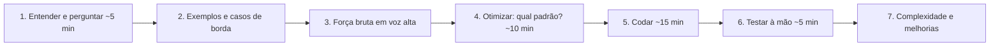

# Como resolver problemas de código em entrevista

## Por que isso importa

Para muitas vagas de desenvolvimento, sobretudo em empresas grandes e em vagas internacionais, a entrevista técnica com problemas de algoritmos é a porta de entrada. Ela é artificial (no trabalho você tem tempo, internet e colegas), mas é previsível: os problemas se repetem em poucos padrões, e o que se avalia é tanto **como você pensa** quanto se o código roda. Gente muito competente é reprovada por pular direto para o código, ficar em silêncio ou travar sem um método. A boa notícia: resolver problemas sob pressão é uma habilidade treinável, e o mesmo método serve para qualquer bug difícil do dia a dia.

## Intuição

Um bom médico não receita nada antes de examinar: pergunta os sintomas, pede exames, considera hipóteses, começa pelo tratamento mais seguro e acompanha o resultado. Na entrevista é igual: **entender** antes de **resolver**, ter uma solução que **funciona** antes da solução **esperta**, e **verificar** antes de dizer "terminei".

E o entrevistador não é um juiz silencioso: é alguém que, na maioria das vezes, quer que você passe e vai dar dicas se você deixar o seu raciocínio visível. Uma entrevista boa parece duas pessoas resolvendo um problema juntas, com você no teclado.

## Visual

O roteiro, com o tempo aproximado numa entrevista de 45 minutos:



As restrições denunciam a complexidade esperada:

```text
  tamanho da entrada (n)      complexidade que cabe em ~1 segundo     ideias típicas
  ─────────────────────────────────────────────────────────────────────────────────────────
  n ≤ 10                      O(n!)                                    permutações, backtracking
  n ≤ 20                      O(2ⁿ)                                    subconjuntos, bitmask
  n ≤ 500                     O(n³)                                    DP em intervalos, Floyd-Warshall
  n ≤ 5.000                   O(n²)                                    dois laços, DP em tabela
  n ≤ 10⁶                     O(n log n) ou O(n)                       ordenar, heap, hash, dois ponteiros
  n ≤ 10¹⁸ (um número)        O(log n) ou O(1)                         busca binária, matemática
```

## Conceito técnico

### 1. Entender e esclarecer

Repita o problema com as suas palavras e pergunte o que não está claro. Perguntas que quase sempre valem:

- Qual o tamanho da entrada? Cabe na memória?
- Que tipos de valores? Podem ser negativos, zero, repetidos? Strings com Unicode, maiúsculas?
- A entrada pode ser vazia? Está ordenada?
- O que devolver se não houver resposta? Se houver várias, qualquer uma serve?
- Posso modificar a entrada?

### 2. Exemplos e casos de borda

Monte **um exemplo seu**, maior que o do enunciado, e resolva à mão. Isso revela o padrão e evita resolver o problema errado. Anote os casos de borda: vazio, um elemento, todos iguais, negativos, o maior valor possível, a resposta no começo ou no fim.

### 3. Força bruta primeiro

Diga em voz alta a solução mais simples que funciona e a complexidade dela ("testar todos os pares, O(n²)"). Isso mostra que você entendeu, garante um piso (uma solução correta vale mais que nenhuma) e é o ponto de partida para otimizar. Às vezes o entrevistador diz "ok, pode codar essa".

### 4. Otimizar: procure o gargalo e o padrão

Pergunte-se: **que trabalho a força bruta repete?** Os padrões que resolvem a maioria dos problemas:

| Sinal no problema | Padrão |
|---|---|
| "Existe um par / já vi este valor?" | **Hash map / set**: troca tempo por memória, O(n) |
| Array **ordenado**, pares, palíndromos | **Dois ponteiros** |
| Subarray ou substring **contígua** "mais longa/curta com..." | **Janela deslizante** |
| Soma de subarrays, consultas de intervalo | **Soma de prefixos** |
| Ordenado, ou "o menor valor que satisfaz..." (resposta monotônica) | **Busca binária** (inclusive na resposta) |
| "Os k maiores/menores", mediana em fluxo | **Heap** (ED-07) |
| Grade, rede, dependências, menor número de passos | **Grafos: BFS/DFS**, ordenação topológica (AL-05) |
| "Todas as combinações/permutações" | **Backtracking** (AL-10) |
| "Quantas formas", "mínimo/máximo" com escolhas que se repetem | **Programação dinâmica** (AL-09) |
| Parênteses, "próximo maior elemento" | **Pilha** (monotônica, ED-02) |
| Intervalos que se sobrepõem | **Ordenar pelo início** e varrer |

Outras perguntas úteis: e se a entrada estivesse ordenada (vale ordenar por O(n log n))? Dá para processar de trás para frente? Que informação eu precisaria guardar para não recalcular?

### 5. Codar

- Antes de digitar, descreva o plano em duas ou três frases e confirme com o entrevistador.
- Nomes claros (`esquerda`, `direita`, `vistos`, não `a`, `b`, `m`), funções auxiliares para partes independentes.
- Continue falando, mas sem narrar cada tecla: explique as decisões ("uso um dicionário porque preciso achar o complemento em O(1)").
- Se esquecer o nome de um método da biblioteca, diga o que ele faz e siga; isso raramente importa.

### 6. Testar

Não diga "acho que está certo". **Execute o código à mão** com o seu exemplo, linha a linha, acompanhando as variáveis. Depois, os casos de borda. Erros comuns de encontrar aqui: índices fora do intervalo (off-by-one), laço que não termina, esquecer de atualizar uma variável, retorno no lugar errado. Achar e corrigir o próprio bug conta **a favor**.

### 7. Complexidade e próximos passos

Diga a complexidade de **tempo e espaço**, e comente compromissos: "dá para fazer com O(1) de memória se eu puder ordenar a entrada", "se os dados não coubessem na memória, eu...". Perguntas de continuação (*follow-ups*) são comuns e mostram até onde você vai.

### Comunicação e postura

- **Pense em voz alta.** Um silêncio de cinco minutos não dá ao entrevistador nada para avaliar e nenhuma chance de ajudar.
- **Travou?** Volte ao exemplo, resolva-o à mão e observe o que você fez; tente um caso menor; tente outro padrão da tabela; diga onde está travado. Pedir uma dica é melhor que ficar parado.
- **Aceite as dicas**: elas são parte da entrevista. Ignorar uma dica pesa mais que precisar dela.
- **Entrevistas em inglês** (vagas internacionais e remotas): treine falar enquanto codifica em inglês; o vocabulário é pequeno e repetitivo (*edge case*, *trade-off*, *brute force*, *hash map*, *two pointers*).

### Entrevistas comportamentais

Quase todo processo inclui perguntas como "conte uma vez em que você discordou do time" ou "um projeto do qual se orgulha". Use o formato **STAR**: **S**ituação (contexto em uma frase), **T**arefa (o que cabia a você), **A**ção (o que **você** fez, no singular) e **R**esultado (de preferência com números, e o que aprendeu). Prepare de 6 a 8 histórias reais que cubram conflito, erro, liderança, prazo apertado e aprendizado.

### Como estudar

- **Por padrão, não ao acaso**: resolva de 5 a 10 problemas de cada padrão antes de passar ao seguinte (listas como NeetCode 150 e Blind 75 são organizadas assim).
- **Limite de tempo**: 30 a 45 minutos por problema. Se travar, leia a solução, entenda e **refaça do zero no dia seguinte**, sem olhar.
- **Revisão espaçada**: volte aos problemas que errou depois de uma semana.
- **Simulações**: faça entrevistas simuladas com colegas ou em plataformas de *mock interview*, falando em voz alta, de preferência no editor que a empresa usa (sem autocompletar).
- **Qualidade acima de quantidade**: 150 problemas bem entendidos valem mais que 500 decorados.

## Código

Um exemplo do caminho completo num problema clássico ("quantos subarrays somam k?"): força bruta, versão otimizada com soma de prefixos, casos de borda e um **teste de estresse**, que compara as duas versões em milhares de entradas aleatórias. Essa técnica é ótima para praticar: a força bruta, fácil de acertar, vira o oráculo da versão rápida.

```python
import random
import time

# Problema: quantos subarrays contíguos de nums somam exatamente k?

def forca_bruta(nums, k):                 # O(n²): todo início, todo fim
    total = 0
    for i in range(len(nums)):
        soma = 0
        for j in range(i, len(nums)):
            soma += nums[j]
            if soma == k:
                total += 1
    return total

def com_prefixos(nums, k):                # O(n): soma de prefixos + dicionário
    vistos = {0: 1}                       # quantas vezes cada soma de prefixo já apareceu
    soma = total = 0
    for x in nums:
        soma += x
        total += vistos.get(soma - k, 0)  # prefixos anteriores que deixam exatamente k até aqui
        vistos[soma] = vistos.get(soma, 0) + 1
    return total

# 1) exemplos pequenos, conferidos à mão
assert com_prefixos([1, 1, 1], 2) == 2
assert com_prefixos([1, 2, 3], 3) == 2          # [1, 2] e [3]
assert com_prefixos([], 0) == 0
assert com_prefixos([0, 0], 0) == 3             # caso de borda: zeros
assert com_prefixos([3, -1, -2, 3], 0) == 2     # negativos: janela deslizante não funcionaria

# 2) teste de estresse: compara com a força bruta em milhares de entradas aleatórias
random.seed(1)
for _ in range(2000):
    nums = [random.randint(-3, 3) for _ in range(random.randint(0, 12))]
    k = random.randint(-4, 4)
    assert com_prefixos(nums, k) == forca_bruta(nums, k), (nums, k)
print("2000 testes aleatórios: as duas versões concordam")

# 3) a diferença de desempenho
nums = [random.randint(-5, 5) for _ in range(3000)]
for funcao in (forca_bruta, com_prefixos):
    inicio = time.perf_counter()
    resultado = funcao(nums, 7)
    print(f"{funcao.__name__:12}: {resultado} subarrays em {(time.perf_counter() - inicio) * 1000:7.1f} ms")
```

Note o caso `[3, -1, -2, 3]`: com números negativos, a janela deslizante não funciona (a soma não cresce sempre que a janela aumenta), e é a soma de prefixos que resolve. Perguntar "pode haver negativos?" no início teria evitado escolher o padrão errado.

## Erros comuns

- **Começar a codar sem entender o problema** nem perguntar sobre as restrições.
- **Ficar em silêncio** enquanto pensa.
- **Pular direto para a solução ótima**, sem passar pela força bruta, e travar no meio dela sem nada funcionando.
- **Não testar** o próprio código, ou testar só com o exemplo do enunciado.
- **Ignorar casos de borda**: vazio, um elemento, repetidos, negativos, overflow.
- **Ignorar as dicas** do entrevistador.
- **Decorar soluções** sem entender o padrão: um enunciado com outra roupagem derruba.
- **Errar a complexidade** (esquecer que `x in lista` é O(n), que fatiar copia, que ordenar é O(n log n)).

## Pratique

```quiz
id: CR-01-q1
tipo: multipla_escolha
pergunta: "O entrevistador apresenta o problema. Qual a melhor primeira atitude?"
opcoes: ["Começar a codar imediatamente para mostrar velocidade", "Repetir o problema com suas palavras, perguntar sobre restrições e casos de borda e montar um exemplo", "Dizer a solução ótima de cabeça", "Pedir para pesquisar na internet"]
resposta: 1
explicacao: "Entender antes de resolver evita gastar 20 minutos no problema errado. Perguntas sobre tamanho da entrada, valores negativos, repetidos e entrada vazia muitas vezes mudam a solução, e mostram maturidade."
dificuldade: 1
```

```quiz
id: CR-01-q2
tipo: multipla_escolha
pergunta: "O problema diz que n pode chegar a 200.000. Qual complexidade você deve mirar?"
opcoes: ["O(2ⁿ)", "O(n²)", "O(n log n) ou O(n)", "O(n³)"]
resposta: 2
explicacao: "Com n = 2·10⁵, O(n²) seria cerca de 4·10¹⁰ operações, demais para um segundo. O(n log n) dá uns 3,5 milhões: tranquilo. A restrição é uma dica do entrevistador sobre a solução esperada."
dificuldade: 2
```

```quiz
id: CR-01-q3
tipo: multipla_escolha
pergunta: "'Encontre o comprimento da maior substring sem caracteres repetidos.' Qual padrão é o mais indicado?"
opcoes: ["Programação dinâmica em tabela 2D", "Janela deslizante com um conjunto ou dicionário dos caracteres da janela", "Busca binária", "BFS"]
resposta: 1
explicacao: "Substring contígua com uma condição ('sem repetidos') que, quando violada, se resolve encolhendo o início: é o sinal clássico da janela deslizante, em O(n)."
dificuldade: 2
```

```quiz
id: CR-01-q4
tipo: verdadeiro_falso
pergunta: "Se você encontra um bug no próprio código durante a entrevista e o corrige, isso conta contra você."
resposta: false
explicacao: "Encontrar e corrigir um bug testando à mão é exatamente o que se espera de quem trabalha bem. O que pesa contra é declarar que terminou sem testar e o entrevistador achar o erro."
dificuldade: 1
```

```quiz
id: CR-01-q5
tipo: resposta_curta
pergunta: "Você está travado há alguns minutos sem ideia de como otimizar. O que fazer?"
resposta: "Falar em voz alta onde está travado; voltar ao exemplo e resolvê-lo à mão observando o que se repete; tentar um caso menor; percorrer os padrões (hash, dois ponteiros, janela, ordenação, busca binária, heap, DP); e, se necessário, pedir uma dica. Ter a força bruta funcionando também garante um resultado."
palavras_chave: ["voz alta", "exemplo", "padrões", "dica", "força bruta"]
dificuldade: 1
```

```quiz
id: CR-01-q6
tipo: codigo
linguagem: python
pergunta: |
  **Dois somam (o clássico).** Escreva `dois_somam(nums, alvo)`, que devolve a tupla `(i, j)` com `i < j` e `nums[i] + nums[j] == alvo`, ou `None` se não houver. Se houver vários pares, devolva o de **menor j** (e, para esse j, o menor i). Faça em O(n), com um dicionário.
codigo_inicial: |
  def dois_somam(nums, alvo):
      return None
usa: [def, for, return]
testes:
  - chamada: "dois_somam([2, 7, 11, 15], 9)"
    saida: "(0, 1)"
  - chamada: "dois_somam([3, 2, 4], 6)"
    saida: "(1, 2)"
  - chamada: "dois_somam([1, 2, 3], 7)"
    saida: "None"
  - chamada: "dois_somam([3, 3], 6)"
    visivel: false
    saida: "(0, 1)"
  - chamada: "dois_somam([5, -2, 5, 7, -2], 3)"
    visivel: false
    saida: "(0, 1)"
  - chamada: "dois_somam([1, 1, 1, 4], 2)"
    visivel: false
    saida: "(0, 1)"
  - chamada: "dois_somam([], 0)"
    visivel: false
    saida: "None"
  - chamada: "dois_somam(list(range(3000)), 5997)"
    visivel: false
    saida: "(2998, 2999)"
dica: "Percorra com enumerate. Para cada x na posição j, veja se alvo − x já está no dicionário (valor → primeiro índice em que apareceu). Se estiver, devolva. Senão, registre x, mas só se ele ainda não estiver lá, para guardar o menor índice."
solucao: |
  def dois_somam(nums, alvo):
      vistos = {}
      for j, x in enumerate(nums):
          if alvo - x in vistos:
              return (vistos[alvo - x], j)
          if x not in vistos:
              vistos[x] = j
      return None
explicacao: "A força bruta testa todos os pares em O(n²). A ideia que otimiza: para cada x, a pergunta 'já vi alvo − x?' é uma busca, e um dicionário responde em O(1). Verificar antes de inserir evita usar o mesmo elemento duas vezes ([3, 3] com alvo 6 funciona porque o primeiro 3 já está registrado quando o segundo chega). Variações deste problema aparecem em muitas formas: pares com diferença k, três somam (ordenar + dois ponteiros)."
dificuldade: 1
```

```quiz
id: CR-01-q7
tipo: codigo
linguagem: python
pergunta: |
  **Janela deslizante.** Escreva `maior_sem_repetir(s)`, que devolve o comprimento da maior substring (contígua) de `s` sem caracteres repetidos. Exemplo: em `'abcabcbb'`, a resposta é 3 (`'abc'`). Faça em O(n).
codigo_inicial: |
  def maior_sem_repetir(s):
      return len(set(s))
usa: [def, for, return]
testes:
  - chamada: "maior_sem_repetir('abcabcbb')"
    saida: "3"
  - chamada: "maior_sem_repetir('bbbbb')"
    saida: "1"
  - chamada: "maior_sem_repetir('pwwkew')"
    saida: "3"
  - chamada: "maior_sem_repetir('')"
    saida: "0"
  - chamada: "maior_sem_repetir('abba')"
    visivel: false
    saida: "2"
  - chamada: "maior_sem_repetir('dvdf')"
    visivel: false
    saida: "3"
  - chamada: "maior_sem_repetir('a b c a')"
    visivel: false
    saida: "3"
  - chamada: "maior_sem_repetir('abcdefghij' * 300)"
    visivel: false
    saida: "10"
dica: "Guarde num dicionário a última posição de cada caractere e o início da janela. Ao ver um caractere repetido que está DENTRO da janela (última posição ≥ início), mova o início para logo depois dessa posição. A cada passo, atualize o maior tamanho com fim − início + 1."
solucao: |
  def maior_sem_repetir(s):
      ultima = {}
      inicio = 0
      melhor = 0
      for fim, c in enumerate(s):
          if c in ultima and ultima[c] >= inicio:
              inicio = ultima[c] + 1
          ultima[c] = fim
          melhor = max(melhor, fim - inicio + 1)
      return melhor
explicacao: "O caso 'abba' é a armadilha: quando o segundo 'a' chega, a última posição do 'a' (0) já está fora da janela, que começa em 2 depois do segundo 'b'. Sem a condição ultima[c] >= inicio, o início voltaria para 1 e a resposta sairia errada. Cada caractere entra e sai da janela no máximo uma vez: O(n)."
dificuldade: 2
```

```quiz
id: CR-01-q8
tipo: codigo
linguagem: javascript
pergunta: |
  **Mesclar intervalos.** Escreva `mesclar(intervalos)`, que recebe uma lista de pares `[inicio, fim]` (em qualquer ordem) e devolve a lista de intervalos mesclados, ordenada pelo início. Intervalos que se tocam (`[1, 3]` e `[3, 5]`) também são mesclados. Não modifique a entrada.
codigo_inicial: |
  function mesclar(intervalos) {
    return intervalos;
  }
usa: [function, for, return, sort]
testes:
  - chamada: "mesclar([[1, 3], [2, 6], [8, 10], [15, 18]])"
    saida: "[ [ 1, 6 ], [ 8, 10 ], [ 15, 18 ] ]"
  - chamada: "mesclar([[1, 4], [4, 5]])"
    saida: "[ [ 1, 5 ] ]"
  - chamada: "mesclar([[8, 10], [1, 3], [2, 4]])"
    saida: "[ [ 1, 4 ], [ 8, 10 ] ]"
  - chamada: "mesclar([])"
    visivel: false
    saida: "[]"
  - chamada: "mesclar([[1, 10], [2, 3], [4, 5]])"
    visivel: false
    saida: "[ [ 1, 10 ] ]"
  - chamada: "(() => { const e = [[5, 6], [1, 2]]; mesclar(e); return e; })()"
    visivel: false
    saida: "[ [ 5, 6 ], [ 1, 2 ] ]"
  - chamada: "mesclar([[2, 3], [10, 20], [1, 2], [15, 25]])"
    visivel: false
    saida: "[ [ 1, 3 ], [ 10, 25 ] ]"
dica: "Copie e ordene pelo início: [...intervalos].sort((a, b) => a[0] - b[0]). Percorra mantendo o último intervalo do resultado: se o atual começa até o fim do último, estenda o fim com Math.max; senão, adicione uma cópia do atual."
solucao: |
  function mesclar(intervalos) {
    const ordenados = [...intervalos].sort((a, b) => a[0] - b[0]);
    const resultado = [];
    for (const [inicio, fim] of ordenados) {
      const ultimo = resultado[resultado.length - 1];
      if (ultimo && inicio <= ultimo[1]) {
        ultimo[1] = Math.max(ultimo[1], fim);
      } else {
        resultado.push([inicio, fim]);
      }
    }
    return resultado;
  }
explicacao: "Ordenar pelo início é o passo que destrava: depois disso, só o último intervalo do resultado pode se sobrepor ao atual, e uma varredura resolve. Total O(n log n) pela ordenação. O Math.max cobre o intervalo contido em outro ([1, 10] com [2, 3]). Problemas de agenda (salas de reunião, horários livres) são variações deste."
dificuldade: 2
```

## Resumo

- Roteiro: **entender e perguntar**, **exemplos e bordas**, **força bruta**, **otimizar pelo padrão**, **codar**, **testar à mão**, **complexidade**.
- As **restrições** indicam a complexidade esperada (n ≤ 10⁶ pede O(n log n) ou O(n)).
- Padrões: **hash**, **dois ponteiros**, **janela deslizante**, **prefixos**, **busca binária**, **heap**, **BFS/DFS**, **backtracking**, **DP**, **pilha**, **intervalos ordenados**.
- **Pense em voz alta**, aceite dicas e teste antes de dizer que terminou.
- Comportamental: histórias no formato **STAR**.
- Estude **por padrão**, com tempo limitado, revisão espaçada e simulações.

## Para ir além

- Resolva a lista NeetCode 150 na ordem do roadmap, um padrão por semana.
- Faça uma entrevista simulada por semana com alguém, revezando os papéis: ser entrevistador ensina muito sobre o que se avalia.
- Escreva suas 6 a 8 histórias STAR e treine contá-las em 2 minutos cada.
- **Próximo módulo**: CR-02 Entrevista de system design.
