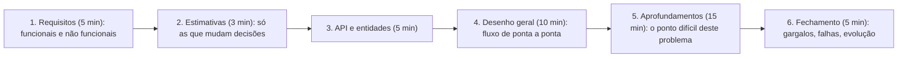

# Entrevista de system design

## Por que isso importa

A partir do nível pleno, e sempre em vagas sêniores, a entrevista de **system design** costuma pesar mais que a de algoritmos. Em 45 a 60 minutos, você recebe um enunciado vago ("projete o Instagram", "projete um sistema de notificações") e precisa conduzir uma conversa até uma arquitetura defensável. Não existe resposta certa: o que se avalia é se você faz as perguntas certas, toma decisões com base em números, conhece as peças (cache, filas, bancos, réplicas) e, principalmente, se sabe **explicar os compromissos** de cada escolha. É a entrevista que mais se parece com o trabalho real de uma pessoa sênior. O SD-04 ensinou o roteiro e o projeto de um encurtador de links; esta aula é sobre **a entrevista**: como conduzir, o que se espera de você e os enunciados que mais aparecem.

## Intuição

Imagine que um cliente pede a um arquiteto: "quero uma casa". Um mau arquiteto começa a desenhar a fachada. Um bom pergunta: quantas pessoas vão morar? Qual o orçamento? Tem criança, idoso, cachorro? Trabalha em casa? Depois faz um desenho geral com os cômodos, e só então detalha o que é difícil naquele projeto: a escada num terreno inclinado, o isolamento acústico do escritório.

System design é isso. O entrevistador é o cliente e, ao mesmo tempo, o colega que vai questionar as escolhas: "e se esse banco cair?", "e se o tráfego decuplicar no Natal?". Ganha quem conduz a conversa, não quem desenha mais caixinhas.

## Visual

Como distribuir 45 minutos:



O que se espera por nível:

```text
  nível            quem conduz                o que mostrar
  ──────────────────────────────────────────────────────────────────────────────────────────────
  júnior/pleno     o entrevistador ajuda      um desenho funcional de ponta a ponta; conhecer as peças
                                              básicas (balanceador, cache, banco, fila)
  sênior           você                       ir fundo em 2 ou 3 pontos difíceis; trade-offs justificados
                                              com números; falhas e consistência
  staff+           você, com visão ampla      antecipar problemas antes da pergunta; custo, operação,
                                              evolução ao longo de anos; quando NÃO complicar
```

## Conceito técnico

### O que o entrevistador está avaliando

- **Resolução de problemas**: você transforma um enunciado vago em requisitos concretos?
- **Conhecimento técnico**: conhece as peças, quando usar cada uma e por quê?
- **Raciocínio sobre compromissos**: SQL ou NoSQL, consistência ou disponibilidade, fan-out na escrita ou na leitura, e por quê **neste** caso?
- **Comunicação**: o desenho e a explicação são claros? Você escuta e incorpora as perguntas?
- **Pragmatismo**: começa simples e só complica quando um requisito exige?

### Conduzindo cada etapa

**1. Requisitos.** Separe **funcionais** (o que o sistema faz: "postar foto", "seguir alguém", "ver o feed") e **não funcionais** (escala, latência, disponibilidade, consistência, durabilidade). Limite o escopo em voz alta: "vou focar em postar e ler o feed; comentários e busca ficam de fora, tudo bem?". Pergunte o que mais importa: "é aceitável um post levar alguns segundos para aparecer para os seguidores?" (consistência eventual), "perder uma mensagem é aceitável?" (durabilidade).

**2. Estimativas.** Calcule só o que muda decisões: leituras e escritas por segundo (e a proporção entre elas), armazenamento em alguns anos, banda. Um feed com 100 leituras para cada escrita pede otimizar a leitura (cache, timelines pré-calculadas); 3 PB de mensagens pede particionamento desde o início. Arredonde sem medo: um dia tem ~10⁵ segundos.

**3. API e entidades.** Os endpoints principais (`POST /posts`, `GET /feed?cursor=...`) e as entidades com os campos importantes. Mencione paginação por cursor, idempotência em operações de pagamento e autenticação.

**4. Desenho geral.** Um fluxo **completo** de ponta a ponta, primeiro simples: cliente → balanceador → serviços → banco/cache/fila/armazenamento de objetos. Percorra uma requisição de escrita e uma de leitura pelo desenho. Só depois otimize.

**5. Aprofundamentos.** Aqui está o "miolo" do problema: o ponto que torna **este** sistema difícil (veja a tabela abaixo). Proponha, discuta alternativas e escolha com justificativa. Se o entrevistador puxar outro ponto, siga-o: ele está dizendo o que quer avaliar.

**6. Fechamento.** Pontos únicos de falha, o que acontece quando cada componente cai, monitoramento (SD-08), como o sistema evolui com 10 vezes mais tráfego, e o que você faria diferente com mais tempo.

### O ponto difícil dos enunciados clássicos

| Enunciado | O desafio central | Ideias que costumam aparecer |
|---|---|---|
| **Feed de rede social** | Montar timelines para bilhões de leituras | Fan-out na escrita (timelines pré-calculadas em cache) × na leitura; **híbrido** para celebridades; paginação por cursor |
| **Chat** | Entregar em tempo real, em ordem, sem perder | Conexões persistentes (WebSocket) com servidores de conexão; fila por conversa; IDs ordenáveis; status de entrega; usuários offline (push) |
| **Busca por proximidade** (restaurantes, motoristas) | "O que está perto de mim?" eficiente | Índices espaciais: **geohash**, quadtree, S2; motoristas atualizando posição a cada poucos segundos em memória |
| **Notificações** | Milhões de envios, vários canais, sem duplicar | Filas por canal, workers, **idempotência**, preferências do usuário, limites por usuário, reenvio com backoff |
| **Vídeo sob demanda** | Banda enorme e muitos dispositivos | Upload em partes, transcodificação assíncrona em várias resoluções, **CDN**, streaming adaptativo (HLS/DASH) |
| **Encurtador de links** | Leituras muito maiores que escritas | IDs em base62, cache, redirecionamento 301 × 302 (SD-04) |
| **Limitador de requisições** | Contar com precisão em vários servidores | Balde de fichas ou janela deslizante, contadores no Redis (SD-04) |
| **Busca com autocompletar** | Responder em poucos milissegundos a cada tecla | Trie com os termos mais buscados pré-calculados, cache, atualização em lote |
| **Pagamentos** | Nunca cobrar duas vezes, nunca perder dinheiro | Idempotência, transações, registro contábil imutável (ledger), conciliação |

### Vocabulário de compromissos

Diga explicitamente o que você ganha e o que paga:

- **Consistência × disponibilidade** em caso de partição (CAP, SD-01): o saldo bancário prefere consistência; o contador de curtidas aceita ficar desatualizado.
- **Latência × consistência**: ler da réplica é rápido e pode estar atrasado; ler do líder é atual e mais caro.
- **Normalizar × desnormalizar**: desnormalizar acelera leituras e complica atualizações.
- **Síncrono × assíncrono**: uma fila desacopla e absorve picos, mas o resultado não é imediato e você precisa lidar com reprocessamento.
- **Pré-calcular × calcular na hora**: escrita cara e leitura barata, ou o contrário.
- **Comprar × construir**: um serviço gerenciado (fila, banco, busca) reduz o trabalho de operação.

### Erros de condução, e como corrigir

- **Desenhar antes de entender**: sempre comece pelos requisitos.
- **Mencionar tecnologias sem justificar** ("uso Kafka, Cassandra e Kubernetes"): diga **por que** aquela peça, naquele lugar.
- **Otimizar cedo demais**: sharding e microsserviços para 1.000 usuários. Comece simples e escale conforme os números.
- **Ficar no raso em tudo**: melhor aprofundar bem dois pontos do que listar vinte.
- **Ignorar falhas**: o que acontece se o cache cair? Se a fila acumular? Se uma região sair do ar?
- **Não gerenciar o tempo**: se faltam 10 minutos e você ainda está nos requisitos, algo deu errado.

### Como estudar

1. Domine as peças: SD-01 a SD-04, bancos de dados (BD-01 a BD-06), mensageria (AS-05).
2. Estude de 10 a 15 enunciados clássicos resolvidos (System Design Primer, livros do Alex Xu), procurando **o ponto difícil** de cada um.
3. Leia blogs de engenharia de empresas (Netflix, Uber, Discord, Nubank, Mercado Livre) sobre como resolveram problemas reais.
4. Treine **em voz alta**, com um quadro (Excalidraw ou papel) e cronômetro, de preferência com outra pessoa fazendo o papel de entrevistador.
5. Depois de cada simulação, anote o que faltou: requisito esquecido, estimativa errada, falha não discutida.

## Código

Estimativas feitas na hora para dois enunciados. Repare como os números conduzem as decisões: no chat, 3,6 PB em cinco anos e 100 milhões de conexões simultâneas exigem particionamento e uma frota de servidores de conexão; no feed, uma celebridade com 80 milhões de seguidores torna o fan-out na escrita inviável para ela.

```python
# Estimativas para dois enunciados clássicos, do jeito que se faz no quadro.
DIA = 86_400

def fmt(n):
    for unidade, valor in (("P", 1e15), ("T", 1e12), ("G", 1e9), ("M", 1e6), ("mil", 1e3)):
        if n >= valor:
            return f"{n / valor:.1f} {unidade}"
    return f"{n:.0f}"

# ---------- 1) Chat (estilo mensageiro) ----------
dau = 500e6                 # usuários ativos por dia
msgs_por_usuario = 40
bytes_por_msg = 100         # texto + metadados; mídia vai para um armazenamento de objetos à parte
msgs_dia = dau * msgs_por_usuario
qps = msgs_dia / DIA
print("CHAT")
print(f"  mensagens/dia: {fmt(msgs_dia)}   escrita média: {fmt(qps)}/s   pico (x3): {fmt(qps * 3)}/s")
print(f"  armazenamento: {fmt(msgs_dia * bytes_por_msg)}B/dia, {fmt(msgs_dia * bytes_por_msg * 365 * 5)}B em 5 anos (sem réplicas)")
print(f"  conexões abertas (WebSocket) no pico, se 20% online: {fmt(dau * 0.2)} -> ~{dau * 0.2 / 100_000:.0f} servidores a 100 mil conexões cada")

# ---------- 2) Feed: fan-out na escrita x na leitura ----------
print("\nFEED: custo de distribuir um post")
posts_dia = 100e6
seguidores_medio = 200
leituras_feed_dia = 2e9
print(f"  fan-out na escrita: {fmt(posts_dia * seguidores_medio)} inserções/dia em timelines prontas; leitura = 1 consulta")
print(f"  fan-out na leitura: cada uma das {fmt(leituras_feed_dia)} leituras junta posts de ~{seguidores_medio} contas seguidas")
for seguidores in (300, 50_000, 80_000_000):
    print(f"  um post de uma conta com {fmt(seguidores):>8} seguidores gera {fmt(seguidores):>8} escritas na abordagem de escrita")
print("  -> híbrido: escrita para contas comuns, leitura (mescla na hora) para celebridades")
```

## Erros comuns

- **Começar pelo desenho** sem levantar requisitos nem perguntar o que importa.
- **Estimativas que não levam a nenhuma decisão**: calcular por calcular.
- **Despejar nomes de tecnologia** sem explicar o papel de cada uma.
- **Um banco só para tudo**, sem pensar em cache, armazenamento de objetos para mídia e índices de busca.
- **Esquecer o caminho de leitura** (ou o de escrita) e os casos extremos, como celebridades e picos.
- **Não falar de falhas**, réplicas, monitoramento e o que acontece quando algo sai do ar.
- **Defender uma escolha a todo custo** quando o entrevistador aponta um problema: reconheça e ajuste.

## Pratique

```quiz
id: CR-02-q1
tipo: multipla_escolha
pergunta: "O entrevistador diz: 'Projete o Instagram'. O que fazer primeiro?"
opcoes: ["Desenhar o balanceador de carga e os servidores", "Escolher entre SQL e NoSQL", "Levantar requisitos: quais funcionalidades entram no escopo, escala esperada e o que importa mais (latência, consistência, disponibilidade)", "Calcular o número exato de servidores"]
resposta: 2
explicacao: "O enunciado é vago de propósito. Limitar o escopo ('postar fotos, seguir, ver o feed') e entender os requisitos não funcionais orienta todas as decisões seguintes. Começar pelo desenho é o erro mais comum."
dificuldade: 1
```

```quiz
id: CR-02-q2
tipo: multipla_escolha
pergunta: "Num feed de rede social, por que se usa uma abordagem híbrida de fan-out?"
opcoes: ["Porque bancos SQL não suportam fan-out", "Porque o fan-out na escrita deixa a leitura barata, mas um post de uma conta com milhões de seguidores geraria milhões de escritas; para essas contas, os posts são mesclados na hora da leitura", "Para economizar em CDN", "Porque o fan-out na leitura é sempre mais rápido"]
resposta: 1
explicacao: "Para a maioria das contas, empurrar o post para as timelines dos seguidores (escrita) é barato e torna a leitura uma consulta simples. Celebridades quebram essa conta. O híbrido combina as timelines pré-calculadas com os posts das celebridades seguidas, buscados na hora."
dificuldade: 2
```

```quiz
id: CR-02-q3
tipo: verdadeiro_falso
pergunta: "Numa entrevista de system design, é melhor citar o máximo de tecnologias possível (Kafka, Cassandra, Redis, Kubernetes) para mostrar conhecimento."
resposta: false
explicacao: "Tecnologias sem justificativa contam pouco ou contra. O que se avalia é por que cada peça está ali e o que ela custa. Uma arquitetura simples, bem justificada e que escala conforme os números é melhor que uma lista de nomes."
dificuldade: 1
```

```quiz
id: CR-02-q4
tipo: multipla_escolha
pergunta: "Para 'encontre os motoristas disponíveis num raio de 2 km', qual ideia resolve o ponto difícil?"
opcoes: ["Calcular a distância para todos os motoristas a cada busca", "Um índice espacial (geohash, quadtree ou S2): o mapa é dividido em células, e a busca olha só a célula do passageiro e as vizinhas", "Ordenar os motoristas por nome", "Guardar as posições num arquivo CSV"]
resposta: 1
explicacao: "Comparar com todos os motoristas não escala. Com geohash, pontos próximos compartilham o prefixo do código, então a busca vira 'os motoristas cujo geohash começa com este prefixo', nas células vizinhas. Como as posições mudam a cada poucos segundos, o índice costuma ficar em memória."
dificuldade: 2
```

```quiz
id: CR-02-q5
tipo: resposta_curta
pergunta: "O que diferencia o desempenho esperado de uma pessoa sênior numa entrevista de system design em relação a uma pessoa pleno?"
resposta: "A pessoa sênior conduz a conversa sozinha, aprofunda os pontos difíceis do problema, justifica as escolhas com números e trade-offs explícitos, e antecipa falhas, consistência e operação. Da pessoa pleno espera-se principalmente um desenho funcional de ponta a ponta e o conhecimento das peças básicas, com mais ajuda do entrevistador."
palavras_chave: ["conduz", "aprofunda", "trade-offs", "falhas"]
dificuldade: 2
```

```quiz
id: CR-02-q6
tipo: codigo
linguagem: python
pergunta: |
  **Fan-out na leitura.** `segue` é um dicionário `usuario -> lista de autores que ele segue` e `posts` é `autor -> lista de (instante, id_do_post)` em ordem **crescente** de instante. Escreva `timeline(segue, posts, usuario, n)`, que devolve os ids dos `n` posts mais recentes dos autores seguidos, do mais novo para o mais antigo (empate de instante: o maior id primeiro). Autores sem posts ou ausentes de `posts` não contribuem.
codigo_inicial: |
  import heapq

  def timeline(segue, posts, usuario, n):
      return []
usa: [def, for, return]
testes:
  - chamada: "timeline({'ana': ['bia', 'caio']}, {'bia': [(1, 'b1'), (5, 'b2')], 'caio': [(3, 'c1')]}, 'ana', 2)"
    saida: "['b2', 'c1']"
  - chamada: "timeline({'ana': ['bia', 'caio']}, {'bia': [(1, 'b1'), (5, 'b2')], 'caio': [(3, 'c1')]}, 'ana', 10)"
    saida: "['b2', 'c1', 'b1']"
  - chamada: "timeline({'ana': []}, {'bia': [(1, 'b1')]}, 'ana', 5)"
    saida: "[]"
  - chamada: "timeline({'x': ['a', 'b', 'fantasma']}, {'a': [(2, 'a1'), (4, 'a2')], 'b': [(4, 'b9'), (6, 'b8')]}, 'x', 3)"
    visivel: false
    saida: "['b8', 'b9', 'a2']"
  - chamada: "timeline({}, {}, 'ninguem', 3)"
    visivel: false
    saida: "[]"
  - chamada: "timeline({'u': ['a']}, {'a': [(i, 'p' + str(i)) for i in range(1000)]}, 'u', 3)"
    visivel: false
    saida: "['p999', 'p998', 'p997']"
dica: "Junte os posts dos autores seguidos (segue.get(usuario, []) e posts.get(autor, [])) e pegue os n maiores com heapq.nlargest(n, lista). Como as tuplas são (instante, id), o empate já desempata pelo id."
solucao: |
  import heapq

  def timeline(segue, posts, usuario, n):
      candidatos = []
      for autor in segue.get(usuario, []):
          candidatos.extend(posts.get(autor, []))
      return [id_post for _, id_post in heapq.nlargest(n, candidatos)]
explicacao: "Isso é o fan-out na leitura: a timeline é montada na hora a partir dos posts de quem a pessoa segue. heapq.nlargest custa O(m log n) para m candidatos, melhor que ordenar tudo. Num sistema real, cada autor teria só os posts recentes em cache, e a mesma mescla seria usada para juntar a timeline pré-calculada com os posts das celebridades seguidas (o modelo híbrido)."
dificuldade: 2
```

```quiz
id: CR-02-q7
tipo: codigo
linguagem: python
pergunta: |
  **Geohash.** O geohash divide o mapa em células: alterne bits de longitude e latitude, começando pela **longitude**. Para cada bit, divida a faixa atual ao meio (longitude em [−180, 180], latitude em [−90, 90]): se a coordenada for **maior ou igual** ao meio, o bit é 1 e a faixa vira a metade de cima; senão o bit é 0 e a faixa vira a de baixo. Cada grupo de 5 bits vira um caractere de `BASE32 = '0123456789bcdefghjkmnpqrstuvwxyz'`.

  Escreva `geohash(lat, lon, precisao)`, que devolve o código com `precisao` caracteres.
codigo_inicial: |
  BASE32 = '0123456789bcdefghjkmnpqrstuvwxyz'

  def geohash(lat, lon, precisao):
      return BASE32[0] * precisao
usa: [def, while, return]
testes:
  - chamada: "geohash(57.64911, 10.40744, 11)"
    saida: "'u4pruydqqvj'"
  - chamada: "geohash(-23.5614, -46.6559, 6)"
    saida: "'6gycfq'"
  - chamada: "geohash(0, 0, 1)"
    saida: "'s'"
  - chamada: "geohash(-8.0476, -34.8770, 5)"
    visivel: false
    saida: "'7nx4n'"
  - chamada: "geohash(-22.9519, -43.2105, 7)"
    visivel: false
    saida: "'75cm2tx'"
  - chamada: "geohash(-23.5505, -46.6333, 6)[:3] == geohash(-23.5614, -46.6559, 6)[:3]"
    visivel: false
    saida: "True"
dica: "Guarde as faixas como listas [mín, máx] e um booleano que alterna entre longitude e latitude. Acumule o valor dos 5 bits atuais (valor = valor * 2 + bit); a cada 5 bits, acrescente BASE32[valor] e zere. Repita até ter precisao caracteres."
solucao: |
  BASE32 = '0123456789bcdefghjkmnpqrstuvwxyz'

  def geohash(lat, lon, precisao):
      faixa_lat = [-90.0, 90.0]
      faixa_lon = [-180.0, 180.0]
      codigo = ''
      valor = 0
      bits = 0
      usar_lon = True
      while len(codigo) < precisao:
          faixa, coord = (faixa_lon, lon) if usar_lon else (faixa_lat, lat)
          meio = (faixa[0] + faixa[1]) / 2
          if coord >= meio:
              valor = valor * 2 + 1
              faixa[0] = meio
          else:
              valor = valor * 2
              faixa[1] = meio
          usar_lon = not usar_lon
          bits += 1
          if bits == 5:
              codigo += BASE32[valor]
              valor = 0
              bits = 0
      return codigo
explicacao: "Cada caractere refina a célula: com 6 caracteres, ela tem cerca de 1,2 km × 0,6 km; com 4, umas dezenas de km. O último teste mostra a propriedade útil: a Avenida Paulista e a Praça da Sé, a poucos km, compartilham o prefixo de 3 caracteres (6gy). Por isso 'o que está perto?' vira uma busca por prefixo num índice comum. Cuidado com as bordas: no 4º caractere os dois já diferem (6gyc e 6gyf), porque estão em lados opostos de uma divisão de célula, mesmo tão perto. Por isso a busca olha também as 8 células vizinhas."
dificuldade: 3
```

```quiz
id: CR-02-q8
tipo: codigo
linguagem: javascript
pergunta: |
  **Orçamento de latência.** Para atender uma requisição, o serviço faz chamadas em **etapas**: as etapas acontecem uma depois da outra, e as chamadas dentro de uma mesma etapa acontecem **em paralelo**. Cada etapa é uma lista de `{ nome, ms }`. Escreva `latencia(etapas, alvoMs)`, que devolve:

  - `total`: a soma, etapa por etapa, da chamada mais lenta de cada etapa;
  - `dentro`: se `total <= alvoMs`;
  - `gargalo`: o nome da chamada mais lenta entre as que definem o tempo de cada etapa (em empate, a que aparece primeiro), ou `null` se não houver etapas.
codigo_inicial: |
  function latencia(etapas, alvoMs) {
    let total = 0;
    for (const etapa of etapas) {
      for (const c of etapa) total += c.ms;
    }
    return { total, dentro: total <= alvoMs, gargalo: null };
  }
usa: [function, for, return]
testes:
  - chamada: "latencia([[{ nome: 'auth', ms: 20 }], [{ nome: 'perfil', ms: 40 }, { nome: 'feed', ms: 90 }]], 150)"
    saida: "{ total: 110, dentro: true, gargalo: 'feed' }"
  - chamada: "latencia([[{ nome: 'a', ms: 50 }], [{ nome: 'b', ms: 50 }], [{ nome: 'c', ms: 80 }]], 150)"
    saida: "{ total: 180, dentro: false, gargalo: 'c' }"
  - chamada: "latencia([], 100)"
    saida: "{ total: 0, dentro: true, gargalo: null }"
  - chamada: "latencia([[{ nome: 'x', ms: 30 }, { nome: 'y', ms: 30 }], [{ nome: 'z', ms: 30 }]], 60)"
    visivel: false
    saida: "{ total: 60, dentro: true, gargalo: 'x' }"
  - chamada: "latencia([[{ nome: 'db', ms: 120 }, { nome: 'cache', ms: 2 }], [{ nome: 'render', ms: 15 }]], 100)"
    visivel: false
    saida: "{ total: 135, dentro: false, gargalo: 'db' }"
dica: "Para cada etapa, ache a chamada com maior ms (percorra e guarde a maior; use > para manter a primeira em empate). Some o ms dela ao total e compare com o maior gargalo visto até agora, também com >."
solucao: |
  function latencia(etapas, alvoMs) {
    let total = 0;
    let gargalo = null;
    for (const etapa of etapas) {
      let maisLenta = null;
      for (const chamada of etapa) {
        if (maisLenta === null || chamada.ms > maisLenta.ms) maisLenta = chamada;
      }
      if (maisLenta === null) continue;
      total += maisLenta.ms;
      if (gargalo === null || maisLenta.ms > gargalo.ms) gargalo = maisLenta;
    }
    return { total, dentro: total <= alvoMs, gargalo: gargalo === null ? null : gargalo.nome };
  }
explicacao: "Em system design, a latência de uma requisição é o caminho crítico: chamadas em sequência somam, chamadas em paralelo custam o tempo da mais lenta. Por isso duas ideias aparecem tanto nos aprofundamentos: paralelizar chamadas independentes (o primeiro teste economiza 40 ms) e atacar o gargalo (no último, um cache na frente do banco resolveria). Lembre também que, com muitas chamadas em paralelo, a latência da etapa tende ao p99 dos serviços, não à média."
dificuldade: 2
```

## Resumo

- A entrevista avalia **condução**, **conhecimento das peças**, **compromissos justificados** e **comunicação**; a expectativa cresce com o nível.
- Roteiro: **requisitos** → **estimativas** que mudam decisões → **API e entidades** → **desenho de ponta a ponta** → **aprofundamentos** no ponto difícil → **falhas e evolução**.
- Cada enunciado clássico tem um **desafio central**: fan-out no feed, tempo real no chat, índice espacial na proximidade, idempotência em pagamentos e notificações, CDN no vídeo.
- Fale em **compromissos**: consistência × disponibilidade, latência × atualidade, síncrono × assíncrono, pré-calcular × calcular na hora.
- Comece simples, escale com números, não despeje tecnologias.

## Para ir além

- Resolva, no papel e cronometrado, cinco enunciados da tabela, e depois compare com as soluções do System Design Primer.
- Leia um post de engenharia por semana (Discord sobre armazenar trilhões de mensagens, Uber sobre índices geográficos, Netflix sobre CDN) e identifique o "ponto difícil" de cada um.
- Faça uma simulação com alguém mais experiente e peça um retorno sobre a condução, não só sobre a arquitetura.
- **Próximo módulo**: CR-03 Portfólio, GitHub e currículo.
