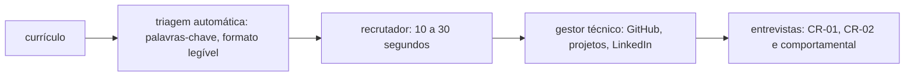

# Portfólio, GitHub e currículo

## Por que isso importa

Antes de qualquer entrevista técnica, alguém precisa decidir que vale a pena falar com você, e essa decisão costuma levar **segundos**: uma passada de olhos no currículo, um clique no GitHub, uma olhada no LinkedIn. Para quem está começando, sem anos de experiência para listar, o portfólio é a prova de que você sabe construir coisas. E boa parte das vagas passa antes por um sistema de triagem automática (ATS, como os usados pelas plataformas de recrutamento), que pode descartar um currículo bonito, mas ilegível para a máquina. Saber se apresentar não substitui saber programar, mas é o que dá a chance de mostrar que sabe.

## Intuição

Pense no currículo como a vitrine de uma loja e no GitHub como o interior. A vitrine precisa, em poucos segundos, mostrar o que você vende e chamar para dentro: nada de amontoar todos os produtos. Lá dentro, as prateleiras precisam estar organizadas, com etiquetas claras (os READMEs), e os melhores produtos à frente (os repositórios fixados). Uma loja com a vitrine bonita e o interior bagunçado frustra; uma loja ótima sem vitrine não recebe visitas.

E um bom produto se descreve pelo que ele **resolve**, não pela lista de ingredientes: "API que reduziu de 3 dias para 2 horas o fechamento mensal" diz muito mais que "usei Python, FastAPI e PostgreSQL".

## Visual

O caminho de uma candidatura:



A estrutura de um currículo técnico de uma página:

```text
 ┌──────────────────────────────────────────────────────────────────────────┐
 │ NOME COMPLETO                                                             │
 │ Desenvolvedora back-end · Recife, PE (aberta a remoto)                    │
 │ email@exemplo.com · linkedin.com/in/... · github.com/...                  │
 ├──────────────────────────────────────────────────────────────────────────┤
 │ RESUMO (2 linhas, opcional): foco, tecnologias principais, o que busca    │
 ├──────────────────────────────────────────────────────────────────────────┤
 │ EXPERIÊNCIA (mais recente primeiro)                                       │
 │  Cargo · Empresa · mês/ano – mês/ano                                       │
 │   • Verbo + o que fez + resultado com número                              │
 │   • ...                                                                   │
 ├──────────────────────────────────────────────────────────────────────────┤
 │ PROJETOS (essencial para quem está começando)                             │
 │  Nome · link · tecnologias                                                │
 │   • O problema, o que você construiu, um resultado ou destaque técnico    │
 ├──────────────────────────────────────────────────────────────────────────┤
 │ FORMAÇÃO · CURSOS RELEVANTES · IDIOMAS (inglês: nível honesto)            │
 │ HABILIDADES: linguagens, frameworks, ferramentas (o que você usaria amanhã)│
 └──────────────────────────────────────────────────────────────────────────┘
```

## Conceito técnico

### O currículo

**Formato**

- **Uma página** para quem tem até uns 5 a 8 anos de experiência. Fonte legível, margens normais, sem colunas complicadas, tabelas, ícones de barra de habilidade ("Python ●●●●○") ou texto dentro de imagens: o ATS não lê, e o recrutador não leva a sério.
- Envie em **PDF**, com o nome do arquivo em ordem (`Nome-Sobrenome-Curriculo.pdf`).
- **Não inclua** foto, idade, estado civil, CPF, RG ou endereço completo: não é necessário e abre espaço para discriminação (e, no caso dos documentos, é dado pessoal desnecessário, ET-03). Cidade e estado bastam.
- Um currículo **por tipo de vaga**: ajuste o resumo e a ordem das habilidades para a vaga de back-end, de dados ou de front-end, usando as palavras da descrição da vaga quando forem verdadeiras.

**Experiência e projetos: o formato que funciona**

Cada item com **verbo de ação + o que você fez + resultado**, de preferência com um número:

| Fraco | Forte |
|---|---|
| Responsável pela API de pedidos | **Desenvolvi** a API de pedidos em FastAPI usada por 3 lojas, com 92% de cobertura de testes |
| Trabalhei com banco de dados | **Reduzi** de 4 s para 300 ms a consulta do relatório de vendas criando índices e reescrevendo 2 JOINs |
| Participei da migração para a nuvem | **Automatizei** o deploy com GitHub Actions e Docker, de 1 h manual para 8 min sem intervenção |
| Fiz um site para um evento | **Criei** o site de inscrições de um evento acadêmico, com 1.200 inscritos e nota 98 de acessibilidade no Lighthouse |

Os números não precisam ser enormes; precisam ser **verdadeiros** e mostrar escala, melhoria ou uso real. Se não houver número, mostre o destaque técnico ("com autenticação JWT e testes de integração no CI").

**Sem experiência profissional?** Projetos, monitoria, iniciação científica, freelas, trabalho voluntário (o site da ONG do bairro conta), hackathons, maratonas de programação e contribuições em código aberto entram como experiência. Cursos do OSSU concluídos com projetos publicados também.

**Nunca minta.** Tudo o que está no currículo pode virar pergunta na entrevista ("me conta como você reduziu essa consulta").

### O GitHub

- **Foto e bio** com o que você faz, cidade e link para LinkedIn ou site.
- **README de perfil**: crie um repositório com o mesmo nome do seu usuário; o README dele aparece no topo do perfil. Duas ou três frases sobre você, o que está estudando, os projetos de destaque e como entrar em contato. Sobriedade vence excesso de badges e GIFs.
- **Repositórios fixados**: até 6. Escolha os seus **melhores projetos originais**, não forks nem exercícios de tutorial.
- **Um bom README de projeto** responde, nesta ordem: o que é e para quem (uma frase), uma imagem ou GIF, o **link para usar** (deploy), as tecnologias, **como rodar localmente** (comandos que funcionam), como rodar os testes, decisões técnicas e próximos passos. Quem avalia raramente roda o projeto: o README e o link são a entrevista.
- **Histórico de commits** com mensagens claras e commits pequenos (FP-09). Ninguém espera o "quadradinho verde" todo dia, mas um projeto com um único commit "projeto completo" levanta suspeita.
- **Higiene**: `.gitignore` correto, nada de `node_modules`, senhas ou chaves no repositório (se vazou, troque a chave: apagar o commit não basta), licença (ET-02).

### Projetos que se destacam

O que diferencia um projeto de portfólio de um exercício:

- **Resolve um problema real**, de preferência seu ou de alguém que você conhece: o controle de estoque da loja da sua tia, o bot que avisa quando abre vaga na disciplina, o painel com dados abertos da sua cidade.
- **Está no ar** e pode ser usado com um clique.
- Tem **qualidade de engenharia**: testes, CI, tratamento de erros, README, um pouco de segurança (validação de entrada, senhas com hash).
- Tem **profundidade** em algo: uma integração com API externa, autenticação, um algoritmo interessante, desempenho medido, acessibilidade.
- **Poucos e bons**: 2 ou 3 projetos completos valem mais que 15 clones de tutorial (lista de tarefas, clone de rede social, calculadora).

Ideias por área: back-end (uma API com autenticação, banco, testes e documentação OpenAPI); front-end (uma aplicação acessível e responsiva consumindo uma API pública); dados (uma análise com dados públicos brasileiros, como IBGE, DataSUS ou Portal da Transparência, com um painel e conclusões); mobile (um app publicado ou instalável); infraestrutura (o deploy completo de um projeto com IaC e observabilidade).

### Código aberto

Contribuir mostra que você lê código alheio, segue padrões e trabalha com outras pessoas, que é a maior parte do trabalho real.

1. Comece por projetos que você **usa**. Procure issues marcadas `good first issue` ou `help wanted`.
2. Leia o `CONTRIBUTING.md` e o código de conduta. Comente na issue antes de começar.
3. Documentação, traduções para o português, testes e correções pequenas são contribuições legítimas.
4. Faça PRs pequenos, com descrição clara, e responda à revisão com calma.

### LinkedIn e busca de vagas

- **LinkedIn**: título que diz o que você faz e busca ("Desenvolvedor back-end · Python · em busca da primeira vaga"), seção "Sobre" curta, experiência coerente com o currículo, e a opção de "aberto a trabalho" ligada.
- **Rede de contatos**: muitas vagas são preenchidas por indicação. Participe de comunidades (grupos de tecnologia da sua cidade, meetups, eventos, comunidades online de linguagens), ajude os outros e compartilhe o que aprende.
- **Candidatura**: leia a vaga inteira, candidate-se mesmo sem cumprir 100% dos requisitos (cerca de 60% a 70% costuma bastar), mantenha uma planilha com empresa, data, status e próximos passos.
- **Vagas internacionais e remotas**: inglês é o requisito número um. Currículo em inglês, sem foto, no formato americano; atenção a fuso horário, contrato (CLT, PJ ou *contractor*) e câmbio.
- **Rejeição faz parte**: taxas de resposta baixas são normais, sobretudo no começo. Ajuste o currículo a cada 15 ou 20 candidaturas sem retorno, peça a alguém da área para revisá-lo, e continue construindo.

## Código

Um gerador de README a partir dos dados do projeto: um jeito de garantir que todos os seus repositórios tenham as mesmas seções essenciais, na ordem certa.

```python
projeto = {
    "nome": "Vagas na Federal",
    "frase": "Bot que avisa no Telegram quando abre vaga numa disciplina lotada da universidade.",
    "imagem": "docs/demo.gif",
    "deploy": "https://t.me/vagas_na_federal_bot",
    "tecnologias": ["Python 3.12", "httpx", "SQLite", "GitHub Actions"],
    "rodar": ["git clone https://github.com/fulana/vagas-na-federal", "cd vagas-na-federal",
              "python -m venv .venv && source .venv/bin/activate", "pip install -r requirements.txt",
              "cp .env.exemplo .env  # coloque o token do bot", "python -m vagas"],
    "testes": "pytest -q",
    "decisoes": [
        "Consulta o sistema acadêmico a cada 5 minutos, com backoff quando ele está fora do ar",
        "Guarda só o id do Telegram e as disciplinas de cada pessoa (nada de matrícula ou nome)",
    ],
    "proximos": ["Notificações por e-mail", "Painel com o histórico de vagas por disciplina"],
    "licenca": "MIT",
}

def gerar_readme(p):
    linhas = [f"# {p['nome']}", "", p["frase"], ""]
    if p.get("imagem"):
        linhas += [f"", ""]
    if p.get("deploy"):
        linhas += [f"**Experimente:** {p['deploy']}", ""]
    linhas += ["## Tecnologias", "", ", ".join(p["tecnologias"]), ""]
    linhas += ["## Como rodar", "", "```bash", *p["rodar"], "```", ""]
    linhas += ["## Testes", "", f"`{p['testes']}`", ""]
    linhas += ["## Decisões técnicas", "", *[f"- {d}" for d in p["decisoes"]], ""]
    linhas += ["## Próximos passos", "", *[f"- [ ] {x}" for x in p["proximos"]], ""]
    linhas += ["## Licença", "", p["licenca"]]
    return "\n".join(linhas)

print(gerar_readme(projeto))
```

Repare na segunda decisão técnica: mencionar que você coletou o mínimo de dados mostra maturidade (ET-03), e é o tipo de detalhe que vira uma boa conversa na entrevista.

## Erros comuns

- **Currículo de três páginas** com todas as tecnologias que você já viu uma vez.
- **Descrever tarefas em vez de resultados** ("responsável por...").
- **Layout que o ATS não lê**: colunas, tabelas, texto em imagem, ícones no lugar de palavras.
- **Foto, idade, CPF e estado civil** no currículo.
- **GitHub com só forks e tutoriais**, sem README, ou com senhas e `node_modules` versionados.
- **Projeto sem link** e sem instruções que funcionem.
- **Mentir ou exagerar** o nível em uma tecnologia ou no inglês.
- **Mandar o mesmo currículo genérico** para todas as vagas e desistir depois de poucas respostas negativas.

## Pratique

```quiz
id: CR-03-q1
tipo: multipla_escolha
pergunta: "Qual destes itens de currículo é o mais forte?"
opcoes: ["Responsável pelo sistema de relatórios", "Conhecimentos em SQL, Python e Power BI", "Automatizei o relatório mensal de vendas com Python e SQL, reduzindo de 2 dias para 15 minutos o tempo de fechamento", "Trabalhei em equipe no desenvolvimento de relatórios"]
resposta: 2
explicacao: "Verbo de ação (automatizei), o que foi feito (relatório com Python e SQL) e o resultado medido (de 2 dias para 15 minutos). Os outros descrevem responsabilidades ou listam ferramentas, sem mostrar impacto."
dificuldade: 1
```

```quiz
id: CR-03-q2
tipo: multipla_escolha
pergunta: "Quais repositórios fixar no perfil do GitHub?"
opcoes: ["Os forks de projetos famosos, para mostrar interesse", "Os exercícios de todos os cursos feitos", "De 2 a 6 projetos originais seus, completos, com README, link para usar e, de preferência, testes", "Os repositórios com mais commits, qualquer que seja o conteúdo"]
resposta: 2
explicacao: "Os fixados são a vitrine. Forks não mostram o seu trabalho (a menos que você tenha contribuído), e exercícios de curso são iguais aos de milhares de pessoas. Poucos projetos próprios, bem documentados e no ar dizem muito mais."
dificuldade: 1
```

```quiz
id: CR-03-q3
tipo: verdadeiro_falso
pergunta: "Um currículo com duas colunas, ícones de barra de habilidade e o nome dentro de uma imagem é uma boa forma de se destacar nas candidaturas online."
resposta: false
explicacao: "Sistemas de triagem (ATS) podem não ler colunas, tabelas e texto em imagem, e o currículo é descartado sem que ninguém o veja. Barras de habilidade não significam nada objetivo. Destaque-se pelo conteúdo: resultados, projetos e links."
dificuldade: 1
```

```quiz
id: CR-03-q4
tipo: multipla_escolha
pergunta: "Você subiu por engano um arquivo .env com uma chave de API para um repositório público e apagou o arquivo no commit seguinte. Está resolvido?"
opcoes: ["Sim, o arquivo não existe mais", "Não: a chave continua no histórico do git e robôs varrem o GitHub atrás de chaves em minutos. É preciso revogar e trocar a chave imediatamente, e então limpar o histórico se quiser", "Sim, desde que o repositório tenha poucos acessos", "Basta tornar o repositório privado depois de alguns dias"]
resposta: 1
explicacao: "O histórico guarda tudo, e há robôs que encontram chaves vazadas em minutos. A única ação segura é revogar a chave. Para prevenir, use .gitignore para arquivos .env e ative a verificação de segredos (secret scanning) do GitHub."
dificuldade: 2
```

```quiz
id: CR-03-q5
tipo: resposta_curta
pergunta: "O que um bom README de projeto de portfólio deve conter?"
resposta: "O que o projeto é e que problema resolve, uma imagem ou GIF, o link para usar (deploy), as tecnologias, como rodar localmente com comandos que funcionam, como rodar os testes, as principais decisões técnicas e os próximos passos (e a licença)."
palavras_chave: ["problema", "imagem", "link", "como rodar", "testes"]
dificuldade: 1
```

```quiz
id: CR-03-q6
tipo: codigo
linguagem: python
pergunta: |
  **Checklist de README.** Escreva `faltando(readme)`, que recebe o texto de um README em Markdown e devolve a lista do que está faltando, nesta ordem, usando estes nomes:

  - `'titulo'`: nenhuma linha começa com `'# '`;
  - `'imagem'`: o texto não contém `'!['`;
  - `'link'`: o texto não contém `'http://'` nem `'https://'`;
  - `'como rodar'`: nenhuma linha que começa com `'## '` contém (sem diferenciar maiúsculas) `'rodar'`, `'instala'` ou `'executar'`;
  - `'comandos'`: o texto não contém um bloco de código (três crases seguidas).
codigo_inicial: |
  def faltando(readme):
      return []
usa: [def, for, return]
testes:
  - chamada: "faltando('')"
    saida: "['titulo', 'imagem', 'link', 'como rodar', 'comandos']"
  - chamada: "faltando('# Meu app\\n\\nhttps://meuapp.dev\\n## Como rodar\\n```\\nnpm start\\n```')"
    saida: "[]"
  - chamada: "faltando('# App\\nUm app.\\n## Instalação\\nnpm i')"
    saida: "['imagem', 'link', 'comandos']"
  - chamada: "faltando('## Titulo errado\\n## EXECUTAR\\nhttp://x.com ')"
    visivel: false
    saida: "['titulo', 'comandos']"
  - chamada: "faltando('#Sem espaço\\n## Sobre\\ntexto com rodar no meio\\n```\\nx\\n```')"
    visivel: false
    saida: "['titulo', 'imagem', 'link', 'como rodar']"
dica: "Separe as linhas com readme.split('\\n'). Para o título, any(l.startswith('# ') ...). Para 'como rodar', percorra as linhas que começam com '## ', converta para minúsculas e procure as três palavras."
solucao: |
  def faltando(readme):
      linhas = readme.split('\n')
      problemas = []
      if not any(l.startswith('# ') for l in linhas):
          problemas.append('titulo')
      if '![' not in readme:
          problemas.append('imagem')
      if 'http://' not in readme and 'https://' not in readme:
          problemas.append('link')
      tem_secao = False
      for l in linhas:
          if l.startswith('## ') and any(p in l.lower() for p in ('rodar', 'instala', 'executar')):
              tem_secao = True
      if not tem_secao:
          problemas.append('como rodar')
      if '`' * 3 not in readme:
          problemas.append('comandos')
      return problemas
explicacao: "Uma verificação simples como essa pode rodar no CI dos seus repositórios, ou num script que percorre todos eles. Repare nos detalhes do Markdown: '#Sem espaço' não é um título para a maioria dos renderizadores, e a palavra 'rodar' solta no texto não é uma seção de instruções. Quem avalia o projeto procura essas seções em segundos."
dificuldade: 1
```

```quiz
id: CR-03-q7
tipo: codigo
linguagem: python
pergunta: |
  **Revisor de itens do currículo.** Escreva `revisar(item)`, que recebe um item (bullet) de experiência e devolve a lista de problemas, nesta ordem:

  - `'comece com um verbo de ação'`: a primeira palavra (em minúsculas) não está em `VERBOS`;
  - `'inclua um número ou resultado'`: o item não tem nenhum dígito;
  - `'encurte'`: o item tem mais de 150 caracteres;
  - `'evite responsável por'`: o item contém `'responsável por'` (sem diferenciar maiúsculas).
codigo_inicial: |
  VERBOS = {'desenvolvi', 'criei', 'reduzi', 'automatizei', 'implementei', 'migrei', 'liderei', 'otimizei', 'construí', 'aumentei'}

  def revisar(item):
      return []
usa: [def, if, return]
testes:
  - chamada: "revisar('Reduzi de 4 s para 300 ms o tempo do relatório de vendas')"
    saida: "[]"
  - chamada: "revisar('Responsável por manter a API de pedidos')"
    saida: "['comece com um verbo de ação', 'inclua um número ou resultado', 'evite responsável por']"
  - chamada: "revisar('Criei o site do evento')"
    saida: "['inclua um número ou resultado']"
  - chamada: "revisar('Fui responsável por 3 sistemas')"
    visivel: false
    saida: "['comece com um verbo de ação', 'evite responsável por']"
  - chamada: "revisar('Implementei ' + 'x' * 140 + ' 2')"
    visivel: false
    saida: "['encurte']"
  - chamada: "revisar('')"
    visivel: false
    saida: "['comece com um verbo de ação', 'inclua um número ou resultado']"
dica: "A primeira palavra é item.split()[0].lower() quando há palavras. Para dígitos, any(c.isdigit() for c in item)."
solucao: |
  VERBOS = {'desenvolvi', 'criei', 'reduzi', 'automatizei', 'implementei', 'migrei', 'liderei', 'otimizei', 'construí', 'aumentei'}

  def revisar(item):
      problemas = []
      palavras = item.split()
      if not palavras or palavras[0].lower() not in VERBOS:
          problemas.append('comece com um verbo de ação')
      if not any(c.isdigit() for c in item):
          problemas.append('inclua um número ou resultado')
      if len(item) > 150:
          problemas.append('encurte')
      if 'responsável por' in item.lower():
          problemas.append('evite responsável por')
      return problemas
explicacao: "Regras simples pegam os vícios mais comuns: itens que descrevem o cargo em vez do que você fez, sem resultado e longos demais. Não leve ao pé da letra (nem todo bom item tem número, e a lista de verbos é curta), mas use como primeira revisão antes de pedir a opinião de alguém da área."
dificuldade: 1
```

```quiz
id: CR-03-q8
tipo: codigo
linguagem: javascript
pergunta: |
  **Quais repositórios fixar?** Cada repositório é `{ nome, fork, readme, testes, deploy, estrelas }`. Escreva `fixar(repos)`, que devolve os nomes de até 6 repositórios, do maior para o menor pontuação:

  - forks nunca entram;
  - pontuação: `readme` vale 3, `testes` vale 2, `deploy` vale 3, e cada estrela vale 1, até no máximo 5 pontos de estrelas;
  - repositórios com pontuação 0 não entram;
  - em empate, ordem alfabética do nome.
codigo_inicial: |
  function fixar(repos) {
    return repos.slice(0, 6).map((r) => r.nome);
  }
usa: [function, return, filter, sort]
testes:
  - chamada: "fixar([{ nome: 'api', fork: false, readme: true, testes: true, deploy: true, estrelas: 2 }, { nome: 'react', fork: true, readme: true, testes: true, deploy: true, estrelas: 0 }])"
    saida: "[ 'api' ]"
  - chamada: "fixar([{ nome: 'b', fork: false, readme: true, testes: false, deploy: false, estrelas: 0 }, { nome: 'a', fork: false, readme: false, testes: false, deploy: true, estrelas: 0 }, { nome: 'c', fork: false, readme: true, testes: true, deploy: false, estrelas: 0 }])"
    saida: "[ 'c', 'a', 'b' ]"
  - chamada: "fixar([{ nome: 'famoso', fork: false, readme: false, testes: false, deploy: false, estrelas: 400 }, { nome: 'completo', fork: false, readme: true, testes: true, deploy: true, estrelas: 0 }])"
    saida: "[ 'completo', 'famoso' ]"
  - chamada: "fixar([{ nome: 'vazio', fork: false, readme: false, testes: false, deploy: false, estrelas: 0 }])"
    visivel: false
    saida: "[]"
  - chamada: "fixar(['p1', 'p2', 'p3', 'p4', 'p5', 'p6', 'p7'].map((nome, i) => ({ nome, fork: false, readme: true, testes: false, deploy: false, estrelas: i })))"
    visivel: false
    saida: "[ 'p6', 'p7', 'p5', 'p4', 'p3', 'p2' ]"
dica: "Filtre os forks, calcule a pontuação com Math.min(estrelas, 5) para as estrelas, descarte os de pontuação 0, ordene com sort((a, b) => b.pontos - a.pontos || a.nome.localeCompare(b.nome)) e pegue os 6 primeiros."
solucao: |
  function fixar(repos) {
    const pontuar = (r) =>
      (r.readme ? 3 : 0) + (r.testes ? 2 : 0) + (r.deploy ? 3 : 0) + Math.min(r.estrelas, 5);
    return repos
      .filter((r) => !r.fork)
      .map((r) => ({ nome: r.nome, pontos: pontuar(r) }))
      .filter((r) => r.pontos > 0)
      .sort((a, b) => b.pontos - a.pontos || a.nome.localeCompare(b.nome))
      .slice(0, 6)
      .map((r) => r.nome);
  }
explicacao: "O teto de 5 pontos para estrelas expressa uma ideia da aula: popularidade ajuda, mas um projeto completo (README, testes e deploy) diz mais sobre como você trabalha. No último teste, p6 e p7 empatam em 8 pontos (o teto das estrelas) e a ordem alfabética decide. Os critérios são uma sugestão, não uma regra: o que importa é escolher conscientemente o que aparece primeiro."
dificuldade: 2
```

## Resumo

- **Currículo**: uma página, legível pelo ATS, sem foto nem documentos, um por tipo de vaga.
- Itens no formato **verbo de ação + o que fez + resultado** (com número quando houver). Nunca minta.
- **GitHub**: README de perfil, até 6 projetos **originais** fixados, READMEs com link, imagem e instruções, nada de segredos versionados.
- **Projetos que se destacam** resolvem um problema real, estão no ar e têm testes e profundidade técnica: poucos e bons.
- **Código aberto**: comece por `good first issue` em projetos que você usa.
- **Busca**: LinkedIn coerente, rede de contatos, planilha de candidaturas, inglês para vagas internacionais e persistência.

## Para ir além

- Reescreva o seu currículo com o formato desta aula e peça a duas pessoas da área para revisá-lo.
- Escolha seu melhor projeto e leve-o até o fim: deploy, testes no CI, README completo. Depois fixe-o.
- Faça uma contribuição de código aberto este mês, mesmo que seja na documentação.
- Este é o último módulo da trilha de carreira, e o último da grade. Volte ao mapa das trilhas, revise os módulos que ficaram com dúvidas e continue construindo: o melhor portfólio é o que você aprendeu aplicado em algo real.
