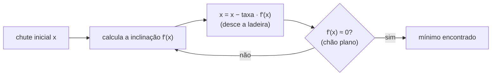

# Funções, limites e derivadas

## Por que isso importa

Cálculo parece distante da programação até você encontrar: **machine learning** treina modelos ajustando milhões de parâmetros com derivadas (descida do gradiente); **jogos e animações** usam taxas de variação para física e movimento suave; **análise de algoritmos** compara o crescimento de funções (n, n², log n, 2ⁿ); **otimização** (menor custo, maior lucro, melhor rota) é achar máximos e mínimos; e bibliotecas numéricas calculam raízes e integrais com os métodos desta aula. É por isso que o OSSU coloca Cálculo no núcleo do currículo e é pré-requisito da trilha de IA.

## Intuição

- Uma **função** é uma **máquina**: entra um número, sai outro. `f(x) = 2x + 1`: entra 3, sai 7.
- Um **limite** pergunta: "**para onde** a saída vai quando a entrada **chega perto** de um valor?", mesmo que você não possa colocar exatamente aquele valor na máquina.
- A **derivada** é o **velocímetro** do carro. O hodômetro diz quanto você andou (a função); o velocímetro diz **quão rápido** isso está mudando **agora** (a derivada). Se a posição é f(t), a velocidade é f'(t).

## Visual

Funções que você vai ver o tempo todo (as mesmas da análise de complexidade, ED-01). Repare como elas se separam quando x cresce:

```
x        log₂ x      x        x²          2ˣ
1          0         1         1            2
2          1         2         4            4
4          2         4        16           16
8          3         8        64          256
16         4        16       256       65.536
32         5        32     1.024    4.294.967.296
1024      10     1.024 1.048.576    (309 dígitos)

log cresce devagar · linear cresce no mesmo ritmo · quadrática acelera · exponencial explode
```

Derivada como inclinação: a reta **secante** passa por dois pontos da curva; quando o segundo ponto se aproxima do primeiro (h → 0), ela vira a reta **tangente**, e a inclinação dela é a derivada.

```
         f(x)
          │                ● (x+h, f(x+h))
          │              ╱│
          │           ╱   │  Δy = f(x+h) − f(x)
          │        ╱      │
          │     ●─────────┘
          │  (x, f(x))  h
          │
          └──────────────────── x

inclinação da secante = Δy / h = (f(x+h) − f(x)) / h
derivada f'(x)       = limite disso quando h → 0
```

Descida do gradiente: para achar o mínimo, dê passos **contra** a inclinação.



## Conceito técnico

### Funções

Uma função associa a cada entrada do **domínio** exatamente uma saída. As famílias mais importantes:

| Família | Forma | Comportamento | Onde aparece |
|---|---|---|---|
| Linear | f(x) = ax + b | reta; cresce sempre no mesmo ritmo (a) | preço por quantidade, busca linear O(n) |
| Quadrática | f(x) = ax² + bx + c | parábola; tem um mínimo ou máximo | física (queda livre), laços aninhados O(n²) |
| Exponencial | f(x) = aˣ | cresce cada vez mais rápido | juros compostos, vírus, força bruta O(2ⁿ) |
| Logarítmica | f(x) = log_b x | cresce cada vez mais devagar; inversa da exponencial | busca binária O(log n), decibéis |

**log₂ n** responde: "quantas vezes divido n por 2 até chegar a 1?". log₂ 1024 = 10, porque 2¹⁰ = 1024.

### Limites

**lim (x→a) f(x) = L** significa: dá para deixar f(x) **tão perto de L quanto se queira**, escolhendo x suficientemente perto de a (sem precisar que x seja igual a a).

Exemplo clássico: f(x) = (x² − 1)/(x − 1) não existe em x = 1 (divisão por zero). Mas, para x ≠ 1, f(x) = x + 1, então perto de 1 os valores chegam perto de **2**:

```
x:     0.9     0.99    0.999   │  1.001   1.01   1.1
f(x):  1.9     1.99    1.999   │  2.001   2.01   2.1     → lim = 2
```

Limites no infinito descrevem o comportamento "a longo prazo": lim (n→∞) (3n² + 100n)/n² = 3. É a ideia por trás do Big-O: para n grande, o termo dominante manda.

Uma função é **contínua** em a quando lim (x→a) f(x) = f(a): o gráfico não tem "pulo" nem "buraco" ali.

### Derivada

```
f'(x) = lim (h → 0) de  [ f(x + h) − f(x) ] / h
```

- **Significado**: taxa de variação instantânea; inclinação da tangente.
- **Sinal**: f' > 0 → f está **subindo**; f' < 0 → **descendo**; f' = 0 → ponto **plano** (candidato a máximo ou mínimo).
- Exemplo pela definição, f(x) = x²: (x+h)² − x² = 2xh + h², dividido por h dá 2x + h, e com h → 0 fica **2x**.

### Regras de derivação

| Regra | Fórmula | Exemplo |
|---|---|---|
| Constante | (c)' = 0 | (7)' = 0 |
| Potência | (xⁿ)' = n·xⁿ⁻¹ | (x³)' = 3x² |
| Constante vezes | (c·f)' = c·f' | (5x²)' = 10x |
| Soma | (f + g)' = f' + g' | (x² + 3x)' = 2x + 3 |
| Produto | (f·g)' = f'·g + f·g' | (x·x²)' = 1·x² + x·2x = 3x² |
| Cadeia | (f(g(x)))' = f'(g(x))·g'(x) | ((2x+1)²)' = 2(2x+1)·2 |
| Exponencial | (eˣ)' = eˣ | |
| Logaritmo | (ln x)' = 1/x | |

A **regra da cadeia** é o coração do **backpropagation** das redes neurais: a derivada de funções compostas em camadas é o produto das derivadas de cada camada.

### Máximos e mínimos

Num ponto de máximo ou mínimo "suave", a tangente é horizontal: **f'(x) = 0**. Para saber qual dos dois, olhe o sinal de f' antes e depois (desce e depois sobe = mínimo), ou a segunda derivada (f'' > 0 → mínimo, f'' < 0 → máximo).

Exemplo: f(x) = x² − 6x + 10. f'(x) = 2x − 6 = 0 → x = 3. f''(x) = 2 > 0, então é mínimo, e f(3) = 1.

### Métodos numéricos

**Derivada numérica** (quando não se tem a fórmula): use um h pequeno. A **diferença central** é bem mais precisa que a da definição:

```
f'(x) ≈ [ f(x + h) − f(x − h) ] / (2h)
```

Cuidado: h pequeno demais (1e−15) faz o erro de arredondamento do float (FP-02) dominar. Algo como h = 1e−5 costuma funcionar bem.

**Método de Newton** (achar onde f(x) = 0): a partir de um chute, siga a tangente até o eixo x e repita:

```
x_novo = x − f(x) / f'(x)
```

Converge muito rápido perto da raiz (o número de dígitos corretos dobra a cada passo). Calculadoras e bibliotecas usam variações dele para calcular raízes quadradas.

**Descida do gradiente** (achar o mínimo): x_novo = x − taxa · f'(x). A **taxa de aprendizado** controla o tamanho do passo: pequena demais demora, grande demais passa do ponto e diverge. É exatamente o que treina modelos de machine learning, com milhões de variáveis em vez de uma.

## Código

Um limite, numericamente:

```python
def f(x):
    return (x ** 2 - 1) / (x - 1)

for h in [0.1, 0.01, 0.001, 0.0001]:
    print(f"x = {1 - h:<8} f(x) = {f(1 - h):.5f}    x = {1 + h:<8} f(x) = {f(1 + h):.5f}")
```

Derivada numérica comparada com a exata, e o efeito de um h pequeno demais:

```python
def derivada(f, x, h=1e-5):
    return (f(x + h) - f(x - h)) / (2 * h)

cubo = lambda x: x ** 3            # f'(x) = 3x², então f'(2) = 12
print(derivada(cubo, 2))           # ~12.0000000001
print(derivada(cubo, 2, h=1e-13))  # pior! o erro do float aparece
```

Newton calculando √2 (raiz de f(x) = x² − 2):

```python
x = 1.0
for passo in range(6):
    x = x - (x ** 2 - 2) / (2 * x)
    print(passo + 1, x)
# 1.5, 1.41666..., 1.41421568..., 1.41421356237469, 1.414213562373095...
```

Descida do gradiente minimizando f(x) = (x − 3)² + 1:

```python
def df(x):
    return 2 * (x - 3)

x = 0.0
taxa = 0.1
for i in range(50):
    x = x - taxa * df(x)
print(round(x, 4))   # 3.0: o mínimo
```

Troque `taxa` para 1.1 e veja o x **divergir** (os passos passam do mínimo e vão aumentando).

## Erros comuns

- **Achar que o limite é o valor da função no ponto.** O limite olha para os **vizinhos**; a função pode nem estar definida ali.
- **Esquecer a regra da cadeia**: (sen(2x))' é 2·cos(2x), não cos(2x).
- **Derivar o produto como produto das derivadas**: (f·g)' ≠ f'·g'.
- **Achar que f'(x) = 0 sempre é mínimo.** Pode ser máximo ou ponto de sela (x³ em 0).
- **h pequeno demais na derivada numérica**: o erro de arredondamento do float explode.
- **Taxa de aprendizado grande demais** na descida do gradiente: o método oscila e diverge.

## Pratique

```quiz
id: MC-01-q1
tipo: multipla_escolha
pergunta: "Quanto vale lim (x→1) (x² − 1)/(x − 1)?"
opcoes: ["0", "1", "2", "Não existe, porque dá divisão por zero"]
resposta: 2
explicacao: "Para x ≠ 1, (x² − 1)/(x − 1) = (x − 1)(x + 1)/(x − 1) = x + 1. Perto de 1, isso chega perto de 2. A função não está definida em x = 1, mas o limite existe: ele só olha os vizinhos."
dificuldade: 1
```

```quiz
id: MC-01-q2
tipo: multipla_escolha
pergunta: "Qual é a derivada de f(x) = 4x³ − 5x + 7?"
opcoes: ["12x² − 5", "12x² − 5 + 7", "4x² − 5", "12x³ − 5x"]
resposta: 0
explicacao: "Potência: (4x³)' = 4·3x² = 12x². (−5x)' = −5. A constante 7 tem derivada 0. Pela regra da soma, f'(x) = 12x² − 5."
dificuldade: 1
```

```quiz
id: MC-01-q3
tipo: multipla_escolha
pergunta: "f(x) = x² − 8x + 3 tem um mínimo em qual x?"
opcoes: ["x = 0", "x = 4", "x = 8", "x = −4"]
resposta: 1
explicacao: "f'(x) = 2x − 8, que é zero em x = 4. Como f''(x) = 2 > 0, é um mínimo (a parábola abre para cima)."
dificuldade: 1
```

```quiz
id: MC-01-q4
tipo: multipla_escolha
pergunta: "Pela regra da cadeia, qual é a derivada de f(x) = (3x + 1)⁴?"
opcoes: ["4(3x + 1)³", "12(3x + 1)³", "(3x + 1)³", "4 · 3x³"]
resposta: 1
explicacao: "Por fora, a potência dá 4(3x + 1)³; por dentro, a derivada de 3x + 1 é 3. Multiplicando: 12(3x + 1)³. Esquecer o fator de dentro é o erro mais comum."
dificuldade: 2
```

```quiz
id: MC-01-q5
tipo: verdadeiro_falso
pergunta: "Se f'(a) = 0, então f tem um máximo ou um mínimo em a."
resposta: false
explicacao: "f'(a) = 0 só diz que a tangente é horizontal. Em f(x) = x³, f'(0) = 0, mas a função continua subindo dos dois lados: é um ponto de inflexão, nem máximo nem mínimo."
dificuldade: 2
```

```quiz
id: MC-01-q6
tipo: multipla_escolha
pergunta: "Na descida do gradiente, o que acontece se a taxa de aprendizado for grande demais?"
opcoes: ["Converge mais rápido, sempre", "Os passos passam do mínimo e o método pode oscilar ou divergir", "Nada muda", "O mínimo vira máximo"]
resposta: 1
explicacao: "Com passos grandes, o x pula de um lado para o outro do mínimo, cada vez mais longe. Taxa pequena demais converge, mas devagar. Escolher a taxa é um dos ajustes mais importantes no treino de modelos de machine learning."
dificuldade: 2
```

```quiz
id: MC-01-q7
tipo: resposta_curta
pergunta: "Explique com suas palavras o que a derivada f'(x) mede e dê um exemplo fora da matemática."
resposta: "Mede a taxa de variação instantânea de f em x, ou seja, quanto a saída muda para uma mudança muito pequena da entrada; graficamente, é a inclinação da reta tangente. Exemplo: se f(t) é a posição de um carro, f'(t) é a velocidade naquele instante."
palavras_chave: ["taxa de variação", "inclinação", "tangente", "velocidade"]
dificuldade: 1
```

```quiz
id: MC-01-q8
tipo: codigo
linguagem: python
pergunta: |
  **Derivada numérica.** Escreva `derivada(f, x, h=1e-5)` que aproxima f'(x) pela **diferença central** `(f(x + h) - f(x - h)) / (2 * h)`, arredondando o resultado em 4 casas. `derivada(lambda x: x ** 2, 3)` retorna `6.0`.
codigo_inicial: |
  def derivada(f, x, h=1e-5):
      pass
usa: [def, return, round]
testes:
  - chamada: "derivada(lambda x: x ** 2, 3)"
    saida: "6.0"
  - chamada: "derivada(lambda x: x ** 3, 2)"
    saida: "12.0"
  - chamada: "derivada(lambda x: 5 * x + 2, -7)"
    saida: "5.0"
  - chamada: "derivada(lambda x: 1 / x, 2)"
    visivel: false
    saida: "-0.25"
  - chamada: "derivada(lambda x: (2 * x + 1) ** 3, 0)"
    visivel: false
    saida: "6.0"
dica: "Uma linha só: return round((f(x + h) - f(x - h)) / (2 * h), 4). Funções são valores (FP-07): f é chamada como qualquer função."
solucao: |
  def derivada(f, x, h=1e-5):
      return round((f(x + h) - f(x - h)) / (2 * h), 4)
explicacao: "A diferença central cancela o erro de primeira ordem, ficando muito mais precisa que (f(x + h) − f(x)) / h. Confira os testes à mão: (1/x)' = −1/x², que em 2 dá −0,25; ((2x + 1)³)' = 3(2x + 1)²·2, que em 0 dá 6."
dificuldade: 1
```

```quiz
id: MC-01-q9
tipo: codigo
linguagem: python
pergunta: |
  **Derivada de polinômio.** Um polinômio é representado pela lista de coeficientes, do grau 0 para cima: `[7, -5, 0, 4]` é 7 − 5x + 0x² + 4x³. Escreva `derivar(coefs)` que devolve a lista de coeficientes da derivada pela regra da potência. `derivar([7, -5, 0, 4])` retorna `[-5, 0, 12]` (−5 + 0x + 12x²). A derivada de uma constante é `[]`.
codigo_inicial: |
  def derivar(coefs):
      pass
usa: [def, return]
testes:
  - chamada: "derivar([7, -5, 0, 4])"
    saida: "[-5, 0, 12]"
  - chamada: "derivar([3])"
    saida: "[]"
  - chamada: "derivar([0, 0, 1])"
    saida: "[0, 2]"
  - chamada: "derivar([1, 1, 1, 1, 1])"
    visivel: false
    saida: "[1, 2, 3, 4]"
  - chamada: "derivar(derivar([0, 0, 0, 2]))"
    visivel: false
    saida: "[0, 12]"
dica: "O coeficiente na posição i multiplica xⁱ, cuja derivada é i·xⁱ⁻¹. Então o novo coeficiente da posição i − 1 é i * coefs[i], para i de 1 até o fim: [i * coefs[i] for i in range(1, len(coefs))]."
solucao: |
  def derivar(coefs):
      return [i * coefs[i] for i in range(1, len(coefs))]
explicacao: "Cada termo cᵢxⁱ vira i·cᵢxⁱ⁻¹: o expoente desce uma posição e multiplica o coeficiente. O termo constante (i = 0) some. Derivar duas vezes 2x³ dá 12x, ou seja, [0, 12]. Sistemas de álgebra computacional (como o SymPy) fazem isso de forma simbólica."
dificuldade: 2
```

```quiz
id: MC-01-q10
tipo: codigo
linguagem: python
pergunta: |
  **Método de Newton para raiz quadrada.** Escreva `raiz(a)` que calcula √a (a > 0) com o método de Newton aplicado a f(x) = x² − a, começando em `x = a` (ou 1, se a < 1) e repetindo `x = x - (x * x - a) / (2 * x)` até que a mudança entre dois passos seja menor que `1e-12`. Devolva o resultado arredondado em 6 casas. Não use `math.sqrt` nem `** 0.5`.
codigo_inicial: |
  def raiz(a):
      pass
usa: [def, while, return, round]
testes:
  - chamada: "raiz(2)"
    saida: "1.414214"
  - chamada: "raiz(144)"
    saida: "12.0"
  - chamada: "raiz(0.25)"
    saida: "0.5"
  - chamada: "raiz(10 ** 10)"
    visivel: false
    saida: "100000.0"
  - chamada: "raiz(3)"
    visivel: false
    saida: "1.732051"
dica: "x = a if a >= 1 else 1.0. Num while True: calcule novo = x - (x * x - a) / (2 * x); se abs(novo - x) < 1e-12, pare; senão x = novo. A derivada de x² − a é 2x."
solucao: |
  def raiz(a):
      x = a if a >= 1 else 1.0
      while True:
          novo = x - (x * x - a) / (2 * x)
          if abs(novo - x) < 1e-12:
              return round(novo, 6)
          x = novo
explicacao: "Cada passo segue a tangente da parábola até o eixo x. Para √2, partindo de 2: 1,5; 1,41667; 1,414216; 1,41421356... O número de dígitos corretos praticamente dobra a cada passo (convergência quadrática), por isso mesmo 10¹⁰ precisa de poucas dezenas de passos."
dificuldade: 2
```

```quiz
id: MC-01-q11
tipo: codigo
linguagem: python
pergunta: |
  **Descida do gradiente.** Escreva `minimizar(df, x0, taxa, passos)` que aplica `passos` vezes a atualização `x = x - taxa * df(x)` a partir de `x0` e devolve o x final arredondado em 3 casas. `df` é a derivada da função a minimizar.
codigo_inicial: |
  def minimizar(df, x0, taxa, passos):
      pass
usa: [def, for, return, round]
testes:
  - chamada: "minimizar(lambda x: 2 * (x - 3), 0, 0.1, 100)"
    saida: "3.0"
  - chamada: "minimizar(lambda x: 2 * x - 8, 10, 0.25, 50)"
    saida: "4.0"
  - chamada: "minimizar(lambda x: 2 * (x - 3), 0, 0.1, 1)"
    saida: "0.6"
  - chamada: "abs(minimizar(lambda x: 2 * (x - 3), 0, 1.1, 30)) > 100"
    visivel: false
    saida: "True"
  - chamada: "minimizar(lambda x: 4 * x ** 3, 1, 0.05, 2000)"
    visivel: false
    saida: "0.035"
dica: "x = x0; um for que roda passos vezes fazendo x = x - taxa * df(x); no fim, return round(x, 3)."
solucao: |
  def minimizar(df, x0, taxa, passos):
      x = x0
      for _ in range(passos):
          x = x - taxa * df(x)
      return round(x, 3)
explicacao: "Com f(x) = (x − 3)², a derivada é 2(x − 3): o método caminha até x = 3. Um passo a partir de 0 dá 0 − 0,1·(−6) = 0,6. Com taxa 1,1 ele diverge (teste oculto). Em x⁴ (derivada 4x³), perto do mínimo a inclinação fica minúscula e o método desacelera muito: depois de 2000 passos ainda está em 0,035, longe do 0."
dificuldade: 2
```

## Resumo

- Funções-modelo: **linear**, **quadrática**, **exponencial**, **logarítmica**; as mesmas do Big-O.
- **Limite**: para onde f(x) vai quando x se aproxima de a; não depende de f(a).
- **Derivada**: taxa de variação instantânea = inclinação da tangente = lim (f(x+h) − f(x))/h.
- Regras: **potência** (n·xⁿ⁻¹), soma, produto, **cadeia** (base do backpropagation).
- f' = 0 marca candidatos a máximo/mínimo. **Newton** acha raízes; **descida do gradiente** acha mínimos (é como se treinam modelos de ML).

## Para ir além

- Assista aos capítulos 1 a 4 de **Essence of Calculus** (3Blue1Brown), com legendas em português.
- Use o **Desmos** (desmos.com/calculator) para desenhar funções e as derivadas delas.
- **Próximos módulos**: MC-02 Integrais; depois MC-04 Álgebra linear, rumo à trilha de IA.
