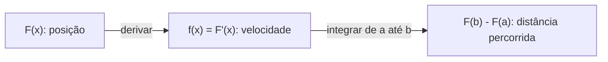

# Integrais

## Por que isso importa

A derivada (MC-01) responde "quão rápido está mudando?". A integral responde a pergunta inversa: **"quanto se acumulou?"**. O GPS soma pequenos trechos de velocidade para saber a distância percorrida; o medidor de energia soma potência ao longo do tempo para chegar aos kWh da conta; a probabilidade de uma variável contínua cair num intervalo é uma área (MC-05); em jogos, a física integra aceleração em velocidade e velocidade em posição a cada quadro; em aprendizado de máquina, médias e expectativas são integrais. E quando a fórmula é complicada demais, o computador integra **numericamente**, com os métodos que você vai programar aqui.

## Intuição

Imagine um carro cujo velocímetro você anota a cada minuto. Para estimar a distância total, você faz "velocidade × 1 minuto" para cada anotação e soma. Quanto mais frequentes as anotações, melhor a estimativa. A **integral** é o valor para onde essa soma converge quando os intervalos ficam infinitamente pequenos.

Geometricamente, é a **área sob o gráfico** da velocidade: cada parcela "velocidade × tempo" é um retângulo fino. E o **teorema fundamental do cálculo** diz algo surpreendente: para calcular essa área exata, basta achar uma função cuja **derivada** é a velocidade (a posição!) e subtrair o valor no fim pelo valor no começo. Somar infinitas fatias vira uma subtração.

## Visual

```text
 f(x)
  │            ▄▄▄
  │         ▄▄█████▄▄            Soma de Riemann: retângulos de largura Δx
  │      ▄▄██████████▄           Σ f(xᵢ) Δx
  │    ▄████████████████▄
  │  ▄██████████████████████▄    Quando Δx → 0, a soma tende à integral
  │▄████████████████████████████ ∫ₐᵇ f(x) dx
  └─┴──────────────────────────┴── x
    a                          b
```



Os métodos numéricos e o erro típico quando se dobra o número de pedaços n:

```text
método              aproxima cada fatia por      erro cai como     dobrar n divide o erro por
Riemann (esq/dir)   retângulo                    1/n               2
ponto médio         retângulo no meio            1/n²              4
trapézio            reta entre as pontas         1/n²              4
Simpson             parábola por três pontos     1/n⁴              16
```

## Conceito técnico

### A integral definida

Para f em [a, b], divida o intervalo em n pedaços de largura Δx = (b - a)/n e some f(xᵢ)·Δx (soma de Riemann). O limite quando n → ∞ é a **integral definida** ∫ₐᵇ f(x) dx.

- É uma **área com sinal**: partes abaixo do eixo x contam negativo. ∫ de sen(x) entre 0 e 2π é 0.
- **Linearidade**: ∫(f + g) = ∫f + ∫g e ∫c·f = c·∫f.
- **Aditividade**: ∫ₐᶜ = ∫ₐᵇ + ∫ᵦᶜ.
- **Média** de f em [a, b]: (1/(b - a)) ∫ₐᵇ f(x) dx.

### Primitivas e o teorema fundamental

Uma **primitiva** (antiderivada) de f é uma F com F' = f. Ela é única a menos de uma constante: ∫ f(x) dx = F(x) + C.

**Teorema fundamental do cálculo**:

1. Se F(x) = ∫ₐˣ f(t) dt, então F'(x) = f(x): acumular e depois derivar devolve a taxa.
2. ∫ₐᵇ f(x) dx = F(b) - F(a), para qualquer primitiva F.

Tabela básica:

```text
f(x)            primitiva F(x)
xⁿ (n ≠ -1)     xⁿ⁺¹ / (n + 1)
1/x             ln|x|
eˣ              eˣ
sen x           -cos x
cos x           sen x
```

Exemplo: ∫₀¹ x² dx = [x³/3]₀¹ = 1/3 - 0 = 1/3.

### Técnicas

- **Substituição** (a regra da cadeia ao contrário): ∫ 2x·cos(x²) dx, com u = x², du = 2x dx, vira ∫ cos u du = sen(x²) + C.
- **Por partes** (a regra do produto ao contrário): ∫ u dv = uv - ∫ v du. Ex.: ∫ x·eˣ dx = x·eˣ - eˣ + C.
- Muitas funções **não têm primitiva elementar** (a curva normal e^(-x²), sen(x)/x). Aí entram os métodos numéricos ou funções especiais (a função erro, erf).

### Integrais impróprias

Intervalos infinitos ou funções que explodem são tratados como limites: ∫₁^∞ 1/x² dx = 1 (converge), mas ∫₁^∞ 1/x dx = ∞ (diverge). Isso aparece em probabilidade (a área total sob uma densidade é 1) e na análise de séries (MC-03).

### Integração numérica

- **Regra do trapézio**: Δx·[f(x₀)/2 + f(x₁) + ... + f(xₙ₋₁) + f(xₙ)/2]. Funciona também com **dados medidos** em pontos irregulares.
- **Regra de Simpson** (n par): (Δx/3)·[f(x₀) + 4f(x₁) + 2f(x₂) + 4f(x₃) + ... + 4f(xₙ₋₁) + f(xₙ)]. Exata para polinômios de grau até 3.
- **Quadratura adaptativa** (o `scipy.integrate.quad`): usa mais pontos onde a função muda rápido.
- **Monte Carlo**: média de f em pontos aleatórios × tamanho do domínio. O erro cai devagar (1/√n), mas não piora com a dimensão, por isso é usado em integrais de muitas variáveis (física, finanças, renderização de imagens).
- **Simulação** (física de jogos): integrar passo a passo, como no método de Euler (velocidade += aceleração·dt; posição += velocidade·dt).

### Integrais e algoritmos

Somas viram integrais para estimar custos: Σᵢ₌₁ⁿ 1/i ≈ ∫₁ⁿ 1/x dx = ln n (o número harmônico, que aparece no quicksort aleatório e em hashing), e Σ i² ≈ n³/3.

## Código

Os métodos numéricos lado a lado em ∫₀^π sen(x) dx, cujo valor exato é 2, e o número harmônico comparado com ln n.

```python
import math

def riemann_esquerda(f, a, b, n):
    dx = (b - a) / n
    return sum(f(a + i * dx) for i in range(n)) * dx

def ponto_medio(f, a, b, n):
    dx = (b - a) / n
    return sum(f(a + (i + 0.5) * dx) for i in range(n)) * dx

def trapezio(f, a, b, n):
    dx = (b - a) / n
    return (f(a) / 2 + sum(f(a + i * dx) for i in range(1, n)) + f(b) / 2) * dx

def simpson(f, a, b, n):
    dx = (b - a) / n
    soma = f(a) + f(b)
    for i in range(1, n):
        soma += (4 if i % 2 else 2) * f(a + i * dx)
    return soma * dx / 3

print(f"{'n':>4} {'Riemann':>12} {'ponto médio':>12} {'trapézio':>12} {'Simpson':>12}   (erros)")
for n in [4, 8, 16, 32]:
    erros = [abs(m(math.sin, 0, math.pi, n) - 2) for m in (riemann_esquerda, ponto_medio, trapezio, simpson)]
    print(f"{n:>4} " + " ".join(f"{e:12.2e}" for e in erros))

for n in [10, 1000, 100000]:
    harmonico = sum(1 / i for i in range(1, n + 1))
    print(f"H({n}) = {harmonico:.4f}   ln({n}) = {math.log(n):.4f}   diferença {harmonico - math.log(n):.4f}")
```

Repare que dobrar n divide o erro do trapézio por 4 e o de Simpson por 16. (Aqui o Riemann à esquerda empata com o trapézio só porque sen(0) = sen(π) = 0, então as metades das pontas não fazem diferença; em geral ele cai como 1/n.) E a diferença entre Hₙ e ln n converge para 0,5772..., a constante de Euler-Mascheroni.

## Erros comuns

- **Esquecer o + C** numa primitiva (ou achar que ele importa numa integral definida, onde se cancela).
- **Esquecer que área abaixo do eixo conta negativo**: para a área geométrica, integre |f|.
- **Aplicar xⁿ⁺¹/(n + 1) com n = -1**: a primitiva de 1/x é ln|x|.
- **Esquecer de trocar os limites** numa substituição em integral definida.
- **Simpson com n ímpar**.
- **Confiar num método numérico perto de singularidades** (1/√x em 0) ou com funções muito oscilantes, sem checar a convergência dobrando n.
- **Integrar dados ruidosos com métodos de ordem alta**: com medições, o trapézio costuma ser o mais honesto.

## Pratique

```quiz
id: MC-02-q1
tipo: multipla_escolha
pergunta: "Qual o valor de ∫₀² 3x² dx?"
opcoes: ["4", "8", "12", "6"]
resposta: 1
explicacao: "Uma primitiva de 3x² é x³. Pelo teorema fundamental: 2³ - 0³ = 8."
dificuldade: 1
```

```quiz
id: MC-02-q2
tipo: multipla_escolha
pergunta: "Um carro tem velocidade v(t) (em m/s). O que ∫₀¹⁰ v(t) dt representa?"
opcoes: ["A aceleração média", "O deslocamento entre t = 0 e t = 10 s, em metros", "A velocidade máxima", "O tempo de viagem"]
resposta: 1
explicacao: "Integrar a taxa (velocidade) acumula a quantidade (posição): o resultado é a variação de posição. Se a velocidade ficar negativa em algum trecho (ré), esse trecho desconta; a distância total percorrida seria a integral de |v|."
dificuldade: 1
```

```quiz
id: MC-02-q3
tipo: verdadeiro_falso
pergunta: "∫ de sen(x) entre 0 e 2π é igual a 4, porque o gráfico forma duas 'ondas' de área 2."
resposta: false
explicacao: "A integral é uma área com sinal: a onda entre π e 2π fica abaixo do eixo e conta -2, então o total é 0. A área geométrica (integral de |sen x|) é que vale 4."
dificuldade: 1
```

```quiz
id: MC-02-q4
tipo: multipla_escolha
pergunta: "Com a regra do trapézio, o erro com n = 100 pedaços foi 0,004. Qual o erro esperado com n = 200, para uma função suave?"
opcoes: ["0,002", "0,001", "0,00025", "0,004"]
resposta: 1
explicacao: "O erro do trapézio é proporcional a 1/n²: dobrar n divide o erro por 4. Com Simpson, que é de ordem 4, dividiria por 16."
dificuldade: 2
```

```quiz
id: MC-02-q5
tipo: resposta_curta
pergunta: "Explique com suas palavras o teorema fundamental do cálculo."
resposta: "Ele liga derivada e integral como operações inversas: se você acumula uma taxa f de a até x, a função acumulada tem derivada f; e, para calcular a integral de f entre a e b, basta achar uma primitiva F (com F' = f) e fazer F(b) - F(a), em vez de somar infinitas fatias."
palavras_chave: ["inversas", "primitiva", "F(b) - F(a)", "derivada"]
dificuldade: 2
```

```quiz
id: MC-02-q6
tipo: codigo
linguagem: python
pergunta: |
  **Regra do trapézio.** Escreva `trapezio(f, a, b, n)`, que aproxima a integral de `f` em `[a, b]` dividindo o intervalo em `n` pedaços iguais e somando as áreas dos trapézios: `dx * (f(a)/2 + f(x1) + ... + f(x_{n-1}) + f(b)/2)`.
codigo_inicial: |
  def trapezio(f, a, b, n):
      dx = (b - a) / n
      return sum(f(a + i * dx) for i in range(n)) * dx
usa: [def, for, return]
testes:
  - chamada: "trapezio(lambda x: 2 * x, 0, 3, 1)"
    saida: "9.0"
  - chamada: "round(trapezio(lambda x: x ** 2, 0, 1, 4), 6)"
    saida: "0.34375"
  - chamada: "round(trapezio(lambda x: x ** 2, 0, 1, 1000), 6)"
    saida: "0.333333"
  - chamada: "trapezio(lambda x: 5, 2, 7, 3)"
    visivel: false
    saida: "25.0"
  - chamada: "round(trapezio(lambda x: 1 / x, 1, 2, 100), 5)"
    visivel: false
    saida: "0.69315"
dica: "Calcule dx, comece a soma com (f(a) + f(b)) / 2 e acrescente f(a + i * dx) para i de 1 a n - 1. Multiplique por dx no fim."
solucao: |
  def trapezio(f, a, b, n):
      dx = (b - a) / n
      soma = (f(a) + f(b)) / 2
      for i in range(1, n):
          soma += f(a + i * dx)
      return soma * dx
explicacao: "Para retas (primeiro e quarto testes), o trapézio é exato até com um pedaço só. Para x², com 4 pedaços sobra um erro de 1/96 (0,34375 contra 1/3), e com 1000 o erro cai para cerca de 1/6.000.000, seguindo o 1/n². O último teste calcula ln 2 = 0,693147... pela integral de 1/x: é assim que se define o logaritmo natural."
dificuldade: 1
```

```quiz
id: MC-02-q7
tipo: codigo
linguagem: python
pergunta: |
  **Integral exata de polinômios.** Um polinômio é a lista de coeficientes `[c0, c1, c2, ...]`, representando `c0 + c1·x + c2·x² + ...`. Escreva:

  - `primitiva(coefs)`: a lista de coeficientes de uma primitiva com constante 0, usando `Fraction` (o termo `c·xⁿ` vira `c/(n+1)·xⁿ⁺¹`);
  - `integral(coefs, a, b)`: o valor exato `F(b) - F(a)`, também como `Fraction` (avalie F com os coeficientes da primitiva).
codigo_inicial: |
  from fractions import Fraction

  def primitiva(coefs):
      return [Fraction(c) for c in coefs]

  def integral(coefs, a, b):
      return Fraction(0)
usa: [def, for, return, Fraction]
testes:
  - chamada: "primitiva([0, 0, 1])"
    saida: "[Fraction(0, 1), Fraction(0, 1), Fraction(0, 1), Fraction(1, 3)]"
  - chamada: "integral([0, 0, 1], 0, 1)"
    saida: "Fraction(1, 3)"
  - chamada: "integral([0, 0, 3], 0, 2)"
    saida: "Fraction(8, 1)"
  - chamada: "integral([1, -2, 0, 4], -1, 2)"
    visivel: false
    saida: "Fraction(15, 1)"
  - chamada: "integral([5], 3, 3)"
    visivel: false
    saida: "Fraction(0, 1)"
  - chamada: "integral([0, 1], 2, 0)"
    visivel: false
    saida: "Fraction(-2, 1)"
dica: "A primitiva começa com 0 (a constante) seguido de Fraction(c, n + 1) para cada coeficiente c de índice n. Para avaliar F(x), some coef * Fraction(x) ** k para cada coeficiente da primitiva."
solucao: |
  from fractions import Fraction

  def primitiva(coefs):
      resultado = [Fraction(0)]
      for n, c in enumerate(coefs):
          resultado.append(Fraction(c, n + 1))
      return resultado

  def integral(coefs, a, b):
      F = primitiva(coefs)
      def avaliar(x):
          total = Fraction(0)
          for k, c in enumerate(F):
              total += c * Fraction(x) ** k
          return total
      return avaliar(b) - avaliar(a)
explicacao: "Com Fraction o resultado é exato: 1/3, e não 0,3333. É o teorema fundamental em código: uma subtração no lugar de infinitas fatias. O último teste mostra que inverter os limites troca o sinal. Sistemas de álgebra computacional, como o SymPy, fazem isso para muito mais tipos de função, mas para polinômios esta regra basta."
dificuldade: 2
```

```quiz
id: MC-02-q8
tipo: codigo
linguagem: javascript
pergunta: |
  **Distância a partir do velocímetro.** Um app registrou a velocidade de uma corrida em instantes **irregulares**. Escreva `distancia(tempos, velocidades)`, que estima a distância percorrida pela regra do trapézio com intervalos variáveis: para cada par de leituras consecutivas, some `(t[i+1] - t[i]) * (v[i] + v[i+1]) / 2`. Arredonde para 2 casas (`Math.round(x * 100) / 100`). Com menos de duas leituras, a distância é 0.
codigo_inicial: |
  function distancia(tempos, velocidades) {
    const total = tempos[tempos.length - 1] - tempos[0];
    const media = velocidades.reduce((s, v) => s + v, 0) / velocidades.length;
    return Math.round(total * media * 100) / 100;
  }
usa: [function, for, return]
testes:
  - chamada: "distancia([0, 10], [2, 4])"
    saida: "30"
  - chamada: "distancia([0, 1, 3, 6], [0, 2, 2, 5])"
    saida: "15.5"
  - chamada: "distancia([0, 2, 2.5, 10], [3, 3.5, 3.1, 2.8])"
    saida: "30.28"
  - chamada: "distancia([5], [3])"
    visivel: false
    saida: "0"
  - chamada: "distancia([0, 60, 90, 300, 310], [0, 4.2, 4.4, 3.9, 0])"
    visivel: false
    saida: "1146"
  - chamada: "distancia([], [])"
    visivel: false
    saida: "0"
dica: "Percorra i de 0 até tempos.length - 2 somando a área de cada trapézio; arredonde só no fim."
solucao: |
  function distancia(tempos, velocidades) {
    let total = 0;
    for (let i = 0; i + 1 < tempos.length; i++) {
      total += (tempos[i + 1] - tempos[i]) * (velocidades[i] + velocidades[i + 1]) / 2;
    }
    return Math.round(total * 100) / 100;
  }
explicacao: "O código inicial multiplica a duração pela média simples das leituras, o que dá peso igual a uma leitura que vale 1 segundo e a outra que vale 3 minutos. O trapézio com intervalos variáveis pesa cada trecho pela sua duração. É exatamente o que apps de corrida e de bicicleta fazem com as leituras do GPS ou do sensor (com filtros para tirar o ruído antes)."
dificuldade: 1
```

## Resumo

- A integral definida é o **acúmulo** de uma taxa e a **área com sinal** sob o gráfico, limite das somas de Riemann.
- **Teorema fundamental**: derivar e integrar são inversos; ∫ₐᵇ f = F(b) - F(a).
- Primitivas pela tabela, **substituição** e **por partes**; nem toda função tem primitiva elementar.
- **Numericamente**: Riemann (1/n), trapézio e ponto médio (1/n²), **Simpson** (1/n⁴), adaptativos, **Monte Carlo** para muitas dimensões.
- Aplicações: distância, energia, médias, probabilidade, física de jogos e somas de custo de algoritmos (Hₙ ≈ ln n).

## Para ir além

- Faça a unidade de integração do MITx 18.01.2x (OSSU).
- Implemente o método de Euler para um objeto em queda com resistência do ar e compare com a solução exata.
- Use `scipy.integrate.quad` para calcular a área sob a curva normal entre -1 e 1 e compare com 68%.
- **Próximo módulo**: MC-03 Séries e coordenadas.
