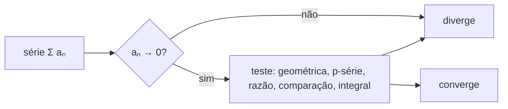

# Séries e coordenadas

## Por que isso importa

Quando você chama `math.sin(0.5)`, o processador não tem uma tabela com todos os senos: ele soma alguns termos de uma **série** (um polinômio de Taylor, depois de reduzir o ângulo) e para quando a precisão basta. Séries também estão na análise de algoritmos (a série harmônica do quicksort, a geométrica do vetor dinâmico que dobra de tamanho, ED-01), em gráficos (curvas de Bézier são polinômios paramétricos), em processamento de sinais e compressão (séries de Fourier, base do JPEG e do MP3) e em física de jogos. E **coordenadas polares** são a linguagem natural para tudo que gira: radar, joystick analógico, órbitas, rotação de sprites, números complexos.

## Intuição

Imagine andar até uma parede dando a cada passo **metade** da distância que falta: 1/2, depois 1/4, depois 1/8... São infinitos passos, mas você nunca passa da parede: a soma 1/2 + 1/4 + 1/8 + ... **converge** para 1. Agora tente outra regra: dar passos de 1, 1/2, 1/3, 1/4... Os passos também ficam minúsculos, mas desta vez você anda para sempre: a série harmônica **diverge**. Termos que vão a zero **não** garantem soma finita.

Uma **série de Taylor** é uma receita para imitar uma função perto de um ponto só com somas e multiplicações: acerte o valor, depois a inclinação, depois a curvatura... Cada termo corrige o anterior, e perto do ponto a imitação fica indistinguível.

E coordenadas: em vez de dizer "3 quadras para leste e 4 para o norte" (cartesiano), você pode dizer "5 quadras na direção 53°" (polar). Mesmo lugar, outra descrição, muito mais conveniente quando o problema é de girar.

## Visual

Polinômios de Taylor de sen(x) em torno de 0: cada termo estende a região em que a aproximação é boa.

```text
sen x ≈ x                                   bom até |x| ≈ 0,3
sen x ≈ x - x³/6                            bom até |x| ≈ 1
sen x ≈ x - x³/6 + x⁵/120                   bom até |x| ≈ 2
sen x ≈ x - x³/6 + x⁵/120 - x⁷/5040         bom até |x| ≈ 3
```

Cartesiano e polar:

```text
        y
        │       • P = (x, y) = (3, 4)
        │      /                       r = √(x² + y²) = 5
        │     / r                      θ = atan2(y, x) ≈ 53,13°
        │    /
        │   / θ                        x = r·cos θ
        └──┴──────── x                 y = r·sen θ
```



## Conceito técnico

### Sequências e séries

Uma **série** Σaₙ é o limite das **somas parciais** Sₙ = a₁ + ... + aₙ. Ela **converge** se Sₙ se aproxima de um número; senão **diverge**.

- **Geométrica**: Σ arⁿ (n a partir de 0) = a / (1 - r) se |r| < 1; diverge se |r| ≥ 1. Ex.: 1 + 1/2 + 1/4 + ... = 2. Um vetor que dobra de capacidade copia ao todo 1 + 2 + 4 + ... + n < 2n elementos: custo amortizado O(1) (ED-01).
- **Harmônica**: Σ 1/n diverge, mas devagar (como ln n, MC-02).
- **p-série**: Σ 1/nᵖ converge se e só se p > 1. Σ 1/n² = π²/6 (o problema da Basileia, resolvido por Euler).
- **Teste do termo**: se aₙ não tende a 0, a série diverge. A recíproca é falsa (harmônica).
- **Teste da razão**: se |aₙ₊₁/aₙ| → L, converge se L < 1 e diverge se L > 1 (L = 1 não decide). Ótimo para fatoriais e potências.
- **Comparação** e **teste da integral**: compare com uma série ou integral conhecida.
- **Alternadas**: Σ (-1)ⁿ bₙ com bₙ decrescendo a 0 converge, e o erro ao parar é menor que o primeiro termo omitido. 1 - 1/3 + 1/5 - 1/7 + ... = π/4 (Leibniz), mas converge lentíssimo.
- **Convergência absoluta** (Σ|aₙ| converge) é robusta; a **condicional** depende da ordem dos termos (Riemann: reordenando, dá para chegar a qualquer valor).

### Séries de potências e de Taylor

Uma **série de potências** Σ cₙ(x - a)ⁿ converge num intervalo em torno de a (o **raio de convergência**). A **série de Taylor** de f em torno de a usa as derivadas:

f(x) = f(a) + f'(a)(x - a) + f''(a)(x - a)²/2! + f'''(a)(x - a)³/3! + ...

Em torno de 0 (Maclaurin):

```text
eˣ        = 1 + x + x²/2! + x³/3! + ...                 para todo x
sen x     = x - x³/3! + x⁵/5! - x⁷/7! + ...              para todo x
cos x     = 1 - x²/2! + x⁴/4! - ...                      para todo x
1/(1 - x) = 1 + x + x² + x³ + ...                        |x| < 1
ln(1 + x) = x - x²/2 + x³/3 - ...                        -1 < x ≤ 1
```

O **erro** ao parar no termo de grau n é da ordem do próximo termo: f⁽ⁿ⁺¹⁾(c)·(x - a)ⁿ⁺¹/(n + 1)! para algum c entre a e x (resto de Lagrange). Por isso as bibliotecas primeiro **reduzem o argumento** (sen(100) vira o seno de um ângulo pequeno usando a periodicidade) e só então somam poucos termos.

Usos: aproximações rápidas (sen x ≈ x para ângulos pequenos, no pêndulo e em física de jogos), o **método de Newton** (MC-01) é Taylor de grau 1, e a **fórmula de Euler** eⁱθ = cos θ + i·sen θ sai de comparar as três séries.

### Somando séries no computador

- Ponto flutuante tem precisão finita: somar 1 + 1e-17 dá 1. Some os termos **pequenos primeiro**, ou use a soma compensada de Kahan (`math.fsum` no Python).
- Pare por **tolerância** e também por **número máximo** de termos.
- Termos com fatoriais e potências grandes estouram: calcule cada termo a partir do anterior (tₙ₊₁ = tₙ · x/(n + 1)).

### Coordenadas polares

Um ponto é (r, θ): distância à origem e ângulo a partir do eixo x.

- Polar → cartesiano: x = r·cos θ, y = r·sen θ.
- Cartesiano → polar: r = √(x² + y²), θ = **atan2(y, x)** (que acerta o quadrante; atan(y/x) não acerta e falha em x = 0).
- Curvas ficam simples: o círculo r = 2, a espiral r = θ, a rosa r = cos(3θ), a cardioide r = 1 + cos θ.
- Área em polares: ½ ∫ r² dθ.
- **Números complexos** são pontos do plano: z = x + iy = r·eⁱθ. Multiplicar complexos multiplica os módulos e **soma os ângulos**: multiplicar por eⁱφ é girar por φ. É assim que se rotaciona em 2D e que a FFT funciona.

### Curvas paramétricas

Em vez de y = f(x), descreva o ponto em função de um parâmetro t: (x(t), y(t)). Um círculo é (cos t, sen t); uma bala de canhão é (v·cos α·t, v·sen α·t - g·t²/2). A velocidade é o vetor das derivadas (x'(t), y'(t)) e o comprimento da curva é ∫ √(x'² + y'²) dt. Animações, trajetórias de jogos e as **curvas de Bézier** de editores gráficos e fontes são paramétricas.

## Código

Aproximando sen e e^x com Taylor, a soma ingênua contra `math.fsum`, e conversões polares com atan2.

```python
import math

def seno_taylor(x, termos):
    soma, termo = 0.0, x
    for n in range(termos):
        soma += termo
        termo *= -x * x / ((2 * n + 2) * (2 * n + 3))   # próximo termo a partir do anterior
    return soma

for x in [0.5, 2.0, 6.0]:
    linha = [f"{abs(seno_taylor(x, t) - math.sin(x)):.1e}" for t in (2, 4, 8)]
    print(f"sen({x}): erro com 2, 4, 8 termos = {linha}")

# Somar muitos termos pequenos: a ordem e o método importam
termos = [1.0] + [1e-16] * 1_000_000
ingenua = 0.0
for t in termos:          # laço simples (o sum() do Python 3.12+ já compensa sozinho)
    ingenua += t
print("soma ingênua:", ingenua, "  fsum:", math.fsum(termos), "  pequenos primeiro:", sum(sorted(termos)))

for x, y in [(3, 4), (-3, 4), (-3, -4), (0, -2)]:
    r, theta = math.hypot(x, y), math.degrees(math.atan2(y, x))
    ingenuo = math.degrees(math.atan(y / x)) if x != 0 else float("nan")
    print(f"({x:2}, {y:2}) → r = {r}, θ = {theta:7.2f}°   (atan(y/x) daria {ingenuo:7.2f}°)")
```

## Erros comuns

- **Concluir convergência porque os termos vão a zero** (a harmônica diverge).
- **Usar a fórmula geométrica com |r| ≥ 1**: 1 + 2 + 4 + ... não é -1 (no sentido usual).
- **Usar Taylor longe do centro** sem reduzir o argumento: seno de 100 com 10 termos é lixo.
- **Calcular xⁿ e n! separadamente** para n grande: estouro ou perda de precisão.
- **Somar uma série grande na ordem errada** em ponto flutuante.
- **`atan(y / x)` no lugar de `atan2(y, x)`**: quadrante errado e divisão por zero.
- **Misturar graus e radianos**: as funções trigonométricas das linguagens usam radianos.

## Pratique

```quiz
id: MC-03-q1
tipo: multipla_escolha
pergunta: "Qual o valor de 1 + 1/3 + 1/9 + 1/27 + ...?"
opcoes: ["4/3", "3/2", "2", "A série diverge"]
resposta: 1
explicacao: "É geométrica com a = 1 e r = 1/3: a soma é 1 / (1 - 1/3) = 3/2."
dificuldade: 1
```

```quiz
id: MC-03-q2
tipo: multipla_escolha
pergunta: "Qual destas séries converge?"
opcoes: ["Σ 1/n", "Σ 1/√n", "Σ 1/n²", "Σ n/(n + 1)"]
resposta: 2
explicacao: "Pela p-série, Σ 1/n^p converge só para p > 1: 1/n² (p = 2) converge para π²/6. 1/n e 1/√n têm p ≤ 1 e divergem, e n/(n + 1) nem tende a zero."
dificuldade: 1
```

```quiz
id: MC-03-q3
tipo: verdadeiro_falso
pergunta: "Se os termos de uma série tendem a zero, a série converge."
resposta: false
explicacao: "É necessário, mas não suficiente. A série harmônica 1 + 1/2 + 1/3 + ... tem termos indo a zero e cresce sem limite (como ln n)."
dificuldade: 1
```

```quiz
id: MC-03-q4
tipo: multipla_escolha
pergunta: "O ponto cartesiano (-1, -1) em coordenadas polares, com o ângulo em (-180°, 180°], é:"
opcoes: ["r = √2, θ = 45°", "r = √2, θ = -135°", "r = 2, θ = 225°", "r = √2, θ = 135°"]
resposta: 1
explicacao: "r = √(1 + 1) = √2. O ponto está no terceiro quadrante; atan2(-1, -1) = -135° (equivalente a 225°). atan(y/x) = atan(1) = 45° erraria o quadrante."
dificuldade: 2
```

```quiz
id: MC-03-q5
tipo: resposta_curta
pergunta: "Por que a aproximação sen x ≈ x funciona bem para ângulos pequenos e onde ela é usada?"
resposta: "Porque é o polinômio de Taylor de grau 1 de sen x em torno de 0; o primeiro termo desprezado é x³/6, muito pequeno quando x é pequeno (em radianos). Ela é usada na física do pêndulo simples, em óptica, em simulações e jogos para cálculos rápidos com ângulos pequenos."
palavras_chave: ["Taylor", "x³/6", "radianos", "pêndulo"]
dificuldade: 2
```

```quiz
id: MC-03-q6
tipo: codigo
linguagem: python
pergunta: |
  **Exponencial por Taylor.** Escreva `exp_taylor(x, tol)`, que soma a série `1 + x + x²/2! + x³/3! + ...` até o próximo termo ter valor absoluto menor que `tol`, e devolve a tupla `(soma, termos_usados)`. Calcule cada termo a partir do anterior (`termo * x / n`), sem `math.factorial` nem `**`.
codigo_inicial: |
  def exp_taylor(x, tol):
      return (1 + x, 2)
usa: [def, while, return]
testes:
  - chamada: "(lambda r: (round(r[0], 6), r[1]))(exp_taylor(1, 1e-10))"
    saida: "(2.718282, 14)"
  - chamada: "exp_taylor(0, 1e-6)"
    saida: "(1.0, 1)"
  - chamada: "(lambda r: (round(r[0], 4), r[1]))(exp_taylor(5, 1e-8))"
    saida: "(148.4132, 26)"
  - chamada: "(lambda r: (round(r[0], 8), r[1]))(exp_taylor(-1, 1e-12))"
    visivel: false
    saida: "(0.36787944, 15)"
  - chamada: "exp_taylor(2, 10)"
    visivel: false
    saida: "(0.0, 0)"
dica: "Comece com soma = 0, termo = 1.0, n = 0. Enquanto abs(termo) >= tol: some o termo, aumente n e faça termo = termo * x / n. Devolva (soma, n)."
solucao: |
  def exp_taylor(x, tol):
      soma, termo, n = 0.0, 1.0, 0
      while abs(termo) >= tol:
          soma += termo
          n += 1
          termo = termo * x / n
      return (soma, n)
explicacao: "Calcular cada termo pelo anterior evita fatoriais e potências enormes. Repare como o número de termos cresce com x: perto de 0, poucos bastam; com x = 5, foram 26. Por isso bibliotecas reduzem o argumento antes (e^x = 2^k · e^r, com r pequeno). O último teste mostra o critério de parada levado ao extremo: com tol = 10, já o primeiro termo (1) é menor que a tolerância, e nada é somado."
dificuldade: 2
```

```quiz
id: MC-03-q7
tipo: codigo
linguagem: python
pergunta: |
  **Cartesiano e polar.** Escreva:

  - `para_polar(x, y)`: devolve `(r, theta)` com `r = hypot(x, y)` e `theta` em **graus** no intervalo `(-180, 180]`, usando `atan2`; arredonde os dois a 2 casas;
  - `para_cartesiano(r, theta)`: com `theta` em graus, devolve `(x, y)` arredondados a 2 casas. Some `0.0` a cada valor arredondado para evitar o `-0.0`.
codigo_inicial: |
  import math

  def para_polar(x, y):
      return (round(math.hypot(x, y), 2), round(math.degrees(math.atan(y / x)), 2))

  def para_cartesiano(r, theta):
      return (r, theta)
usa: [def, return, atan2]
testes:
  - chamada: "para_polar(3, 4)"
    saida: "(5.0, 53.13)"
  - chamada: "para_polar(-1, -1)"
    saida: "(1.41, -135.0)"
  - chamada: "para_cartesiano(2, 90)"
    saida: "(0.0, 2.0)"
  - chamada: "para_polar(0, -2)"
    visivel: false
    saida: "(2.0, -90.0)"
  - chamada: "para_cartesiano(10, 210)"
    visivel: false
    saida: "(-8.66, -5.0)"
  - chamada: "para_cartesiano(*para_polar(-3, 4))"
    visivel: false
    saida: "(-3.0, 4.0)"
dica: "Use math.atan2(y, x) e math.degrees para o ângulo; na volta, math.radians(theta) com cos e sen."
solucao: |
  import math

  def para_polar(x, y):
      return (round(math.hypot(x, y), 2), round(math.degrees(math.atan2(y, x)), 2))

  def para_cartesiano(r, theta):
      t = math.radians(theta)
      return (round(r * math.cos(t), 2) + 0.0, round(r * math.sin(t), 2) + 0.0)
explicacao: "O código inicial usa atan(y / x), que só conhece dois quadrantes e divide por zero em x = 0 (o teste oculto com (0, -2)). atan2 recebe y e x separados e por isso sabe o quadrante. O + 0.0 transforma -0.0 em 0.0: cos(90°) em ponto flutuante dá 6e-17, que arredonda para 0.0, mas em outros ângulos o arredondamento de um número negativo minúsculo daria -0.0."
dificuldade: 1
```

```quiz
id: MC-03-q8
tipo: codigo
linguagem: javascript
pergunta: |
  **Cuidado com o critério de parada.** Escreva `somarAte(termo, tol, max)`, que soma `termo(1) + termo(2) + ...` e para quando o **próximo** termo tiver valor absoluto menor que `tol` ou depois de `max` termos. Devolva `{ soma, termos }`, com a soma arredondada a 6 casas (`Math.round(x * 1e6) / 1e6`).
codigo_inicial: |
  function somarAte(termo, tol, max) {
    return { soma: termo(1), termos: 1 };
  }
usa: [function, while, return]
testes:
  - chamada: "somarAte((k) => 1 / 2 ** k, 1e-9, 1000)"
    saida: "{ soma: 1, termos: 29 }"
  - chamada: "somarAte((k) => 1 / (k * k), 1e-6, 100000)"
    saida: "{ soma: 1.643935, termos: 1000 }"
  - chamada: "somarAte((k) => 1 / k, 1e-3, 100000)"
    saida: "{ soma: 7.485471, termos: 1000 }"
  - chamada: "somarAte((k) => (k % 2 ? 4 : -4) / (2 * k - 1), 1e-4, 1000000)"
    visivel: false
    saida: "{ soma: 3.141543, termos: 20000 }"
  - chamada: "somarAte((k) => 1, 0.5, 10)"
    visivel: false
    saida: "{ soma: 10, termos: 10 }"
dica: "Use soma = 0 e k = 1. Enquanto k <= max e Math.abs(termo(k)) >= tol, some termo(k) e avance k. O número de termos usados é k - 1."
solucao: |
  function somarAte(termo, tol, max) {
    let soma = 0;
    let k = 1;
    while (k <= max && Math.abs(termo(k)) >= tol) {
      soma += termo(k);
      k += 1;
    }
    return { soma: Math.round(soma * 1e6) / 1e6, termos: k - 1 };
  }
explicacao: "Os testes mostram por que 'parar quando o termo fica pequeno' é perigoso. Para 1/2^k funciona: a soma é 1. Para 1/k², a soma real é π²/6 ≈ 1,644934, e parar em 1000 termos deixa um erro de 0,001, mil vezes maior que a tolerância. E a harmônica (1/k), que diverge, 'converge' para 7,49 com esse critério, sem nenhum aviso. Para alternadas como a de Leibniz (teste oculto, que aproxima π), o erro é menor que o próximo termo, mas são 20 mil termos para 4 casas. Teste de convergência vem antes do código."
dificuldade: 2
```

## Resumo

- Série = limite das somas parciais; **geométrica** converge para a/(1 - r) se |r| < 1; **p-série** se p > 1; a **harmônica** diverge.
- Testes: termo, razão, comparação, integral, alternadas; termos indo a zero **não bastam**.
- **Taylor**: imitar f com derivadas no ponto; erro ~ próximo termo; bibliotecas reduzem o argumento e somam poucos termos.
- No computador: termos pelo anterior, tolerância **e** limite, cuidado com a ordem (`fsum`).
- **Polares**: x = r cos θ, y = r sen θ, θ = **atan2(y, x)**; complexos e rotações; curvas **paramétricas** e Bézier.

## Para ir além

- Assista ao vídeo do 3Blue1Brown sobre séries de Taylor e faça a unidade de séries do MITx 18.01.3x.
- Desenhe a rosa r = cos(kθ) para vários k usando matplotlib ou um canvas.
- Implemente uma curva de Bézier cúbica paramétrica e anime um ponto sobre ela.
- **Próximo módulo**: MC-04 Álgebra linear: vetores, matrizes, transformações.
