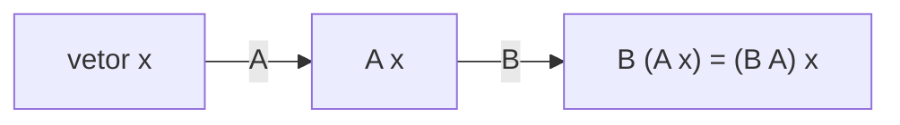

# Álgebra linear: vetores, matrizes, transformações

## Por que isso importa

Álgebra linear é a matemática mais usada da computação moderna. Cada imagem é uma matriz de pixels; cada filtro do Instagram é uma operação sobre ela. Jogos e interfaces giram, escalam e movem objetos multiplicando matrizes, e as GPUs existem para fazer exatamente isso bilhões de vezes por segundo. Redes neurais (IA-03) são, no fundo, multiplicações de matrizes intercaladas com funções simples. Sistemas de recomendação, o PageRank do Google, compressão de imagens, busca semântica com embeddings (vetores de texto comparados por ângulo) e regressão linear (IA-02): tudo álgebra linear. Saber o que uma matriz **faz** torna esse mundo legível.

## Intuição

Um **vetor** é uma seta: uma direção e um tamanho, ou simplesmente uma lista de números (preço, área, quartos de um imóvel). Somar vetores é andar uma seta e depois a outra; multiplicar por um número é esticar ou encolher.

Uma **matriz** é uma **máquina de transformar o espaço**: você dá um vetor e ela devolve outro. Ela é "linear" porque mantém a grade do espaço reta e igualmente espaçada: linhas continuam linhas, a origem fica parada. Girar, esticar, espelhar, inclinar: tudo isso é uma matriz 2×2. E o segredo para ler uma matriz: **as colunas dizem para onde vão os vetores da base**. A primeira coluna é onde o vetor (1, 0) vai parar; a segunda, onde vai parar o (0, 1).

Multiplicar duas matrizes é **aplicar uma transformação depois da outra**. Por isso a ordem importa: girar e depois esticar não é o mesmo que esticar e depois girar.

## Visual

A matriz de rotação de 90° mostrada pelas colunas:

```text
          ┌ 0  -1 ┐         (1, 0) vai para (0, 1)   ← primeira coluna
R(90°) =  │       │
          └ 1   0 ┘         (0, 1) vai para (-1, 0)  ← segunda coluna

   y                              y
   │  ↑ ĵ                    ← R ĵ │
   │  │                      ──────┤
   │  └──→ î                       │ ↑ R î
   └──────── x                     └─┴────── x
```

Transformações comuns em 2D:

```text
escala (sx, sy)     rotação θ                 cisalhamento         reflexão no eixo x
┌ sx  0 ┐           ┌ cos θ  -sen θ ┐         ┌ 1  k ┐              ┌ 1   0 ┐
└ 0  sy ┘           └ sen θ   cos θ ┘         └ 0  1 ┘              └ 0  -1 ┘
det = sx·sy         det = 1                    det = 1               det = -1
```



## Conceito técnico

### Vetores

- Soma e escala componente a componente: (1, 2) + (3, 1) = (4, 3); 2·(1, 2) = (2, 4).
- **Produto escalar**: u · v = Σ uᵢvᵢ = |u|·|v|·cos θ. É zero quando são **perpendiculares**; positivo quando apontam para o mesmo lado.
- **Norma** (tamanho): |v| = √(v · v). **Normalizar**: v / |v| tem tamanho 1.
- **Similaridade de cosseno**: cos θ = u·v / (|u||v|). É assim que se compara a semelhança de documentos e embeddings, ignorando o tamanho.
- **Projeção** de u sobre v: (u·v / v·v)·v. A "sombra" de u na direção de v.
- Em 3D, o **produto vetorial** u × v dá um vetor perpendicular aos dois (normais de superfícies em gráficos 3D).

### Matrizes e transformações lineares

- Uma matriz m×n leva vetores de n dimensões em vetores de m dimensões.
- **Ax** = combinação das colunas de A com os pesos de x.
- **Produto de matrizes**: (AB)ᵢⱼ = linha i de A · coluna j de B. Só existe se o número de colunas de A é igual ao de linhas de B. Custa O(n³) de forma direta. **Não é comutativo** (AB ≠ BA em geral), mas é associativo.
- **Identidade** I: não muda nada. **Transposta** Aᵀ: troca linhas por colunas.

### Sistemas lineares

Um sistema como 2x + y = 5, x - y = 1 é **Ax = b**. A **eliminação de Gauss** usa operações de linha (trocar, multiplicar, somar múltiplos) para chegar a uma forma triangular e depois resolver de baixo para cima. Custo O(n³).

- Uma solução, nenhuma (retas paralelas) ou infinitas (retas coincidentes).
- Na prática, **pivoteamento parcial** (escolher o maior pivô da coluna) evita divisões por números minúsculos que amplificam erros de arredondamento. Use `numpy.linalg.solve`.

### Determinante, inversa e posto

- O **determinante** é o fator pelo qual a transformação multiplica **áreas** (2D) ou volumes (3D). det = 0 quer dizer que o espaço foi achatado numa dimensão menor: a transformação perde informação. Negativo: inverte a orientação (espelho). Para 2×2: ad - bc.
- A **inversa** A⁻¹ desfaz A: A⁻¹A = I. Existe se e só se det ≠ 0. Para resolver Ax = b, quase nunca calcule a inversa: elimine.
- O **posto** é a dimensão do espaço de saída (quantas colunas independentes). Vetores são **linearmente independentes** se nenhum é combinação dos outros.

### Coordenadas homogêneas

Translação (mover) **não** é linear: a origem sai do lugar. O truque dos gráficos é acrescentar uma coordenada: o ponto (x, y) vira (x, y, 1), e a translação vira uma matriz 3×3:

```text
┌ 1  0  tx ┐ ┌ x ┐   ┌ x + tx ┐
│ 0  1  ty │ │ y │ = │ y + ty │
└ 0  0  1  ┘ └ 1 ┘   └   1    ┘
```

Agora rotação, escala e translação são todas matrizes, e uma sequência inteira de transformações vira **uma única matriz** (o produto delas), aplicada a milhares de vértices. Em 3D, matrizes 4×4 fazem também a **projeção em perspectiva**. É isso que o CSS `transform`, o canvas, o OpenGL e os motores de jogos fazem.

### Autovalores e autovetores

Um **autovetor** de A é uma direção que A apenas estica (ou encolhe, ou inverte), sem girar: Av = λv. O fator λ é o **autovalor**.

- Aplicar A muitas vezes faz quase todo vetor se alinhar com o autovetor de maior |λ| (**método da potência**). O **PageRank** é o autovetor da matriz de links da web: a distribuição estável de um navegante aleatório.
- **PCA** (análise de componentes principais) usa os autovetores da matriz de covariância para achar as direções de maior variação dos dados e reduzir dimensões.
- A **SVD** (decomposição em valores singulares) generaliza a ideia para qualquer matriz: compressão de imagens, sistemas de recomendação, busca semântica.

## Código

Matrizes como transformações: o que acontece com o quadrado unitário, como a composição depende da ordem e como o determinante mede a área.

```python
import math

def mat_vec(A, v):
    return [sum(a * x for a, x in zip(linha, v)) for linha in A]

def mat_mat(A, B):
    return [[sum(A[i][k] * B[k][j] for k in range(len(B))) for j in range(len(B[0]))] for i in range(len(A))]

def det2(A):
    return A[0][0] * A[1][1] - A[0][1] * A[1][0]

def rot(graus):
    t = math.radians(graus)
    return [[math.cos(t), -math.sin(t)], [math.sin(t), math.cos(t)]]

def fmt(v):
    return "(" + ", ".join(f"{x:5.2f}" for x in v) + ")"

quadrado = [[0, 0], [1, 0], [1, 1], [0, 1]]
escala = [[2, 0], [0, 1]]
cisalha = [[1, 1], [0, 1]]

for nome, M in [("escala x2 em x", escala), ("rotação 90°", rot(90)), ("cisalhamento", cisalha)]:
    print(f"{nome:15} det = {det2(M):5.2f}   quadrado vira", " ".join(fmt(mat_vec(M, p)) for p in quadrado))

a = mat_mat(rot(90), escala)     # primeiro escala, depois gira
b = mat_mat(escala, rot(90))     # primeiro gira, depois escala
print("gira∘escala aplicado a (1, 0):", fmt(mat_vec(a, [1, 0])))
print("escala∘gira aplicado a (1, 0):", fmt(mat_vec(b, [1, 0])))

# Similaridade de cosseno entre "documentos" (contagens de palavras)
def cos_sim(u, v):
    return sum(x * y for x, y in zip(u, v)) / (math.sqrt(sum(x * x for x in u)) * math.sqrt(sum(y * y for y in v)))
doc_python = [5, 3, 0, 1]   # python, código, receita, dados
doc_dados = [4, 2, 0, 6]
doc_bolo = [0, 0, 7, 1]
print(f"python x dados: {cos_sim(doc_python, doc_dados):.2f}   python x bolo: {cos_sim(doc_python, doc_bolo):.2f}")
```

## Erros comuns

- **Multiplicar matrizes elemento a elemento** achando que é o produto de matrizes (`*` contra `@` no NumPy).
- **Esquecer que AB ≠ BA**: a ordem das transformações importa (e a convenção: quem é aplicado primeiro fica à direita).
- **Dimensões incompatíveis**: (2×3)·(2×3) não existe.
- **Calcular a inversa para resolver um sistema**: mais lento e menos preciso que eliminar.
- **Testar `det == 0` com ponto flutuante**: use uma tolerância ou o número de condição.
- **Graus contra radianos** nas matrizes de rotação.
- **Achar que translação é linear**: precisa de coordenadas homogêneas.
- **Comparar embeddings pela distância bruta** quando o que importa é a direção (cosseno).

## Pratique

```quiz
id: MC-04-q1
tipo: multipla_escolha
pergunta: "Qual o produto escalar de u = (1, 2, 3) e v = (4, -5, 2), e o que ele indica?"
opcoes: ["0: os vetores são perpendiculares", "0: os vetores são paralelos", "12: apontam na mesma direção", "-6: apontam em sentidos opostos"]
resposta: 0
explicacao: "1·4 + 2·(-5) + 3·2 = 4 - 10 + 6 = 0. Produto escalar zero significa ângulo de 90°: os vetores são ortogonais."
dificuldade: 1
```

```quiz
id: MC-04-q2
tipo: multipla_escolha
pergunta: "A matriz [[0, 1], [1, 0]] (colunas (0, 1) e (1, 0)) faz o quê com o plano?"
opcoes: ["Gira 90°", "Reflete em torno da reta y = x, trocando x com y", "Dobra o tamanho", "Achata tudo numa reta"]
resposta: 1
explicacao: "As colunas dizem para onde vão os vetores da base: (1, 0) vai para (0, 1) e (0, 1) vai para (1, 0). É a reflexão na diagonal; o determinante é -1, sinal de que a orientação foi invertida."
dificuldade: 2
```

```quiz
id: MC-04-q3
tipo: verdadeiro_falso
pergunta: "Se det(A) = 0, o sistema Ax = b tem exatamente uma solução."
resposta: false
explicacao: "Determinante zero significa que A achata o espaço: ela não é inversível. O sistema tem nenhuma solução ou infinitas, dependendo de b estar ou não no espaço achatado. Solução única exige det ≠ 0."
dificuldade: 1
```

```quiz
id: MC-04-q4
tipo: multipla_escolha
pergunta: "Por que motores gráficos usam matrizes 3×3 (em 2D) e 4×4 (em 3D) em vez de 2×2 e 3×3?"
opcoes: ["Por tradição", "Para representar a translação como multiplicação de matriz (coordenadas homogêneas) e assim combinar qualquer sequência de transformações numa só matriz", "Para guardar a cor dos pontos", "Porque GPUs não multiplicam matrizes 2×2"]
resposta: 1
explicacao: "Translação não é linear (move a origem). Com a coordenada extra 1, ela vira multiplicação; então rotações, escalas e translações se compõem num único produto, aplicado a todos os vértices. Em 3D, a 4×4 também permite a projeção em perspectiva."
dificuldade: 2
```

```quiz
id: MC-04-q5
tipo: resposta_curta
pergunta: "O que é um autovetor de uma matriz, e dê um exemplo de aplicação."
resposta: "É um vetor cuja direção não muda quando a matriz é aplicada: ela só o multiplica por um número, o autovalor (Av = λv). Aplicações: o PageRank é o autovetor dominante da matriz de links; o PCA usa autovetores da covariância para achar as direções de maior variação e reduzir dimensões."
palavras_chave: ["direção", "autovalor", "PageRank", "PCA"]
dificuldade: 2
```

```quiz
id: MC-04-q6
tipo: codigo
linguagem: python
pergunta: |
  **Produto de matrizes.** Escreva `multiplicar(A, B)` para matrizes como listas de listas. Se o número de colunas de `A` for diferente do número de linhas de `B`, devolva `None`. Não use bibliotecas.
codigo_inicial: |
  def multiplicar(A, B):
      return [[a * b for a, b in zip(la, lb)] for la, lb in zip(A, B)]
usa: [def, for, if, return]
testes:
  - chamada: "multiplicar([[1, 2], [3, 4]], [[5, 6], [7, 8]])"
    saida: "[[19, 22], [43, 50]]"
  - chamada: "multiplicar([[1, 2, 3]], [[1], [0], [2]])"
    saida: "[[7]]"
  - chamada: "multiplicar([[1, 2]], [[1, 2]])"
    saida: "None"
  - chamada: "multiplicar([[0, -1], [1, 0]], [[0, -1], [1, 0]])"
    visivel: false
    saida: "[[-1, 0], [0, -1]]"
  - chamada: "multiplicar([[1], [2]], [[3, 4]])"
    visivel: false
    saida: "[[3, 4], [6, 8]]"
  - chamada: "multiplicar([[2, 0], [0, 2]], [[1, 2, 3], [4, 5, 6]])"
    visivel: false
    saida: "[[2, 4, 6], [8, 10, 12]]"
dica: "O resultado tem len(A) linhas e len(B[0]) colunas. A posição (i, j) é a soma de A[i][k] * B[k][j] para k de 0 a len(B) - 1."
solucao: |
  def multiplicar(A, B):
      if len(A[0]) != len(B):
          return None
      linhas, colunas, meio = len(A), len(B[0]), len(B)
      C = [[0] * colunas for _ in range(linhas)]
      for i in range(linhas):
          for j in range(colunas):
              for k in range(meio):
                  C[i][j] += A[i][k] * B[k][j]
      return C
explicacao: "O código inicial multiplica elemento a elemento, um erro comum (é o * do NumPy, enquanto o produto de matrizes é o @). O primeiro teste oculto multiplica a rotação de 90° por ela mesma e obtém a rotação de 180° (que inverte os dois eixos): compor transformações é multiplicar matrizes. O último mostra que (2×2)·(2×3) dá 2×3. São três laços, O(n³); bibliotecas como BLAS fazem o mesmo cálculo dezenas de vezes mais rápido usando cache e SIMD (AC-05)."
dificuldade: 1
```

```quiz
id: MC-04-q7
tipo: codigo
linguagem: python
pergunta: |
  **Eliminação de Gauss exata.** Escreva `resolver(A, b)`, que resolve `Ax = b` (A quadrada) com `Fraction` para não ter erro de arredondamento, e devolve a lista de soluções ou `None` se a matriz for singular (não houver solução única). Faça a eliminação com troca de linhas quando o pivô for zero, e depois a substituição de trás para frente.
codigo_inicial: |
  from fractions import Fraction

  def resolver(A, b):
      return [Fraction(x) for x in b]
usa: [def, for, if, return, Fraction]
testes:
  - chamada: "resolver([[2, 1], [1, -1]], [5, 1])"
    saida: "[Fraction(2, 1), Fraction(1, 1)]"
  - chamada: "resolver([[1, 2], [2, 4]], [3, 6])"
    saida: "None"
  - chamada: "resolver([[0, 1], [1, 0]], [7, 3])"
    saida: "[Fraction(3, 1), Fraction(7, 1)]"
  - chamada: "resolver([[2, 1, -1], [-3, -1, 2], [-2, 1, 2]], [8, -11, -3])"
    visivel: false
    saida: "[Fraction(2, 1), Fraction(3, 1), Fraction(-1, 1)]"
  - chamada: "resolver([[3, 1], [1, 2]], [1, 1])"
    visivel: false
    saida: "[Fraction(1, 5), Fraction(2, 5)]"
  - chamada: "resolver([[1, 1, 1], [1, 2, 3], [2, 3, 4]], [1, 2, 3])"
    visivel: false
    saida: "None"
dica: "Monte a matriz aumentada M com Fraction. Para cada coluna c: ache uma linha r >= c com M[r][c] != 0 (senão devolva None), troque com a linha c, e zere M[i][c] nas linhas abaixo subtraindo um múltiplo da linha c. Depois, de baixo para cima: x[i] = (M[i][n] - soma de M[i][j] * x[j] para j > i) / M[i][i]."
solucao: |
  from fractions import Fraction

  def resolver(A, b):
      n = len(A)
      M = [[Fraction(v) for v in A[i]] + [Fraction(b[i])] for i in range(n)]
      for c in range(n):
          pivo = next((r for r in range(c, n) if M[r][c] != 0), None)
          if pivo is None:
              return None
          M[c], M[pivo] = M[pivo], M[c]
          for i in range(c + 1, n):
              fator = M[i][c] / M[c][c]
              for j in range(c, n + 1):
                  M[i][j] -= fator * M[c][j]
      x = [Fraction(0)] * n
      for i in range(n - 1, -1, -1):
          soma = sum(M[i][j] * x[j] for j in range(i + 1, n))
          x[i] = (M[i][n] - soma) / M[i][i]
      return x
explicacao: "A troca de linhas resolve o terceiro teste, em que o primeiro pivô é zero. Os testes com None são matrizes singulares: no segundo, a segunda equação é o dobro da primeira (retas coincidentes); no último, a terceira linha é a soma das duas primeiras. Com Fraction o resultado é exato; com floats, o pivoteamento parcial (escolher o maior pivô) seria essencial para controlar os erros de arredondamento."
dificuldade: 3
```

```quiz
id: MC-04-q8
tipo: codigo
linguagem: javascript
pergunta: |
  **Transformações 2D com coordenadas homogêneas.** Escreva `transformar(pontos, ops)`. `pontos` é uma lista de `[x, y]` e `ops` uma lista de operações aplicadas **na ordem**: `['escala', sx, sy]`, `['rotacao', graus]` (anti-horária, em torno da origem) e `['translacao', tx, ty]`. Monte a matriz 3×3 de cada operação, **componha todas numa única matriz** e aplique a cada ponto. Arredonde as coordenadas a 2 casas e some 0 para evitar `-0`.
codigo_inicial: |
  function transformar(pontos, ops) {
    return pontos;
  }
usa: [function, for, return]
testes:
  - chamada: "transformar([[1, 0]], [['rotacao', 90]])"
    saida: "[ [ 0, 1 ] ]"
  - chamada: "transformar([[1, 1], [2, 0]], [['escala', 2, 3], ['translacao', 1, -1]])"
    saida: "[ [ 3, 2 ], [ 5, -1 ] ]"
  - chamada: "transformar([[1, 0]], [['translacao', 1, 0], ['rotacao', 90]])"
    saida: "[ [ 0, 2 ] ]"
  - chamada: "transformar([[1, 0]], [['rotacao', 90], ['translacao', 1, 0]])"
    visivel: false
    saida: "[ [ 1, 1 ] ]"
  - chamada: "transformar([[2, 2], [0, 0]], [['translacao', -1, -1], ['rotacao', 45], ['translacao', 1, 1]])"
    visivel: false
    saida: "[ [ 1, 2.41 ], [ 1, -0.41 ] ]"
  - chamada: "transformar([[3, 4]], [])"
    visivel: false
    saida: "[ [ 3, 4 ] ]"
dica: "Crie mult(A, B) para 3×3. Comece com a identidade M e, para cada operação com matriz T, faça M = mult(T, M) (a nova transformação vai à esquerda, porque é aplicada depois). Aplique M a [x, y, 1]."
solucao: |
  function mult(A, B) {
    const C = [[0, 0, 0], [0, 0, 0], [0, 0, 0]];
    for (let i = 0; i < 3; i++) {
      for (let j = 0; j < 3; j++) {
        for (let k = 0; k < 3; k++) C[i][j] += A[i][k] * B[k][j];
      }
    }
    return C;
  }

  function matriz(op) {
    if (op[0] === 'escala') return [[op[1], 0, 0], [0, op[2], 0], [0, 0, 1]];
    if (op[0] === 'translacao') return [[1, 0, op[1]], [0, 1, op[2]], [0, 0, 1]];
    const t = (op[1] * Math.PI) / 180;
    return [[Math.cos(t), -Math.sin(t), 0], [Math.sin(t), Math.cos(t), 0], [0, 0, 1]];
  }

  function transformar(pontos, ops) {
    let M = [[1, 0, 0], [0, 1, 0], [0, 0, 1]];
    for (const op of ops) M = mult(matriz(op), M);
    const arred = (v) => Math.round(v * 100) / 100 + 0;
    const resultado = [];
    for (const [x, y] of pontos) {
      resultado.push([arred(M[0][0] * x + M[0][1] * y + M[0][2]), arred(M[1][0] * x + M[1][1] * y + M[1][2])]);
    }
    return resultado;
  }
explicacao: "O terceiro teste e o primeiro oculto usam as mesmas duas operações em ordens diferentes e chegam a pontos diferentes: transladar e girar não comutam. O penúltimo é o padrão para girar em torno de um ponto que não é a origem (aqui, (1, 1)): leve o centro à origem, gire e devolva. Compor tudo numa matriz única antes de aplicar é o que permite à GPU transformar milhões de vértices com uma multiplicação cada."
dificuldade: 3
```

## Resumo

- **Vetores**: soma, escala, **produto escalar** (ângulo, perpendicularidade), norma, projeção, similaridade de cosseno.
- **Matrizes são transformações**; as **colunas** são as imagens da base; produto = **composição**, não comutativo.
- **Sistemas lineares** por **eliminação de Gauss** (com pivoteamento); determinante = fator de área; det = 0 ⇒ sem inversa.
- **Coordenadas homogêneas** tornam a translação uma matriz: toda a cadeia de transformações vira uma só.
- **Autovetores** são direções preservadas: PageRank, PCA, SVD.

## Para ir além

- Assista à série Essence of Linear Algebra do 3Blue1Brown inteira: é a melhor intuição disponível.
- Refaça os desafios com NumPy (`@`, `np.linalg.solve`, `np.linalg.eig`) e compare a velocidade com matrizes 500×500.
- Implemente o método da potência e calcule o PageRank de um grafo pequeno de páginas.
- **Próximo módulo**: MC-05 Probabilidade e estatística.
