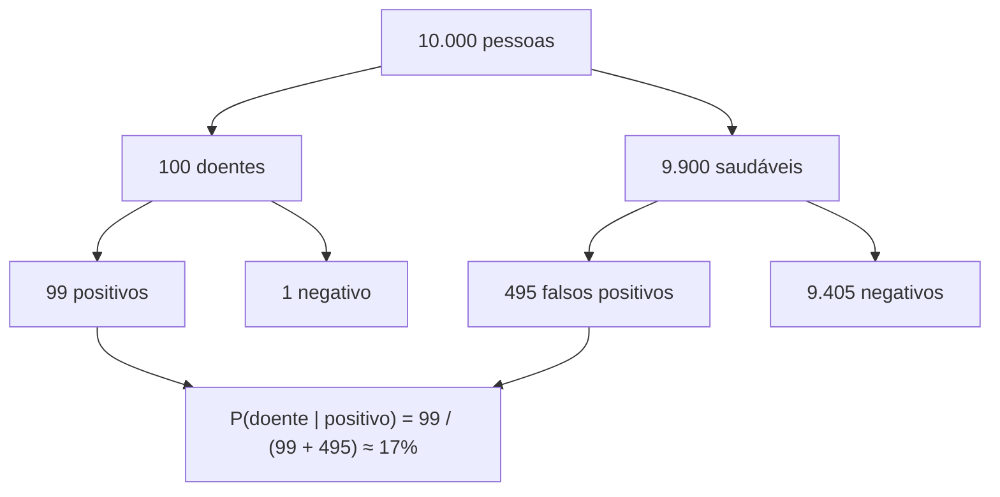

# Probabilidade e estatística

## Por que isso importa

Programar é lidar com incerteza o tempo todo: quanto tempo uma requisição leva (SD-01), quantos acessos chegam por segundo (SD-04), se a nova versão do botão aumentou mesmo as vendas (teste A/B), se um e-mail é spam, se uma transação é fraude. Aprendizado de máquina (trilha de IA) é estatística com muito dado e computação. E bugs de raciocínio estatístico custam caro: decidir com base em amostras pequenas, olhar só a média de latências, acreditar num exame positivo sem considerar a raridade da doença. Este módulo dá as ferramentas para quantificar o acaso e decidir com dados, continuando o que a combinatória do MD-05 começou com eventos discretos.

## Intuição

Jogue uma moeda 10 vezes e você pode ver 7 caras. Jogue 10.000 e vai ver algo muito perto de 5.000. A **probabilidade** descreve o comportamento de longo prazo; a **estatística** faz o caminho inverso: olhando os resultados que você viu, o que dá para concluir sobre a moeda?

Duas ideias carregam quase tudo:

- **Médias de muitas coisas aleatórias são previsíveis**, e sua distribuição tem formato de sino (a curva **normal**), qualquer que seja a forma das coisas somadas. É o teorema central do limite, e é por isso que pesquisas eleitorais funcionam com 2.000 entrevistas.
- **Atualizar crenças com evidência** (Bayes): um exame "99% preciso" para uma doença rara ainda erra a maioria das vezes que dá positivo, porque os poucos doentes são superados pelos falsos positivos entre os muitos saudáveis.

## Visual

As distribuições do dia a dia:

```text
Bernoulli(p)        um sim/não: clique ou não clique                         média p
Binomial(n, p)      quantos sim em n tentativas: cliques em 1000 visitas      média np
Poisson(λ)          contagens de eventos raros num intervalo: requisições/s   média λ
Uniforme(a, b)      qualquer valor no intervalo, igualmente provável          média (a+b)/2
Exponencial(λ)      tempo até o próximo evento: entre duas requisições       média 1/λ
Normal(μ, σ)        sino: alturas, erros de medição, médias de amostras      média μ
```

A regra 68-95-99,7 da normal:

```text
                    ▁▃▆██▆▃▁
                 ▁▃█████████▃▁
             ▁▂▅███████████████▅▂▁
   ──────┬──────┬──────┬──────┬──────┬──────┬──────
       μ-3σ   μ-2σ   μ-σ     μ     μ+σ   μ+2σ   μ+3σ
                     └─── 68% ───┘
              └──────── 95% ────────┘
       └──────────── 99,7% ────────────┘
```

Bayes num exame (prevalência 1%, sensibilidade 99%, especificidade 95%), para 10.000 pessoas:



## Conceito técnico

### Variáveis aleatórias, esperança e variância

- Uma **variável aleatória** associa um número a cada resultado. **Discreta** (contagens) tem função de probabilidade P(X = k); **contínua** (tempo, altura) tem **densidade** f(x), e probabilidades são **áreas**: P(a ≤ X ≤ b) = ∫ₐᵇ f(x) dx (MC-02). Para contínuas, P(X = um valor exato) = 0.
- **Esperança** (média de longo prazo): E[X] = Σ x·P(X = x) ou ∫ x·f(x) dx. É linear: E[X + Y] = E[X] + E[Y], sempre.
- **Variância**: Var(X) = E[(X - μ)²], o espalhamento. O **desvio padrão** σ = √Var tem a mesma unidade dos dados. Para X e Y independentes, Var(X + Y) = Var(X) + Var(Y).

### Probabilidade condicional e Bayes

- P(A | B) = P(A e B) / P(B): a probabilidade de A **sabendo** B.
- A e B são **independentes** se P(A | B) = P(A).
- **Teorema de Bayes**: P(A | B) = P(B | A)·P(A) / P(B). Atualiza a crença inicial P(A) (a priori) com a evidência B, gerando a posterior.
- A **falácia da taxa-base**: ignorar P(A). O exemplo do exame acima: 99% de sensibilidade, mas só 17% de chance de doença dado um positivo.
- Filtros de spam bayesianos, diagnóstico, classificação (Naive Bayes) e sistemas de recomendação usam essa conta.

### Lei dos grandes números e teorema central do limite

- **Lei dos grandes números**: a média de n amostras independentes converge para a esperança quando n cresce. É o que justifica Monte Carlo (MC-02) e simulações.
- **Teorema central do limite** (TCL): a média de n amostras independentes, com média μ e desvio σ, tem distribuição aproximadamente **normal** com média μ e desvio **σ/√n** (o **erro padrão**), qualquer que seja a distribuição original. Para ter metade do erro, é preciso **quatro vezes** mais dados.

### Estatística descritiva

- **Média** (sensível a extremos), **mediana** (o valor do meio, robusta) e **moda**.
- **Variância e desvio padrão amostrais** dividem por n - 1 (correção de Bessel), porque a média amostral já "usou" um grau de liberdade.
- **Percentis** e quartis (SD-01): p50, p95, p99. Para latências, salários e preços de imóveis, a mediana e os percentis dizem mais que a média.
- **Correlação** (de -1 a 1) mede associação linear, e **correlação não é causalidade**: sorvete e afogamentos sobem juntos no verão.
- Sempre **visualize** os dados: o quarteto de Anscombe tem médias, variâncias e correlações idênticas e gráficos completamente diferentes.

### Inferência: intervalos e testes

- **Intervalo de confiança** de 95% para a média: média ± 1,96·(s/√n). Interpretação correta: o **método** captura o valor real em 95% das amostras.
- **Teste de hipótese**: assuma a hipótese nula H₀ ("o botão novo não muda nada"), calcule quão improvável é o que você observou sob H₀ (o **p-valor**). Se p < 0,05 (escolhido antes), rejeite H₀.
- O p-valor **não** é a probabilidade de H₀ ser verdadeira, nem o tamanho do efeito. Um efeito minúsculo fica "significativo" com dados suficientes; olhe também o **tamanho do efeito** e o intervalo.
- **Teste A/B** de proporções: com conversões pA e pB, use a proporção combinada p, o erro padrão √(p(1 - p)(1/nA + 1/nB)) e z = (pB - pA)/EP. |z| ≥ 1,96 corresponde a p < 0,05 (bilateral).
- Armadilhas: **olhar o resultado todo dia e parar quando ficar significativo** (peeking), testar 20 métricas e comemorar a que deu p < 0,05 (comparações múltiplas), amostras enviesadas, efeito novidade. Defina o tamanho da amostra antes.

## Código

O teorema central do limite em ação: médias de lançamentos de dado, um dado com distribuição uniforme, viram um sino cada vez mais estreito.

```python
import random, statistics

random.seed(42)

def histograma(valores, minimo, maximo, faixas=12, largura=40):
    contagem = [0] * faixas
    for v in valores:
        i = min(int((v - minimo) / (maximo - minimo) * faixas), faixas - 1)
        contagem[i] += 1
    topo = max(contagem)
    for i, c in enumerate(contagem):
        inicio = minimo + i * (maximo - minimo) / faixas
        print(f"   {inicio:4.2f} | " + "█" * round(c / topo * largura))

for n in [1, 2, 10, 50]:
    medias = [statistics.mean(random.randint(1, 6) for _ in range(n)) for _ in range(5000)]
    print(f"média de {n} dados: média {statistics.mean(medias):.3f}, desvio {statistics.stdev(medias):.3f} (teórico {1.708 / n ** 0.5:.3f})")
    histograma(medias, 0.5, 6.5, faixas=6 if n == 1 else 15)
```

Com 1 dado a distribuição é plana; com 10, já é um sino; e o desvio cai como 1/√n, como o TCL prevê (1,708 é o desvio de um único dado).

## Erros comuns

- **Ignorar a taxa-base** (prevalência) ao interpretar testes e alarmes.
- **Usar só a média** em dados assimétricos (latência, renda): use mediana e percentis.
- **Dividir por n em vez de n - 1** no desvio amostral (em amostras pequenas faz diferença).
- **Achar que correlação implica causa.**
- **Interpretar o p-valor como "probabilidade de a hipótese ser verdadeira".**
- **Parar o teste A/B assim que fica significativo**, ou testar muitas variações sem corrigir.
- **Amostras pequenas**: 3 de 5 usuários preferiram não diz nada.
- **Supor independência** onde não há (requisições do mesmo usuário, falhas em cascata, SD-01).
- **Falácia do apostador**: depois de 5 caras, a próxima continua 50%.

## Pratique

```quiz
id: MC-05-q1
tipo: multipla_escolha
pergunta: "Uma doença atinge 1% da população. Um exame tem sensibilidade de 99% e especificidade de 95%. Uma pessoa aleatória testa positivo. Qual a probabilidade aproximada de ela ter a doença?"
opcoes: ["99%", "95%", "Cerca de 17%", "1%"]
resposta: 2
explicacao: "Em 10.000 pessoas: 100 doentes, 99 positivos verdadeiros; 9.900 saudáveis, 5% (495) falsos positivos. P = 99 / (99 + 495) ≈ 16,7%. A raridade da doença faz os falsos positivos dominarem."
dificuldade: 2
```

```quiz
id: MC-05-q2
tipo: multipla_escolha
pergunta: "Os tempos de resposta de uma API foram 20, 22, 21, 25, 23 e 900 ms. Qual medida descreve melhor a experiência típica?"
opcoes: ["A média, cerca de 168 ms", "A mediana, 22,5 ms", "O máximo, 900 ms", "A variância"]
resposta: 1
explicacao: "A média é puxada pelo valor extremo e não representa ninguém. A mediana mostra o típico, e o p99 ou o máximo mostram a cauda, que também importa (SD-01). Em latência, use percentis, não médias."
dificuldade: 1
```

```quiz
id: MC-05-q3
tipo: verdadeiro_falso
pergunta: "Pelo teorema central do limite, para reduzir pela metade o erro padrão da média de uma pesquisa, basta dobrar o tamanho da amostra."
resposta: false
explicacao: "O erro padrão é σ/√n. Para dividi-lo por 2, √n precisa dobrar, ou seja, n precisa quadruplicar. É por isso que precisão estatística fica cara rapidamente."
dificuldade: 2
```

```quiz
id: MC-05-q4
tipo: multipla_escolha
pergunta: "Num teste A/B, o resultado deu p = 0,03. Qual a interpretação correta?"
opcoes: ["Há 97% de chance de a versão B ser melhor", "Se não houvesse diferença real entre as versões, uma diferença tão grande quanto a observada (ou maior) apareceria em cerca de 3% dos experimentos", "A versão B aumenta a conversão em 3%", "Há 3% de chance de a hipótese nula ser verdadeira"]
resposta: 1
explicacao: "O p-valor é calculado supondo que a hipótese nula vale. Ele não diz a probabilidade de a hipótese ser verdadeira nem o tamanho do efeito; para isso, olhe o intervalo de confiança da diferença."
dificuldade: 2
```

```quiz
id: MC-05-q5
tipo: resposta_curta
pergunta: "Por que olhar o resultado de um teste A/B todos os dias e parar no primeiro dia em que p < 0,05 é um erro?"
resposta: "Porque o p-valor oscila com o acaso, e cada olhada é uma nova chance de cruzar 0,05 por sorte. Parar no primeiro cruzamento aumenta muito a taxa de falsos positivos acima dos 5% prometidos. O correto é definir o tamanho da amostra antes e analisar só no fim, ou usar métodos sequenciais feitos para isso."
palavras_chave: ["acaso", "falsos positivos", "tamanho da amostra", "antes"]
dificuldade: 2
```

```quiz
id: MC-05-q6
tipo: codigo
linguagem: python
pergunta: |
  **Estatística descritiva.** Escreva `resumo(dados)`, que devolve um dicionário com `'media'`, `'mediana'` e `'desvio'` (desvio padrão **amostral**, dividindo por n - 1), todos arredondados a 2 casas, **sem** o módulo `statistics`. Com menos de 2 valores, o desvio é `0.0`. Para quantidade par de valores, a mediana é a média dos dois do meio.
codigo_inicial: |
  def resumo(dados):
      media = sum(dados) / len(dados)
      return {'media': round(media, 2), 'mediana': round(media, 2), 'desvio': 0.0}
usa: [def, for, return, sorted]
testes:
  - chamada: "resumo([2, 4, 4, 4, 5, 5, 7, 9])"
    saida: "{'media': 5.0, 'mediana': 4.5, 'desvio': 2.14}"
  - chamada: "resumo([20, 22, 21, 25, 23, 900])"
    saida: "{'media': 168.5, 'mediana': 22.5, 'desvio': 358.36}"
  - chamada: "resumo([7])"
    saida: "{'media': 7.0, 'mediana': 7, 'desvio': 0.0}"
  - chamada: "resumo([1, 2, 3])"
    visivel: false
    saida: "{'media': 2.0, 'mediana': 2, 'desvio': 1.0}"
  - chamada: "resumo([10, 10, 10, 10])"
    visivel: false
    saida: "{'media': 10.0, 'mediana': 10.0, 'desvio': 0.0}"
dica: "Ordene com sorted. Para a mediana: com n ímpar, o elemento do meio; com n par, a média dos dois do meio. O desvio é a raiz de soma((x - media) ** 2) / (n - 1)."
solucao: |
  def resumo(dados):
      n = len(dados)
      media = sum(dados) / n
      ordenados = sorted(dados)
      meio = n // 2
      if n % 2:
          mediana = ordenados[meio]
      else:
          mediana = (ordenados[meio - 1] + ordenados[meio]) / 2
      desvio = 0.0
      if n > 1:
          soma = 0
          for x in dados:
              soma += (x - media) ** 2
          desvio = (soma / (n - 1)) ** 0.5
      return {'media': round(media, 2), 'mediana': round(mediana, 2), 'desvio': round(desvio, 2)}
explicacao: "O segundo teste é o exemplo das latências: um único valor extremo leva a média a 168,5 e o desvio a 358, enquanto a mediana continua em 22,5. Dividir por n - 1 corrige o fato de a média ter sido estimada com os mesmos dados (com n, o desvio sairia sistematicamente menor). A mediana de quantidade ímpar mantém o tipo original (7, e não 7.0), como o statistics.median."
dificuldade: 1
```

```quiz
id: MC-05-q7
tipo: codigo
linguagem: python
pergunta: |
  **Teorema de Bayes.** Escreva `posterior(prevalencia, sensibilidade, especificidade)`, que devolve a probabilidade de uma pessoa ter a condição **dado que o teste deu positivo**, arredondada a 4 casas.

  - sensibilidade = P(positivo | doente);
  - especificidade = P(negativo | saudável), então P(positivo | saudável) = 1 - especificidade.
codigo_inicial: |
  def posterior(prevalencia, sensibilidade, especificidade):
      return round(sensibilidade, 4)
usa: [def, return]
testes:
  - chamada: "posterior(0.01, 0.99, 0.95)"
    saida: "0.1667"
  - chamada: "posterior(0.5, 0.9, 0.9)"
    saida: "0.9"
  - chamada: "posterior(0.001, 0.999, 0.999)"
    saida: "0.5"
  - chamada: "posterior(0.2, 0.8, 0.7)"
    visivel: false
    saida: "0.4"
  - chamada: "posterior(0.01, 0.99, 1.0)"
    visivel: false
    saida: "1.0"
dica: "P(positivo) = sensibilidade·prevalência + (1 - especificidade)·(1 - prevalência). A posterior é sensibilidade·prevalência / P(positivo)."
solucao: |
  def posterior(prevalencia, sensibilidade, especificidade):
      verdadeiros = sensibilidade * prevalencia
      falsos = (1 - especificidade) * (1 - prevalencia)
      return round(verdadeiros / (verdadeiros + falsos), 4)
explicacao: "O terceiro teste é o mais surpreendente: um exame 99,9% preciso para algo que atinge 1 em mil pessoas acerta só metade dos positivos. É a mesma conta de alarmes de fraude, detecção de intrusão e moderação automática: com eventos raros, até um classificador excelente gera muitos falsos positivos, e por isso se combinam testes (um segundo exame, uma revisão humana)."
dificuldade: 2
```

```quiz
id: MC-05-q8
tipo: codigo
linguagem: javascript
pergunta: |
  **Um teste A/B de verdade.** Escreva `testeAB(convA, nA, convB, nB)`, que compara as taxas de conversão das versões A e B com o teste z de duas proporções e devolve `{ taxaA, taxaB, z, significativo }`:

  - `taxaA = convA / nA`, `taxaB = convB / nB` (arredonde a 4 casas);
  - `p = (convA + convB) / (nA + nB)` e `ep = Math.sqrt(p * (1 - p) * (1 / nA + 1 / nB))`;
  - `z = (taxaB - taxaA) / ep` (use as taxas sem arredondar; arredonde z a 2 casas);
  - `significativo` é `true` se `|z| >= 1.96` (use o z arredondado).
codigo_inicial: |
  function testeAB(convA, nA, convB, nB) {
    const taxaA = convA / nA;
    const taxaB = convB / nB;
    return { taxaA, taxaB, z: 0, significativo: taxaB > taxaA };
  }
usa: [function, return]
testes:
  - chamada: "testeAB(200, 10000, 260, 10000)"
    saida: "{ taxaA: 0.02, taxaB: 0.026, z: 2.83, significativo: true }"
  - chamada: "testeAB(20, 1000, 26, 1000)"
    saida: "{ taxaA: 0.02, taxaB: 0.026, z: 0.9, significativo: false }"
  - chamada: "testeAB(50, 1000, 50, 1000)"
    saida: "{ taxaA: 0.05, taxaB: 0.05, z: 0, significativo: false }"
  - chamada: "testeAB(300, 5000, 240, 5000)"
    visivel: false
    saida: "{ taxaA: 0.06, taxaB: 0.048, z: -2.65, significativo: true }"
  - chamada: "testeAB(10000, 500000, 10800, 500000)"
    visivel: false
    saida: "{ taxaA: 0.02, taxaB: 0.0216, z: 5.61, significativo: true }"
dica: "Calcule as taxas, a proporção combinada p, o erro padrão ep e z. Arredonde com Math.round(x * 10000) / 10000 e Math.round(z * 100) / 100."
solucao: |
  function testeAB(convA, nA, convB, nB) {
    const ta = convA / nA;
    const tb = convB / nB;
    const p = (convA + convB) / (nA + nB);
    const ep = Math.sqrt(p * (1 - p) * (1 / nA + 1 / nB));
    const z = Math.round(((tb - ta) / ep) * 100) / 100;
    return {
      taxaA: Math.round(ta * 10000) / 10000,
      taxaB: Math.round(tb * 10000) / 10000,
      z,
      significativo: Math.abs(z) >= 1.96,
    };
  }
explicacao: "Os dois primeiros testes têm exatamente as mesmas taxas (2% contra 2,6%, uma melhora de 30%), mas só o de 10.000 visitas por braço é significativo: com 1.000, a diferença cabe no acaso. O teste oculto com z negativo mostra que o teste é bilateral: B pode ser significativamente pior. E o último mostra o outro lado: com amostras enormes, uma melhora de 2% para 2,16% pode ser 'significativa' e ainda assim pequena demais para importar; olhe sempre o tamanho do efeito."
dificuldade: 2
```

## Resumo

- Variáveis aleatórias **discretas** e **contínuas** (densidade, probabilidade como área); **esperança** é linear; **variância** e desvio padrão medem espalhamento.
- Distribuições: Bernoulli, binomial, Poisson, uniforme, exponencial, **normal** (68-95-99,7).
- **Condicional** e **Bayes**: não ignore a **taxa-base**.
- **Lei dos grandes números** e **TCL**: médias ficam normais, com erro padrão σ/√n.
- Descreva com **mediana e percentis** além da média; correlação não é causalidade.
- **Intervalos de confiança** e **testes de hipótese**; p-valor bem interpretado; testes A/B sem peeking e com tamanho de amostra definido antes.

## Para ir além

- Explore o Seeing Theory e simule o TCL com distribuições bem assimétricas (exponencial).
- Leia os capítulos de inferência do OpenIntro Statistics.
- Calcule com uma calculadora de tamanho de amostra quantos visitantes um teste A/B do seu projeto precisaria para detectar uma melhora de 10%.
- **Fim da trilha.** Com cálculo, álgebra linear e probabilidade, você tem a base matemática da trilha de IA e aprendizado de máquina.
