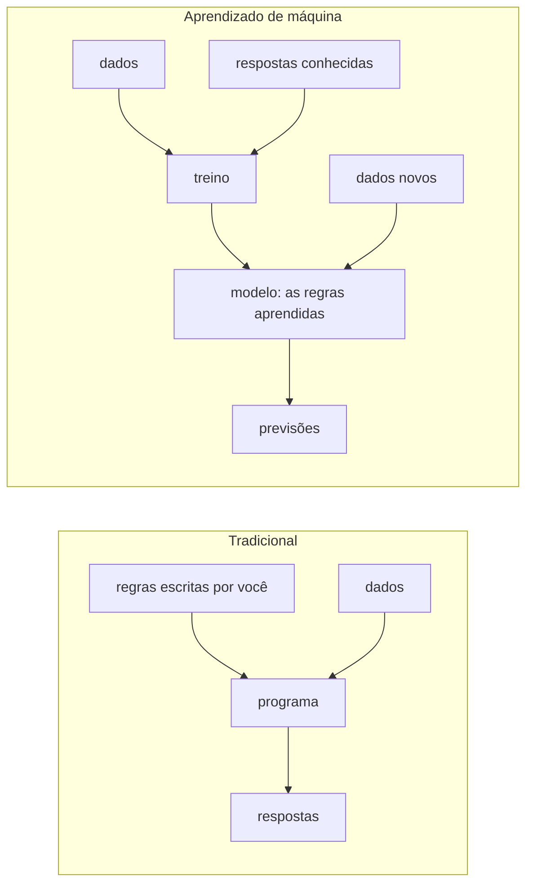

# O que é aprendizado de máquina: supervisionado × não supervisionado

## Por que isso importa

Tente escrever as regras para reconhecer um gato numa foto: "se tem orelhas pontudas e bigodes..." e logo você está perdido em exceções. Há problemas em que é muito mais fácil **mostrar exemplos** do que **escrever regras**: reconhecer rostos, filtrar spam, recomendar filmes, prever o preço de um imóvel, transcrever áudio, traduzir textos. **Aprendizado de máquina** (machine learning, ML) é a técnica de fazer o computador **descobrir as regras a partir dos dados**. Hoje ele está em quase todo produto digital, e os modelos de linguagem que conversam com você são o caso mais famoso. Mesmo sem ser especialista, toda pessoa desenvolvedora precisa entender o vocabulário, saber quando ML é a ferramenta certa e reconhecer os erros que fazem um modelo parecer bom e falhar em produção.

## Intuição

Como uma criança aprende o que é um cachorro? Ninguém dá a ela uma definição formal: os adultos apontam e dizem "cachorro", "gato", "cachorro" dezenas de vezes, e ela vai ajustando a ideia até acertar cachorros que nunca viu. Isso é **aprendizado supervisionado**: exemplos **com a resposta certa**.

Agora imagine dar a ela uma caixa de botões misturados, sem dizer nada. Ela provavelmente vai separá-los em grupos: os grandes, os pequenos, os dourados. Ninguém disse quais grupos existiam; ela encontrou **estrutura** sozinha. Isso é **aprendizado não supervisionado**.

E um cachorro que aprende a sentar porque ganha petisco quando acerta, sem que ninguém mostre a resposta, só a recompensa: é **aprendizado por reforço**.

## Visual

Programação tradicional contra aprendizado de máquina:



O vocabulário numa tabela de imóveis:

```text
                 atributos (features, X)                      rótulo (y)
            ┌──────────────────────────────────────┐        ┌──────────┐
exemplo 1   │ área 70 m² │ 2 quartos │ bairro Centro │   →    │ R$ 420 mil│
exemplo 2   │ área 120   │ 3         │ Boa Vista     │   →    │ R$ 780 mil│
exemplo 3   │ área 45    │ 1         │ Centro        │   →    │ R$ 260 mil│
  ...                                                           ...
novo        │ área 90    │ 2         │ Boa Vista     │   →    │    ???    │   ← previsão do modelo
```

## Conceito técnico

### Os tipos de aprendizado

- **Supervisionado**: dados com rótulos (a resposta certa).
  - **Classificação**: o rótulo é uma categoria. Spam ou não, qual dígito está na imagem, se a transação é fraude.
  - **Regressão**: o rótulo é um número. Preço do imóvel, tempo de entrega, demanda de amanhã (IA-02).
- **Não supervisionado**: sem rótulos; o objetivo é achar estrutura.
  - **Agrupamento** (clustering): segmentar clientes por comportamento (IA-04).
  - **Redução de dimensionalidade**: resumir 100 atributos em 2 para visualizar (PCA, MC-04).
  - **Detecção de anomalias**: o que destoa do normal (fraude, falha em sensor).
- **Auto-supervisionado**: os rótulos vêm dos próprios dados, como "qual é a próxima palavra deste texto?". É assim que os modelos de linguagem são pré-treinados em quantidades enormes de texto, sem ninguém rotular nada.
- **Por reforço**: um agente age num ambiente e recebe recompensas (jogos, robótica, e o ajuste fino de modelos de linguagem com preferências humanas).

### O fluxo de um projeto de ML

1. **Definir o problema** e a métrica de sucesso: o que errar custa? Um falso negativo de fraude custa mais que um falso positivo?
2. **Coletar e entender os dados**: de onde vêm, quem eles representam, o que falta.
3. **Preparar os atributos**: tratar valores faltando, converter categorias em números (one-hot), colocar escalas parecidas.
4. **Separar treino e teste**: o modelo aprende só com o treino e é avaliado no teste, que ele **nunca viu**. Isso simula dados novos.
5. **Comparar com uma linha de base** (baseline): o chute mais simples, como sempre prever a classe mais comum. Um modelo com 95% de acerto não impressiona se 95% dos e-mails já são "não spam".
6. **Treinar, avaliar, iterar** (IA-04 aprofunda a avaliação e o sobreajuste).
7. **Colocar em produção e monitorar**: os dados mudam com o tempo (drift), e o modelo envelhece.

### Um primeiro algoritmo: k-vizinhos mais próximos

O **k-NN** é o modelo mais simples de entender: para classificar um ponto novo, ache os **k exemplos de treino mais próximos** (distância euclidiana entre os vetores de atributos) e use o **voto da maioria**. Para regressão, use a média dos vizinhos.

- Não há "treino": o modelo é o próprio conjunto de dados. A previsão é que custa (comparar com todos).
- k pequeno segue cada detalhe (e o ruído); k grande suaviza demais.
- **Escala importa**: se um atributo vai de 0 a 1 e outro de 0 a 100.000, o segundo domina a distância. Normalize.

### Quando (não) usar ML

Use quando há um **padrão real**, ele é **difícil de escrever à mão**, e há **dados** suficientes e representativos. Não use quando uma regra simples resolve (validar CPF não precisa de rede neural), quando os erros não podem ser explicados ou tolerados, ou quando não há dados. E lembre: **o modelo aprende o que está nos dados**, inclusive vieses históricos (ET-01): um modelo de contratação treinado com decisões passadas enviesadas repete o viés.

## Código

Um k-NN completo em poucas linhas, com separação de treino e teste e comparação com a linha de base. Os dados são frutas descritas por peso (g) e uma nota de textura (0 = lisa, 10 = rugosa).

```python
import math
from collections import Counter

frutas = [
    (150, 2, "maçã"), (170, 3, "maçã"), (140, 1, "maçã"), (160, 2, "maçã"), (155, 3, "maçã"),
    (130, 8, "laranja"), (180, 7, "laranja"), (160, 9, "laranja"), (150, 8, "laranja"), (175, 9, "laranja"),
    (120, 4, "maçã"), (190, 8, "laranja"), (145, 2, "maçã"), (165, 7, "laranja"),
]
treino, teste = frutas[:10], frutas[10:]

def knn(treino, peso, textura, k=3):
    dist = sorted((math.dist((peso / 50, textura), (p / 50, t)), rotulo) for p, t, rotulo in treino)
    votos = Counter(rotulo for _, rotulo in dist[:k])
    return votos.most_common(1)[0][0]

acertos = 0
for peso, textura, real in teste:
    previsto = knn(treino, peso, textura)
    acertos += previsto == real
    print(f"{peso:4} g, textura {textura}: previsto {previsto:8} real {real}")

mais_comum = Counter(r for *_, r in treino).most_common(1)[0][0]
base = sum(r == mais_comum for *_, r in teste) / len(teste)
print(f"acurácia do k-NN: {acertos / len(teste):.0%}   linha de base (sempre '{mais_comum}'): {base:.0%}")
```

Repare na divisão do peso por 50: sem ela, uma diferença de 20 g pesaria mais que a diferença entre casca lisa e rugosa, que é o que de fato separa as frutas.

## Erros comuns

- **Avaliar o modelo nos dados de treino**: ele "decorou" as respostas e parece ótimo.
- **Vazamento de dados** (data leakage): informação do teste ou do futuro entrando no treino (normalizar usando todos os dados, um atributo que só existe depois do resultado).
- **Não comparar com a linha de base.**
- **Acurácia em classes desbalanceadas**: 99% de acerto prevendo "não é fraude" para tudo (IA-04).
- **Atributos em escalas muito diferentes** em modelos baseados em distância.
- **Dados que não representam quem vai usar o sistema** (só fotos de dia, só sotaques de uma região).
- **Usar ML onde uma regra simples resolve**, ou esperar que ML resolva sem dados.

## Pratique

```quiz
id: IA-01-q1
tipo: multipla_escolha
pergunta: "Prever quantos minutos uma entrega vai demorar, a partir de entregas passadas com o tempo real registrado, é um problema de:"
opcoes: ["Classificação supervisionada", "Regressão supervisionada", "Agrupamento não supervisionado", "Aprendizado por reforço"]
resposta: 1
explicacao: "Há rótulos (o tempo real de cada entrega passada), então é supervisionado; e o rótulo é um número contínuo, então é regressão. Se a pergunta fosse 'vai atrasar ou não?', seria classificação."
dificuldade: 1
```

```quiz
id: IA-01-q2
tipo: multipla_escolha
pergunta: "Uma loja quer descobrir grupos de clientes com comportamentos de compra parecidos, sem saber de antemão quais grupos existem. Que tipo de aprendizado é esse?"
opcoes: ["Supervisionado, classificação", "Não supervisionado, agrupamento", "Supervisionado, regressão", "Por reforço"]
resposta: 1
explicacao: "Não há rótulos nem respostas certas: o algoritmo procura estrutura nos dados. Algoritmos como o k-means (IA-04) fazem isso."
dificuldade: 1
```

```quiz
id: IA-01-q3
tipo: verdadeiro_falso
pergunta: "Se um modelo acerta 98% dos exemplos com que foi treinado, ele vai acertar cerca de 98% em dados novos."
resposta: false
explicacao: "O desempenho no treino é otimista: o modelo pode ter decorado os exemplos, inclusive o ruído. Só a avaliação em dados que ele nunca viu (teste) estima o desempenho real. A diferença entre os dois é o sobreajuste (IA-04)."
dificuldade: 1
```

```quiz
id: IA-01-q4
tipo: multipla_escolha
pergunta: "Um classificador de fraude tem 99,5% de acurácia. Só 0,5% das transações são fraudes. O que se pode concluir?"
opcoes: ["Que é excelente", "Nada ainda: prever 'não é fraude' para tudo também dá 99,5%; é preciso olhar quantas fraudes ele de fato pega", "Que está sobreajustado", "Que precisa de mais atributos"]
resposta: 1
explicacao: "A linha de base (sempre a classe mais comum) já tem 99,5%. Em classes desbalanceadas, olhe a revocação (quantas fraudes ele encontra) e a precisão (quantos alarmes são fraude de verdade), assunto do IA-04."
dificuldade: 2
```

```quiz
id: IA-01-q5
tipo: resposta_curta
pergunta: "Por que se separa um conjunto de teste que o modelo nunca vê durante o treino?"
resposta: "Para estimar o desempenho em dados novos, que é o que importa em produção. Avaliar nos próprios dados de treino mede a capacidade de decorar, e o modelo pode ter aprendido ruído e detalhes que não se repetem. O teste simula exemplos nunca vistos."
palavras_chave: ["dados novos", "decorar", "produção", "nunca vistos"]
dificuldade: 1
```

```quiz
id: IA-01-q6
tipo: codigo
linguagem: python
pergunta: |
  **k-vizinhos mais próximos.** `treino` é uma lista de `(atributos, rotulo)`, em que `atributos` é uma tupla de números. Escreva `knn(treino, ponto, k)`, que devolve o rótulo mais votado entre os `k` exemplos mais próximos de `ponto` (distância euclidiana). Desempates:

  - entre exemplos à mesma distância, vale a ordem em que aparecem no treino;
  - se dois rótulos empatarem em votos, vence o que tem o vizinho **mais próximo**.
codigo_inicial: |
  import math

  def knn(treino, ponto, k):
      return treino[0][1]
usa: [def, for, return, sorted]
testes:
  - chamada: "knn([((1, 1), 'A'), ((2, 2), 'A'), ((8, 8), 'B'), ((9, 9), 'B')], (2, 1), 3)"
    saida: "'A'"
  - chamada: "knn([((1, 1), 'A'), ((2, 2), 'A'), ((8, 8), 'B'), ((9, 9), 'B')], (7, 9), 1)"
    saida: "'B'"
  - chamada: "knn([((0,), 'baixo'), ((10,), 'alto'), ((11,), 'alto')], (4,), 3)"
    saida: "'alto'"
  - chamada: "knn([((0, 0), 'x'), ((3, 0), 'y'), ((0, 4), 'y'), ((1, 0), 'x')], (0, 0), 4)"
    visivel: false
    saida: "'x'"
  - chamada: "knn([((5, 0), 'p'), ((0, 5), 'q')], (0, 0), 2)"
    visivel: false
    saida: "'p'"
  - chamada: "knn([((0, 2), 'q'), ((2, 0), 'p'), ((9, 9), 'p')], (0, 0), 2)"
    visivel: false
    saida: "'q'"
dica: "Monte a lista (distância, índice, rótulo) com math.dist, ordene e pegue os k primeiros. Conte os votos; entre os rótulos com mais votos, escolha o que aparece primeiro na lista ordenada."
solucao: |
  import math

  def knn(treino, ponto, k):
      vizinhos = sorted((math.dist(attrs, ponto), i, rotulo) for i, (attrs, rotulo) in enumerate(treino))[:k]
      votos = {}
      for _, _, rotulo in vizinhos:
          votos[rotulo] = votos.get(rotulo, 0) + 1
      maximo = max(votos.values())
      for _, _, rotulo in vizinhos:
          if votos[rotulo] == maximo:
              return rotulo
explicacao: "O terceiro teste mostra o efeito do k: o ponto 4 está mais perto do 'baixo' (0), mas com k = 3 os dois 'alto' vencem a votação. Com k = 1 a resposta seria 'baixo'. Escolher k é um hiperparâmetro, ajustado com dados de validação (IA-04). O índice na tupla de ordenação garante a regra de desempate por ordem, e percorrer os vizinhos já ordenados resolve o empate de votos pelo mais próximo, como nos dois últimos testes."
dificuldade: 2
```

```quiz
id: IA-01-q7
tipo: codigo
linguagem: python
pergunta: |
  **O modelo bate o chute?** Escreva `avaliar(reais, previstos)`, que devolve `(acuracia_modelo, acuracia_base)`, arredondadas a 2 casas:

  - `acuracia_modelo`: fração de posições em que `previstos[i] == reais[i]`;
  - `acuracia_base`: a acurácia de um "modelo" que sempre prevê o rótulo **mais frequente** em `reais` (em empate, o que aparece primeiro).
codigo_inicial: |
  def avaliar(reais, previstos):
      return (1.0, 0.0)
usa: [def, for, return]
testes:
  - chamada: "avaliar(['a', 'b', 'a', 'a'], ['a', 'b', 'b', 'a'])"
    saida: "(0.75, 0.75)"
  - chamada: "avaliar(['ok'] * 95 + ['fraude'] * 5, ['ok'] * 100)"
    saida: "(0.95, 0.95)"
  - chamada: "avaliar(['gato', 'cão', 'cão', 'gato', 'peixe'], ['gato', 'cão', 'cão', 'gato', 'gato'])"
    saida: "(0.8, 0.4)"
  - chamada: "avaliar(['x', 'y'], ['y', 'x'])"
    visivel: false
    saida: "(0.0, 0.5)"
  - chamada: "avaliar(['s'] * 3, ['s'] * 3)"
    visivel: false
    saida: "(1.0, 1.0)"
dica: "Conte os acertos com um for sobre zip(reais, previstos). Para a base, conte as ocorrências de cada rótulo num dicionário (que mantém a ordem de inserção) e pegue o maior com max(contagem, key=contagem.get)."
solucao: |
  def avaliar(reais, previstos):
      acertos = 0
      for r, p in zip(reais, previstos):
          if r == p:
              acertos += 1
      contagem = {}
      for r in reais:
          contagem[r] = contagem.get(r, 0) + 1
      mais_comum = max(contagem, key=contagem.get)
      n = len(reais)
      return (round(acertos / n, 2), round(contagem[mais_comum] / n, 2))
explicacao: "O segundo teste é o alerta clássico: um 'modelo' que nunca aponta fraude tem 95% de acurácia e é inútil, empatando com a linha de base. No terceiro, o modelo realmente aprendeu algo (80% contra 40%). Sempre reporte a linha de base junto: é ela que diz se o modelo agrega valor."
dificuldade: 1
```

```quiz
id: IA-01-q8
tipo: codigo
linguagem: javascript
pergunta: |
  **Preparando atributos: one-hot encoding.** Modelos trabalham com números, mas a coluna "bairro" tem textos. Escreva `oneHot(valores)`, que recebe a lista de valores de uma coluna categórica e devolve `{ categorias, vetores }`:

  - `categorias`: os valores distintos em **ordem alfabética**;
  - `vetores`: para cada valor da entrada, um array de 0 e 1 com um único 1 na posição da sua categoria.
codigo_inicial: |
  function oneHot(valores) {
    const categorias = [...new Set(valores)];
    return { categorias, vetores: valores.map((v) => categorias.indexOf(v)) };
  }
usa: [function, for, return]
testes:
  - chamada: "oneHot(['Centro', 'Boa Vista', 'Centro'])"
    saida: "{ categorias: [ 'Boa Vista', 'Centro' ], vetores: [ [ 0, 1 ], [ 1, 0 ], [ 0, 1 ] ] }"
  - chamada: "oneHot(['p', 'm', 'g', 'm'])"
    saida: "{ categorias: [ 'g', 'm', 'p' ], vetores: [ [ 0, 0, 1 ], [ 0, 1, 0 ], [ 1, 0, 0 ], [ 0, 1, 0 ] ] }"
  - chamada: "oneHot([])"
    visivel: false
    saida: "{ categorias: [], vetores: [] }"
  - chamada: "oneHot(['único', 'único'])"
    visivel: false
    saida: "{ categorias: [ 'único' ], vetores: [ [ 1 ], [ 1 ] ] }"
dica: "As categorias são [...new Set(valores)].sort(). Para cada valor, crie um array de zeros do tamanho das categorias (new Array(n).fill(0)) e coloque 1 em categorias.indexOf(valor)."
solucao: |
  function oneHot(valores) {
    const categorias = [...new Set(valores)].sort();
    const vetores = [];
    for (const v of valores) {
      const vetor = new Array(categorias.length).fill(0);
      vetor[categorias.indexOf(v)] = 1;
      vetores.push(vetor);
    }
    return { categorias, vetores };
  }
explicacao: "Por que não usar só o índice (Boa Vista = 0, Centro = 1, Jardim = 2)? Porque o modelo entenderia que Jardim é 'o dobro' de Centro e que Centro fica 'entre' os outros dois, uma ordem que não existe. O one-hot dá a cada categoria sua própria dimensão, todas à mesma distância umas das outras. Para categorias com milhares de valores (CEPs, produtos), usam-se embeddings, vetores densos aprendidos (IA-03)."
dificuldade: 1
```

## Resumo

- **ML** aprende regras a partir de **exemplos**; vale a pena quando há padrão, ele é difícil de escrever à mão e há dados.
- **Supervisionado** (classificação, regressão), **não supervisionado** (agrupamento, redução de dimensão, anomalias), **auto-supervisionado** e **por reforço**.
- Vocabulário: exemplos, **atributos** (X), **rótulos** (y), modelo, treino, previsão.
- **Treino e teste separados**, **linha de base**, nada de vazamento de dados.
- **k-NN**: voto dos vizinhos mais próximos; escala dos atributos importa; **one-hot** para categorias.
- O modelo aprende também os **vieses** dos dados.

## Para ir além

- Faça as primeiras semanas do Machine Learning Crash Course do Google.
- Refaça o exemplo das frutas com o `KNeighborsClassifier` do scikit-learn, usando `train_test_split`.
- Pegue um conjunto de dados público (o Iris ou o dos imóveis da Califórnia, no scikit-learn) e compare o k-NN com a linha de base.
- **Próximo módulo**: IA-02 Regressão linear e logística, gradiente descendente.
