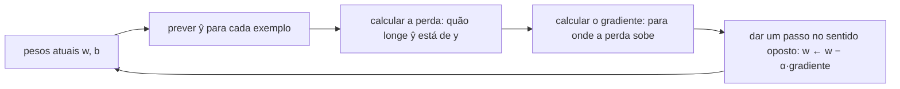

# Regressão linear e logística, gradiente descendente

## Por que isso importa

A regressão linear e a logística são os modelos mais usados do mundo real: preço, demanda, risco de crédito, probabilidade de clique, chance de cancelamento. São rápidas, fáceis de explicar ("cada m² a mais soma R$ 6 mil") e, muitas vezes, boas o bastante. E há um motivo ainda mais forte para estudá-las: a ideia central aqui, **definir uma perda e descer pelo gradiente até ela ficar pequena**, é exatamente como se treinam as redes neurais (IA-03), inclusive os grandes modelos de linguagem. Quem entende o gradiente descendente numa reta entende o motor de todo o deep learning.

## Intuição

Imagine pontos num gráfico (área do apartamento × preço) e uma régua transparente que você pode girar e deslizar. Treinar uma regressão linear é procurar a posição da régua que **passa mais perto** de todos os pontos. "Perto" precisa de uma medida: somamos os quadrados das distâncias verticais de cada ponto até a régua. Isso é a **perda**.

Agora o gradiente descendente: você está numa montanha com neblina e quer chegar ao vale. Não vê o mapa, mas sente a **inclinação do chão** sob os pés. Dá um passo para o lado que desce mais, sente de novo, dá outro passo. O tamanho do passo é a **taxa de aprendizado**: passos minúsculos levam uma eternidade; passos enormes fazem você pular o vale e subir a outra encosta.

## Visual

O ciclo do treino:



O efeito da taxa de aprendizado α sobre a perda ao longo dos passos:

```text
perda                                perda                               perda
 │\                                   │╲                                   │      ╱╲    ╱
 │ \                                  │ ╲_                                 │ ╱╲  ╱  ╲  ╱
 │  \                                 │   ╲___                             │╱  ╲╱    ╲╱
 │   \___________                     │       ╲______                      │  (oscila e explode)
 └──────────────── passos             └──────────────── passos             └──────────────── passos
   α bom: cai rápido e estabiliza       α pequeno: cai devagar               α grande: diverge
```

## Conceito técnico

### Regressão linear

O modelo prevê com uma combinação linear dos atributos:

ŷ = w₁x₁ + w₂x₂ + … + wₙxₙ + b = **w · x + b**

Os **pesos** `w` dizem quanto cada atributo influencia; o **viés** `b` é o valor quando todos os atributos são zero. Com um único atributo, é a reta `ŷ = w·x + b` que você viu na escola.

A **perda** mais comum é o **erro quadrático médio** (MSE):

MSE = (1/n) · Σ (ŷᵢ − yᵢ)²

Elevar ao quadrado deixa tudo positivo e pune muito os erros grandes (o que também torna o MSE sensível a outliers; o erro absoluto médio, MAE, é a alternativa robusta).

### Duas formas de achar os melhores pesos

**1. Fórmula fechada (mínimos quadrados).** Com um atributo, o mínimo do MSE tem solução exata:

- w = Σ(xᵢ − x̄)(yᵢ − ȳ) / Σ(xᵢ − x̄)²   (a covariância dividida pela variância de x)
- b = ȳ − w · x̄

Com vários atributos, é a **equação normal** `w = (XᵀX)⁻¹ Xᵀ y`, um sistema linear (MC-04). Funciona muito bem para dezenas ou centenas de atributos, mas fica caro com milhões, e não existe para modelos não lineares.

**2. Gradiente descendente.** O **gradiente** é o vetor das derivadas parciais da perda em relação a cada parâmetro (MC-01): aponta para onde a perda **sobe mais rápido**. Andamos no sentido oposto:

w ← w − α · ∂L/∂w     b ← b − α · ∂L/∂b

Para o MSE de uma reta, pela regra da cadeia:

- ∂L/∂w = (2/n) · Σ (ŷᵢ − yᵢ) · xᵢ
- ∂L/∂b = (2/n) · Σ (ŷᵢ − yᵢ)

Repare na leitura: se o modelo está prevendo **acima** (ŷ > y) em pontos com x grande, o gradiente de w é positivo e o passo **diminui** w. O erro de cada exemplo empurra os pesos na direção que o corrigiria.

Detalhes que importam:

- **Atualização simultânea**: calcule todos os gradientes com os pesos atuais e só depois atualize.
- **Taxa de aprendizado α**: o hiperparâmetro mais importante. Se a perda sobe ou vira `nan`, α está grande demais.
- **Variantes**: *batch* (usa todos os exemplos a cada passo), **estocástico** (SGD, um exemplo por passo, ruidoso mas barato) e **mini-batch** (32 a 512 exemplos, o padrão em deep learning).
- **Padronização**: se um atributo vai de 0 a 1 e outro de 0 a 100.000, a "montanha" vira um vale estreito e alongado, e o gradiente zigue-zagueia. Transformar cada atributo em `(x − média) / desvio` acelera muito o treino.
- **Convexidade**: o MSE de um modelo linear é uma tigela, com um único mínimo. O gradiente descendente sempre chega lá com α adequado. Em redes neurais isso não vale, e mesmo assim funciona bem na prática.

### Avaliando uma regressão

- **RMSE** = √MSE, na mesma unidade do alvo ("erramos em média uns R$ 40 mil").
- **R²** = 1 − (soma dos erros² do modelo) / (soma dos erros² de prever sempre a média). R² = 0 é tão bom quanto a linha de base da média; R² = 1 é perfeito; pode ser negativo se o modelo for pior que a média.

### "Linear" nos parâmetros

O modelo é linear nos **pesos**, não necessariamente nos atributos. Você pode criar atributos como x², log(x) ou área × bairro, e a regressão continua linear (e a fórmula fechada continua valendo). É assim que uma "reta" ajusta curvas. Cuidado: muitos atributos polinomiais levam ao sobreajuste (IA-04).

### Regressão logística: classificação com probabilidade

Para classificar (spam ou não, vai cancelar ou não), queremos uma **probabilidade** entre 0 e 1. A regressão logística passa a combinação linear pela **função sigmoide**:

σ(z) = 1 / (1 + e^(−z))     p = σ(w · x + b)

- z muito positivo → p perto de 1; z muito negativo → p perto de 0; z = 0 → p = 0,5.
- A **fronteira de decisão** (onde p = 0,5) é onde `w · x + b = 0`: uma reta (ou hiperplano). A logística é um classificador **linear**.
- Os pesos têm leitura: cada unidade a mais de xⱼ multiplica a **chance** (p / (1 − p)) por e^(wⱼ).

A perda não é o MSE (com a sigmoide ele vira uma superfície cheia de platôs). Usa-se a **entropia cruzada binária** (log loss):

L = −(1/n) · Σ [ yᵢ · log(pᵢ) + (1 − yᵢ) · log(1 − pᵢ) ]

Ela pune com força uma previsão **confiante e errada**: dizer p = 0,99 quando a resposta é 0 custa −log(0,01) ≈ 4,6, enquanto p = 0,6 custa só 0,92. E o gradiente sai com uma forma linda, quase igual à da regressão linear:

∂L/∂w = (1/n) · Σ (pᵢ − yᵢ) · xᵢ     ∂L/∂b = (1/n) · Σ (pᵢ − yᵢ)

Para mais de duas classes, a generalização é a **softmax** com entropia cruzada, que é exatamente a última camada de uma rede neural classificadora (IA-03).

### Regularização

Com muitos atributos, os pesos podem crescer para ajustar o ruído. A **regularização** soma à perda uma penalidade pelo tamanho dos pesos:

- **L2 (Ridge)**: + λ · Σ wⱼ². Encolhe todos os pesos, suaviza o modelo.
- **L1 (Lasso)**: + λ · Σ |wⱼ|. Zera pesos inúteis, fazendo seleção de atributos.

λ controla o equilíbrio entre ajustar o treino e manter o modelo simples. A escolha de λ é feita com validação (IA-04).

## Código

Os dois modelos do zero, só com a biblioteca padrão. Primeiro, a regressão linear pela fórmula fechada e pelo gradiente descendente, que devem chegar ao mesmo lugar. Depois, uma regressão logística que estima a chance de aprovação pelas horas de estudo.

```python
import math

# ---------- Regressão linear: área (m²) -> preço (R$ mil) ----------
area = [40, 55, 60, 72, 80, 95, 110, 130]
preco = [250, 330, 345, 410, 470, 540, 610, 730]
n = len(area)

# 1) fórmula fechada
mx, my = sum(area) / n, sum(preco) / n
w_exato = sum((x - mx) * (y - my) for x, y in zip(area, preco)) / sum((x - mx) ** 2 for x in area)
b_exato = my - w_exato * mx
print(f"fórmula fechada:  preço = {w_exato:.3f}·área + {b_exato:.2f}")

# 2) gradiente descendente, com a área padronizada
desvio = math.sqrt(sum((x - mx) ** 2 for x in area) / n)
z = [(x - mx) / desvio for x in area]
w, b, alfa = 0.0, 0.0, 0.1
for passo in range(300):
    erros = [w * zi + b - yi for zi, yi in zip(z, preco)]
    gw = 2 / n * sum(e * zi for e, zi in zip(erros, z))
    gb = 2 / n * sum(erros)
    w, b = w - alfa * gw, b - alfa * gb
    if passo in (0, 10, 50, 299):
        mse = sum(e * e for e in erros) / n
        print(f"  passo {passo:3}: MSE = {mse:10.2f}")

# desfaz a padronização: w·(x - mx)/desvio + b
w_gd = w / desvio
b_gd = b - w * mx / desvio
print(f"gradiente:        preço = {w_gd:.3f}·área + {b_gd:.2f}")

previsto = [w_exato * x + b_exato for x in area]
ss_res = sum((p - y) ** 2 for p, y in zip(previsto, preco))
ss_tot = sum((y - my) ** 2 for y in preco)
print(f"R² = {1 - ss_res / ss_tot:.4f}   previsão para 90 m²: R$ {w_exato * 90 + b_exato:.0f} mil")

# ---------- Regressão logística: horas de estudo -> aprovado (1) ou não (0) ----------
horas = [0.5, 1, 1.5, 2, 2.5, 3, 3.5, 4, 4.5, 5, 5.5, 6]
aprovado = [0, 0, 0, 0, 1, 0, 1, 0, 1, 1, 1, 1]

def sigmoide(t):
    return 1 / (1 + math.exp(-t))

w, b = 0.0, 0.0
for passo in range(5000):
    ps = [sigmoide(w * h + b) for h in horas]
    gw = sum((p - y) * h for p, y, h in zip(ps, aprovado, horas)) / len(horas)
    gb = sum(p - y for p, y in zip(ps, aprovado)) / len(horas)
    w, b = w - 0.3 * gw, b - 0.3 * gb

ps = [sigmoide(w * h + b) for h in horas]
perda = -sum(y * math.log(p) + (1 - y) * math.log(1 - p) for p, y in zip(ps, aprovado)) / len(horas)
print(f"\nlogística: w = {w:.2f}, b = {b:.2f}, log loss = {perda:.3f}")
print(f"fronteira de decisão: {-b / w:.2f} horas")
for h in (1, 3, 5):
    print(f"  {h} h de estudo -> chance de aprovação {sigmoide(w * h + b):.0%}")
```

Os dois métodos encontram a mesma reta. Note como a padronização permitiu α = 0,1: com a área em m² crua, esse mesmo α faria o treino explodir. Na prática, use `LinearRegression` e `LogisticRegression` do scikit-learn, mas agora você sabe o que acontece dentro do `.fit()`.

## Erros comuns

- **Taxa de aprendizado grande demais**: a perda sobe ou vira `nan`. Reduza α por fatores de 10 (0,1, 0,01, 0,001).
- **Esquecer de padronizar** atributos em escalas diferentes: treino lento e instável.
- **Padronizar com a média e o desvio de todos os dados**, incluindo o teste: vazamento. Calcule só no treino e aplique os mesmos números ao teste.
- **Atualizar w antes de calcular o gradiente de b** (atualização não simultânea).
- **Usar regressão linear para classificar**: as "probabilidades" saem menores que 0 e maiores que 1, e um outlier move a fronteira inteira.
- **Interpretar peso como causa**: um peso alto mostra associação nos dados, não que mudar o atributo muda o resultado.
- **Ler pesos sem olhar a escala**: um peso pequeno num atributo medido em reais pode importar mais que um grande num atributo de 0 a 1.
- **Usar o limiar 0,5 sem pensar**: se um falso negativo custa muito mais, um limiar menor pode ser o certo (IA-04).

## Pratique

```quiz
id: IA-02-q1
tipo: multipla_escolha
pergunta: "O que significa 'treinar' uma regressão linear?"
opcoes: ["Memorizar todos os exemplos de treino", "Encontrar os pesos e o viés que minimizam a perda (por exemplo, o erro quadrático médio) nos dados de treino", "Escolher quais atributos usar", "Dividir os dados em treino e teste"]
resposta: 1
explicacao: "O modelo é uma família de retas (uma para cada combinação de w e b). Treinar é escolher a que minimiza a perda. Pode ser feito pela fórmula fechada ou pelo gradiente descendente."
dificuldade: 1
```

```quiz
id: IA-02-q2
tipo: multipla_escolha
pergunta: "Durante o treino com gradiente descendente, a perda vai 120, 450, 3.800, 91.000, depois inf e nan. O que fazer primeiro?"
opcoes: ["Treinar por mais passos", "Diminuir a taxa de aprendizado (e verificar se os atributos estão padronizados)", "Adicionar mais atributos", "Trocar o MSE pelo MAE"]
resposta: 1
explicacao: "Perda crescendo sem parar é o sintoma clássico de α grande demais: cada passo pula o vale e cai mais alto do outro lado. Diminua α por um fator de 10. Atributos sem padronização agravam o problema, porque a escala grande gera gradientes enormes."
dificuldade: 2
```

```quiz
id: IA-02-q3
tipo: verdadeiro_falso
pergunta: "Na regressão logística, a fronteira de decisão (p = 0,5) é onde w · x + b = 0, por isso ela é uma reta (ou um hiperplano) no espaço dos atributos."
resposta: true
explicacao: "σ(z) = 0,5 exatamente quando z = 0. Por isso a logística é um classificador linear. Para fronteiras curvas, é preciso criar atributos não lineares (x², produtos) ou usar outro modelo, como uma rede neural."
dificuldade: 2
```

```quiz
id: IA-02-q4
tipo: multipla_escolha
pergunta: "Um modelo de regressão tem R² = −0,3 no conjunto de teste. O que isso quer dizer?"
opcoes: ["Que 30% das previsões estão erradas", "Que o modelo é pior que simplesmente prever a média do alvo para todo mundo", "Que há correlação negativa entre os atributos e o alvo", "É impossível, R² vai de 0 a 1"]
resposta: 1
explicacao: "R² compara a soma dos erros² do modelo com a de prever sempre a média. Negativo significa que o modelo erra mais que essa linha de base, comum quando ele sobreajustou o treino ou quando o teste vem de outra distribuição."
dificuldade: 2
```

```quiz
id: IA-02-q5
tipo: resposta_curta
pergunta: "Por que a regressão logística usa a entropia cruzada (log loss) em vez do erro quadrático médio?"
resposta: "Porque, com a sigmoide, o MSE vira uma função não convexa e com gradientes muito pequenos quando o modelo erra com confiança, o que trava o treino. A entropia cruzada é convexa para a logística, pune fortemente previsões confiantes e erradas (−log de uma probabilidade pequena é enorme) e dá um gradiente simples, (p − y)·x."
palavras_chave: ["convexa", "confiante", "gradiente", "sigmoide"]
dificuldade: 3
```

```quiz
id: IA-02-q6
tipo: codigo
linguagem: python
pergunta: |
  **Mínimos quadrados.** Escreva `minimos_quadrados(xs, ys)`, que devolve `(w, b)` da reta `y = w·x + b` que minimiza o erro quadrático, cada um arredondado a 3 casas:

  - w = Σ(xᵢ − x̄)(yᵢ − ȳ) / Σ(xᵢ − x̄)²
  - b = ȳ − w · x̄
codigo_inicial: |
  def minimos_quadrados(xs, ys):
      return (0.0, 0.0)
usa: [def, for, return]
testes:
  - chamada: "minimos_quadrados([1, 2, 3, 4], [3, 5, 7, 9])"
    saida: "(2.0, 1.0)"
  - chamada: "minimos_quadrados([0, 1, 2, 3], [1, 2, 2, 4])"
    saida: "(0.9, 0.9)"
  - chamada: "minimos_quadrados([10, 20, 30], [5, 5, 5])"
    saida: "(0.0, 5.0)"
  - chamada: "minimos_quadrados([1, 2, 4, 5, 7], [10, 8, 6, 3, 1])"
    visivel: false
    saida: "(-1.509, 11.333)"
  - chamada: "minimos_quadrados([40, 60, 80], [250, 345, 470])"
    visivel: false
    saida: "(5.5, 25.0)"
dica: "Calcule as médias, depois some (x − mx)·(y − my) e (x − mx)² num for sobre zip(xs, ys). Arredonde só no fim, com round(valor, 3)."
solucao: |
  def minimos_quadrados(xs, ys):
      n = len(xs)
      mx = sum(xs) / n
      my = sum(ys) / n
      num = 0.0
      den = 0.0
      for x, y in zip(xs, ys):
          num += (x - mx) * (y - my)
          den += (x - mx) ** 2
      w = num / den
      b = my - w * mx
      return (round(w, 3), round(b, 3))
explicacao: "O numerador mede se x e y sobem juntos (covariância) e o denominador, o quanto x varia. No terceiro teste, y não muda com x e a reta é horizontal, na média. Essa fórmula é o caso de um atributo da equação normal (XᵀX)⁻¹Xᵀy."
dificuldade: 2
```

```quiz
id: IA-02-q7
tipo: codigo
linguagem: python
pergunta: |
  **Gradiente descendente do zero.** Escreva `descida(xs, ys, alfa, passos)`, que treina `ŷ = w·x + b` começando de `w = b = 0` e, a cada passo, atualiza **simultaneamente**:

  - `gw = (2/n) · Σ (ŷᵢ − yᵢ) · xᵢ` e `gb = (2/n) · Σ (ŷᵢ − yᵢ)`
  - `w ← w − alfa·gw` e `b ← b − alfa·gb`

  Devolva `(w, b)` arredondados a 3 casas.
codigo_inicial: |
  def descida(xs, ys, alfa, passos):
      w = b = 0.0
      return (round(w, 3), round(b, 3))
usa: [def, for, return]
testes:
  - chamada: "descida([1, 2, 3], [2, 4, 6], 0.1, 1)"
    saida: "(1.867, 0.8)"
  - chamada: "descida([0, 1, 2, 3, 4], [1, 3, 5, 7, 9], 0.05, 2000)"
    saida: "(2.0, 1.0)"
  - chamada: "descida([1, 2, 3], [2, 4, 6], 0.1, 0)"
    saida: "(0.0, 0.0)"
  - chamada: "descida([0, 1, 2, 3], [1, 2, 2, 4], 0.1, 1000)"
    visivel: false
    saida: "(0.9, 0.9)"
  - chamada: "descida([1, 2], [1, 1], 0.1, 2)"
    visivel: false
    saida: "(0.39, 0.27)"
dica: "Dentro do for de passos, calcule a lista de erros (w*x + b − y) com os pesos atuais, depois os dois gradientes, e só então atualize w e b na mesma linha: w, b = w − alfa*gw, b − alfa*gb."
solucao: |
  def descida(xs, ys, alfa, passos):
      n = len(xs)
      w = b = 0.0
      for _ in range(passos):
          erros = [w * x + b - y for x, y in zip(xs, ys)]
          gw = 2 / n * sum(e * x for e, x in zip(erros, xs))
          gb = 2 / n * sum(erros)
          w, b = w - alfa * gw, b - alfa * gb
      return (round(w, 3), round(b, 3))
explicacao: "O quarto teste chega ao mesmo (0,9; 0,9) da fórmula fechada do exercício anterior: com α adequado e passos suficientes, o gradiente descendente encontra o mínimo da tigela convexa. Experimente alfa = 0.5 nos dados do segundo teste: os pesos explodem, porque cada passo pula o vale."
dificuldade: 2
```

```quiz
id: IA-02-q8
tipo: codigo
linguagem: javascript
pergunta: |
  **Treinando uma regressão logística.** `exemplos` é uma lista de pares `[x, y]`, com `y` igual a 0 ou 1. Escreva `treinarLogistica(exemplos, alfa, passos)`, que começa com `w = b = 0` e, a cada passo:

  - calcula `p = 1 / (1 + Math.exp(-(w·x + b)))` para cada exemplo;
  - `gw = (1/n) · Σ (p − y) · x` e `gb = (1/n) · Σ (p − y)`;
  - atualiza simultaneamente `w -= alfa·gw` e `b -= alfa·gb`.

  Devolva `{ w, b }` com cada valor arredondado a 3 casas (`Math.round(v * 1000) / 1000`).
codigo_inicial: |
  function treinarLogistica(exemplos, alfa, passos) {
    let w = 0;
    let b = 0;
    return { w, b };
  }
usa: [function, for, return]
testes:
  - chamada: "treinarLogistica([[1, 0], [2, 0], [3, 1], [4, 1]], 0.5, 1)"
    saida: "{ w: 0.25, b: 0 }"
  - chamada: "treinarLogistica([[1, 1], [2, 1]], 1, 1)"
    saida: "{ w: 0.75, b: 0.5 }"
  - chamada: "treinarLogistica([[0, 0], [1, 0], [2, 1], [3, 1]], 0.5, 2)"
    saida: "{ w: 0.394, b: -0.045 }"
  - chamada: "treinarLogistica([[1, 0], [2, 0], [3, 1], [4, 1]], 0.5, 3)"
    visivel: false
    saida: "{ w: 0.305, b: -0.148 }"
  - chamada: "treinarLogistica([[1, 1], [2, 0]], 1, 2)"
    visivel: false
    saida: "{ w: -0.346, b: 0.092 }"
dica: "Num for de passos, percorra os exemplos acumulando somaW += (p − y)·x e somaB += (p − y), usando os w e b atuais. Depois do laço interno, atualize os dois."
solucao: |
  function treinarLogistica(exemplos, alfa, passos) {
    const n = exemplos.length;
    let w = 0;
    let b = 0;
    for (let i = 0; i < passos; i++) {
      let somaW = 0;
      let somaB = 0;
      for (const [x, y] of exemplos) {
        const p = 1 / (1 + Math.exp(-(w * x + b)));
        somaW += (p - y) * x;
        somaB += p - y;
      }
      w -= (alfa * somaW) / n;
      b -= (alfa * somaB) / n;
    }
    const arred = (v) => Math.round(v * 1000) / 1000;
    return { w: arred(w), b: arred(b) };
  }
explicacao: "No primeiro passo, com w = b = 0, toda previsão é p = 0,5: o modelo começa sem opinião. Os exemplos positivos (y = 1) puxam w para cima na proporção de x, e os negativos puxam para baixo. Com mais passos, w cresce e b fica negativo, colocando a fronteira −b/w entre as duas classes. Essa mesma atualização, (p − y) vezes a entrada, reaparece na última camada de uma rede neural (IA-03)."
dificuldade: 3
```

## Resumo

- **Regressão linear**: ŷ = w · x + b, treinada minimizando o **MSE**. Avalie com **RMSE** e **R²**.
- **Mínimos quadrados**: solução exata, w = cov(x, y) / var(x) com um atributo, equação normal com vários.
- **Gradiente descendente**: w ← w − α · ∇L, com **atualização simultânea**. A taxa **α** decide entre lento, bom e divergente.
- **Padronize** os atributos (com estatísticas do treino) para treinar rápido e estável.
- **Regressão logística**: p = σ(w · x + b), perda de **entropia cruzada**, gradiente (p − y) · x, fronteira linear em w · x + b = 0.
- **Regularização** L2 e L1 controla o tamanho dos pesos e combate o sobreajuste.

## Para ir além

- Faça a semana 1 a 3 do curso de Andrew Ng e compare com o que você implementou aqui.
- Treine o exemplo das horas de estudo com `LogisticRegression` do scikit-learn e confira se w e b ficam parecidos (o scikit-learn aplica regularização L2 por padrão, então haverá diferença).
- Implemente o gradiente descendente estocástico (um exemplo por passo, em ordem aleatória) e compare a curva da perda com a da versão batch.
- **Próximo módulo**: IA-03 Redes neurais.
