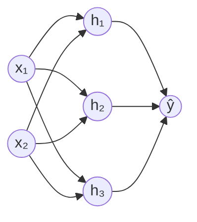

# Redes neurais

## Por que isso importa

Reconhecimento de voz, tradução automática, carros que enxergam a pista, detecção de câncer em exames, geração de imagens e os assistentes de conversa: quase toda a IA que virou notícia nos últimos quinze anos é feita com **redes neurais**. A ideia não é nova (o perceptron é de 1958), mas a combinação de muitos dados, GPUs e algumas ideias certeiras fez as redes "profundas" superarem as outras técnicas em imagem, áudio e texto. Você não precisa treinar um modelo de linguagem para tirar proveito disso, mas precisa entender o que acontece dentro de um: o que é um peso, por que o treino precisa de tanta computação, o que é um embedding e por que o modelo às vezes erra com toda a confiança.

## Intuição

Uma regressão logística (IA-02) é um único "neurônio": soma os atributos com pesos, passa por uma curva e decide. Ela só consegue separar classes com uma **reta**. O problema clássico que ela não resolve é o **XOR**: "um ou outro, mas não os dois". Nenhuma reta separa (0,1) e (1,0) de (0,0) e (1,1).

A saída é **empilhar** neurônios. A primeira camada cria novos atributos (um neurônio pode aprender "x₁ OU x₂", outro "x₁ E x₂"), e a camada seguinte combina esses atributos ("OU, mas não E"). Cada camada transforma a representação dos dados até que, no fim, uma reta baste. Numa rede que reconhece rostos, as primeiras camadas aprendem bordas, as do meio aprendem olhos e narizes, e as últimas aprendem rostos. Ninguém programou essas etapas: elas surgem do treino.

## Visual

Uma rede com 2 entradas, uma camada escondida de 3 neurônios e 1 saída:



Cada seta é um peso. Cada neurônio faz a mesma conta:

```text
            entradas      pesos
              x₁ ────── w₁ ──┐
              x₂ ────── w₂ ──┤
              x₃ ────── w₃ ──┼──►  z = w₁x₁ + w₂x₂ + w₃x₃ + b  ──►  a = ativação(z)  ──►  saída
                             │
                   viés b ───┘
```

## Conceito técnico

### O neurônio e a camada

Um neurônio calcula `a = f(w · x + b)`: uma combinação linear seguida de uma **função de ativação** `f`. Uma **camada densa** (totalmente conectada) com m neurônios faz isso m vezes, o que se escreve como uma multiplicação de matriz por vetor (MC-04):

**a = f(W x + b)**, em que W tem uma linha por neurônio e uma coluna por entrada.

Uma rede é uma composição de camadas: `ŷ = f₃(W₃ f₂(W₂ f₁(W₁ x + b₁) + b₂) + b₃)`. Calcular a saída a partir da entrada é a **passagem para a frente** (forward pass). O número de parâmetros cresce rápido: uma camada de 1.000 entradas para 1.000 saídas já tem um milhão de pesos.

### Por que a ativação precisa ser não linear

Sem ativação (ou com ativação linear), duas camadas viram uma só: `W₂(W₁x) = (W₂W₁)x`, outra transformação linear. Empilhar cem camadas lineares dá um modelo tão limitado quanto uma regressão. A não linearidade é o que dá poder à rede. As ativações mais comuns:

- **ReLU**: `max(0, z)`. Simples, rápida e o padrão nas camadas escondidas. Sua derivada é 1 para z > 0 e 0 para z < 0.
- **Sigmoide**: `1 / (1 + e^(−z))`, entre 0 e 1. Usada na saída para probabilidade binária.
- **tanh**: entre −1 e 1, centrada em zero. Sua derivada é `1 − tanh²(z)`.
- **Softmax** (na saída, para várias classes): transforma um vetor de números em probabilidades que somam 1: `softmax(z)ᵢ = e^(zᵢ) / Σⱼ e^(zⱼ)`. Para não estourar com valores grandes, subtrai-se o maior zᵢ antes de exponenciar; o resultado é o mesmo.

O **teorema da aproximação universal** diz que uma rede com uma única camada escondida suficientemente larga aproxima qualquer função contínua. Na prática, redes **profundas** (muitas camadas) conseguem o mesmo com muito menos neurônios.

### Retropropagação: a regra da cadeia em série

Treinar é o mesmo de antes: definir uma perda e usar gradiente descendente. A dificuldade é calcular a derivada da perda em relação a **cada um** dos milhões de pesos. A **retropropagação** (backpropagation) faz isso com eficiência usando a regra da cadeia (MC-01):

1. Faça a passagem para a frente e **guarde** os valores intermediários (z e a de cada camada).
2. Calcule o gradiente da perda em relação à saída.
3. Volte camada por camada: o gradiente em relação às ativações de uma camada é o da camada seguinte multiplicado pelos pesos transpostos e pela derivada da ativação.
4. Em cada camada, o gradiente de um peso é (gradiente que chegou ao neurônio) × (entrada daquele peso).

Para uma rede de uma entrada e um neurônio escondido, `z₁ = w₁x + b₁`, `h = relu(z₁)`, `ŷ = w₂h + b₂` e perda `L = (ŷ − y)²`:

```text
dL/dŷ  = 2(ŷ − y)
dL/dw₂ = dL/dŷ · h           dL/db₂ = dL/dŷ
dL/dh  = dL/dŷ · w₂
dL/dz₁ = dL/dh · relu'(z₁)   (1 se z₁ > 0, senão 0)
dL/dw₁ = dL/dz₁ · x          dL/db₁ = dL/dz₁
```

O custo da passagem para trás é da mesma ordem que o da passagem para a frente. Bibliotecas como PyTorch, TensorFlow e JAX fazem isso automaticamente (**diferenciação automática**): você escreve só a passagem para a frente.

### Treinando na prática

- **Inicialização aleatória**: se todos os pesos começam iguais, todos os neurônios recebem o mesmo gradiente e continuam iguais para sempre. Pesos pequenos e aleatórios, com escala ajustada ao tamanho da camada (Xavier, He), quebram a simetria.
- **Mini-batches e épocas**: os exemplos passam em lotes; uma **época** é uma passada por todo o conjunto de treino.
- **Otimizadores**: além do gradiente descendente puro, usa-se **momento** (lembra a direção dos passos anteriores) e **Adam** (ajusta α por parâmetro), o padrão mais comum.
- **Gradientes que somem ou explodem**: em redes profundas, multiplicar muitas derivadas menores que 1 faz o gradiente chegar quase zero às primeiras camadas (por isso a sigmoide saiu das camadas escondidas e a ReLU entrou). Conexões residuais e normalização (batch norm, layer norm) resolvem boa parte disso.
- **Sobreajuste**: redes têm parâmetros de sobra para decorar o treino. Combate-se com mais dados, **aumento de dados** (girar e recortar imagens), **dropout** (desligar neurônios aleatórios durante o treino), regularização L2 e **parada antecipada** (parar quando a perda de validação começa a subir, IA-04).

### Arquiteturas que você vai ouvir falar

- **Redes convolucionais (CNNs)**: aplicam o mesmo pequeno filtro em todas as posições de uma imagem. Compartilhar pesos assim reduz parâmetros e captura padrões locais (bordas, texturas) onde quer que estejam.
- **Redes recorrentes (RNNs, LSTMs)**: processam sequências um item por vez, carregando um estado. Foram o padrão em texto e áudio até 2017.
- **Transformers**: baseados em **atenção**: cada palavra (token) olha para todas as outras e decide quanto cada uma importa para ela. Paralelizam muito bem em GPUs e são a base dos modelos de linguagem (GPT, Claude, Gemini, Llama) e de muitos modelos de imagem.
- **Embeddings**: vetores densos aprendidos que representam palavras, produtos ou usuários. Itens parecidos ficam próximos no espaço. São a base da busca semântica e do RAG (geração aumentada por recuperação).

### Modelos de linguagem em uma frase

Um modelo de linguagem é um transformer enorme, pré-treinado com aprendizado auto-supervisionado para **prever o próximo token** em trilhões de palavras, e depois ajustado com exemplos e preferências humanas para seguir instruções. Ele gera texto escolhendo um token por vez a partir das probabilidades da softmax. Isso explica tanto a fluência quanto as **alucinações**: o modelo produz o texto mais plausível, que nem sempre é o verdadeiro.

## Código

Uma rede de 2 entradas, 4 neurônios escondidos (tanh) e 1 saída (sigmoide) aprendendo o XOR, com a retropropagação escrita à mão. Nenhuma regressão logística sozinha consegue isso.

```python
import math, random

random.seed(7)
X = [(0, 0), (0, 1), (1, 0), (1, 1)]
Y = [0, 1, 1, 0]
H = 4  # neurônios na camada escondida

# pesos pequenos e aleatórios: se todos começassem iguais, todos aprenderiam a mesma coisa
W1 = [[random.uniform(-1, 1) for _ in range(2)] for _ in range(H)]
b1 = [0.0] * H
W2 = [random.uniform(-1, 1) for _ in range(H)]
b2 = 0.0

def sigmoide(z):
    return 1 / (1 + math.exp(-z))

def frente(x):
    h = [math.tanh(W1[j][0] * x[0] + W1[j][1] * x[1] + b1[j]) for j in range(H)]
    p = sigmoide(sum(W2[j] * h[j] for j in range(H)) + b2)
    return h, p

alfa = 0.5
for epoca in range(3001):
    gW1 = [[0.0, 0.0] for _ in range(H)]
    gb1 = [0.0] * H
    gW2 = [0.0] * H
    gb2 = 0.0
    perda = 0.0
    for x, y in zip(X, Y):
        h, p = frente(x)                       # 1) passagem para a frente
        perda -= y * math.log(p) + (1 - y) * math.log(1 - p)
        dz2 = p - y                            # 2) sigmoide + entropia cruzada: p − y
        for j in range(H):
            gW2[j] += dz2 * h[j]
            dh = dz2 * W2[j]                   # 3) o erro volta pela camada de saída
            dz1 = dh * (1 - h[j] ** 2)         #    derivada da tanh
            gW1[j][0] += dz1 * x[0]
            gW1[j][1] += dz1 * x[1]
            gb1[j] += dz1
        gb2 += dz2
    for j in range(H):                         # 4) gradiente descendente (média dos 4 exemplos)
        W2[j] -= alfa * gW2[j] / 4
        b1[j] -= alfa * gb1[j] / 4
        W1[j][0] -= alfa * gW1[j][0] / 4
        W1[j][1] -= alfa * gW1[j][1] / 4
    b2 -= alfa * gb2 / 4
    if epoca % 1000 == 0:
        print(f"época {epoca:4}: perda média = {perda / 4:.4f}")

for x, y in zip(X, Y):
    print(f"{x} -> {frente(x)[1]:.3f}  (esperado {y})")
```

A mesma rede em PyTorch, que calcula todos os gradientes sozinho com `perda.backward()`:

```text
modelo = nn.Sequential(nn.Linear(2, 4), nn.Tanh(), nn.Linear(4, 1))
otimizador = torch.optim.SGD(modelo.parameters(), lr=0.5)
for epoca in range(3000):
    perda = nn.functional.binary_cross_entropy_with_logits(modelo(X), Y)
    otimizador.zero_grad()
    perda.backward()       # retropropagação automática
    otimizador.step()      # w ← w − α·gradiente
```

## Erros comuns

- **Esquecer a ativação** entre camadas: a rede inteira vira um modelo linear.
- **Inicializar todos os pesos com zero**: os neurônios de uma camada ficam idênticos para sempre.
- **Softmax ingênua** com valores grandes: `exp(1000)` estoura. Subtraia o máximo antes.
- **Aplicar sigmoide ou softmax duas vezes**: muitas funções de perda (como `CrossEntropyLoss` do PyTorch) já esperam os valores crus (logits).
- **Avaliar só no treino**: redes decoram com facilidade. Separe validação e acompanhe as duas curvas.
- **Usar rede neural para tudo**: em dados tabulares pequenos, modelos de árvores (gradient boosting) ou uma regressão costumam ganhar, treinar mais rápido e ser mais fáceis de explicar.
- **Confiar na probabilidade da saída** como se fosse certeza calibrada: redes costumam ser confiantes demais, inclusive quando estão erradas.

## Pratique

```quiz
id: IA-03-q1
tipo: multipla_escolha
pergunta: "Uma rede tem 5 camadas densas, todas sem função de ativação. O que ela consegue representar?"
opcoes: ["Qualquer função contínua, por ser profunda", "Apenas transformações lineares, como uma única camada", "Apenas funções não lineares simples", "Depende da quantidade de neurônios"]
resposta: 1
explicacao: "A composição de transformações lineares é linear: W₅W₄W₃W₂W₁x é só uma matriz vezes x. Sem a não linearidade, a profundidade não adiciona poder. É a ativação que permite curvar as fronteiras."
dificuldade: 2
```

```quiz
id: IA-03-q2
tipo: multipla_escolha
pergunta: "Uma camada densa recebe 784 entradas (uma imagem 28×28) e tem 128 neurônios. Quantos parâmetros ela tem?"
opcoes: ["912", "100.352", "100.480", "784"]
resposta: 2
explicacao: "São 784 × 128 = 100.352 pesos, mais um viés por neurônio (128): 100.480 parâmetros. É por isso que imagens usam convoluções, que compartilham poucos pesos em todas as posições."
dificuldade: 2
```

```quiz
id: IA-03-q3
tipo: verdadeiro_falso
pergunta: "A retropropagação é um algoritmo de otimização diferente do gradiente descendente."
resposta: false
explicacao: "A retropropagação só calcula os gradientes, aplicando a regra da cadeia de trás para a frente. Quem usa esses gradientes para atualizar os pesos é o otimizador (gradiente descendente, momento, Adam)."
dificuldade: 2
```

```quiz
id: IA-03-q4
tipo: multipla_escolha
pergunta: "A perda de treino cai sem parar, mas a perda de validação começa a subir a partir da época 15. O que está acontecendo e o que fazer?"
opcoes: ["A taxa de aprendizado está pequena; aumente", "Sobreajuste: a rede está decorando o treino. Use parada antecipada, dropout, regularização ou mais dados", "O modelo é simples demais; adicione camadas", "É normal; continue treinando até a perda de treino zerar"]
resposta: 1
explicacao: "A distância crescente entre treino e validação é a assinatura do sobreajuste. A parada antecipada guarda os pesos da melhor época de validação; dropout, L2 e aumento de dados reduzem a capacidade de decorar."
dificuldade: 2
```

```quiz
id: IA-03-q5
tipo: resposta_curta
pergunta: "Por que um modelo de linguagem às vezes afirma com segurança algo falso (alucina)?"
resposta: "Porque ele foi treinado para gerar o próximo token mais provável dado o texto, não para verificar fatos. Ele produz o texto mais plausível segundo os padrões que aprendeu, e algo plausível pode ser falso. A fluência não indica que a informação está correta, e a confiança da saída não é calibrada para veracidade."
palavras_chave: ["próximo token", "plausível", "provável", "verificar"]
dificuldade: 2
```

```quiz
id: IA-03-q6
tipo: codigo
linguagem: python
pergunta: |
  **Passagem para a frente.** Uma rede é uma lista de camadas `(W, b, ativacao)`, em que `W` é uma lista de linhas (uma por neurônio), `b` é a lista de vieses e `ativacao` é `'relu'` ou `'linear'`. Escreva `frente(x, camadas)`, que aplica as camadas em ordem (cada neurônio calcula `f(Σ W[i][j]·entrada[j] + b[i])`) e devolve a saída final com cada valor convertido em float e arredondado a 3 casas: `round(float(v), 3)`.
codigo_inicial: |
  def frente(x, camadas):
      return x
usa: [def, for, return]
testes:
  - chamada: "frente([1, 2], [([[1, 1]], [0], 'linear')])"
    saida: "[3.0]"
  - chamada: "frente([1, -1], [([[1, 0], [0, 1]], [0, 0], 'relu')])"
    saida: "[1.0, 0.0]"
  - chamada: "frente([0.5, 2], [([[1, -1], [2, 1]], [0, -1], 'relu'), ([[1, 1]], [0.5], 'linear')])"
    saida: "[2.5]"
  - chamada: "frente([1, 0], [([[1, 1], [1, 1]], [0, -1], 'relu'), ([[1, -2]], [0], 'linear')])"
    visivel: false
    saida: "[1.0]"
  - chamada: "frente([1, 1], [([[1, 1], [1, 1]], [0, -1], 'relu'), ([[1, -2]], [0], 'linear')])"
    visivel: false
    saida: "[0.0]"
  - chamada: "frente([0, 0], [([[1, 1], [1, 1]], [0, -1], 'relu'), ([[1, -2]], [0], 'linear')])"
    visivel: false
    saida: "[0.0]"
dica: "Mantenha uma variável a com a entrada atual. Para cada camada, calcule z = sum(w * v for w, v in zip(linha, a)) + vies para cada linha, aplique max(0, z) se for 'relu', e substitua a pelo resultado."
solucao: |
  def frente(x, camadas):
      a = x
      for W, b, ativacao in camadas:
          saida = []
          for linha, vies in zip(W, b):
              z = sum(w * v for w, v in zip(linha, a)) + vies
              if ativacao == 'relu':
                  z = max(0, z)
              saida.append(z)
          a = saida
      return [round(float(v), 3) for v in a]
explicacao: "Os três testes escondidos usam uma rede de 2 camadas que calcula o XOR com ReLU: h₁ = relu(x₁ + x₂) conta quantas entradas estão ligadas, h₂ = relu(x₁ + x₂ − 1) só liga quando as duas estão, e a saída h₁ − 2h₂ dá 0, 1, 1, 0. É exatamente a ideia da intuição: a primeira camada cria os atributos 'pelo menos um' e 'os dois', e a segunda os combina. Aqui os pesos foram escolhidos à mão; o treino serve para encontrá-los sozinho."
dificuldade: 2
```

```quiz
id: IA-03-q7
tipo: codigo
linguagem: python
pergunta: |
  **Softmax estável.** Escreva `softmax(zs)`, que devolve a lista de probabilidades `e^(zᵢ) / Σ e^(zⱼ)`, cada uma arredondada a 3 casas. Ela precisa funcionar com valores grandes, como `[1000, 1000]`, em que `math.exp(1000)` estoura.
codigo_inicial: |
  import math

  def softmax(zs):
      total = sum(math.exp(z) for z in zs)
      return [round(math.exp(z) / total, 3) for z in zs]
usa: [def, return, max]
testes:
  - chamada: "softmax([0, 0])"
    saida: "[0.5, 0.5]"
  - chamada: "softmax([1, 2, 3])"
    saida: "[0.09, 0.245, 0.665]"
  - chamada: "softmax([1000, 1000])"
    saida: "[0.5, 0.5]"
  - chamada: "softmax([1000, 1001, 999])"
    visivel: false
    saida: "[0.245, 0.665, 0.09]"
  - chamada: "softmax([-1000, 0])"
    visivel: false
    saida: "[0.0, 1.0]"
dica: "Subtraia o maior valor de todos antes de exponenciar: e^(zᵢ − m) / Σ e^(zⱼ − m) é igual à fórmula original (o fator e^(−m) cancela) e o maior expoente vira 0."
solucao: |
  import math

  def softmax(zs):
      m = max(zs)
      exps = [math.exp(z - m) for z in zs]
      total = sum(exps)
      return [round(e / total, 3) for e in exps]
explicacao: "O código inicial falha com OverflowError em [1000, 1000]. Subtrair o máximo não muda o resultado e garante que o maior expoente seja 0 (e⁰ = 1), sem estouro. Repare que [1000, 1001, 999] dá as mesmas probabilidades de [1, 2, 3], só que em outra ordem: somar uma constante a todos os valores não muda a softmax, só as diferenças importam. Toda biblioteca de deep learning faz esse truque."
dificuldade: 2
```

```quiz
id: IA-03-q8
tipo: codigo
linguagem: javascript
pergunta: |
  **Retropropagação à mão.** Uma rede minúscula: `z1 = w1·x + b1`, `h = relu(z1)`, `yhat = w2·h + b2`, com perda `L = (yhat − y)²`. Escreva `gradientes(p, x, y)`, em que `p = { w1, b1, w2, b2 }`, que devolve `{ dw1, db1, dw2, db2 }` (as derivadas de L em relação a cada parâmetro), cada uma arredondada a 3 casas. Use relu'(z1) = 1 se `z1 > 0`, senão 0.
codigo_inicial: |
  function gradientes(p, x, y) {
    return { dw1: 0, db1: 0, dw2: 0, db2: 0 };
  }
usa: [function, return]
testes:
  - chamada: "gradientes({ w1: 1, b1: 0, w2: 1, b2: 0 }, 2, 1)"
    saida: "{ dw1: 4, db1: 2, dw2: 4, db2: 2 }"
  - chamada: "gradientes({ w1: 0.5, b1: 1, w2: -2, b2: 0.5 }, 2, 0)"
    saida: "{ dw1: 28, db1: 14, dw2: -14, db2: -7 }"
  - chamada: "gradientes({ w1: -1, b1: 0, w2: 3, b2: 1 }, 2, 0)"
    saida: "{ dw1: 0, db1: 0, dw2: 0, db2: 2 }"
  - chamada: "gradientes({ w1: 2, b1: -1, w2: 0.5, b2: 0 }, 1, 3)"
    visivel: false
    saida: "{ dw1: -2.5, db1: -2.5, dw2: -5, db2: -5 }"
  - chamada: "gradientes({ w1: 0.3, b1: 0.1, w2: 0.7, b2: -0.2 }, 1.5, 1)"
    visivel: false
    saida: "{ dw1: -1.711, db1: -1.141, dw2: -0.896, db2: -1.63 }"
dica: "Faça a passagem para a frente guardando z1 e h. Depois volte: dyhat = 2·(yhat − y); dw2 = dyhat·h; db2 = dyhat; dh = dyhat·w2; dz1 = z1 > 0 ? dh : 0; dw1 = dz1·x; db1 = dz1."
solucao: |
  function gradientes(p, x, y) {
    const z1 = p.w1 * x + p.b1;
    const h = Math.max(0, z1);
    const yhat = p.w2 * h + p.b2;
    const dyhat = 2 * (yhat - y);
    const dh = dyhat * p.w2;
    const dz1 = z1 > 0 ? dh : 0;
    const arred = (v) => Math.round(v * 1000) / 1000;
    return {
      dw1: arred(dz1 * x),
      db1: arred(dz1),
      dw2: arred(dyhat * h),
      db2: arred(dyhat),
    };
  }
explicacao: "No terceiro teste o neurônio escondido está 'desligado' (z1 = −2 < 0): o gradiente não passa por ele e w1 e b1 não aprendem nada neste exemplo. Se isso acontecer para todos os exemplos, o neurônio 'morre' (o problema da ReLU morta). Bibliotecas fazem exatamente essa sequência, só que com matrizes e para milhões de parâmetros."
dificuldade: 3
```

## Resumo

- Um **neurônio** calcula f(w · x + b); uma **camada** é f(Wx + b); uma **rede** é uma composição de camadas.
- **Ativações não lineares** (ReLU, tanh, sigmoide, softmax) são o que dá poder à profundidade.
- **Passagem para a frente** calcula a saída; **retropropagação** aplica a regra da cadeia de trás para a frente e calcula todos os gradientes; o **otimizador** (SGD, Adam) atualiza os pesos.
- Na prática: inicialização aleatória, mini-batches, softmax estável, cuidado com gradientes que somem e com o **sobreajuste** (dropout, parada antecipada, mais dados).
- **CNNs** para imagens, **RNNs** para sequências, **transformers** com atenção para texto e quase tudo hoje; **embeddings** representam itens como vetores.
- Modelos de linguagem preveem o próximo token: daí a fluência e as alucinações.

## Para ir além

- Assista à série de redes neurais do 3Blue1Brown, depois ao vídeo do micrograd do Karpathy e reescreva o micrograd você mesmo.
- Treine uma rede no conjunto MNIST (dígitos escritos à mão) com PyTorch ou com o curso do fast.ai.
- Brinque com o TensorFlow Playground (playground.tensorflow.org): adicione e remova camadas e veja a fronteira de decisão mudar.
- **Próximo módulo**: IA-04 Clustering, avaliação de modelos e overfitting.
