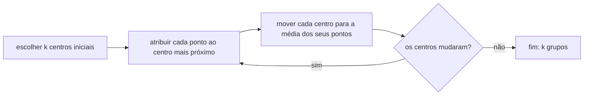

# Clustering, avaliação de modelos e overfitting

## Por que isso importa

Treinar um modelo é a parte fácil: três linhas de scikit-learn. Saber **se ele é bom** é onde os projetos de ML dão certo ou errado. Um modelo com "95% de acurácia" pode ser inútil, um modelo perfeito no notebook pode falhar no primeiro dia em produção, e um detalhe na separação dos dados pode inflar os resultados sem ninguém perceber. Esta aula reúne as ferramentas para medir honestamente: as métricas certas para cada custo de erro, a validação cruzada, o diagnóstico de sobreajuste. E, de quebra, o aprendizado não supervisionado mais usado, o **agrupamento**, que encontra segmentos de clientes, organiza documentos e comprime imagens.

## Intuição

**Agrupamento**: você despeja na mesa as fotos de uma viagem e, sem ninguém dizer quais grupos existem, separa em pilhas: praia, cidade, comida. O k-means faz isso com números: escolhe k "centros", põe cada ponto na pilha do centro mais próximo, move cada centro para o meio da sua pilha e repete até estabilizar.

**Sobreajuste**: um aluno que decora as respostas da lista de exercícios tira 10 na lista e vai mal na prova, porque as perguntas mudaram. Outro que só aprendeu "a resposta costuma ser C" vai mal nas duas. O bom aluno aprendeu o **padrão** por trás das questões. Um modelo complexo demais decora o ruído do treino (**sobreajuste**, alta variância); simples demais, nem aprende o padrão (**subajuste**, alto viés).

**Métricas**: um detector de incêndio que nunca toca tem 99,9% de acurácia, já que quase nunca há incêndio. O que importa é: quando há incêndio, ele toca (**revocação**)? E quando ele toca, é incêndio mesmo (**precisão**)?

## Visual

Uma iteração do k-means:



A matriz de confusão de um classificador de fraude, com 1.000 transações:

```text
                          previsto: fraude   previsto: normal
   real: fraude         │   VP = 40         │   FN = 10        │   ← 50 fraudes reais
   real: normal         │   FP = 60         │   VN = 890       │   ← 950 normais
                            ↑ 100 alarmes

   acurácia  = (40 + 890) / 1000 = 93%
   precisão  = 40 / (40 + 60)   = 40%   "dos alarmes, quantos eram fraude?"
   revocação = 40 / (40 + 10)   = 80%   "das fraudes, quantas pegamos?"
```

Erro de treino e de validação conforme a complexidade do modelo:

```text
 erro
  │╲                                  ╱  validação
  │ ╲                              ╱
  │  ╲                          ╱
  │   ╲___                 ___╱
  │       ╲____________ ╱          ← ponto ideal
  │  ╲___
  │       ╲_______
  │               ╲_____________   treino
  └───────────────────────────────── complexidade
    subajuste          │          sobreajuste
    (alto viés)        │          (alta variância)
```

## Conceito técnico

### Agrupamento com k-means

Dados sem rótulo e um número k de grupos:

1. Escolha k centros iniciais (pontos aleatórios; a variante **k-means++** espalha os centros e funciona melhor).
2. **Atribuição**: cada ponto vai para o centro mais próximo.
3. **Atualização**: cada centro vira a média dos pontos do seu grupo.
4. Repita 2 e 3 até os centros pararem de mudar.

O k-means minimiza a **inércia**: a soma das distâncias² de cada ponto ao seu centro. Ele sempre converge, mas pode parar num mínimo local, então costuma-se rodar várias vezes com inícios diferentes e ficar com a menor inércia.

**Como escolher k?** A inércia sempre cai quando k aumenta (com k = n, ela é zero), então não basta minimizá-la. Opções:

- **Método do cotovelo**: plote a inércia por k e procure o ponto em que ela para de cair muito.
- **Coeficiente de silhueta**: para cada ponto, compara a distância média ao próprio grupo com a distância ao grupo vizinho mais próximo (de −1 a 1; maior é melhor).
- **O problema**: muitas vezes o k vem do negócio ("queremos 4 segmentos de clientes para 4 campanhas").

**Limitações**: o k-means supõe grupos mais ou menos redondos e de tamanhos parecidos, é sensível à escala (padronize!) e a outliers. Alternativas: **DBSCAN** (grupos de qualquer forma, por densidade, e marca ruído), **agrupamento hierárquico** (gera uma árvore de grupos, o dendrograma) e **misturas gaussianas** (grupos elípticos e pertencimento probabilístico).

### Métricas de classificação

Com uma classe "positiva" (a que interessa: fraude, doença, spam):

- **VP** (verdadeiro positivo), **FP** (falso positivo, alarme falso), **FN** (falso negativo, o que escapou), **VN**.
- **Acurácia** = (VP + VN) / total. Enganosa com classes desbalanceadas.
- **Precisão** = VP / (VP + FP): dos que o modelo marcou, quantos eram positivos. Importa quando o **alarme falso custa caro** (bloquear o cartão de um cliente legítimo, mandar um e-mail bom para o spam).
- **Revocação** (recall, sensibilidade) = VP / (VP + FN): dos positivos, quantos o modelo achou. Importa quando **deixar passar custa caro** (câncer, fraude grande).
- **F1** = 2 · P · R / (P + R): a média harmônica, alta só se as duas forem altas.

### Limiar, curva ROC e AUC

Um classificador como a regressão logística dá uma **pontuação** (probabilidade). Classificar é escolher um **limiar**: acima dele, positivo. Baixar o limiar aumenta a revocação e diminui a precisão; subir faz o contrário. O limiar certo depende do custo de cada erro, não é sempre 0,5.

A **curva ROC** mostra, para todos os limiares, a taxa de verdadeiros positivos (revocação) contra a taxa de falsos positivos (FP / (FP + VN)). A **AUC** (área sob a curva) resume o modelo independentemente do limiar e tem uma leitura simples: é a **probabilidade de que um positivo sorteado receba pontuação maior que um negativo sorteado**. AUC = 0,5 é chute; 1,0 é perfeito. Em classes muito desbalanceadas, a curva **precisão-revocação** costuma ser mais informativa.

Para regressão, as métricas são as do IA-02: MAE, RMSE e R².

### Treino, validação e teste

Você vai comparar modelos e ajustar **hiperparâmetros** (o k do k-NN, o λ da regularização, o número de camadas). Se fizer isso olhando o conjunto de teste, o teste deixa de ser uma estimativa honesta: você escolheu o que funcionou nele. Por isso, três conjuntos:

- **Treino**: o modelo aprende os parâmetros.
- **Validação**: você escolhe os hiperparâmetros e o modelo.
- **Teste**: usado **uma vez**, no fim, para reportar o desempenho esperado.

**Validação cruzada k-fold**: com poucos dados, divida o treino em k partes (5 ou 10); treine k vezes, cada vez validando numa parte diferente, e tire a média. Usa todos os dados para treinar e para validar, e mostra também a **variação** entre as partes. Variações: **estratificada** (mantém a proporção das classes em cada parte), **por grupo** (todos os exames de um paciente na mesma parte) e **temporal** (para séries no tempo, valide sempre no futuro do treino, nunca embaralhe).

### Viés, variância e o diagnóstico

| Sintoma | Diagnóstico | O que tentar |
|---|---|---|
| Erro alto no treino **e** na validação | Subajuste (viés alto) | Modelo mais complexo, mais atributos, menos regularização, treinar mais |
| Erro baixo no treino, **alto** na validação | Sobreajuste (variância alta) | Mais dados, regularização, modelo mais simples, dropout, parada antecipada |
| Os dois baixos e próximos | Bom ajuste | Avaliar no teste e monitorar em produção |

A **curva de aprendizado** (erro por quantidade de dados de treino) ajuda a decidir se vale a pena coletar mais dados: se as curvas de treino e validação ainda estão distantes, mais dados devem ajudar; se já se encontraram num erro alto, o problema é o modelo.

### Vazamento de dados

O erro mais traiçoeiro: informação que não estaria disponível na hora da previsão entra no treino, e o modelo parece ótimo até ir para produção.

- **Pré-processamento antes da separação**: padronizar, preencher faltantes ou selecionar atributos usando todos os dados. Faça tudo **dentro** de cada partição (em scikit-learn, use `Pipeline`).
- **Atributos do futuro**: prever cancelamento usando "data do pedido de cancelamento".
- **Duplicatas** e **mesmo indivíduo** em treino e teste.
- **Embaralhar séries temporais**: o modelo "vê o futuro".

Sinal de alerta: resultado bom demais para ser verdade quase sempre é vazamento.

## Código

Duas demonstrações. Primeiro, o k-means num conjunto de clientes com três grupos "escondidos", e o método do cotovelo apontando k = 3. Depois, o k-NN com k = 1 (decora), k = 15 e k = 101 (simples demais) em dados com 15% de rótulos errados, medido com validação cruzada.

```python
import math, random
from collections import Counter

random.seed(42)

# ---------- 1) k-means: agrupando clientes por (visitas/mês, ticket médio em R$ 100) ----------
grupos_reais = [(2, 1), (8, 2), (5, 7)]
clientes = [(random.gauss(cx, 0.8), random.gauss(cy, 0.8)) for cx, cy in grupos_reais for _ in range(30)]

def kmeans(pontos, k, iteracoes=20):
    centros = random.sample(pontos, k)
    for _ in range(iteracoes):
        grupos = [[] for _ in range(k)]
        for p in pontos:
            mais_perto = min(range(k), key=lambda i: math.dist(p, centros[i]))
            grupos[mais_perto].append(p)
        centros = [
            (sum(x for x, _ in g) / len(g), sum(y for _, y in g) / len(g)) if g else centros[i]
            for i, g in enumerate(grupos)
        ]
    inercia = sum(min(math.dist(p, c) ** 2 for c in centros) for p in pontos)
    return centros, inercia

print("método do cotovelo (inércia = soma das distâncias² ao centro mais próximo):")
for k in range(1, 7):
    _, inercia = kmeans(clientes, k)
    print(f"  k = {k}: {inercia:8.1f}  {'#' * int(inercia / 30)}")

# ---------- 2) sobreajuste: k-NN com k = 1 e k = 15, validação cruzada em 5 partes ----------
dados = []
for _ in range(200):
    x, y = random.uniform(0, 10), random.uniform(0, 10)
    classe = 1 if y > x else 0
    if random.random() < 0.15:          # 15% dos rótulos trocados: ruído
        classe = 1 - classe
    dados.append(((x, y), classe))

def knn(treino, ponto, k):
    vizinhos = sorted(treino, key=lambda ex: math.dist(ex[0], ponto))[:k]
    return Counter(c for _, c in vizinhos).most_common(1)[0][0]

def acuracia(treino, avaliados, k):
    return sum(knn(treino, p, k) == c for p, c in avaliados) / len(avaliados)

print("\nk-NN, acurácia média na validação cruzada (5 partes):")
partes = [dados[i::5] for i in range(5)]
for k in (1, 15, 101):
    no_treino, na_validacao = [], []
    for i in range(5):
        validacao = partes[i]
        treino = [ex for j, p in enumerate(partes) if j != i for ex in p]
        no_treino.append(acuracia(treino, treino, k))
        na_validacao.append(acuracia(treino, validacao, k))
    print(f"  k = {k:3}: treino {sum(no_treino) / 5:.0%}   validação {sum(na_validacao) / 5:.0%}")
```

O cotovelo em k = 3 é nítido: a inércia despenca até 3 e quase não cai depois. No k-NN, k = 1 tem 100% no treino (cada ponto é o próprio vizinho) e o pior resultado na validação: decorou o ruído. k = 101 é simples demais e perde nos dois. O meio-termo vence, e só a validação mostra isso.

## Erros comuns

- **Reportar a acurácia** em classes desbalanceadas, sem precisão, revocação ou a linha de base.
- **Ajustar hiperparâmetros olhando o teste**: o número final fica otimista.
- **Pré-processar antes de separar** os dados (vazamento).
- **Embaralhar dados temporais** na validação cruzada.
- **Usar o limiar 0,5** sem considerar o custo de cada erro.
- **k-means sem padronizar** os atributos, ou esperando que ele ache grupos alongados ou em forma de anel.
- **Achar que os grupos do k-means são "verdades"**: o algoritmo sempre devolve k grupos, mesmo em dados sem estrutura nenhuma. Interprete e valide com quem conhece o domínio.
- **Avaliar uma vez e esquecer**: os dados mudam (drift) e o desempenho em produção cai. Monitore.

## Pratique

```quiz
id: IA-04-q1
tipo: multipla_escolha
pergunta: "Um exame de triagem para uma doença grave e tratável deve priorizar qual métrica?"
opcoes: ["Precisão, para não assustar pessoas saudáveis", "Revocação, para deixar escapar o mínimo de doentes; os positivos passam depois por um exame confirmatório", "Acurácia", "Inércia"]
resposta: 1
explicacao: "Um falso negativo (doente que sai sem diagnóstico) custa muito mais que um falso positivo, que será descartado no exame confirmatório. Em triagem, aceita-se precisão menor para ter revocação alta."
dificuldade: 2
```

```quiz
id: IA-04-q2
tipo: multipla_escolha
pergunta: "Um modelo tem 99% de acurácia no treino e 71% na validação. Qual o diagnóstico mais provável e uma boa ação?"
opcoes: ["Subajuste; use um modelo mais complexo", "Sobreajuste; regularize, simplifique o modelo ou consiga mais dados", "Vazamento de dados no treino; nada a fazer", "O modelo está ótimo; publique"]
resposta: 1
explicacao: "Erro baixo no treino e alto na validação é variância alta: o modelo decorou o treino. As ações reduzem a capacidade de decorar (regularização, modelo mais simples, parada antecipada) ou dão mais exemplos para o padrão aparecer."
dificuldade: 1
```

```quiz
id: IA-04-q3
tipo: verdadeiro_falso
pergunta: "Para escolher k no k-means, basta escolher o k com a menor inércia."
resposta: false
explicacao: "A inércia sempre diminui quando k aumenta, chegando a zero com um grupo por ponto. Por isso se procura o 'cotovelo' (onde a queda perde força), se usa a silhueta, ou se escolhe k pela necessidade do negócio."
dificuldade: 1
```

```quiz
id: IA-04-q4
tipo: multipla_escolha
pergunta: "Uma equipe padroniza todos os dados (média e desvio de tudo) e só então separa treino e teste. Qual o problema?"
opcoes: ["Nenhum, a padronização não muda o modelo", "Vazamento: as estatísticas do teste influenciaram o treino, e a avaliação fica otimista", "A padronização deveria ser feita só no teste", "O modelo vai subajustar"]
resposta: 1
explicacao: "Em produção, você não terá os dados futuros para calcular média e desvio. Calcule as estatísticas só no treino e aplique os mesmos números ao teste. Em validação cruzada, isso deve acontecer dentro de cada partição, o que um Pipeline faz automaticamente."
dificuldade: 2
```

```quiz
id: IA-04-q5
tipo: resposta_curta
pergunta: "Por que se separa um conjunto de validação além do conjunto de teste?"
resposta: "Porque escolher hiperparâmetros e comparar modelos olhando um conjunto também é uma forma de ajustar a esse conjunto. Se essa escolha for feita no teste, ele deixa de estimar honestamente o desempenho em dados novos. A validação é usada para as escolhas, e o teste só uma vez no fim."
palavras_chave: ["hiperparâmetros", "escolha", "honesta", "uma vez"]
dificuldade: 2
```

```quiz
id: IA-04-q6
tipo: codigo
linguagem: python
pergunta: |
  **k-means.** Escreva `kmeans(pontos, centros, iteracoes)`. `pontos` e `centros` são listas de tuplas `(x, y)`. Em cada iteração:

  - cada ponto vai para o centro mais próximo (distância euclidiana; em empate, o de menor índice);
  - cada centro vira a média dos seus pontos; um centro sem pontos fica onde está.

  Devolva a lista final de centros, cada coordenada arredondada a 2 casas.
codigo_inicial: |
  import math

  def kmeans(pontos, centros, iteracoes):
      return centros
usa: [def, for, return]
testes:
  - chamada: "kmeans([(0, 0), (0, 2), (10, 10), (10, 12)], [(0, 0), (10, 10)], 1)"
    saida: "[(0.0, 1.0), (10.0, 11.0)]"
  - chamada: "kmeans([(1, 1), (2, 1), (8, 9), (9, 8), (9, 9)], [(1, 1), (2, 1)], 1)"
    saida: "[(1.0, 1.0), (7.0, 6.75)]"
  - chamada: "kmeans([(1, 1), (2, 1), (8, 9), (9, 8), (9, 9)], [(1, 1), (2, 1)], 3)"
    saida: "[(1.5, 1.0), (8.67, 8.67)]"
  - chamada: "kmeans([(0, 0), (1, 0)], [(0, 0), (50, 50)], 2)"
    visivel: false
    saida: "[(0.5, 0.0), (50.0, 50.0)]"
  - chamada: "kmeans([(0, 0), (4, 0), (2, 3)], [(0, 0), (4, 0)], 5)"
    visivel: false
    saida: "[(1.0, 1.5), (4.0, 0.0)]"
dica: "Em cada iteração, crie uma lista vazia por centro. Para cada ponto, ache o índice do centro mais próximo com min(range(len(centros)), key=...) e coloque o ponto na lista dele. Depois recalcule cada centro como a média dos xs e dos ys da sua lista."
solucao: |
  import math

  def kmeans(pontos, centros, iteracoes):
      centros = list(centros)
      for _ in range(iteracoes):
          grupos = [[] for _ in centros]
          for p in pontos:
              i = min(range(len(centros)), key=lambda j: math.dist(p, centros[j]))
              grupos[i].append(p)
          novos = []
          for c, g in zip(centros, grupos):
              if g:
                  c = (sum(x for x, _ in g) / len(g), sum(y for _, y in g) / len(g))
              novos.append(c)
          centros = novos
      return [(round(float(x), 2), round(float(y), 2)) for x, y in centros]
explicacao: "Os testes 2 e 3 mostram a convergência: os centros iniciais estavam ruins (os dois no canto de baixo), mas, a cada iteração, o segundo centro é puxado na direção do grupo de cima até se instalar nele. O último teste mostra o empate: (2, 3) está à mesma distância dos dois centros iniciais e fica com o de menor índice."
dificuldade: 2
```

```quiz
id: IA-04-q7
tipo: codigo
linguagem: python
pergunta: |
  **Precisão, revocação e F1.** `reais` e `previstos` são listas de 0 e 1 (1 é a classe positiva). Escreva `metricas(reais, previstos)`, que devolve `(precisao, revocacao, f1)`, cada uma arredondada a 3 casas. Se um denominador for zero, a métrica correspondente vale `0.0`.
codigo_inicial: |
  def metricas(reais, previstos):
      acertos = sum(r == p for r, p in zip(reais, previstos))
      a = round(acertos / len(reais), 3)
      return (a, a, a)
usa: [def, for, return]
testes:
  - chamada: "metricas([1, 1, 0, 0], [1, 0, 1, 0])"
    saida: "(0.5, 0.5, 0.5)"
  - chamada: "metricas([1, 1, 1, 0, 0, 0, 0, 0], [1, 1, 0, 1, 1, 1, 0, 0])"
    saida: "(0.4, 0.667, 0.5)"
  - chamada: "metricas([0, 0, 0, 1], [0, 0, 0, 0])"
    saida: "(0.0, 0.0, 0.0)"
  - chamada: "metricas([1, 0, 1, 1], [1, 0, 1, 1])"
    visivel: false
    saida: "(1.0, 1.0, 1.0)"
  - chamada: "metricas([1] * 50 + [0] * 950, [1] * 40 + [0] * 10 + [1] * 60 + [0] * 890)"
    visivel: false
    saida: "(0.4, 0.8, 0.533)"
dica: "Conte VP, FP e FN num for sobre zip(reais, previstos). precisão = VP / (VP + FP), revocação = VP / (VP + FN), F1 = 2·P·R / (P + R), cada uma protegida contra divisão por zero."
solucao: |
  def metricas(reais, previstos):
      vp = fp = fn = 0
      for r, p in zip(reais, previstos):
          if p == 1 and r == 1:
              vp += 1
          elif p == 1:
              fp += 1
          elif r == 1:
              fn += 1
      precisao = vp / (vp + fp) if vp + fp else 0.0
      revocacao = vp / (vp + fn) if vp + fn else 0.0
      f1 = 2 * precisao * revocacao / (precisao + revocacao) if precisao + revocacao else 0.0
      return (round(precisao, 3), round(revocacao, 3), round(f1, 3))
explicacao: "O terceiro teste é o modelo 'preguiçoso' que nunca prevê positivo: 75% de acurácia e zero em tudo que importa. O último é a matriz da aula (40 VP, 10 FN, 60 FP): 93% de acurácia, mas só 40% dos alarmes são fraude de verdade."
dificuldade: 2
```

```quiz
id: IA-04-q8
tipo: codigo
linguagem: javascript
pergunta: |
  **AUC pela definição.** A AUC é a probabilidade de um exemplo positivo sorteado ter pontuação maior que um negativo sorteado. Escreva `auc(reais, pontuacoes)`: considere todos os pares (positivo, negativo); cada par em que o positivo tem pontuação maior vale 1, empate vale 0,5, e menor vale 0. Devolva a média, arredondada a 3 casas (`Math.round(v * 1000) / 1000`). `reais` tem 0 e 1, e há pelo menos um de cada.
codigo_inicial: |
  function auc(reais, pontuacoes) {
    return 0.5;
  }
usa: [function, for, return]
testes:
  - chamada: "auc([1, 1, 0, 0], [0.9, 0.8, 0.3, 0.1])"
    saida: "1"
  - chamada: "auc([1, 0, 1, 0], [0.6, 0.7, 0.4, 0.2])"
    saida: "0.5"
  - chamada: "auc([1, 0, 1, 0, 1], [0.8, 0.6, 0.6, 0.2, 0.3])"
    saida: "0.75"
  - chamada: "auc([1, 1, 0, 0], [0.1, 0.2, 0.9, 0.8])"
    visivel: false
    saida: "0"
  - chamada: "auc([0, 1, 0, 0, 1, 1], [0.3, 0.7, 0.5, 0.1, 0.4, 0.9])"
    visivel: false
    saida: "0.889"
dica: "Separe as pontuações dos positivos e dos negativos. Com dois for aninhados, some 1, 0.5 ou 0 para cada par e divida pelo número de pares (positivos × negativos)."
solucao: |
  function auc(reais, pontuacoes) {
    const pos = [];
    const neg = [];
    for (let i = 0; i < reais.length; i++) {
      if (reais[i] === 1) pos.push(pontuacoes[i]);
      else neg.push(pontuacoes[i]);
    }
    let soma = 0;
    for (const p of pos) {
      for (const n of neg) {
        if (p > n) soma += 1;
        else if (p === n) soma += 0.5;
      }
    }
    return Math.round((soma / (pos.length * neg.length)) * 1000) / 1000;
  }
explicacao: "A AUC só olha a ordem das pontuações, não o limiar: um modelo que coloca todos os positivos acima de todos os negativos tem AUC 1, mesmo com probabilidades mal calibradas. AUC 0 significa ordem perfeitamente invertida (basta inverter a saída). Para muitos exemplos, há um cálculo O(n log n) ordenando as pontuações, mas a definição por pares é a que dá a intuição."
dificuldade: 2
```

## Resumo

- **k-means**: atribuir ao centro mais próximo, mover centros para a média, repetir; minimiza a **inércia**. Escolha k pelo **cotovelo**, pela **silhueta** ou pelo negócio. Padronize os atributos.
- **Matriz de confusão**: VP, FP, FN, VN. **Precisão** quando alarme falso é caro, **revocação** quando deixar escapar é caro, **F1** para equilibrar.
- O **limiar** depende do custo dos erros; **ROC/AUC** avaliam o modelo em todos os limiares.
- **Treino, validação e teste**; **validação cruzada** k-fold (estratificada, por grupo, temporal).
- **Subajuste** (viés) × **sobreajuste** (variância): compare o erro de treino com o de validação.
- **Vazamento de dados**: pré-processe dentro de cada partição, cuidado com atributos do futuro e duplicatas.

## Para ir além

- Refaça o exemplo com `KMeans`, `cross_val_score` e `classification_report` do scikit-learn.
- Compare k-means e DBSCAN nos conjuntos `make_moons` e `make_blobs` do scikit-learn e veja onde cada um falha.
- Pegue um classificador seu e desenhe a curva de precisão-revocação; escolha o limiar a partir de um custo que você definir para FP e FN.
- Este é o último módulo da trilha de IA. Para continuar, faça o curso completo de Andrew Ng e depois o fast.ai, e leia o capítulo de ética da IA em ET-01.
