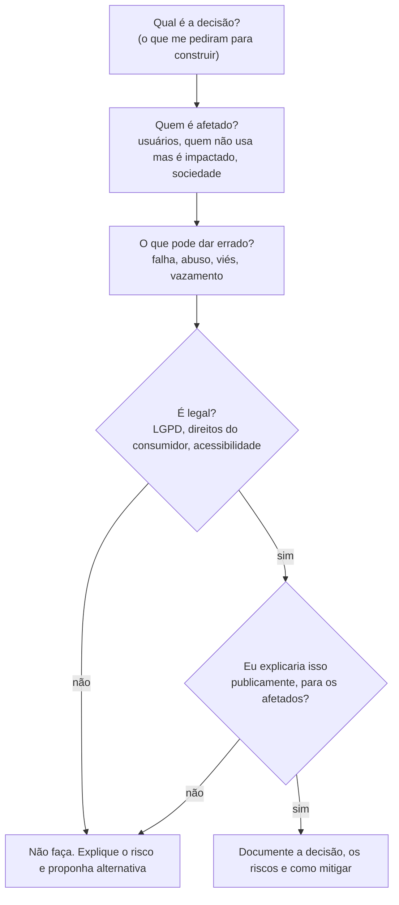

# Ética em tecnologia e engenharia

## Por que isso importa

Software decide quem recebe crédito, qual currículo é lido, que notícia você vê, quanto de radiação um paciente recebe e se um avião sobe ou desce. Quem escreve esse código toma decisões que afetam milhões de pessoas, muitas vezes sem perceber. Ética não é uma matéria "de humanas" separada da programação: é parte do trabalho de engenharia, como testes e segurança. E, no Brasil, parte dela virou lei: a **LGPD** (Lei Geral de Proteção de Dados) multa empresas que tratam dados pessoais de forma errada.

## Intuição

Pense num **engenheiro civil**. Ele não pergunta só "a ponte fica de pé?", mas também "aguenta o dobro do peso previsto?", "quem passa por ela?", "o que acontece se falhar?". Se o chefe pedir para economizar no aço abaixo do seguro, ele diz não, porque responde pelas vidas de quem atravessa.

No software as falhas são menos visíveis que uma ponte caindo, mas o raciocínio é o mesmo: **quem é afetado pelo que eu estou construindo, e o que acontece quando dá errado?**

## Visual

Roteiro para pensar num dilema antes de decidir:



## Conceito técnico

### Casos que todo dev deveria conhecer

| Caso | O que aconteceu | Lição |
|---|---|---|
| **Therac-25** (1985-87) | Máquina de radioterapia com uma condição de corrida no software deu doses até 100 vezes maiores; pessoas morreram. As travas físicas de segurança tinham sido removidas porque "o software cuidava disso". | Software crítico precisa de redundância, testes rigorosos e relato de incidentes levado a sério. |
| **Boeing 737 MAX** (2018-19) | O sistema MCAS dependia de **um único sensor**; com o sensor com defeito, empurrava o nariz do avião para baixo repetidamente. Pilotos não tinham sido treinados sobre ele. 346 mortes. | Um ponto único de falha, documentação escondida e pressão de prazo e custo matam. |
| **Ferramenta de recrutamento da Amazon** (2018) | Um modelo treinado com currículos de 10 anos (maioria de homens) aprendeu a penalizar a palavra "women's". Foi descontinuada. | Dados históricos carregam os preconceitos do passado; o modelo os reproduz em escala. |
| **COMPAS** (EUA) | Algoritmo que estimava risco de reincidência criminal errava mais contra pessoas negras (mais falsos positivos). | "O computador decidiu" não torna a decisão neutra. Decisões que afetam direitos precisam de transparência e revisão humana. |
| **Cambridge Analytica** (2018) | Um app de quiz coletou dados de dezenas de milhões de perfis do Facebook (incluindo amigos de quem respondeu) para propaganda política. | Consentimento de verdade exige saber para que os dados serão usados. Coletar "porque dá" é risco. |

### Privacidade e LGPD

A **LGPD** (Lei 13.709/2018) vale para qualquer tratamento de dados pessoais de pessoas no Brasil. Conceitos que impactam diretamente o código:

- **Dado pessoal**: qualquer informação que identifique uma pessoa (nome, CPF, e-mail, IP, localização). **Dado sensível**: saúde, religião, origem racial, biometria, orientação sexual, opinião política; exige cuidado redobrado.
- **Base legal**: só se pode tratar dados com um motivo previsto em lei (consentimento, contrato, obrigação legal, entre outros).
- **Princípios**: **finalidade** (usar só para o que foi informado), **necessidade** (coletar o mínimo necessário), **transparência**, **segurança**, **prevenção**.
- **Direitos do titular**: acessar, corrigir, apagar, levar os dados para outro serviço (portabilidade) e revogar o consentimento.

Na prática, para quem programa: **privacy by design** (privacidade desde o projeto). Não colete o que não precisa, não guarde por mais tempo que o necessário, criptografe dados sensíveis, mascare dados em logs e telas, e faça o "apagar minha conta" apagar de verdade.

### Viés algorítmico

Um sistema pode discriminar sem que ninguém tenha escrito `if raça == ...`. Fontes comuns:

- **Dados de treino** que refletem desigualdades históricas (o caso da Amazon).
- **Variáveis substitutas** (proxies): o CEP pode funcionar como substituto de raça e renda.
- **Dados que não representam todo mundo**: sistemas de reconhecimento facial com taxas de erro muito maiores para mulheres negras, porque foram treinados com poucas fotos delas.
- **Métrica errada**: otimizar só "tempo de tela" favorece conteúdo que causa indignação.

Mitigar: medir o desempenho **separadamente por grupo**, revisar as variáveis, permitir contestação humana e documentar as limitações.

### Dark patterns

Truques de interface que levam a pessoa a fazer o que não queria: cancelamento escondido em cinco telas, caixa de "aceito receber ofertas" já marcada, contagem regressiva falsa ("só hoje!"), botão "Não, prefiro pagar mais caro" (*confirmshaming*). Além de antiético, muitos violam o Código de Defesa do Consumidor e a LGPD (consentimento precisa ser livre e informado).

### Acessibilidade

Mais de 18 milhões de brasileiros têm alguma deficiência (IBGE, 2022). Software inacessível exclui essas pessoas de bancos, serviços públicos e trabalho. A **Lei Brasileira de Inclusão** (13.146/2015) exige acessibilidade em sites. O básico você viu em WB-01: HTML semântico, `alt`, `label`, contraste, teclado.

### Propriedade intelectual e licenças

- Código tem **direito autoral** automaticamente. Código no GitHub **sem licença** não é livre para usar: você só pode ver.
- **Licenças permissivas** (MIT, Apache 2.0, BSD): pode usar, modificar e vender, mantendo o aviso de copyright.
- **Licenças copyleft** (GPL): pode usar e modificar, mas se **distribuir** um programa derivado, ele também precisa ser GPL com o código aberto.
- Copiar código do Stack Overflow ou de IA para projetos da empresa também tem implicações de licença e de segurança: entenda o que está colando.

### Responsabilidade profissional

O **Código de Ética da ACM** resume bem: contribuir para o bem-estar das pessoas, **evitar danos**, ser honesto, respeitar a privacidade, cumprir o que promete e **ser competente**: não aceitar trabalho que você não sabe fazer com segurança sem buscar ajuda. Quando algo está errado, existe o dever de levantar o problema (com dados, por escrito e pelos canais certos).

## Código

Ética também é código. Um exemplo de **minimização** e **mascaramento**: o log da aplicação não precisa do CPF completo nem do e-mail inteiro para depuração.

```python
def mascarar_cpf(cpf):
    """123.456.789-09 → ***.456.***-**  (mostra só o meio para conferência)"""
    digitos = [c for c in cpf if c.isdigit()]
    meio = "".join(digitos[3:6])
    return f"***.{meio}.***-**"


usuario = {"nome": "Israel", "cpf": "123.456.789-09", "senha": "segredo123"}
log = {"nome": usuario["nome"], "cpf": mascarar_cpf(usuario["cpf"])}   # sem a senha!
print("login:", log)
```

Medindo viés de forma simples: compare a **taxa de aprovação por grupo** de um sistema.

```python
decisoes = [
    ("A", True), ("A", True), ("A", False), ("A", True),
    ("B", False), ("B", True), ("B", False), ("B", False),
]

for grupo in ("A", "B"):
    do_grupo = [aprovado for g, aprovado in decisoes if g == grupo]
    taxa = sum(do_grupo) / len(do_grupo)
    print(f"grupo {grupo}: {taxa:.0%} aprovados")
```

Uma diferença grande (75% × 25%) não prova discriminação sozinha, mas é um **sinal de alerta** que exige investigação.

## Erros comuns

- **"Eu só escrevi o código, quem decidiu foi o chefe."** Quem constrói também responde. Levante o problema por escrito.
- **"O algoritmo é neutro, é matemática."** Ele aprende e reproduz os padrões dos dados e as escolhas de quem o projetou.
- **Coletar tudo "porque pode ser útil um dia".** Contraria a LGPD (necessidade) e aumenta o estrago num vazamento.
- **Guardar senhas em texto puro ou dados pessoais em logs.**
- **Usar código de um repositório sem licença** achando que "está no GitHub, então é livre".
- **Deixar acessibilidade "para depois".** Corrigir no fim custa muito mais que fazer certo desde o começo.

## Pratique

```quiz
id: ET-01-q1
tipo: multipla_escolha
pergunta: "No caso Therac-25, qual decisão de projeto contribuiu diretamente para as mortes?"
opcoes: ["Usar a linguagem errada", "Remover as travas físicas de segurança, confiando só no software", "Ter uma interface colorida", "Usar um banco de dados relacional"]
resposta: 1
explicacao: "Os modelos anteriores tinham intertravamentos de hardware que impediam doses absurdas. No Therac-25 eles foram removidos porque 'o software cuidava disso', e uma condição de corrida no software ficou sem nenhuma barreira."
dificuldade: 1
```

```quiz
id: ET-01-q2
tipo: multipla_escolha
pergunta: "Um app de lanterna pede acesso aos contatos e à localização \"para melhorar o serviço\". Qual princípio da LGPD isso mais claramente viola?"
opcoes: ["Portabilidade", "Necessidade (coletar só o mínimo para a finalidade)", "Livre acesso", "Nenhum, se o usuário clicou em aceitar"]
resposta: 1
explicacao: "Uma lanterna não precisa de contatos nem de localização. O princípio da necessidade limita a coleta ao mínimo para a finalidade. Clicar em 'aceitar' não legitima uma coleta desnecessária e mal explicada."
dificuldade: 1
```

```quiz
id: ET-01-q3
tipo: verdadeiro_falso
pergunta: "Se um modelo de crédito não usa a variável raça, ele não pode discriminar por raça."
resposta: false
explicacao: "Outras variáveis podem funcionar como substitutas (proxies), como CEP, escola ou renda, que se correlacionam com raça por causa de desigualdades históricas. É preciso medir os resultados por grupo para saber."
dificuldade: 2
```

```quiz
id: ET-01-q4
tipo: multipla_escolha
pergunta: "Você encontrou no GitHub um repositório útil, sem arquivo de licença. O que pode fazer?"
opcoes: ["Usar livremente, está público", "Usar se der crédito ao autor", "Ler e estudar, mas não copiar para o seu projeto sem permissão do autor", "Copiar, desde que mude os nomes das variáveis"]
resposta: 2
explicacao: "Sem licença, valem os direitos autorais padrão: todos os direitos reservados. Ser público não significa ser livre. O caminho é pedir ao autor que adicione uma licença ou dar permissão por escrito."
dificuldade: 2
```

```quiz
id: ET-01-q5
tipo: multipla_escolha
pergunta: "Qual destes é um dark pattern?"
opcoes: ["Um botão 'Cancelar assinatura' na tela de conta", "Uma caixa 'quero receber ofertas' que já vem marcada", "Um aviso de que a senha é fraca", "Pedir confirmação antes de apagar a conta"]
resposta: 1
explicacao: "Caixa pré-marcada aproveita a desatenção para obter um 'consentimento' que a pessoa não deu ativamente, o que também contraria a LGPD (consentimento deve ser livre, informado e inequívoco). As outras opções ajudam o usuário."
dificuldade: 1
```

```quiz
id: ET-01-q6
tipo: multipla_escolha
pergunta: "Você usa uma biblioteca GPL num programa que sua empresa vai vender e distribuir aos clientes. O que a GPL exige?"
opcoes: ["Nada, GPL é igual a MIT", "Que o programa derivado distribuído também seja licenciado como GPL, com código-fonte disponível", "Pagar royalties ao autor", "Que o programa seja gratuito"]
resposta: 1
explicacao: "A GPL é copyleft: quem distribui um derivado precisa manter a mesma licença e disponibilizar o código. Ela não proíbe vender. Por isso empresas olham a licença de cada dependência antes de usar."
dificuldade: 2
```

```quiz
id: ET-01-q7
tipo: resposta_curta
pergunta: "Seu gerente pede para lançar amanhã um recurso que você sabe que tem uma falha de segurança que expõe dados de clientes. O que você faz?"
resposta: "Explico o risco por escrito, com evidências e o impacto possível (vazamento de dados pessoais, LGPD), proponho alternativas (adiar, desligar o recurso, corrigir a parte crítica antes) e escalo pelos canais adequados se o risco for ignorado. Não lanço em silêncio."
palavras_chave: ["risco", "escrito", "alternativa", "dados"]
dificuldade: 2
```

```quiz
id: ET-01-q8
tipo: resposta_curta
pergunta: "No caso do 737 MAX, cite dois problemas de engenharia e de processo que levaram aos acidentes."
resposta: "O MCAS dependia de um único sensor de ângulo de ataque (ponto único de falha, sem redundância), e o sistema não foi documentado nem incluído no treinamento dos pilotos, sob pressão de prazo e custo para competir com o concorrente."
palavras_chave: ["sensor", "redundância", "treinamento", "pressão"]
dificuldade: 2
```

```quiz
id: ET-01-q9
tipo: codigo
linguagem: python
pergunta: |
  **Minimização de dados no log.** Escreva `mascarar_email(email)` que mantém só a **primeira letra** do usuário e o domínio inteiro, trocando o resto do usuário por `***`. `mascarar_email("israel@gmail.com")` retorna `'i***@gmail.com'`. Se o texto não tiver exatamente um `@`, lance `ValueError`. Os testes usam a função `tentar` (pronta), que devolve `'erro'` quando há ValueError.
codigo_inicial: |
  def mascarar_email(email):
      pass


  # não mude: os testes usam esta função
  def tentar(email):
      try:
          return mascarar_email(email)
      except ValueError:
          return "erro"
usa: [def, split, return, raise]
testes:
  - chamada: "tentar('israel@gmail.com')"
    saida: "'i***@gmail.com'"
  - chamada: "tentar('a@b.com')"
    saida: "'a***@b.com'"
  - chamada: "tentar('sem-arroba')"
    saida: "'erro'"
  - chamada: "tentar('x@y@z')"
    visivel: false
    saida: "'erro'"
  - chamada: "tentar('maria.silva@empresa.com.br')"
    visivel: false
    saida: "'m***@empresa.com.br'"
dica: "partes = email.split(\"@\"); se len(partes) != 2, raise ValueError(...). Depois usuario, dominio = partes e retorne usuario[0] + \"***@\" + dominio."
solucao: |
  def mascarar_email(email):
      partes = email.split("@")
      if len(partes) != 2:
          raise ValueError("e-mail inválido")
      usuario, dominio = partes
      return usuario[0] + "***@" + dominio


  # não mude: os testes usam esta função
  def tentar(email):
      try:
          return mascarar_email(email)
      except ValueError:
          return "erro"
explicacao: "Para depurar um problema de login, a primeira letra e o domínio quase sempre bastam. Guardar o mínimo reduz o estrago se o log vazar e cumpre o princípio da necessidade da LGPD. A quantidade de * é fixa para não revelar o tamanho do nome."
dificuldade: 1
```

```quiz
id: ET-01-q10
tipo: codigo
linguagem: python
pergunta: |
  **Auditoria de viés.** Escreva `taxas_por_grupo(decisoes)` que recebe uma lista de tuplas `(grupo, aprovado)` e retorna um dicionário `{grupo: taxa}`, com a taxa de aprovação de cada grupo arredondada em 2 casas, com os grupos em ordem alfabética. Depois, `alerta(decisoes)` retorna `True` se a diferença entre a maior e a menor taxa for **maior que 0.2**.
codigo_inicial: |
  def taxas_por_grupo(decisoes):
      pass


  def alerta(decisoes):
      pass
usa: [def, for, return, round]
testes:
  - chamada: "taxas_por_grupo([('A', True), ('A', False), ('B', True), ('B', True)])"
    saida: "{'A': 0.5, 'B': 1.0}"
  - chamada: "alerta([('A', True), ('A', False), ('B', True), ('B', True)])"
    saida: "True"
  - chamada: "alerta([('x', True), ('y', True), ('x', False), ('y', False)])"
    saida: "False"
  - chamada: "taxas_por_grupo([('C', False), ('A', True), ('C', True), ('C', True)])"
    visivel: false
    saida: "{'A': 1.0, 'C': 0.67}"
  - chamada: "alerta([('A', True), ('A', True), ('A', True), ('A', False), ('B', True), ('B', False)])"
    visivel: false
    saida: "True"
dica: "Monte dois dicionários: total[grupo] e aprovados[grupo] (comece cada grupo em 0 com .get(g, 0)). Depois percorra sorted(total) calculando round(aprovados[g] / total[g], 2). Em alerta, use max e min de taxas.values()."
solucao: |
  def taxas_por_grupo(decisoes):
      total = {}
      aprovados = {}
      for grupo, aprovado in decisoes:
          total[grupo] = total.get(grupo, 0) + 1
          aprovados[grupo] = aprovados.get(grupo, 0) + (1 if aprovado else 0)
      taxas = {}
      for g in sorted(total):
          taxas[g] = round(aprovados[g] / total[g], 2)
      return taxas


  def alerta(decisoes):
      taxas = taxas_por_grupo(decisoes).values()
      return max(taxas) - min(taxas) > 0.2
explicacao: "Essa é a métrica de 'paridade demográfica', uma das mais simples de justiça algorítmica. Ela não prova discriminação sozinha (os grupos podem diferir por motivos legítimos), mas um alerta exige investigar os dados e as variáveis do modelo. Dicionários vão ser estudados a fundo em ED-04."
dificuldade: 2
```

## Resumo

- Software toma decisões que afetam pessoas; pergunte sempre **quem é afetado** e **o que acontece quando falha**.
- Casos como **Therac-25** e **737 MAX** mostram o custo de pontos únicos de falha, pressa e documentação escondida.
- **LGPD**: base legal, **finalidade**, **necessidade** (mínimo de dados), segurança e direitos do titular. Pratique *privacy by design*.
- **Viés** vem de dados históricos, proxies e métricas erradas: meça os resultados **por grupo**.
- Evite **dark patterns**, faça software **acessível** e respeite **licenças** (sem licença ≠ livre; GPL é copyleft).

## Para ir além

- Leia o **Código de Ética da ACM** (acm.org/code-of-ethics) e o texto da **LGPD** (planalto.gov.br, Lei 13.709).
- Livro: *Algoritmos de Destruição em Massa*, de Cathy O'Neil (tem em português).
- **Próximos módulos** no seu caminho (semanas 9-12): ED-03 Listas ligadas e AL-01 Busca linear e binária.
