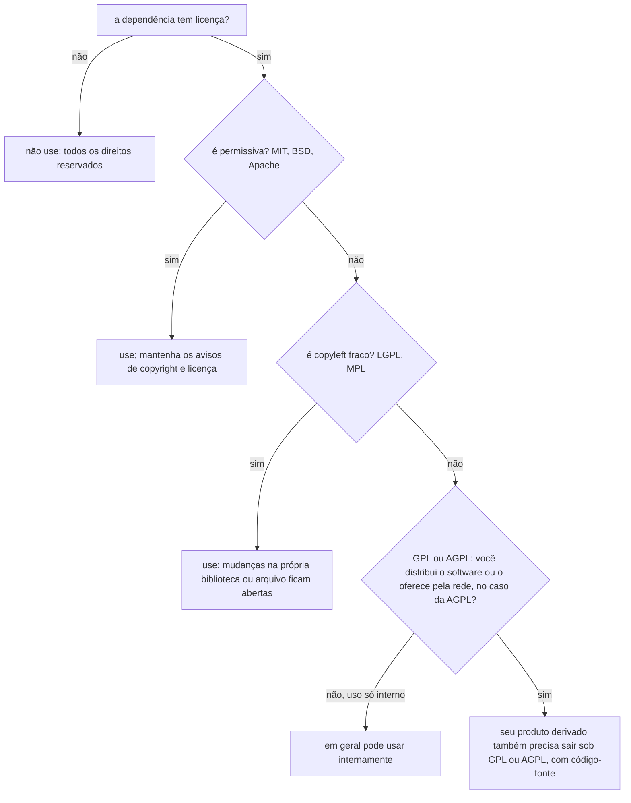

# Propriedade intelectual e licenças de software

## Por que isso importa

Todo projeto moderno é feito em boa parte de código alheio: um `npm install` típico traz centenas de pacotes, cada um com uma licença. Usar uma biblioteca com a licença errada pode obrigar uma empresa a abrir o código do produto, tirar um app do ar ou pagar indenização; auditorias de licença são rotina em fusões, aquisições e vendas para clientes grandes. Do outro lado, se você publica um projeto sem licença, ninguém pode usá-lo legalmente, e se escreve código no emprego, precisa saber de quem ele é. Nada disso exige ser advogado: exige conhecer meia dúzia de conceitos e ter o hábito de olhar o arquivo `LICENSE`.

> Esta aula é uma introdução para quem desenvolve, não um parecer jurídico. Em casos concretos com dinheiro ou risco envolvido, consulte um advogado especializado.

## Intuição

Escrever um programa é como escrever um livro: assim que você escreve, ele é seu, mesmo sem registrar nada. Os outros podem ler o que você publicou, mas **não podem copiar, alterar ou distribuir** sem a sua permissão.

Uma **licença** é essa permissão por escrito, dada de antemão a todo mundo, com condições. Algumas dizem "faça o que quiser, só mantenha meu nome" (**permissivas**). Outras dizem "pode usar e modificar, mas se distribuir uma versão modificada, ela também precisa ser livre, com o código aberto" (**copyleft**). É como uma receita de família que você pode passar adiante, desde que quem a receber também possa passá-la adiante.

## Visual

O espectro das licenças, das mais permissivas às mais restritivas:

```text
  domínio público      permissivas               copyleft fraco        copyleft forte          rede
  ─────────────────────────────────────────────────────────────────────────────────────────────────►
  CC0, Unlicense       MIT, BSD, ISC,            MPL 2.0 (por arquivo)  GPL 2.0, GPL 3.0        AGPL 3.0
                       Apache 2.0                LGPL (por biblioteca)
  sem condições        mantenha o aviso          mudanças NAQUELE        a obra derivada inteira  vale também para
                       (Apache: + patentes)      componente ficam        distribuída fica GPL      quem só USA pela rede
                                                 abertas
```

Posso usar esta dependência?



## Conceito técnico

### Os tipos de propriedade intelectual

- **Direito autoral** (copyright): protege a **expressão** (o código-fonte e o objeto), não a ideia. Nasce automaticamente com a criação, sem registro. No Brasil, a **Lei 9.609/1998** (Lei do Software) e a Lei 9.610/1998 (direitos autorais) tratam do tema; a proteção do software dura **50 anos**. O registro no INPI é opcional e serve como prova de autoria e data.
- **Patente**: protege uma **invenção** técnica. No Brasil, a Lei 9.279/1996 diz que programas de computador "em si" **não** são patenteáveis, mas invenções implementadas por software que resolvem um problema técnico podem ser. Nos EUA, patentes de software são mais comuns, e é por isso que licenças como a Apache 2.0 tratam de patentes.
- **Marca**: protege nomes e logotipos ("Python", "Linux", "Firefox"). Uma licença livre sobre o código **não** dá direito de usar a marca: é por isso que distribuições do Firefox modificado mudam de nome.
- **Segredo de negócio**: o que a empresa mantém em sigilo (algoritmos internos, dados). Protegido por contratos (NDAs) e pela lei de concorrência desleal.

### De quem é o código?

Pela **Lei do Software (art. 4º)**, salvo contrato em contrário:

- Código feito **no emprego**, como parte das funções para as quais você foi contratado (ou com recursos, equipamentos e informações da empresa), pertence ao **empregador**.
- Código feito **sem relação** com o trabalho e **sem usar** recursos da empresa pertence a você.
- **Freelas e prestadores de serviço**: depende do contrato. Sem cláusula de cessão, a discussão fica aberta, por isso o contrato precisa dizer quem fica com os direitos.

Na prática: leia o contrato de trabalho (muitos têm cláusulas de propriedade intelectual), não use o notebook da empresa para projetos pessoais e peça autorização por escrito antes de abrir código feito no trabalho.

### O que é software livre e de código aberto

As duas definições quase coincidem na prática:

- **Software livre** (Free Software Foundation): as **quatro liberdades**: executar para qualquer fim, estudar e modificar (acesso ao código), redistribuir cópias e distribuir versões modificadas.
- **Código aberto** (Open Source Initiative): dez critérios, incluindo redistribuição livre, acesso ao código e **nenhuma discriminação** de pessoas ou áreas de uso.

Uma licença que proíbe uso comercial, ou que restringe quem pode usar, **não** é de código aberto, mesmo que o código esteja visível. Essas licenças "de código disponível" (*source-available*) existem: BSL, SSPL, Elastic License e Commons Clause. Elas permitem ler o código, mas impõem restrições, geralmente contra concorrentes que ofereçam o software como serviço de nuvem.

### As licenças que você mais vai ver

| Licença | Tipo | Pode usar em software fechado? | Principais condições |
|---|---|---|---|
| **MIT**, **ISC**, **BSD-2/3-Clause** | Permissiva | Sim | Manter o aviso de copyright e o texto da licença |
| **Apache 2.0** | Permissiva | Sim | Avisos, arquivo NOTICE, indicar mudanças; **concessão de patentes** dos contribuidores, que se perde se você processar alguém por patente |
| **MPL 2.0** | Copyleft fraco (por arquivo) | Sim | Arquivos MPL modificados continuam MPL e abertos |
| **LGPL 2.1/3.0** | Copyleft fraco (por biblioteca) | Sim, ligando à biblioteca | Mudanças na biblioteca ficam LGPL; o usuário precisa poder trocar a biblioteca |
| **GPL 2.0/3.0** | Copyleft forte | Não, se distribuir | Obra derivada distribuída fica GPL, com código-fonte disponível |
| **AGPL 3.0** | Copyleft de rede | Não, se distribuir **ou oferecer pela rede** | Como a GPL, e quem usa o software modificado por um site ou API tem direito ao código |
| **CC0**, **Unlicense** | Domínio público | Sim | Nenhuma |

Pontos que confundem:

- **Copyleft só é ativado por distribuição** (ou acesso pela rede, na AGPL). Usar GPL internamente, sem distribuir, não obriga a abrir nada. Um SaaS usando GPL no servidor não distribui o software; foi para fechar essa brecha que a AGPL foi criada.
- **Compatibilidade**: código MIT pode entrar num projeto GPL (o todo fica GPL), mas o contrário não. A Apache 2.0 é compatível com a GPL 3.0, mas **não** com a GPL 2.0 *only*. GPL 2.0 *only* e GPL 3.0 são incompatíveis entre si; "GPL 2.0 *or later*" resolve.
- **Creative Commons** é para textos, imagens e dados, não para código (com exceção da CC0).
- **Licença dupla**: um projeto pode oferecer AGPL para todos e uma licença comercial paga para quem não quer abrir o código (MySQL, Qt).

### Cumprindo as licenças na prática

- Mantenha os **avisos de copyright** e os textos das licenças das dependências que você distribui. Apps e produtos costumam ter uma tela ou arquivo de "licenças de terceiros" (os `THIRD-PARTY-NOTICES`).
- Use **identificadores SPDX** (`MIT`, `Apache-2.0`, `GPL-3.0-only`, `GPL-3.0-or-later`) no `package.json`, no `pyproject.toml` e em cabeçalhos de arquivo (`// SPDX-License-Identifier: MIT`). Expressões como `MIT OR Apache-2.0` significam que você escolhe uma; `MIT AND BSD-3-Clause`, que precisa cumprir as duas.
- **Automatize**: ferramentas como `license-checker` (npm), `pip-licenses`, `cargo-deny`, FOSSA e a análise de dependências do GitHub listam as licenças e quebram o CI quando aparece uma proibida.
- **Contribuições**: muitos projetos pedem um **DCO** (você assina cada commit com `Signed-off-by`, atestando que tem o direito de enviar aquele código) ou um **CLA** (um contrato que cede ou licencia os direitos ao mantenedor).

### Escolhendo a licença do seu projeto

- Quer que o máximo de gente use, inclusive empresas, sem atrito: **MIT** (ou **Apache 2.0**, se quiser a proteção de patentes).
- Quer que melhorias voltem para a comunidade: **GPL 3.0**; se for um serviço web, **AGPL 3.0**.
- Uma biblioteca que quer ser usada por software fechado, mas com melhorias na própria biblioteca abertas: **MPL 2.0** ou **LGPL**.
- **Sem licença = todos os direitos reservados.** Coloque um arquivo `LICENSE` na raiz de todo repositório público.

### E o código gerado por IA?

Território ainda em definição, e vale acompanhar. Questões em aberto: se o código gerado pode reproduzir trechos de código licenciado usado no treino (algumas ferramentas têm filtros para bloquear trechos idênticos a código público); se há direito autoral sobre algo criado sem autoria humana significativa (o escritório de direitos autorais dos EUA tem negado registro a obras sem contribuição humana relevante); e o que diz a política da sua empresa. Boa prática: trate a saída de IA como um trecho de código de origem desconhecida: revise, entenda, teste e não cole grandes blocos sem saber de onde vieram.

## Código

Uma auditoria de licenças simples: dada a lista de dependências com expressões SPDX e a política da empresa, aponta o que precisa de atenção.

```python
politica = {
    "permitidas": {"MIT", "ISC", "BSD-2-Clause", "BSD-3-Clause", "Apache-2.0", "0BSD", "CC0-1.0"},
    "revisar": {"MPL-2.0", "LGPL-2.1-only", "LGPL-3.0-only"},
    "proibidas": {"GPL-2.0-only", "GPL-3.0-only", "GPL-3.0-or-later", "AGPL-3.0-only", "SSPL-1.0"},
}

dependencias = [
    ("react", "18.3.1", "MIT"),
    ("lodash", "4.17.21", "MIT"),
    ("tslib", "2.6.2", "0BSD"),
    ("rxjs", "7.8.1", "Apache-2.0"),
    ("bibliotecaX", "1.0.0", "MIT OR GPL-3.0-only"),
    ("graficos-pro", "3.2.0", "AGPL-3.0-only"),
    ("parser-legado", "0.9.1", "LGPL-2.1-only"),
    ("util-sem-licenca", "0.0.3", ""),
]

def classificar(expressao):
    if not expressao:
        return "XX", "sem licença: todos os direitos reservados"
    opcoes = [o.strip() for o in expressao.split(" OR ")]  # OR: podemos escolher qualquer uma
    for opcao in opcoes:
        if opcao in politica["permitidas"]:
            return "ok", f"usar sob {opcao}"
    for opcao in opcoes:
        if opcao in politica["revisar"]:
            return "??", f"{opcao}: copyleft fraco, revisar como a biblioteca é usada"
    if all(o in politica["proibidas"] for o in opcoes):
        return "XX", "proibida pela política (copyleft forte ou restrição de uso)"
    return "??", "licença desconhecida: pedir análise"

for nome, versao, licenca in dependencias:
    marca, motivo = classificar(licenca)
    print(f"{marca}  {nome + '@' + versao:<24} {licenca or '(nenhuma)':<22} {motivo}")
```

Repare em `bibliotecaX`: com `MIT OR GPL-3.0-only`, você **escolhe** usar sob MIT, e ela passa. Já `graficos-pro` (AGPL) num produto oferecido pela internet obrigaria a abrir o código: precisa de outra biblioteca ou de uma licença comercial.

## Erros comuns

- **"Está no GitHub, então é livre."** Sem arquivo de licença, todos os direitos são reservados.
- **Achar que "open source" significa "pode fazer qualquer coisa"**: as licenças têm condições, como manter avisos e abrir derivados.
- **Remover cabeçalhos de copyright** de arquivos copiados.
- **Usar uma biblioteca AGPL num SaaS** achando que, como não distribui o software, a licença não se aplica.
- **Misturar GPL 2.0 *only* com Apache 2.0** ou com GPL 3.0 no mesmo programa distribuído.
- **Abrir no GitHub um código feito no trabalho** sem autorização: pela lei, ele provavelmente é da empresa.
- **Usar a marca de um projeto** (nome e logo) num fork como se fosse o oficial.
- **Colar código de IA ou de fórum** sem saber a origem e sem revisar.

## Pratique

```quiz
id: ET-02-q1
tipo: multipla_escolha
pergunta: "Você encontrou no GitHub um repositório público com o código exato de que precisa, mas sem nenhum arquivo de licença. O que pode fazer?"
opcoes: ["Usar livremente, já que é público", "Ler e aprender, mas não copiar nem distribuir: sem licença, todos os direitos são reservados. Peça ao autor que adicione uma licença", "Usar, desde que cite o autor", "Usar em projetos não comerciais"]
resposta: 1
explicacao: "O direito autoral nasce com a criação. Publicar o código não concede nenhuma permissão além de visualizar (e, pelos termos do GitHub, fazer fork na plataforma). Abrir uma issue pedindo uma licença costuma resolver."
dificuldade: 1
```

```quiz
id: ET-02-q2
tipo: multipla_escolha
pergunta: "Sua empresa oferece um sistema web (SaaS) e quer usar uma biblioteca modificada. Qual licença obrigaria a disponibilizar o código modificado para os usuários do site?"
opcoes: ["MIT", "Apache 2.0", "GPL 3.0", "AGPL 3.0"]
resposta: 3
explicacao: "A GPL só é ativada pela distribuição do software; um SaaS não distribui o programa, só o executa no servidor. A AGPL foi criada para isso: quem interage com o software modificado pela rede tem direito ao código-fonte. É por isso que muitas empresas proíbem AGPL."
dificuldade: 2
```

```quiz
id: ET-02-q3
tipo: verdadeiro_falso
pergunta: "Pela Lei do Software brasileira, salvo contrato em contrário, o código que você escreve no emprego, como parte das suas funções, pertence ao empregador."
resposta: true
explicacao: "É o que diz o art. 4º da Lei 9.609/1998. Código feito fora do horário, sem relação com o contrato e sem usar recursos da empresa pertence a quem o fez. Em caso de dúvida, leia o contrato e peça autorização por escrito."
dificuldade: 1
```

```quiz
id: ET-02-q4
tipo: multipla_escolha
pergunta: "Qual a principal diferença prática da Apache 2.0 em relação à MIT?"
opcoes: ["A Apache 2.0 é copyleft", "A Apache 2.0 inclui uma concessão explícita de patentes dos contribuidores (perdida por quem processar por patente) e exige um arquivo NOTICE", "A Apache 2.0 proíbe uso comercial", "Nenhuma; são idênticas"]
resposta: 1
explicacao: "As duas são permissivas e permitem uso em software fechado. A Apache 2.0 é mais longa porque trata de patentes: cada contribuidor licencia as patentes que cobrem a sua contribuição. Por isso muitas empresas preferem a Apache 2.0 em projetos grandes."
dificuldade: 2
```

```quiz
id: ET-02-q5
tipo: resposta_curta
pergunta: "Qual a diferença entre uma licença permissiva e uma copyleft? Dê um exemplo de cada."
resposta: "Uma licença permissiva (MIT, BSD, Apache) permite usar, modificar e redistribuir, inclusive em software fechado, pedindo basicamente que se mantenham os avisos de copyright. Uma copyleft (GPL, AGPL) também permite tudo isso, mas exige que obras derivadas distribuídas sejam licenciadas sob a mesma licença, com o código-fonte aberto."
palavras_chave: ["permissiva", "copyleft", "derivada", "mesma licença"]
dificuldade: 1
```

```quiz
id: ET-02-q6
tipo: codigo
linguagem: python
pergunta: |
  **Auditoria com expressões SPDX.** Cada dependência é uma tupla `(nome, expressao)`. A expressão é uma licença (`'MIT'`), uma escolha entre licenças separadas por `' OR '` (basta **uma** ser permitida) ou um conjunto separado por `' AND '` (**todas** precisam ser permitidas). Não há expressões misturando `OR` e `AND`. Uma expressão vazia nunca é permitida.

  Escreva `bloqueadas(dependencias, permitidas)`, que devolve a lista dos nomes que **não** passam na política, na ordem original.
codigo_inicial: |
  def bloqueadas(dependencias, permitidas):
      return [nome for nome, expr in dependencias if expr not in permitidas]
usa: [def, for, return]
testes:
  - chamada: "bloqueadas([('a', 'MIT'), ('b', 'GPL-3.0-only')], {'MIT'})"
    saida: "['b']"
  - chamada: "bloqueadas([('a', 'MIT OR GPL-3.0-only'), ('b', 'GPL-2.0-only OR AGPL-3.0-only')], {'MIT', 'Apache-2.0'})"
    saida: "['b']"
  - chamada: "bloqueadas([('a', 'MIT AND BSD-3-Clause'), ('b', 'MIT AND GPL-3.0-only')], {'MIT', 'BSD-3-Clause'})"
    saida: "['b']"
  - chamada: "bloqueadas([('x', ''), ('y', 'ISC')], {'ISC'})"
    visivel: false
    saida: "['x']"
  - chamada: "bloqueadas([('p', 'Apache-2.0 OR MIT'), ('q', 'Apache-2.0'), ('r', 'BSD-2-Clause AND MIT')], {'MIT'})"
    visivel: false
    saida: "['q', 'r']"
  - chamada: "bloqueadas([], {'MIT'})"
    visivel: false
    saida: "[]"
dica: "Para cada expressão: se estiver vazia, bloqueie. Se contiver ' OR ', permita se any(op in permitidas ...) sobre expr.split(' OR '). Se contiver ' AND ', permita se all(...) sobre expr.split(' AND '). Senão, é uma licença só."
solucao: |
  def bloqueadas(dependencias, permitidas):
      resultado = []
      for nome, expr in dependencias:
          if not expr:
              ok = False
          elif ' OR ' in expr:
              ok = any(op in permitidas for op in expr.split(' OR '))
          elif ' AND ' in expr:
              ok = all(op in permitidas for op in expr.split(' AND '))
          else:
              ok = expr in permitidas
          if not ok:
              resultado.append(nome)
      return resultado
explicacao: "OR é uma escolha oferecida pelo autor (licença dupla): você pode usar sob qualquer uma, então basta uma ser aceitável. AND acontece quando partes do pacote têm licenças diferentes: você precisa cumprir todas. Ferramentas reais de conformidade (license-checker, cargo-deny, FOSSA) fazem exatamente isso, com o parser completo de expressões SPDX, que aceita parênteses e WITH para exceções."
dificuldade: 2
```

```quiz
id: ET-02-q7
tipo: codigo
linguagem: python
pergunta: |
  **Posso incluir esta dependência?** Use esta tabela simplificada de compatibilidade para **distribuir** um programa:

  - dependências `'MIT'`, `'BSD-3-Clause'` e `'LGPL-3.0'` podem entrar em qualquer projeto;
  - `'Apache-2.0'` pode entrar em qualquer projeto, **exceto** `'GPL-2.0-only'`;
  - `'GPL-3.0'` só pode entrar em projetos `'GPL-3.0'` ou `'AGPL-3.0'`;
  - `'AGPL-3.0'` só pode entrar em projetos `'AGPL-3.0'`;
  - `'GPL-2.0-only'` só pode entrar em projetos `'GPL-2.0-only'`;
  - qualquer outra licença de dependência: `False`.

  Escreva `pode_incluir(projeto, dependencia)`, que devolve `True` ou `False`.
codigo_inicial: |
  def pode_incluir(projeto, dependencia):
      return projeto == dependencia
usa: [def, if, return]
testes:
  - chamada: "pode_incluir('MIT', 'Apache-2.0')"
    saida: "True"
  - chamada: "pode_incluir('MIT', 'GPL-3.0')"
    saida: "False"
  - chamada: "pode_incluir('GPL-3.0', 'MIT')"
    saida: "True"
  - chamada: "pode_incluir('GPL-2.0-only', 'Apache-2.0')"
    saida: "False"
  - chamada: "pode_incluir('AGPL-3.0', 'GPL-3.0')"
    visivel: false
    saida: "True"
  - chamada: "pode_incluir('GPL-3.0', 'AGPL-3.0')"
    visivel: false
    saida: "False"
  - chamada: "pode_incluir('Proprietaria', 'LGPL-3.0')"
    visivel: false
    saida: "True"
  - chamada: "pode_incluir('GPL-3.0', 'GPL-2.0-only')"
    visivel: false
    saida: "False"
  - chamada: "pode_incluir('MIT', 'WTFPL')"
    visivel: false
    saida: "False"
dica: "Um dicionário de dependência para o conjunto de projetos que a aceitam resolve quase tudo; trate 'qualquer projeto' (e a exceção da Apache) com um if antes."
solucao: |
  def pode_incluir(projeto, dependencia):
      if dependencia in ('MIT', 'BSD-3-Clause', 'LGPL-3.0'):
          return True
      if dependencia == 'Apache-2.0':
          return projeto != 'GPL-2.0-only'
      aceitam = {
          'GPL-3.0': {'GPL-3.0', 'AGPL-3.0'},
          'AGPL-3.0': {'AGPL-3.0'},
          'GPL-2.0-only': {'GPL-2.0-only'},
      }
      return projeto in aceitam.get(dependencia, set())
explicacao: "A regra geral do copyleft: o código pode fluir de licenças menos restritivas para mais restritivas, nunca o contrário. MIT entra na GPL; GPL não entra num projeto MIT distribuído. A GPL 3.0 permite expressamente a combinação com AGPL 3.0. A tabela é simplificada (a LGPL, por exemplo, exige que o usuário possa trocar a biblioteca), mas cobre os casos que mais aparecem."
dificuldade: 2
```

```quiz
id: ET-02-q8
tipo: codigo
linguagem: javascript
pergunta: |
  **Arquivo de avisos de terceiros.** Escreva `avisos(deps)`, em que cada dependência é `{ nome, versao, licenca, autor }`. Devolva uma lista de linhas agrupadas por licença:

  - as licenças em ordem alfabética; para cada uma, uma linha `'== LICENÇA =='` seguida das linhas `'nome@versao (c) autor'`, em ordem alfabética de nome;
  - dependências com `licenca` vazia não entram nos grupos; se houver alguma, termine com a linha `'ATENÇÃO sem licença: '` seguida dos nomes em ordem alfabética, separados por `', '`.
codigo_inicial: |
  function avisos(deps) {
    return deps.map((d) => d.nome);
  }
usa: [function, for, return, sort]
testes:
  - chamada: "avisos([{ nome: 'react', versao: '18.3.1', licenca: 'MIT', autor: 'Meta' }])"
    saida: "[ '== MIT ==', 'react@18.3.1 (c) Meta' ]"
  - chamada: "avisos([{ nome: 'zod', versao: '3.23', licenca: 'MIT', autor: 'Colin' }, { nome: 'rxjs', versao: '7.8', licenca: 'Apache-2.0', autor: 'Google' }, { nome: 'axios', versao: '1.7', licenca: 'MIT', autor: 'Matt' }])"
    saida: "[ '== Apache-2.0 ==', 'rxjs@7.8 (c) Google', '== MIT ==', 'axios@1.7 (c) Matt', 'zod@3.23 (c) Colin' ]"
  - chamada: "avisos([{ nome: 'x', versao: '1', licenca: '', autor: '?' }, { nome: 'a', versao: '2', licenca: '', autor: '?' }])"
    visivel: false
    saida: "[ 'ATENÇÃO sem licença: a, x' ]"
  - chamada: "avisos([])"
    visivel: false
    saida: "[]"
  - chamada: "avisos([{ nome: 'b', versao: '1', licenca: 'ISC', autor: 'B' }, { nome: 'c', versao: '1', licenca: '', autor: 'C' }])"
    visivel: false
    saida: "[ '== ISC ==', 'b@1 (c) B', 'ATENÇÃO sem licença: c' ]"
dica: "Agrupe num objeto { licenca: [deps] } e separe as sem licença. Depois percorra Object.keys(grupos).sort(), ordene cada grupo por nome com sort((a, b) => a.nome.localeCompare(b.nome)) e monte as linhas."
solucao: |
  function avisos(deps) {
    const grupos = {};
    const semLicenca = [];
    for (const d of deps) {
      if (!d.licenca) {
        semLicenca.push(d.nome);
        continue;
      }
      if (!grupos[d.licenca]) grupos[d.licenca] = [];
      grupos[d.licenca].push(d);
    }
    const linhas = [];
    for (const licenca of Object.keys(grupos).sort()) {
      linhas.push(`== ${licenca} ==`);
      const ordenadas = grupos[licenca].sort((a, b) => a.nome.localeCompare(b.nome));
      for (const d of ordenadas) {
        linhas.push(`${d.nome}@${d.versao} (c) ${d.autor}`);
      }
    }
    if (semLicenca.length > 0) {
      linhas.push("ATENÇÃO sem licença: " + semLicenca.sort().join(", "));
    }
    return linhas;
  }
explicacao: "Manter os avisos de copyright é a condição comum a quase todas as licenças, inclusive as permissivas. Apps móveis e produtos embarcados costumam ter uma tela 'Licenças de código aberto' gerada exatamente assim, a partir do lockfile, no build. Uma dependência sem licença deve parar o processo até alguém decidir o que fazer."
dificuldade: 2
```

## Resumo

- Software é protegido por **direito autoral** desde a criação (Lei 9.609/1998); **patentes** de software "em si" não existem no Brasil; **marcas** protegem nomes.
- Código feito **no emprego**, nas funções do cargo, é do **empregador**, salvo contrato.
- **Sem licença = todos os direitos reservados.**
- **Permissivas** (MIT, BSD, Apache 2.0): mantenha avisos. **Copyleft fraco** (MPL, LGPL): o componente fica aberto. **Copyleft forte** (GPL): o derivado distribuído fica GPL. **AGPL**: vale também pela rede.
- Use **SPDX**, automatize a verificação de licenças no CI e gere os avisos de terceiros.
- Código de IA: trate como origem desconhecida e revise.

## Para ir além

- Rode `npx license-checker --summary` (ou `pip-licenses`) num projeto seu e veja quantas licenças diferentes você já usa.
- Escolha uma licença em choosealicense.com e adicione `LICENSE` e o campo `license` (SPDX) a todos os seus repositórios públicos.
- Leia a Lei 9.609/1998: é curta, e os artigos 2º a 4º respondem às dúvidas mais comuns.
- **Próximo módulo**: ET-03 Privacidade de dados e LGPD.
