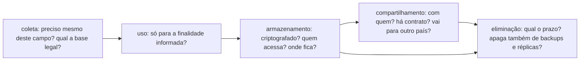

# Privacidade de dados e LGPD

## Por que isso importa

Quase todo sistema guarda dados pessoais: um cadastro, um log com IP, um formulário de contato, uma planilha de clientes. A **LGPD** (Lei Geral de Proteção de Dados, Lei 13.709/2018) vale para qualquer empresa ou órgão que trate dados de pessoas no Brasil, do banco à padaria com programa de fidelidade, e as decisões que mais pesam no cumprimento dela são técnicas: o que o formulário pede, o que vai para o log, quanto tempo o backup guarda, se o "excluir conta" exclui de verdade. Vazamentos de dados no Brasil já expuseram centenas de milhões de registros; cada um começa com um campo que não precisava existir, uma senha mal guardada ou um bucket público. Quem programa é a primeira linha de defesa da privacidade.

> Esta aula é uma introdução prática para quem desenvolve, não um parecer jurídico. Casos concretos devem passar pelo encarregado de dados (DPO) ou pelo jurídico da organização.

## Intuição

Imagine que você empresta a chave de casa para um eletricista consertar o chuveiro. Você espera que ele entre só para isso (**finalidade**), mexa só no banheiro (**necessidade**), não faça cópia da chave (**retenção**), não conte para ninguém o que viu lá dentro (**segurança** e **sigilo**), e devolva a chave quando você pedir (**direitos do titular**). Se ele aproveitar para fotografar seus documentos "porque podem ser úteis um dia", algo está muito errado.

Dados pessoais são essa chave. A pessoa (o **titular**) empresta os dados para um fim; a empresa (o **controlador**) responde pelo que é feito com eles, inclusive pelos prestadores que contratou (os **operadores**).

## Visual

O ciclo de vida de um dado pessoal e as perguntas de cada fase:



Quem é quem:

```text
   TITULAR                    CONTROLADOR                         OPERADOR
   a pessoa a quem    ──►     decide POR QUE e COMO       ──►     trata os dados EM NOME do
   os dados se                os dados são tratados                controlador (nuvem, e-mail
   referem                    (a loja, o app, o hospital)          marketing, empresa de folha)
                                       │
                                       ├── ENCARREGADO (DPO): canal com titulares e com a ANPD
                                       │
                              ANPD: Autoridade Nacional de Proteção de Dados (fiscaliza e sanciona)
```

## Conceito técnico

### O que é dado pessoal

- **Dado pessoal**: informação relacionada a pessoa natural **identificada ou identificável**. Não só nome e CPF: e-mail, telefone, IP, identificador de dispositivo, cookie, geolocalização, placa do carro, foto, voz. Se dá para chegar à pessoa combinando com outras informações, é dado pessoal.
- **Dado pessoal sensível**: origem racial ou étnica, convicção religiosa, opinião política, filiação a sindicato ou organização religiosa, filosófica ou política, saúde, vida sexual, dado genético ou **biométrico**. Tem regras mais restritas.
- **Dados de crianças e adolescentes**: tratados sempre no **melhor interesse** deles; para crianças, em regra com consentimento específico de um dos pais ou responsável.
- **Dado anonimizado** não é dado pessoal para a LGPD, **desde que** a anonimização não possa ser revertida com esforço razoável. Dado **pseudonimizado** (o nome trocado por um código, mas a tabela de correspondência existe) **continua** sendo dado pessoal.

### Bases legais: só se trata dado com um motivo da lista

A LGPD lista dez hipóteses (art. 7º). As mais comuns no dia a dia de produto:

- **Consentimento**: livre, informado, inequívoco e para finalidades específicas. Pode ser revogado a qualquer momento, e revogar tem de ser tão fácil quanto dar. Caixa pré-marcada não vale.
- **Execução de contrato**: o endereço para entregar a compra, o e-mail para enviar o recibo.
- **Cumprimento de obrigação legal**: guardar notas fiscais pelo prazo fiscal.
- **Legítimo interesse**: interesse real da empresa (prevenção a fraude, segurança), equilibrado com os direitos do titular e documentado. Não serve para dado sensível.
- Também: exercício de direitos em processo, proteção da vida, tutela da saúde, proteção do crédito, políticas públicas e pesquisa.

Consentimento **não** é a única base, e nem sempre é a melhor: se o dado é necessário para o serviço, a base é o contrato, e pedir "consentimento" para algo obrigatório confunde.

### Os princípios, traduzidos para decisões técnicas

| Princípio (art. 6º) | Na prática |
|---|---|
| **Finalidade** e **adequação** | O dado coletado para entrega não vira base de marketing sem nova base legal |
| **Necessidade** (minimização) | Não peça CPF, data de nascimento ou gênero se o serviço não precisa |
| **Livre acesso** e **transparência** | Política de privacidade clara; a pessoa consegue ver o que você tem sobre ela |
| **Qualidade dos dados** | Permitir corrigir; manter os dados atualizados |
| **Segurança** e **prevenção** | Criptografia, controle de acesso, logs sem dados pessoais, testes de segurança (SE-01 a SE-04) |
| **Não discriminação** | Nada de usar dados para discriminar de forma ilícita ou abusiva |
| **Responsabilização** | Conseguir **demonstrar** que cumpre: registros, políticas, relatórios de impacto |

### Os direitos do titular, e o que eles exigem do sistema

O titular pode pedir, a qualquer momento (art. 18):

- **Confirmação e acesso**: "vocês têm dados meus? quais?". O sistema precisa encontrar todos os dados de uma pessoa, em todos os bancos, filas e serviços.
- **Correção** de dados incompletos ou desatualizados.
- **Anonimização, bloqueio ou eliminação** do que for desnecessário, excessivo ou tratado em desconformidade.
- **Portabilidade** para outro fornecedor, em formato estruturado.
- **Eliminação** dos dados tratados com base no consentimento, e **revogação** do consentimento.
- **Informação** sobre com quem os dados foram compartilhados.
- **Revisão de decisões automatizadas** que afetem seus interesses (art. 20), como uma negativa de crédito por algoritmo.

Para atender isso, o sistema precisa saber **onde estão** os dados pessoais (um inventário ou mapa de dados), conseguir **exportá-los** e **apagá-los de verdade**, inclusive em réplicas, caches, data warehouse e serviços de terceiros, e respeitando os prazos de backup e as obrigações legais de guarda.

### Privacidade desde a concepção (privacy by design)

Técnicas que você aplica no código:

- **Minimização**: cada campo do formulário precisa de justificativa. Guarde a faixa etária em vez da data de nascimento, a cidade em vez do endereço, quando bastar.
- **Pseudonimização**: substituir identificadores por códigos. Um HMAC com chave secreta (SE-02) gera sempre o mesmo código para o mesmo CPF, o que permite cruzar tabelas sem expor o CPF; sem a chave, não dá para reverter por força bruta.
- **Anonimização**: remover ou generalizar até que ninguém seja reidentificável. É mais difícil do que parece: CEP, data de nascimento e sexo, juntos, identificam a grande maioria das pessoas. O **k-anonimato** exige que cada combinação de atributos "quase identificadores" apareça em pelo menos k registros.
- **Retenção**: defina um prazo para cada tipo de dado e apague automaticamente depois dele (um job diário, um TTL no banco).
- **Segurança**: criptografia em trânsito (TLS) e em repouso, senhas com hash lento (SE-02), controle de acesso por papel (SE-03), logs que **não** contêm dados pessoais nem segredos, ambientes de teste **sem** dados reais de produção.
- **Padrões protetivos** (privacy by default): o compartilhamento opcional começa desligado, o perfil começa privado.
- **Cookies e rastreamento**: cookies não essenciais (analytics de terceiros, publicidade) dependem de consentimento; o banner precisa permitir recusar com a mesma facilidade de aceitar.

### Incidentes de segurança

Quando dados pessoais vazam ou são acessados indevidamente:

1. **Contenha** o incidente (revogue credenciais, feche o acesso) e preserve as evidências.
2. **Avalie o risco** para os titulares: que dados, quantas pessoas, se há dados sensíveis ou financeiros.
3. Se houver risco ou dano relevante, **comunique a ANPD e os titulares**. A regulamentação da ANPD (Resolução CD/ANPD nº 15/2024) fixa o prazo de **3 dias úteis** a partir do conhecimento do incidente.
4. **Corrija a causa** e registre o incidente, mesmo os que não precisaram ser comunicados.

Sanções: advertência, publicização da infração, bloqueio ou eliminação dos dados, suspensão do tratamento e **multa de até 2% do faturamento** no Brasil, limitada a **R$ 50 milhões por infração**. O dano à reputação costuma custar mais.

### LGPD e GDPR

A LGPD foi muito inspirada no **GDPR** europeu: princípios, bases legais e direitos parecidos. Diferenças: o GDPR prevê multas de até 4% do faturamento **global** (ou 20 milhões de euros) e prazo de 72 horas para notificar incidentes. Se o seu sistema atende pessoas na Europa, o GDPR também se aplica. Transferir dados pessoais para fora do Brasil (inclusive para uma nuvem no exterior) exige uma das hipóteses do art. 33, como cláusulas contratuais padrão.

## Código

Um cadastro que aplica minimização, pseudonimização e logs limpos, e uma exportação para atender o direito de acesso e portabilidade.

```python
import hashlib
import hmac
import json
from datetime import date

CHAVE = b"segredo-guardado-num-cofre"  # em produção: um gerenciador de segredos, nunca no código

def pseudonimo(cpf):
    digitos = "".join(c for c in cpf if c.isdigit())
    return hmac.new(CHAVE, digitos.encode(), hashlib.sha256).hexdigest()[:16]

def faixa_etaria(nascimento, hoje):
    idade = hoje.year - nascimento.year - ((hoje.month, hoje.day) < (nascimento.month, nascimento.day))
    if idade < 18:
        return "menor de 18"
    inicio = min(idade // 10 * 10, 60)
    return f"{inicio}+" if inicio == 60 else f"{inicio}-{inicio + 9}"

formulario = {
    "nome": "Ana Souza", "email": "ana@exemplo.com", "cpf": "123.456.789-09",
    "nascimento": date(1990, 7, 14), "cidade": "Recife", "religiao": "não informar",
    "aceita_ofertas": False,
}

# minimização: só o que a finalidade (enviar pedidos e estatísticas por faixa etária) exige
cliente = {
    "id": pseudonimo(formulario["cpf"]),
    "nome": formulario["nome"],
    "email": formulario["email"],
    "cidade": formulario["cidade"],
    "faixa_etaria": faixa_etaria(formulario["nascimento"], date(2026, 3, 1)),
    "consentimentos": {"ofertas": formulario["aceita_ofertas"]},  # padrão protetivo: desligado
}
print("guardado:", cliente)

# logs: identifique o registro pelo pseudônimo, nunca pelos dados
print(f"log: cliente {cliente['id']} cadastrado, cidade={cliente['cidade']}")

# direito de acesso e portabilidade: tudo o que temos, num formato estruturado
pedidos = [{"cliente": cliente["id"], "pedido": 1042, "total": 89.9}]
exportacao = {
    "dados_cadastrais": {k: v for k, v in cliente.items() if k != "id"},
    "pedidos": [{k: v for k, v in p.items() if k != "cliente"} for p in pedidos if p["cliente"] == cliente["id"]],
    "compartilhado_com": ["transportadora (entrega)", "gateway de pagamento (cobrança)"],
}
print(json.dumps(exportacao, ensure_ascii=False, indent=2))
```

Repare que o campo de religião nem foi guardado: é dado sensível, e a loja não precisa dele. O melhor dado para proteger é o que você não coletou.

## Erros comuns

- **Coletar "porque pode ser útil"**: viola a necessidade e aumenta o estrago num vazamento.
- **Achar que só nome e CPF são dados pessoais**: IP, e-mail, cookie e localização também são.
- **Caixa de consentimento pré-marcada**, ou consentimento "empacotado" com os termos de uso.
- **Dados pessoais em logs**, mensagens de erro, URLs (`?email=...`) e ferramentas de monitoramento de terceiros.
- **Copiar o banco de produção para teste** ou para o notebook de alguém.
- **"Excluir conta" que só marca `ativo = false`** e mantém tudo para sempre, sem prazo de retenção.
- **Chamar de anonimizado** um dado que só teve o nome trocado por um código (isso é pseudonimização) ou que ainda tem CEP e data de nascimento completos.
- **Esconder um incidente** em vez de conter, avaliar e comunicar no prazo.

## Pratique

```quiz
id: ET-03-q1
tipo: multipla_escolha
pergunta: "Qual destes NÃO é, em regra, um dado pessoal para a LGPD?"
opcoes: ["O endereço IP de quem acessou o site", "O e-mail ana.souza@empresa.com", "A quantidade total de pedidos feitos na loja em março, sem vínculo com clientes", "A localização GPS do celular de um entregador"]
resposta: 2
explicacao: "Um total agregado sem possibilidade de chegar a uma pessoa não é dado pessoal. IP, e-mail e localização se relacionam a pessoas identificáveis, mesmo que sozinhos não digam o nome."
dificuldade: 1
```

```quiz
id: ET-03-q2
tipo: multipla_escolha
pergunta: "Uma loja online precisa do endereço do cliente para entregar a compra. Qual a base legal mais adequada?"
opcoes: ["Consentimento, com uma caixa obrigatória para marcar", "Execução de contrato: sem o endereço, não há como cumprir a venda", "Legítimo interesse de marketing", "Nenhuma: endereço não é dado pessoal"]
resposta: 1
explicacao: "O endereço é necessário para cumprir o contrato de compra e venda. Pedir 'consentimento' para algo sem o qual o serviço não funciona é confuso, porque consentimento pode ser revogado. Já usar o mesmo endereço para enviar catálogos impressos precisaria de outra base."
dificuldade: 2
```

```quiz
id: ET-03-q3
tipo: verdadeiro_falso
pergunta: "Se trocamos o CPF por um código gerado com HMAC e guardamos a chave em outro lugar, os dados deixam de ser pessoais para a LGPD."
resposta: false
explicacao: "Isso é pseudonimização: quem tem a chave consegue refazer o vínculo, e outros campos podem identificar a pessoa. Os dados continuam pessoais, embora a técnica reduza muito o risco. Só a anonimização que não pode ser revertida com esforço razoável tira o dado do alcance da LGPD."
dificuldade: 2
```

```quiz
id: ET-03-q4
tipo: multipla_escolha
pergunta: "A equipe descobre que um bucket com cópias de documentos de clientes ficou público por duas semanas. Qual a sequência certa?"
opcoes: ["Fechar o bucket e não falar nada, já que ninguém reclamou", "Conter (fechar o acesso), avaliar quais dados e quantas pessoas foram afetadas e, havendo risco relevante, comunicar a ANPD e os titulares no prazo, além de corrigir a causa", "Esperar a ANPD entrar em contato", "Apagar os logs de acesso para não haver prova"]
resposta: 1
explicacao: "Conter, avaliar, comunicar e corrigir. Documentos pessoais expostos são um risco relevante, e a comunicação tem prazo (3 dias úteis pela regulamentação da ANPD). Apagar evidências agrava a situação e impede saber quem acessou."
dificuldade: 1
```

```quiz
id: ET-03-q5
tipo: resposta_curta
pergunta: "Cite três decisões técnicas, no código ou na arquitetura, que aplicam o princípio da necessidade (minimização)."
resposta: "Não criar campos que a finalidade não exige (CPF, gênero, data de nascimento sem uso); guardar dados generalizados quando bastam (faixa etária em vez de data, cidade em vez de endereço); não registrar dados pessoais em logs; definir prazos de retenção com exclusão automática; enviar a terceiros só os campos de que eles precisam."
palavras_chave: ["campos", "faixa", "logs", "retenção", "terceiros"]
dificuldade: 1
```

```quiz
id: ET-03-q6
tipo: codigo
linguagem: python
pergunta: |
  **Pseudonimização para análise.** A equipe de dados quer analisar compras sem ver quem comprou. Escreva `pseudonimizar(registros, chave)`, que devolve uma **nova** lista de dicionários em que, para cada registro:

  - o campo `'cpf'` é substituído por `'id'`, com os 12 primeiros caracteres hexadecimais de `hmac.new(chave, digitos, hashlib.sha256)`, em que `digitos` são só os dígitos do CPF, em bytes;
  - os campos `'nome'` e `'email'` são removidos;
  - os demais campos são mantidos, e `'id'` vem **primeiro** no dicionário.
codigo_inicial: |
  import hashlib
  import hmac

  def pseudonimizar(registros, chave):
      return registros
usa: [def, for, return]
testes:
  - chamada: "pseudonimizar([{'cpf': '123.456.789-09', 'nome': 'Ana', 'total': 50}], b'k')"
    saida: "[{'id': 'e610ccd483d9', 'total': 50}]"
  - chamada: "[r['id'] for r in pseudonimizar([{'cpf': '123.456.789-09'}, {'cpf': '12345678909'}], b'k')]"
    saida: "['e610ccd483d9', 'e610ccd483d9']"
  - chamada: "pseudonimizar([{'cpf': '111.111.111-11', 'email': 'x@y.com', 'cidade': 'Natal', 'total': 10}], b'outra')"
    visivel: false
    saida: "[{'id': '4c0762f50a7f', 'cidade': 'Natal', 'total': 10}]"
  - chamada: "(lambda rs: (pseudonimizar(rs, b'k'), rs[0]['nome']))([{'cpf': '1', 'nome': 'Bia'}])"
    visivel: false
    saida: "([{'id': '0aa2054d8855'}], 'Bia')"
  - chamada: "pseudonimizar([], b'k')"
    visivel: false
    saida: "[]"
dica: "Para cada registro, comece um dicionário novo com {'id': ...} e depois copie os pares (campo, valor) cujo campo não esteja em ('cpf', 'nome', 'email'). Para os dígitos: ''.join(c for c in cpf if c.isdigit()).encode()."
solucao: |
  import hashlib
  import hmac

  def pseudonimizar(registros, chave):
      resultado = []
      for r in registros:
          digitos = ''.join(c for c in r['cpf'] if c.isdigit()).encode()
          novo = {'id': hmac.new(chave, digitos, hashlib.sha256).hexdigest()[:12]}
          for campo, valor in r.items():
              if campo not in ('cpf', 'nome', 'email'):
                  novo[campo] = valor
          resultado.append(novo)
      return resultado
explicacao: "O segundo teste mostra por que normalizar antes: o mesmo CPF com e sem pontuação gera o mesmo id, então dá para contar compras por pessoa sem saber quem é. Um hash sem chave (sha256 puro do CPF) não serviria: há só cerca de um bilhão de CPFs possíveis (9 dígitos mais 2 verificadores), e um atacante calcula o hash de todos em minutos. Com o HMAC, sem a chave, não há como reverter. Ainda assim, o resultado é pseudonimizado, não anônimo: quem tem a chave reidentifica."
dificuldade: 2
```

```quiz
id: ET-03-q7
tipo: codigo
linguagem: python
pergunta: |
  **k-anonimato.** Antes de publicar uma base "anonimizada", meça o risco de reidentificação. Escreva `k_anonimato(registros, campos)`, que agrupa os registros pela combinação dos valores dos `campos` (os quase identificadores) e devolve o tamanho do **menor** grupo. Para uma lista vazia, devolva 0.
codigo_inicial: |
  def k_anonimato(registros, campos):
      return len(registros)
usa: [def, for, return, min]
testes:
  - chamada: "k_anonimato([{'cep': '50000', 'idade': '20-29'}, {'cep': '50000', 'idade': '20-29'}], ['cep', 'idade'])"
    saida: "2"
  - chamada: "k_anonimato([{'cep': '50000', 'idade': '20-29'}, {'cep': '50000', 'idade': '20-29'}, {'cep': '51000', 'idade': '20-29'}], ['cep', 'idade'])"
    saida: "1"
  - chamada: "k_anonimato([{'cep': '50000', 'idade': '20-29'}, {'cep': '50000', 'idade': '20-29'}, {'cep': '51000', 'idade': '20-29'}], ['idade'])"
    saida: "3"
  - chamada: "k_anonimato([], ['cep'])"
    visivel: false
    saida: "0"
  - chamada: "k_anonimato([{'a': 1, 'b': 1, 'doenca': 'x'}, {'a': 1, 'b': 2, 'doenca': 'y'}, {'a': 1, 'b': 1, 'doenca': 'z'}, {'a': 1, 'b': 2, 'doenca': 'x'}, {'a': 1, 'b': 2, 'doenca': 'y'}], ['a', 'b'])"
    visivel: false
    saida: "2"
dica: "Monte uma chave com tuple(r[c] for c in campos) para cada registro e conte quantas vezes cada chave aparece num dicionário. A resposta é min(contagem.values())."
solucao: |
  def k_anonimato(registros, campos):
      if not registros:
          return 0
      contagem = {}
      for r in registros:
          chave = tuple(r[c] for c in campos)
          contagem[chave] = contagem.get(chave, 0) + 1
      return min(contagem.values())
explicacao: "k = 1 significa que há alguém único naquela combinação: quem souber o CEP e a faixa etária dessa pessoa descobre o resto do registro dela (inclusive dados sensíveis, como a doença do último teste). Generalizar (CEP de 5 para 3 dígitos, idade em faixas maiores) aumenta k. O k-anonimato tem limites: se todos de um grupo têm a mesma doença, o grupo inteiro revela a doença, problema que técnicas como l-diversidade e privacidade diferencial tratam."
dificuldade: 2
```

```quiz
id: ET-03-q8
tipo: codigo
linguagem: javascript
pergunta: |
  **Política de retenção.** Um job diário aplica os prazos de guarda. Escreva `retencao(registros, hoje, prazos)`, em que cada registro é `{ id, categoria, data }` (datas `'AAAA-MM-DD'`) e `prazos` diz quantos dias cada categoria pode ser guardada. Devolva `{ manter, apagar, revisar }`, três listas de ids na ordem original:

  - `apagar`: a categoria tem prazo e se passaram **mais** dias que o prazo desde `data`;
  - `revisar`: a categoria não tem prazo definido (ninguém decidiu ainda);
  - `manter`: os demais.

  Use `(Date.parse(hoje) - Date.parse(data)) / 86400000` para contar os dias.
codigo_inicial: |
  function retencao(registros, hoje, prazos) {
    return { manter: registros.map((r) => r.id), apagar: [], revisar: [] };
  }
usa: [function, for, return]
testes:
  - chamada: "retencao([{ id: 1, categoria: 'log', data: '2026-01-01' }, { id: 2, categoria: 'log', data: '2026-03-20' }], '2026-04-01', { log: 30 })"
    saida: "{ manter: [ 2 ], apagar: [ 1 ], revisar: [] }"
  - chamada: "retencao([{ id: 'a', categoria: 'curriculo', data: '2025-10-01' }, { id: 'b', categoria: 'misterio', data: '2020-01-01' }], '2026-04-01', { curriculo: 180 })"
    saida: "{ manter: [], apagar: [ 'a' ], revisar: [ 'b' ] }"
  - chamada: "retencao([{ id: 7, categoria: 'log', data: '2026-03-02' }], '2026-04-01', { log: 30 })"
    saida: "{ manter: [ 7 ], apagar: [], revisar: [] }"
  - chamada: "retencao([{ id: 8, categoria: 'log', data: '2026-03-01' }], '2026-04-01', { log: 30 })"
    visivel: false
    saida: "{ manter: [], apagar: [ 8 ], revisar: [] }"
  - chamada: "retencao([], '2026-04-01', {})"
    visivel: false
    saida: "{ manter: [], apagar: [], revisar: [] }"
  - chamada: "retencao([{ id: 1, categoria: 'nota_fiscal', data: '2022-01-10' }, { id: 2, categoria: 'carrinho', data: '2026-03-01' }, { id: 3, categoria: 'carrinho', data: '2026-03-31' }], '2026-04-01', { nota_fiscal: 1826, carrinho: 7 })"
    visivel: false
    saida: "{ manter: [ 1, 3 ], apagar: [ 2 ], revisar: [] }"
dica: "Percorra os registros. Se prazos[r.categoria] for undefined (use 'r.categoria in prazos'), vá para revisar; senão, calcule os dias e compare com o prazo usando >."
solucao: |
  function retencao(registros, hoje, prazos) {
    const manter = [];
    const apagar = [];
    const revisar = [];
    for (const r of registros) {
      if (!(r.categoria in prazos)) {
        revisar.push(r.id);
        continue;
      }
      const dias = (Date.parse(hoje) - Date.parse(r.data)) / 86400000;
      if (dias > prazos[r.categoria]) apagar.push(r.id);
      else manter.push(r.id);
    }
    return { manter, apagar, revisar };
  }
explicacao: "Dados sem prazo de retenção tendem a ficar para sempre, e é aí que um vazamento expõe currículos de dez anos atrás. Repare na nota fiscal: ela tem prazo longo porque há obrigação legal de guarda, que também é uma base legal. Mandar categorias desconhecidas para revisão, em vez de apagar ou manter em silêncio, força alguém a decidir. Num sistema real, 'apagar' inclui réplicas, caches e o prazo de expiração dos backups."
dificuldade: 2
```

## Resumo

- **Dado pessoal** é tudo que identifica ou pode identificar alguém (IP e cookie incluídos); **sensível** inclui saúde, biometria, religião, origem racial, opinião política e vida sexual.
- **Controlador** decide, **operador** executa, **encarregado** é o canal, **ANPD** fiscaliza.
- Todo tratamento precisa de uma **base legal** (consentimento, contrato, obrigação legal, legítimo interesse...).
- **Princípios**: finalidade, necessidade, transparência, segurança, prevenção, responsabilização.
- **Direitos do titular** exigem saber onde estão os dados, exportá-los e apagá-los de verdade.
- **Privacy by design**: minimização, pseudonimização (HMAC), anonimização (k-anonimato), retenção com exclusão automática, logs limpos.
- **Incidente**: conter, avaliar, comunicar (ANPD e titulares, 3 dias úteis) e corrigir.

## Para ir além

- Faça um inventário de dados de um projeto seu: cada campo pessoal, a finalidade, a base legal, onde fica e o prazo de retenção.
- Leia o guia da ANPD de segurança da informação para agentes de pequeno porte: é curto e prático.
- Implemente, num projeto seu, um endpoint "baixar meus dados" e um "excluir minha conta" que apaguem de verdade, e escreva os testes.
- Este é o último módulo da trilha de ética. Para continuar, siga a parte de ética do OSSU e acompanhe as publicações da ANPD.
