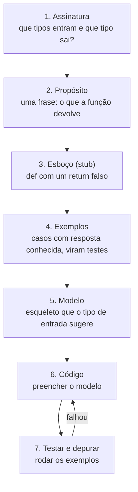

# Projeto sistemático de funções (receita de projeto)

## Por que isso importa

Diante de um problema novo, é comum olhar para a tela em branco sem saber por onde começar, ou sair escrevendo código e se perder no meio. A **receita de projeto** (do livro *How to Design Programs* e do curso *Systematic Program Design*, ambos no OSSU) é um roteiro passo a passo que transforma "não sei por onde começar" em uma sequência de perguntas pequenas. Ela também produz, de brinde, a documentação e os testes da função. É o mesmo espírito do TDD (desenvolvimento guiado por testes) usado na indústria.

## Intuição

Um bom cozinheiro não começa ligando o fogão. Primeiro decide **o que** vai servir e para **quantas pessoas** (assinatura), escreve **o nome do prato** (propósito), imagina **como deve ficar no prato** (exemplos), separa os **ingredientes e utensílios** que esse tipo de prato sempre usa (modelo) e só então cozinha (código). No fim, **prova** (testes). Pular etapas funciona em pratos simples, mas não em um banquete.

## Visual



## Conceito técnico

### Os passos, com um exemplo

Problema: "calcular quanto um cliente paga de estacionamento: R$ 5 pela primeira hora e R$ 3 por hora adicional (fração conta como hora inteira)".

**1. Assinatura** (que tipos entram e saem). Em Python, com **anotações de tipo**:

```text
def preco_estacionamento(minutos: int) -> int:
```

**2. Propósito** (uma frase, em docstring):

```text
    """Devolve o preço em reais para `minutos` de permanência."""
```

**3. Esboço (stub)**: um corpo que devolve um valor do tipo certo, mesmo que errado. Assim o arquivo já roda e os testes já podem ser escritos.

```text
    return 0
```

**4. Exemplos**, **antes** do código, cobrindo os casos típicos e as **bordas**:

```text
assert preco_estacionamento(30) == 5      # menos de 1 hora: só a primeira
assert preco_estacionamento(60) == 5      # borda: exatamente 1 hora
assert preco_estacionamento(61) == 8      # 1 minuto a mais: conta 2ª hora
assert preco_estacionamento(150) == 11    # 2h30: 5 + 3 + 3
```

Escrever os exemplos obriga você a **entender o problema**. Se não consegue calcular um exemplo à mão, ainda não está pronto para programar. Bônus: os exemplos viram testes automáticos.

**5. Modelo** (template): o esqueleto que o **tipo do dado** sugere. Um número com faixas pede um `if`; uma lista pede um `for` com acumulador; um texto pede percorrer caracteres ou `split`. Exemplo de modelo para "função que recebe uma lista":

```text
def f(lista: list) -> ...:
    resultado = ...              # valor inicial do acumulador
    for item in lista:
        ... item ... resultado   # combina item com o acumulado
    return resultado
```

**6. Código**: preencha o modelo usando os exemplos como guia.

**7. Teste e depure**: rode os exemplos. Se algum falha, o problema pode estar no código **ou no exemplo**: confira os dois.

### Definições de dados

Antes das funções, defina como as informações do problema viram dados no programa, e escreva isso:

```python
# Temperatura é float: graus Celsius
# Nota é int de 0 a 10
# Semáforo é uma destas strings: "verde", "amarelo", "vermelho"
```

Uma definição de dado do tipo "um entre poucos valores" (enumeração, como o Semáforo) sugere um modelo com um `if/elif` com **um ramo por valor**. Isso é o que torna a receita sistemática: o formato do dado decide o formato do código.

### Anotações de tipo

`def f(x: int, nome: str = "") -> bool:` documenta o que a função espera. O Python **não confere** as anotações ao rodar, mas editores (VS Code) e ferramentas como o `mypy` conferem e avisam antes. Tipos mais usados: `int`, `float`, `str`, `bool`, `list[int]`, `dict[str, int]`, `tuple[int, int]`, `None`, e `int | None` para "int ou nada".

### Uma função, uma tarefa

Se o propósito precisa de "e" ("lê o arquivo **e** calcula a média **e** imprime"), divida em várias funções. Funções pequenas são fáceis de nomear, testar e reaproveitar. Uma regra prática do OSSU: **uma função por tarefa e uma função auxiliar para cada transformação de dado não trivial**.

## Código

A receita aplicada por completo:

```python
def preco_estacionamento(minutos: int) -> int:
    """Devolve o preço em reais para `minutos` de permanência.

    R$ 5 pela primeira hora e R$ 3 por hora adicional (fração conta como hora).
    """
    if minutos <= 60:
        return 5
    horas_extras = (minutos - 60 + 59) // 60   # arredonda para cima
    return 5 + 3 * horas_extras


assert preco_estacionamento(30) == 5
assert preco_estacionamento(60) == 5
assert preco_estacionamento(61) == 8
assert preco_estacionamento(150) == 11
print("todos os exemplos passaram")
```

O truque `(a + b - 1) // b` é a **divisão arredondando para cima** com inteiros (o mesmo que `math.ceil(a / b)`).

Modelo de enumeração para o semáforo:

```python
def proximo(cor: str) -> str:
    """Devolve a próxima cor do semáforo."""
    if cor == "verde":
        return "amarelo"
    elif cor == "amarelo":
        return "vermelho"
    elif cor == "vermelho":
        return "verde"
    raise ValueError(f"cor desconhecida: {cor}")


assert proximo("verde") == "amarelo"
assert proximo("vermelho") == "verde"
print(proximo("amarelo"))
```

## Erros comuns

- **Começar pelo código.** Sem exemplos, você não sabe o que é "certo" e só descobre o problema depois.
- **Exemplos só do caso fácil.** Os bugs moram nas **bordas**: zero, lista vazia, exatamente no limite (60 minutos), negativo.
- **Propósito vago** ("processa os dados"). Se não dá para descrever em uma frase, a função faz coisas demais.
- **Copiar o exemplo para dentro do código** (`if minutos == 150: return 11`). Os exemplos guiam, não substituem a regra geral; é para isso que existem testes ocultos.
- **Achar que as anotações de tipo são conferidas pelo Python.** Elas são documentação; quem confere é o editor ou o `mypy`.

## Pratique

```quiz
id: FP-10-q1
tipo: multipla_escolha
pergunta: "Na receita de projeto, os exemplos (testes) devem ser escritos:"
opcoes: ["Depois do código, para conferir", "Antes do código, logo depois da assinatura, do propósito e do esboço", "Só se sobrar tempo", "Apenas pelo time de QA"]
resposta: 1
explicacao: "Escrever exemplos antes obriga a entender o problema e define o que é 'certo'. Se você não consegue calcular um exemplo à mão, ainda não está pronto para programar. Depois eles viram testes automáticos."
dificuldade: 1
```

```quiz
id: FP-10-q2
tipo: multipla_escolha
pergunta: "Para que serve o esboço (stub) `return 0` logo no início?"
opcoes: ["É a resposta final da função", "Faz o arquivo rodar e permite escrever e executar os testes antes do código de verdade", "Evita erros de sintaxe no Python", "Otimiza a função"]
resposta: 1
explicacao: "O stub devolve um valor do tipo certo, ainda que errado. Com ele, os exemplos já podem ser executados (e falhar), o que confirma que os testes estão funcionando antes de você escrever a lógica."
dificuldade: 1
```

```quiz
id: FP-10-q3
tipo: verdadeiro_falso
pergunta: "Em `def f(x: int) -> str:`, o Python lança erro se você chamar `f(\"oi\")`."
resposta: false
explicacao: "Anotações de tipo não são verificadas na execução: a chamada roda normalmente (e pode dar erro mais adiante, ou não). Quem confere as anotações é o editor ou uma ferramenta como o mypy, antes de rodar."
dificuldade: 1
```

```quiz
id: FP-10-q4
tipo: multipla_escolha
pergunta: "Uma função recebe uma `Semáforo` (\"verde\", \"amarelo\" ou \"vermelho\"). Que modelo a receita sugere?"
opcoes: ["Um for com acumulador", "Recursão", "Um if/elif com um ramo para cada valor possível", "Um while True"]
resposta: 2
explicacao: "Um dado do tipo enumeração (um entre poucos valores) sugere um condicional com um ramo por valor. O formato do dado decide o formato do código: é isso que torna o método sistemático."
dificuldade: 2
```

```quiz
id: FP-10-q5
tipo: resposta_curta
pergunta: "Para uma função `desconto(valor_compra)` que dá 10% de desconto acima de R$ 100, que exemplos você escreveria e por quê?"
resposta: "Um valor abaixo de 100 (sem desconto), exatamente 100 (a borda, para decidir se 'acima' inclui o 100), um valor acima (com desconto) e talvez 0. As bordas são onde ficam os erros, como usar > no lugar de >=."
palavras_chave: ["borda", "100", "abaixo", "acima"]
dificuldade: 2
```

```quiz
id: FP-10-q6
tipo: codigo
linguagem: python
pergunta: |
  **Receita completa: frete.** Uma loja cobra frete assim: compras a partir de R$ 200 têm frete grátis; abaixo disso, R$ 15 fixos mais R$ 2 por kg (o peso é inteiro). Escreva `frete(valor: float, peso_kg: int) -> float`.

  Siga a receita: o esboço já está pronto. **Antes de programar**, escreva no editor pelo menos 3 `assert` com exemplos calculados à mão (inclua a borda dos R$ 200). Os testes da correção chamam a função diretamente.
codigo_inicial: |
  def frete(valor: float, peso_kg: int) -> float:
      """Devolve o valor do frete de uma compra."""
      return 0.0  # esboço


  # exemplos (escreva antes do código!)
  # assert frete(250.0, 3) == 0.0
usa: [def, return, if]
testes:
  - chamada: "frete(250.0, 3)"
    saida: "0.0"
  - chamada: "frete(100.0, 5)"
    saida: "25.0"
  - chamada: "frete(200.0, 10)"
    saida: "0.0"
  - chamada: "frete(199.99, 0)"
    visivel: false
    saida: "15.0"
  - chamada: "frete(50.0, 12)"
    visivel: false
    saida: "39.0"
dica: "Exemplos: frete(250, 3) é 0 (grátis); frete(100, 5) é 15 + 2*5 = 25; frete(200, 10) é 0 porque 'a partir de 200' inclui o 200 (use >=). Depois o código é um if com dois ramos."
solucao: |
  def frete(valor: float, peso_kg: int) -> float:
      """Devolve o valor do frete de uma compra."""
      if valor >= 200:
          return 0.0
      return 15.0 + 2.0 * peso_kg


  assert frete(250.0, 3) == 0.0
  assert frete(100.0, 5) == 25.0
  assert frete(200.0, 10) == 0.0
  assert frete(199.99, 0) == 15.0
explicacao: "O exemplo da borda (exatamente R$ 200) decide entre > e >=: 'a partir de' inclui o valor. Os asserts no fim do arquivo rodam junto com o programa: se algum falhar, você vê um AssertionError apontando a linha."
dificuldade: 1
```

```quiz
id: FP-10-q7
tipo: codigo
linguagem: python
pergunta: |
  **Modelo de lista: média sem a menor nota.** Escreva `media_sem_pior(notas: list[float]) -> float` que devolve a média das notas descartando **uma** ocorrência da menor. Com uma nota só ou nenhuma, devolva `0.0`. Resultado arredondado com `round(..., 2)`.
codigo_inicial: |
  def media_sem_pior(notas: list[float]) -> float:
      """Média das notas sem a menor delas (uma vez)."""
      return 0.0  # esboço


  # escreva seus exemplos aqui, com assert
usa: [def, return, round]
testes:
  - chamada: "media_sem_pior([5.0, 8.0, 9.0])"
    saida: "8.5"
  - chamada: "media_sem_pior([7.0])"
    saida: "0.0"
  - chamada: "media_sem_pior([])"
    saida: "0.0"
  - chamada: "media_sem_pior([6.0, 6.0, 9.0])"
    visivel: false
    saida: "7.5"
  - chamada: "media_sem_pior([10.0, 2.0, 7.0, 3.0])"
    visivel: false
    saida: "6.67"
dica: "Casos: menos de 2 notas → 0.0. Senão: (sum(notas) - min(notas)) / (len(notas) - 1). Repare no exemplo [6, 6, 9]: só um dos 6 sai, a média é (6 + 9) / 2."
solucao: |
  def media_sem_pior(notas: list[float]) -> float:
      """Média das notas sem a menor delas (uma vez)."""
      if len(notas) < 2:
          return 0.0
      return round((sum(notas) - min(notas)) / (len(notas) - 1), 2)


  assert media_sem_pior([5.0, 8.0, 9.0]) == 8.5
  assert media_sem_pior([]) == 0.0
  assert media_sem_pior([6.0, 6.0, 9.0]) == 7.5
explicacao: "Os exemplos das bordas (lista vazia, uma nota, nota repetida) aparecem antes de qualquer código e já revelam os ramos que a função precisa. Tirar a soma da menor remove exatamente uma ocorrência, sem alterar a lista original."
dificuldade: 2
```

```quiz
id: FP-10-q8
tipo: codigo
linguagem: python
pergunta: |
  **Decompor um problema: jogo da forca (parte 1).** Para o mini-projeto das semanas 5-6, escreva duas funções auxiliares da forca:

  - `mascarar(palavra: str, tentativas: list[str]) -> str` devolve a palavra com `_` nas letras ainda não tentadas, separadas por espaço. `mascarar("casa", ["a"])` devolve `'_ a _ a'`.
  - `venceu(palavra: str, tentativas: list[str]) -> bool` devolve `True` se todas as letras da palavra já foram tentadas. Reaproveite a ideia (ou a própria função) acima.
codigo_inicial: |
  def mascarar(palavra: str, tentativas: list[str]) -> str:
      """Palavra com _ nas letras não tentadas, separadas por espaço."""
      return ""


  def venceu(palavra: str, tentativas: list[str]) -> bool:
      """True se todas as letras de `palavra` estão em `tentativas`."""
      return False
usa: [def, for, return, join]
testes:
  - chamada: "mascarar('casa', ['a'])"
    saida: "'_ a _ a'"
  - chamada: "mascarar('casa', [])"
    saida: "'_ _ _ _'"
  - chamada: "venceu('casa', ['c', 'a', 's'])"
    saida: "True"
  - chamada: "venceu('casa', ['c', 'a'])"
    saida: "False"
  - chamada: "mascarar('python', ['p', 'n', 'o', 'z'])"
    visivel: false
    saida: "'p _ _ _ o n'"
  - chamada: "venceu('ovo', ['o', 'v', 'x'])"
    visivel: false
    saida: "True"
dica: "Em mascarar, monte uma lista: para cada letra da palavra, coloque a letra se ela está em tentativas, senão \"_\". Depois \" \".join(lista). Em venceu: a pessoa venceu se não sobrou nenhum \"_\" em mascarar(...)."
solucao: |
  def mascarar(palavra: str, tentativas: list[str]) -> str:
      """Palavra com _ nas letras não tentadas, separadas por espaço."""
      partes = []
      for letra in palavra:
          if letra in tentativas:
              partes.append(letra)
          else:
              partes.append("_")
      return " ".join(partes)


  def venceu(palavra: str, tentativas: list[str]) -> bool:
      """True se todas as letras de `palavra` estão em `tentativas`."""
      return "_" not in mascarar(palavra, tentativas)
explicacao: "Duas funções pequenas, cada uma com um propósito de uma frase e testável sozinha. Com elas, o laço principal do jogo (ler letra, contar erros, desenhar) fica curto. Monte o jogo completo no seu computador como o mini-projeto das semanas 5-6."
dificuldade: 2
```

## Resumo

- Receita: **assinatura → propósito → esboço → exemplos → modelo → código → testes**.
- **Exemplos antes do código**, sempre incluindo as **bordas** (zero, vazio, exatamente no limite).
- O **tipo do dado** sugere o **modelo**: faixas → `if`; enumeração → um ramo por valor; lista → `for` com acumulador.
- Anotações de tipo e docstring documentam; `assert` transforma exemplos em testes.
- Uma função, uma tarefa. Se o propósito tem "e", divida.

## Para ir além

- **Mini-projeto das semanas 5-6**: termine o jogo da forca no terminal usando as funções do último desafio (sorteie a palavra com `random.choice`, leia letras com `input`, limite de 6 erros).
- **Próximos módulos** no seu caminho (semanas 7-8): FP-06 Programação orientada a objetos e FP-07 Programação funcional.
