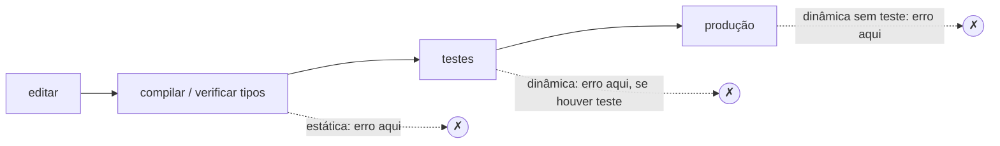

# Tipagem estática × dinâmica, inferência de tipos

## Por que isso importa

"Python ou Java?", "vale a pena migrar para TypeScript?", "por que o Rust reclama tanto?". Grande parte dessas discussões é, no fundo, sobre **sistemas de tipos**: quando os erros aparecem (enquanto você digita ou quando o cliente clica), quanta coisa você precisa escrever, quanto o editor consegue te ajudar e quanta liberdade você tem. Entender os eixos (estático × dinâmico, forte × fraco, nominal × estrutural) permite comparar linguagens com argumentos em vez de torcida, usar bem as anotações de tipo do Python e do TypeScript e entender as mensagens do compilador em vez de brigar com elas.

## Intuição

Um **tipo** é uma promessa sobre um valor: "isto é um número", "isto é uma lista de usuários", "isto tem um método `fechar()`". O sistema de tipos é o fiscal que confere as promessas.

- Na tipagem **estática**, o fiscal lê a planta do prédio antes da obra: se uma porta de 2 m está prevista para um vão de 1,5 m, ele avisa antes de qualquer tijolo. O programa nem roda se houver inconsistência.
- Na tipagem **dinâmica**, o fiscal fica no canteiro e confere cada peça quando ela é instalada. A obra começa mais rápido, mas o erro só aparece quando aquela parede específica for montada, talvez meses depois.

E a **inferência** é o fiscal que deduz sozinho: se você escreveu `x = 3`, ele não precisa que você diga "x é um inteiro".

## Visual

Os dois eixos mais confundidos são independentes:

```text
                          verificação dos tipos
                    estática (antes de rodar)     dinâmica (enquanto roda)
                  ┌────────────────────────────┬────────────────────────────┐
  forte           │ Haskell, Rust, Java, Go,   │ Python, Ruby, Elixir,      │
  (poucas         │ Kotlin, Swift, OCaml       │ Clojure, Lisp              │
  conversões      │                            │                            │
  implícitas)     │                            │                            │
                  ├────────────────────────────┼────────────────────────────┤
  fraca           │ C, C++ (conversões         │ JavaScript, PHP, Perl,     │
  (muitas         │ implícitas, casts, void*)  │ Bash                       │
  conversões)     │                            │                            │
                  └────────────────────────────┴────────────────────────────┘
       TypeScript e Python com mypy: tipagem gradual, verificação estática opcional
```

Onde os erros de tipo aparecem:



## Conceito técnico

### Estática × dinâmica

- **Estática**: os tipos pertencem às **expressões e variáveis** e são verificados **antes da execução**. `int x = "oi";` não compila em Java. Vantagens: erros cedo, autocompletar e refatoração confiáveis, documentação que não fica desatualizada, código mais rápido (o compilador sabe o layout dos dados). Custos: mais cerimônia, e alguns programas corretos são rejeitados.
- **Dinâmica**: os tipos pertencem aos **valores** e são verificados **durante a execução**. Em Python, `x = 3` e depois `x = "oi"` é válido; `x + 1` só falha quando a linha roda com x sendo texto. Vantagens: rapidez para prototipar, metaprogramação, menos código. Custos: erros só aparecem quando o caminho é executado; refatorações grandes são arriscadas sem testes.

### Forte × fraca

Não há definição formal, mas a ideia é **quanto a linguagem converte tipos implicitamente**:

- Python (forte): `"1" + 1` levanta `TypeError`.
- JavaScript (fraca): `"1" + 1` é `"11"`, `"5" - 2` é `3`, `[] + {}` é `"[object Object]"` e `0 == ""` é `true`. Daí a recomendação de usar sempre `===`.
- C (fraca, apesar de estática): um `char*` vira `int*` com um cast, e a memória é reinterpretada sem reclamação.

### Nominal × estrutural

- **Nominal** (Java, C#, Rust): um tipo é compatível com outro se foi **declarado** assim (`class Pato implements Ave`). Dois tipos com os mesmos campos e nomes diferentes são incompatíveis.
- **Estrutural** (TypeScript, Go nas interfaces, OCaml nos objetos): é compatível se tem a **forma** certa. Um objeto com `{ nome: string, idade: number }` serve onde se espera `{ nome: string }`: campos a mais não atrapalham.
- **Duck typing** é a versão dinâmica do estrutural: "se anda como pato e grasna como pato, é um pato". Em Python, qualquer objeto com `__len__` funciona com `len()`. O `typing.Protocol` traz isso para a verificação estática.

### Tipagem gradual

TypeScript e o Python com anotações misturam os dois mundos: você anota onde quiser, e um verificador (o `tsc`, o `mypy` ou o `pyright`) confere o que estiver anotado. Pontos importantes:

- As anotações **não mudam a execução**. O Python ignora `def f(x: int)` e aceita `f("oi")`; o TypeScript apaga os tipos ao gerar JavaScript (**apagamento de tipos**).
- O tipo `any` desliga a verificação. `unknown` (TS) e `object` (Python) são as alternativas seguras: obrigam você a verificar antes de usar.
- Os tipos não dizem nada sobre **dados externos**: o JSON que chega de uma API é `unknown` até ser validado. Por isso a validação na fronteira (Pydantic, Zod) continua necessária.
- Nenhum dos dois é totalmente **seguro** (sound): há buracos conhecidos (casts, `any`, variância de arrays no TS). Haskell e Rust se esforçam mais por essa garantia.

### Inferência de tipos

Escrever todos os tipos é cansativo, e o compilador consegue deduzir boa parte:

- **Inferência local** (Java `var`, C++ `auto`, Go `:=`, TypeScript, Kotlin): o tipo da variável vem da expressão à direita. `const n = 3` é `number`.
- **Inferência global, Hindley-Milner** (Haskell, OCaml, F#, a base do Rust): deduz até os tipos dos parâmetros de funções pelo **uso**. Em OCaml, `let soma x y = x + y` é inferida como `int -> int -> int` porque `+` só existe para inteiros. A ideia é gerar **equações** entre tipos ("o tipo de x é igual ao do primeiro argumento de +") e resolvê-las por **unificação**.
- **Polimorfismo e genéricos**: `let primeiro (a, b) = a` vira `'a * 'b -> 'a`: funciona para quaisquer tipos. Em TypeScript, `function primeiro<A, B>(p: [A, B]): A`.

Como um verificador funciona por dentro (o desafio desta aula): percorre a árvore da expressão de baixo para cima; o tipo de cada nó é calculado a partir do tipo dos filhos e de uma regra. Para `a + b`: se `a` e `b` são números, o resultado é número, senão erro. Para `if c then x else y`: `c` precisa ser booleano, e `x` e `y` precisam ter o **mesmo** tipo, que é o tipo do `if`.

### Onde cada abordagem brilha

Não há vencedor universal. Tipagem estática compensa em bases de código grandes, de vida longa e com muitas pessoas, em bibliotecas e onde o erro custa caro. Dinâmica brilha em scripts, exploração de dados, protótipos e metaprogramação. A tendência dos últimos anos é a convergência: linguagens dinâmicas ganhando tipos opcionais (TypeScript, mypy, Sorbet para Ruby) e estáticas ganhando inferência para reduzir a cerimônia.

## Código

O Python ignora as anotações em tempo de execução, mas elas ficam disponíveis para quem quiser usá-las. Aqui um decorador lê as anotações e as verifica a cada chamada: uma "tipagem dinâmica com contrato". Repare também na tipagem forte do Python e no duck typing.

```python
import functools
import typing

def verificar_tipos(funcao):
    dicas = typing.get_type_hints(funcao)

    @functools.wraps(funcao)
    def embrulho(*args):
        nomes = funcao.__code__.co_varnames[: len(args)]
        for nome, valor in zip(nomes, args):
            esperado = dicas.get(nome)
            if esperado is not None and not isinstance(valor, esperado):
                raise TypeError(f"{funcao.__name__}: '{nome}' deveria ser {esperado.__name__}, veio {type(valor).__name__}")
        resultado = funcao(*args)
        if "return" in dicas and not isinstance(resultado, dicas["return"]):
            raise TypeError(f"{funcao.__name__}: retorno deveria ser {dicas['return'].__name__}")
        return resultado

    return embrulho

def media_sem_verificacao(total: float, n: int) -> float:
    return total / n

@verificar_tipos
def media(total: float, n: int) -> float:
    return total / n

print("anotações não são verificadas pelo Python:")
try:
    media_sem_verificacao("10", 2)
except TypeError as erro:
    print("  só falha lá dentro, na divisão:", erro)

print("com o decorador, o erro aparece na fronteira:")
try:
    media(10.0, "2")
except TypeError as erro:
    print(" ", erro)
print("  media(10.0, 4) =", media(10.0, 4))

print("\ntipagem forte: o Python não converte sozinho")
try:
    "1" + 1
except TypeError as erro:
    print("  '1' + 1 ->", erro)
print("  conversão explícita: int('1') + 1 =", int("1") + 1)

print("\nduck typing: len() aceita qualquer coisa com __len__")
class Playlist:
    def __init__(self, musicas):
        self.musicas = musicas
    def __len__(self):
        return len(self.musicas)

for coisa in ("texto", [1, 2, 3], {"a": 1}, Playlist(["x", "y"])):
    print(f"  {type(coisa).__name__:9} len = {len(coisa)}")
```

A mesma ideia de verificação, agora estática, em TypeScript. O compilador rejeita a linha errada antes de qualquer execução, e a compatibilidade é estrutural:

```typescript
type Nomeado = { nome: string };

function saudar(x: Nomeado): string {
  return `Olá, ${x.nome}`;
}

const usuario = { nome: "Ana", idade: 31 };   // inferido: { nome: string; idade: number }
saudar(usuario);                               // ok: tem 'nome', o campo extra não atrapalha
saudar({ name: "Ana" });                       // erro de compilação: falta 'nome'

const dados: unknown = JSON.parse('{"nome": 1}');
// saudar(dados);                              // erro: unknown precisa ser verificado antes
```

## Erros comuns

- **Confundir estática com forte** (C é estática e fraca; Python é dinâmica e forte).
- **Achar que anotar tipos em Python valida os dados**: sem mypy ou pyright rodando (e sem validação em tempo de execução), as anotações são só documentação.
- **Espalhar `any`** no TypeScript para "calar o compilador": você paga o custo dos tipos e perde o benefício.
- **Confiar no tipo de dados externos**: `const u = await resp.json() as Usuario` não verifica nada. Valide na fronteira.
- **Usar `==` em JavaScript** e cair nas conversões implícitas.
- **`isinstance(True, int)` é `True`** em Python (bool é subclasse de int). Se a diferença importa, compare `type(x) is int`.
- **Brigar com o compilador** em vez de ler a mensagem: muitas vezes o erro aponta um caso que você não tinha pensado (null, uma variante esquecida).

## Pratique

```quiz
id: LP-01-q1
tipo: multipla_escolha
pergunta: "Qual combinação descreve corretamente o JavaScript?"
opcoes: ["Estática e forte", "Dinâmica e forte", "Dinâmica e fraca", "Estática e fraca"]
resposta: 2
explicacao: "Os tipos são verificados enquanto o programa roda (dinâmica), e a linguagem faz muitas conversões implícitas, como '5' - 2 resultando em 3 e 0 == '' sendo true (fraca). Python também é dinâmica, mas forte: '1' + 1 é erro."
dificuldade: 1
```

```quiz
id: LP-01-q2
tipo: multipla_escolha
pergunta: "Em TypeScript, uma função espera { nome: string }. Você passa uma variável com { nome: 'Ana', idade: 31 }. O que acontece?"
opcoes: ["Erro: o tipo não foi declarado como compatível", "Compila: a tipagem é estrutural, e ter campos a mais não impede a compatibilidade", "Compila, mas o campo idade é apagado", "Erro em tempo de execução"]
resposta: 1
explicacao: "No TypeScript, a compatibilidade depende da forma, não do nome do tipo (tipagem estrutural). Numa linguagem nominal como Java, seria preciso declarar que a classe implementa a interface. Detalhe: se você escrever o objeto literal direto na chamada, o TS reclama do campo extra (excess property check), uma regra extra para pegar erros de digitação."
dificuldade: 2
```

```quiz
id: LP-01-q3
tipo: verdadeiro_falso
pergunta: "Em Python, def f(x: int) -> int faz o interpretador rejeitar a chamada f('oi')."
resposta: false
explicacao: "O interpretador ignora as anotações; a chamada roda (e talvez falhe lá dentro, ou pior, funcione com o tipo errado). Quem acusa o erro é um verificador estático como mypy ou pyright, rodado à parte, ou uma validação em tempo de execução que você mesmo escreva."
dificuldade: 1
```

```quiz
id: LP-01-q4
tipo: multipla_escolha
pergunta: "Em OCaml, você escreve let dobro x = x * 2, sem anotar nada. Qual tipo o compilador infere?"
opcoes: ["Nenhum: sem anotação, x fica sem tipo", "'a -> 'a (genérico)", "int -> int, porque * só funciona com inteiros em OCaml", "float -> float"]
resposta: 2
explicacao: "A inferência Hindley-Milner olha o uso: * exige dois int (para float, OCaml usa *.), então x é int, e o resultado também. Você ganha a segurança da tipagem estática sem escrever o tipo."
dificuldade: 2
```

```quiz
id: LP-01-q5
tipo: resposta_curta
pergunta: "Se o projeto já usa TypeScript com tipos bem definidos, por que ainda é preciso validar o JSON que chega de uma API externa?"
resposta: "Porque os tipos do TypeScript só existem em tempo de compilação e são apagados ao gerar JavaScript. O compilador não sabe o que a API vai mandar de verdade; um 'as Usuario' só diz para ele confiar. Dados externos devem ser tratados como unknown e validados em tempo de execução (com Zod, por exemplo) antes de ganhar o tipo."
palavras_chave: ["compilação", "apagados", "execução", "unknown"]
dificuldade: 2
```

```quiz
id: LP-01-q6
tipo: codigo
linguagem: python
pergunta: |
  **Um verificador de tipos.** Expressões são tuplas:

  - `('num', 3)` e `('bool', True)` são literais;
  - `('+', a, b)` exige dois `num` e dá `num`;
  - `('<', a, b)` exige dois `num` e dá `bool`;
  - `('e', a, b)` exige dois `bool` e dá `bool`;
  - `('se', c, x, y)` exige `c` do tipo `bool` e `x` e `y` do **mesmo** tipo, que é o tipo do resultado.

  Escreva `tipo(expr)`, que devolve `'num'`, `'bool'` ou `'erro'` (qualquer violação, em qualquer ponto da árvore, dá `'erro'`).
codigo_inicial: |
  def tipo(expr):
      return 'num'
usa: [def, if, return]
testes:
  - chamada: "tipo(('+', ('num', 1), ('num', 2)))"
    saida: "'num'"
  - chamada: "tipo(('<', ('num', 1), ('num', 2)))"
    saida: "'bool'"
  - chamada: "tipo(('+', ('num', 1), ('bool', True)))"
    saida: "'erro'"
  - chamada: "tipo(('se', ('<', ('num', 1), ('num', 2)), ('num', 10), ('num', 20)))"
    saida: "'num'"
  - chamada: "tipo(('se', ('num', 1), ('num', 10), ('num', 20)))"
    visivel: false
    saida: "'erro'"
  - chamada: "tipo(('se', ('bool', True), ('num', 1), ('bool', False)))"
    visivel: false
    saida: "'erro'"
  - chamada: "tipo(('e', ('bool', True), ('se', ('bool', False), ('<', ('num', 3), ('num', 4)), ('bool', True))))"
    visivel: false
    saida: "'bool'"
  - chamada: "tipo(('+', ('num', 1), ('+', ('num', 2), ('<', ('num', 1), ('num', 2)))))"
    visivel: false
    saida: "'erro'"
dica: "Use recursão: para cada operador, calcule o tipo dos filhos com tipo(...) e confira a regra. Um 'erro' num filho deve virar 'erro' no pai, o que acontece naturalmente se você só aceitar as combinações válidas."
solucao: |
  def tipo(expr):
      op = expr[0]
      if op == 'num' or op == 'bool':
          return op
      if op == 'se':
          c, x, y = tipo(expr[1]), tipo(expr[2]), tipo(expr[3])
          if c == 'bool' and x == y and x != 'erro':
              return x
          return 'erro'
      a, b = tipo(expr[1]), tipo(expr[2])
      if op == '+' and a == b == 'num':
          return 'num'
      if op == '<' and a == b == 'num':
          return 'bool'
      if op == 'e' and a == b == 'bool':
          return 'bool'
      return 'erro'
explicacao: "Isso é um verificador estático: ele rejeita ('+', 1, True) sem calcular nada, só pela estrutura. Repare que o 'se' com ramos de tipos diferentes é rejeitado mesmo que a condição seja sempre verdadeira: a verificação estática é conservadora e recusa alguns programas que funcionariam. Compiladores reais fazem exatamente isso, com mais regras e com um ambiente que guarda o tipo de cada variável."
dificuldade: 2
```

```quiz
id: LP-01-q7
tipo: codigo
linguagem: python
pergunta: |
  **Validando dados dinâmicos.** Um esquema é um tipo (`int`, `float`, `str`, `bool`), uma lista com um esquema (`[int]` quer dizer "lista de int") ou um dicionário de campos para esquemas. Escreva `erros(valor, esquema, caminho='$')`, que devolve a lista dos caminhos onde o valor não bate com o esquema, na ordem em que aparecem.

  - Para tipos simples, use `type(valor) is esquema` (assim `True` não passa como `int`).
  - Caminhos: campos com `.campo`, posições de lista com `[i]`. Campo ausente é um erro no caminho do campo.
codigo_inicial: |
  def erros(valor, esquema, caminho='$'):
      return []
usa: [def, for, return, isinstance]
testes:
  - chamada: "erros(5, int)"
    saida: "[]"
  - chamada: "erros('5', int)"
    saida: "['$']"
  - chamada: "erros({'nome': 'Ana', 'idade': '31'}, {'nome': str, 'idade': int})"
    saida: "['$.idade']"
  - chamada: "erros([1, 'x', 3, True], [int])"
    saida: "['$[1]', '$[3]']"
  - chamada: "erros({'nome': 'Bia'}, {'nome': str, 'tags': [str]})"
    visivel: false
    saida: "['$.tags']"
  - chamada: "erros({'itens': [{'preco': 2.5}, {'preco': 3}]}, {'itens': [{'preco': float}]})"
    visivel: false
    saida: "['$.itens[1].preco']"
  - chamada: "erros('nao sou lista', [int])"
    visivel: false
    saida: "['$']"
  - chamada: "erros([], {'a': int})"
    visivel: false
    saida: "['$']"
dica: "Três casos. Se o esquema é uma lista: o valor precisa ser lista; então valide cada item com o esquema esquema[0] e caminho f'{caminho}[{i}]'. Se é um dicionário: o valor precisa ser dict; para cada campo, se faltar, registre o caminho, senão valide recursivamente. Senão, compare type(valor) is esquema."
solucao: |
  def erros(valor, esquema, caminho='$'):
      if isinstance(esquema, list):
          if not isinstance(valor, list):
              return [caminho]
          achados = []
          for i, item in enumerate(valor):
              achados += erros(item, esquema[0], f'{caminho}[{i}]')
          return achados
      if isinstance(esquema, dict):
          if not isinstance(valor, dict):
              return [caminho]
          achados = []
          for campo, sub in esquema.items():
              if campo not in valor:
                  achados.append(f'{caminho}.{campo}')
              else:
                  achados += erros(valor[campo], sub, f'{caminho}.{campo}')
          return achados
      return [] if type(valor) is esquema else [caminho]
explicacao: "É o que bibliotecas como Pydantic, Zod e JSON Schema fazem na fronteira do sistema: dados que chegam de fora não têm tipo garantido, então são verificados em tempo de execução, e só depois o resto do código pode confiar neles. Note o teste com 3 no lugar de float: o esquema é estrito. Bibliotecas reais costumam ter um modo que converte int em float automaticamente."
dificuldade: 3
```

```quiz
id: LP-01-q8
tipo: codigo
linguagem: typescript
pergunta: |
  **Compatibilidade estrutural.** Tipos são representados assim: `"number"`, `"string"`, `"boolean"` ou um objeto cujos campos são outros tipos. Escreva `compativel(esperado, real)`, que diz se um valor do tipo `real` pode ser usado onde se espera `esperado`, com as regras do TypeScript:

  - primitivos são compatíveis só se forem iguais;
  - um objeto `real` é compatível com um objeto `esperado` se tiver **todos** os campos de `esperado`, cada um compatível (campos a mais são permitidos);
  - primitivo e objeto nunca são compatíveis.
codigo_inicial: |
  type Primitivo = "number" | "string" | "boolean";
  type Objeto = { [campo: string]: Tipo };
  type Tipo = Primitivo | Objeto;

  function compativel(esperado: Tipo, real: Tipo): boolean {
    return esperado === real;
  }
usa: [function, for, return, typeof]
testes:
  - chamada: "compativel('number', 'number')"
    saida: "true"
  - chamada: "compativel({ nome: 'string' }, { nome: 'string', idade: 'number' })"
    saida: "true"
  - chamada: "compativel({ nome: 'string', idade: 'number' }, { nome: 'string' })"
    saida: "false"
  - chamada: "compativel({ id: 'number' }, { id: 'string' })"
    saida: "false"
  - chamada: "compativel({ a: { b: 'boolean' } }, { a: { b: 'boolean', c: 'number' }, d: 'string' })"
    visivel: false
    saida: "true"
  - chamada: "compativel({ a: { b: 'boolean' } }, { a: 'boolean' })"
    visivel: false
    saida: "false"
  - chamada: "compativel('string', { length: 'number' })"
    visivel: false
    saida: "false"
  - chamada: "compativel({}, { x: 'number' })"
    visivel: false
    saida: "true"
dica: "Se algum dos dois for string (typeof === 'string'), compare com ===. Se os dois forem objetos, percorra os campos de esperado com for...of Object.keys e verifique se o campo existe em real e é compatível, recursivamente."
solucao: |
  type Primitivo = "number" | "string" | "boolean";
  type Objeto = { [campo: string]: Tipo };
  type Tipo = Primitivo | Objeto;

  function compativel(esperado: Tipo, real: Tipo): boolean {
    if (typeof esperado === "string" || typeof real === "string") {
      return esperado === real;
    }
    for (const campo of Object.keys(esperado)) {
      if (!(campo in real) || !compativel(esperado[campo], real[campo])) {
        return false;
      }
    }
    return true;
  }
explicacao: "Esse é o núcleo da tipagem estrutural (subtipagem de largura e de profundidade): um tipo com mais informação pode ser usado onde se pede menos. O último teste mostra o caso extremo: {} aceita qualquer objeto. Em uma linguagem nominal, a resposta dependeria de declarações como 'implements', não da forma."
dificuldade: 2
```

## Resumo

- **Estática** verifica antes de rodar (tipos nas expressões); **dinâmica** verifica rodando (tipos nos valores).
- **Forte** × **fraca**: quanto a linguagem converte tipos sozinha (Python forte, JavaScript fraca).
- **Nominal** (pelo nome declarado) × **estrutural** (pela forma); **duck typing** é o estrutural dinâmico.
- **Tipagem gradual** (TypeScript, mypy): anotações opcionais, verificadas por uma ferramenta, **apagadas** na execução.
- **Inferência**: local (`var`, `auto`, `const`) ou global (Hindley-Milner, por unificação).
- Dados externos são `unknown` até serem **validados em tempo de execução** na fronteira.

## Para ir além

- Faça a parte A do curso Programming Languages (Grossman), que usa Standard ML e sua inferência de tipos.
- Ligue o `mypy --strict` num projeto Python seu e corrija os avisos; ou ligue `strict: true` num projeto TypeScript.
- Estenda o verificador do exercício com variáveis: um ambiente (dicionário de nome para tipo) e uma expressão `('seja', nome, valor, corpo)`.
- **Próximo módulo**: LP-02 Funções de primeira classe, closures, pattern matching.
