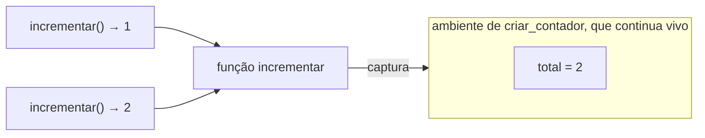

# Funções de primeira classe, closures, pattern matching

## Por que isso importa

Você usa essas ideias o tempo todo, talvez sem saber o nome: o `onClick={() => ...}` do React é uma closure, o `sorted(lista, key=...)` recebe uma função, o `@app.get("/")` do FastAPI é um decorador, os hooks do React dependem inteiramente de closures, e o `match` do Python, o `switch` com padrões do Java moderno e o `match` do Rust são pattern matching. Vieram das linguagens funcionais (Lisp, ML, Haskell) e hoje estão em todas as linguagens populares. Dominá-las deixa o código mais curto, mais reutilizável e mais fácil de testar, e evita uma classe inteira de bugs sutis (a closure que captura a variável errada).

## Intuição

**Funções de primeira classe**: uma função é um valor como um número ou um texto. Dá para guardar numa variável, passar para outra função, devolver de uma função, colocar numa lista. Pense numa receita escrita num cartão: você pode entregar o cartão para outra pessoa executar quando quiser.

**Closure**: agora imagine que o cartão traz, grampeado, um bilhete com os ingredientes da sua cozinha ("use o fermento da minha despensa"). Mesmo levado para outra casa, ele continua apontando para aquela despensa. Uma closure é uma função **mais o ambiente onde ela nasceu**: as variáveis de fora que ela usa vão junto, vivas, mesmo depois que a função que as criou terminou.

**Pattern matching**: é a triagem dos Correios. "Se é envelope pequeno, vai para a caixa A; se é caixa com mais de 10 kg, vai para o caminhão; se tem o selo 'frágil', vai à mão." Você descreve a **forma** do que espera e, ao reconhecer, já pega as partes de que precisa.

## Visual

Uma closure guarda uma referência para o ambiente em que foi criada:



Pattern matching desmonta e testa ao mesmo tempo:

```text
   valor:  {"tipo": "clique", "x": 10, "y": 40}

   case {"tipo": "tecla", "tecla": k}           ✗ tipo diferente
   case {"tipo": "clique", "x": x, "y": y}      ✓ casa! x = 10, y = 40
   case _                                        (nem chega aqui)
```

## Conceito técnico

### Funções de primeira classe e de ordem superior

Uma linguagem tem funções de **primeira classe** quando elas são valores. Uma função de **ordem superior** recebe ou devolve funções. As três mais famosas:

- `map(f, xs)`: aplica f a cada elemento.
- `filter(p, xs)`: mantém os elementos que satisfazem p.
- `reduce(f, xs, inicial)`: combina tudo num único valor (soma, máximo, dicionário de contagens).

Também são de ordem superior `sorted(xs, key=f)`, `addEventListener("click", f)`, `setTimeout(f, 1000)` e qualquer **callback**. Em Python, compreensões (`[f(x) for x in xs if p(x)]`) costumam ser mais legíveis que `map` e `filter`; em JavaScript, os métodos `.map().filter().reduce()` são o idioma.

### Closures

Quando uma função é definida dentro de outra e usa variáveis da de fora, ela **captura** essas variáveis. Isso é o **escopo léxico** (LP-03): o que vale é onde a função foi **escrita**, não de onde ela é chamada.

```python
def criar_contador():
    total = 0
    def incrementar():
        nonlocal total   # sem isto, "total += 1" criaria uma variável local
        total += 1
        return total
    return incrementar
```

Cada chamada a `criar_contador()` cria um ambiente novo, então dois contadores são independentes. Closures são a forma funcional de ter **estado privado**: ninguém de fora acessa `total`, só pelo `incrementar`. Um objeto com um método e uma closure são duas formas da mesma ideia.

**A pegadinha: closures capturam variáveis, não valores.** Se a variável muda depois, a closure vê o valor novo:

- Em Python, `[lambda: i for i in range(3)]` cria três funções que devolvem **2**, porque todas olham para o mesmo `i`, que terminou valendo 2. A correção clássica é `lambda i=i: i` (o valor padrão é avaliado na criação).
- Em JavaScript, `for (var i = 0; ...)` tem o mesmo problema; `let` cria um `i` novo a cada volta e resolve.
- No React, um `useEffect` ou `setInterval` que captura um estado antigo é a mesma coisa (a "closure velha", stale closure).

### Currying, aplicação parcial e composição

- **Aplicação parcial**: fixar alguns argumentos e obter uma função com os restantes. `functools.partial(pow, 2)` é "2 elevado a ...". Em JS, `fn.bind(null, a)`.
- **Currying**: transformar `f(a, b, c)` em `f(a)(b)(c)`. Em Haskell e OCaml, toda função é assim naturalmente; por isso a aplicação parcial é gratuita.
- **Composição**: `compor(f, g)(x) = f(g(x))`. Pipelines de transformações (`|>` em Elixir e F#) são composição.
- **Decoradores** (Python) são funções de ordem superior que recebem uma função e devolvem outra "embrulhada": cache (`@functools.cache`), log, medição de tempo, autenticação de rota.

### Pattern matching

Pattern matching compara um valor com uma sequência de **padrões**; o primeiro que casa é executado, e as variáveis do padrão recebem as partes correspondentes. Os padrões podem ser:

- **Literais**: `case 0`, `case "sair"`.
- **Captura**: `case x` (casa com tudo e dá nome).
- **Sequências**: `case [primeiro, *resto]`, `case [x, y]`.
- **Mapeamentos e objetos**: `case {"tipo": "clique", "x": x}`, `case Ponto(x=0, y=y)`.
- **Alternativas e guardas**: `case "s" | "sim"`, `case Ponto(x, y) if x == y`.
- **Coringa**: `case _` (o "senão").

Em Python (desde a 3.10) é o `match`/`case`; em Rust, Scala, Haskell, OCaml, Elixir, F# e Swift é central; Java ganhou padrões no `switch` e no `instanceof`; JavaScript tem a **desestruturação** (`const { x, y } = ponto`, `const [primeiro, ...resto] = lista`), que é a parte de "desmontar" sem a de "testar".

### Tipos algébricos: onde o pattern matching brilha

Um **tipo produto** junta campos (um `Ponto` tem x **e** y; tuplas, structs, records). Um **tipo soma** é uma escolha entre variantes (uma `Forma` é um `Circulo` **ou** um `Retangulo` **ou** um `Triangulo`; um `Option` é `Some(valor)` **ou** `None`). Juntos, formam os **tipos de dados algébricos**.

Pattern matching é o jeito natural de consumir um tipo soma: um `case` por variante. Em Rust, Haskell e OCaml (e no TypeScript com uniões discriminadas e `never`, WB-03), o compilador verifica a **exaustividade**: se você criar uma variante nova e esquecer de tratá-la em algum `match`, o código não compila. É uma alternativa ao polimorfismo de objetos (FP-06): com classes, é fácil adicionar **tipos** novos; com tipos soma e matching, é fácil adicionar **operações** novas. Esse dilema tem nome: o *expression problem*.

## Código

Ordem superior, closures (com a pegadinha), decorador, aplicação parcial e pattern matching num só programa:

```python
from dataclasses import dataclass
from functools import partial, reduce
import time

# --- funções como valores e ordem superior ---
produtos = [("caderno", 18.0), ("caneta", 3.5), ("mochila", 120.0), ("lápis", 1.5)]
caros = [nome for nome, preco in produtos if preco > 10]
total = reduce(lambda acc, p: acc + p[1], produtos, 0.0)
por_preco = sorted(produtos, key=lambda p: p[1])
print("caros:", caros, "| total:", total, "| mais barato:", por_preco[0][0])

# --- closures: estado privado ---
def criar_contador():
    total = 0
    def incrementar():
        nonlocal total
        total += 1
        return total
    return incrementar

a, b = criar_contador(), criar_contador()
print("contadores independentes:", a(), a(), a(), b())

# --- a pegadinha: closures capturam a variável, não o valor ---
errado = [lambda: i for i in range(3)]
certo = [lambda i=i: i for i in range(3)]
print("captura tardia:", [f() for f in errado], "| corrigido:", [f() for f in certo])

# --- decorador: uma função que embrulha outra ---
def cronometrar(funcao):
    def embrulho(*args):
        inicio = time.perf_counter()
        resultado = funcao(*args)
        print(f"  {funcao.__name__}{args} levou {(time.perf_counter() - inicio) * 1000:.2f} ms")
        return resultado
    return embrulho

@cronometrar
def soma_ate(n):
    return sum(range(n + 1))

print("soma:", soma_ate(100_000))

# --- aplicação parcial ---
potencia_de_2 = partial(pow, 2)
print("potências de 2:", [potencia_de_2(k) for k in range(8)])

# --- pattern matching sobre um tipo soma ---
@dataclass
class Circulo:
    raio: float

@dataclass
class Retangulo:
    largura: float
    altura: float

def descrever(forma):
    match forma:
        case Circulo(raio=0):
            return "um ponto"
        case Circulo(raio=r):
            return f"círculo de área {3.14159 * r * r:.1f}"
        case Retangulo(largura=l, altura=a) if l == a:
            return f"quadrado de lado {l}"
        case Retangulo(largura=l, altura=a):
            return f"retângulo {l}×{a}"
        case [primeira, *resto]:
            return f"lista começando com {descrever(primeira)} e mais {len(resto)}"
        case _:
            return "forma desconhecida"

for f in (Circulo(0), Circulo(2), Retangulo(3, 3), Retangulo(2, 5), [Circulo(1), Retangulo(1, 1)], "?"):
    print(" ", descrever(f))
```

A mesma pegadinha do laço em JavaScript, com `var` e com `let`:

```javascript
const comVar = [];
for (var i = 0; i < 3; i++) comVar.push(() => i);
const comLet = [];
for (let j = 0; j < 3; j++) comLet.push(() => j);

console.log("var:", comVar.map((f) => f())); // [3, 3, 3]: um só i, compartilhado
console.log("let:", comLet.map((f) => f())); // [0, 1, 2]: um j novo a cada volta

// desestruturação: a parte "desmontar" do pattern matching
const evento = { tipo: "clique", posicao: { x: 10, y: 40 }, botoes: ["esq", "dir"] };
const { tipo, posicao: { x, y }, botoes: [primeiro, ...outros] } = evento;
console.log(tipo, x, y, primeiro, outros);
```

## Erros comuns

- **Chamar a função em vez de passá-la**: `botao.onclick = salvar()` executa agora e passa o resultado; o certo é `onclick = salvar`.
- **A closure no laço** (`var` em JS, `lambda` em Python) que vê só o último valor.
- **Esquecer `nonlocal`** em Python ao reatribuir uma variável capturada: vira `UnboundLocalError`.
- **Closure que segura memória**: um callback guardado indefinidamente mantém vivo todo o ambiente que ele captura (um vazamento comum em listeners nunca removidos).
- **Ordem dos `case`**: um padrão genérico antes de um específico "rouba" os casos (`case Circulo(raio=r)` antes de `case Circulo(raio=0)`).
- **Em Python, `case nome:` captura**, não compara com uma variável `nome` existente. Para comparar com uma constante, use um nome com ponto (`case Cor.VERMELHO`) ou uma guarda (`case x if x == nome`).
- **Encadear map/filter/reduce ilegíveis** onde um laço simples ou uma compreensão seria mais clara.

## Pratique

```quiz
id: LP-02-q1
tipo: multipla_escolha
pergunta: "O que é uma closure?"
opcoes: ["Uma função sem nome (lambda)", "Uma função junto com o ambiente onde foi criada, de modo que ela continua acessando as variáveis de fora mesmo depois que a função externa terminou", "Uma função que não pode ser modificada", "O fechamento de um arquivo ou conexão"]
resposta: 1
explicacao: "Uma lambda pode ou não ser uma closure, e uma função com nome também pode ser. O que define a closure é capturar variáveis do escopo onde foi escrita, que continuam vivas enquanto a função existir."
dificuldade: 1
```

```quiz
id: LP-02-q2
tipo: multipla_escolha
pergunta: "Em Python, o que imprime [f() for f in [lambda: i * 10 for i in range(3)]]?"
opcoes: ["[0, 10, 20]", "[20, 20, 20]", "[0, 0, 0]", "Um erro, porque i não existe mais"]
resposta: 1
explicacao: "As três lambdas capturam a mesma variável i, que ao final da compreensão vale 2. Quando são chamadas, todas calculam 2 * 10. Para fixar o valor da volta, use lambda i=i: i * 10."
dificuldade: 2
```

```quiz
id: LP-02-q3
tipo: verdadeiro_falso
pergunta: "Em Python, dentro de um match, case limite: compara o valor com a variável limite definida antes."
resposta: false
explicacao: "Um nome simples num case é um padrão de captura: casa com qualquer coisa e reatribui limite. Para comparar, use uma guarda (case x if x == limite) ou uma constante com ponto (case Config.LIMITE). É uma das armadilhas mais comuns do match do Python."
dificuldade: 2
```

```quiz
id: LP-02-q4
tipo: multipla_escolha
pergunta: "Qual a vantagem de o compilador verificar a exaustividade do pattern matching (Rust, Haskell, TypeScript com never)?"
opcoes: ["O programa roda mais rápido", "Ao adicionar uma variante nova a um tipo soma, todo lugar que não a trata vira erro de compilação, em vez de um bug em produção", "Dispensa testes", "Permite adicionar variantes sem mudar código"]
resposta: 1
explicacao: "A exaustividade transforma 'esqueci de tratar o caso novo' em erro de compilação, apontando cada match que precisa ser atualizado. Em linguagens sem essa verificação, o caso cai no coringa ou em nenhum ramo, silenciosamente."
dificuldade: 2
```

```quiz
id: LP-02-q5
tipo: resposta_curta
pergunta: "Como uma closure pode substituir um objeto com estado privado? Dê um exemplo."
resposta: "Uma função externa cria variáveis locais e devolve funções internas que as leem e alteram. Ninguém de fora consegue acessar essas variáveis, só pelas funções devolvidas, como um objeto com atributos privados e métodos. Exemplo: criar_contador() guarda total e devolve incrementar(); cada chamada a criar_contador cria um contador independente."
palavras_chave: ["variáveis", "privado", "devolve", "contador"]
dificuldade: 2
```

```quiz
id: LP-02-q6
tipo: codigo
linguagem: python
pergunta: |
  **Estado com closures.** Escreva `criar_conta(saldo)`, que devolve um dicionário com três funções que compartilham o mesmo saldo:

  - `'depositar'(valor)`: soma ao saldo e devolve o novo saldo;
  - `'sacar'(valor)`: se houver saldo suficiente, subtrai e devolve o novo saldo; senão, não muda nada e devolve `None`;
  - `'saldo'()`: devolve o saldo atual.

  Nada de classes: use closures e `nonlocal`.
codigo_inicial: |
  def criar_conta(saldo):
      return {'depositar': lambda v: saldo + v, 'sacar': lambda v: saldo - v, 'saldo': lambda: saldo}
usa: [def, nonlocal, return]
testes:
  - chamada: "(lambda c: (c['depositar'](50), c['saldo']()))(criar_conta(100))"
    saida: "(150, 150)"
  - chamada: "(lambda c: (c['sacar'](30), c['sacar'](100), c['saldo']()))(criar_conta(100))"
    saida: "(70, None, 70)"
  - chamada: "(lambda a, b: (a['depositar'](10), b['saldo']()))(criar_conta(0), criar_conta(5))"
    saida: "(10, 5)"
  - chamada: "(lambda c: (c['depositar'](1), c['depositar'](2), c['sacar'](3), c['saldo']()))(criar_conta(0))"
    visivel: false
    saida: "(1, 3, 0, 0)"
  - chamada: "(lambda c: (c['sacar'](1), c['saldo']()))(criar_conta(0))"
    visivel: false
    saida: "(None, 0)"
dica: "Defina três funções internas (def depositar(valor): ...) que usam nonlocal saldo para poder reatribuí-lo, e devolva {'depositar': depositar, 'sacar': sacar, 'saldo': ver_saldo}."
solucao: |
  def criar_conta(saldo):
      def depositar(valor):
          nonlocal saldo
          saldo += valor
          return saldo

      def sacar(valor):
          nonlocal saldo
          if valor > saldo:
              return None
          saldo -= valor
          return saldo

      def ver_saldo():
          return saldo

      return {'depositar': depositar, 'sacar': sacar, 'saldo': ver_saldo}
explicacao: "As três funções capturam a mesma variável saldo, e cada chamada a criar_conta cria um ambiente novo (o terceiro teste mostra duas contas independentes). O código inicial falha porque as lambdas só calculam saldo + v, sem reatribuir: o estado nunca muda. Isso é encapsulamento sem classe nenhuma, o mesmo padrão dos módulos em JavaScript antigo e dos hooks do React."
dificuldade: 2
```

```quiz
id: LP-02-q7
tipo: codigo
linguagem: python
pergunta: |
  **Pattern matching em comandos.** Um jogo de texto recebe comandos já separados em listas de palavras. Escreva `interpretar(cmd)` usando `match`:

  - `['ir', direcao]`, com direção `'norte'`, `'sul'`, `'leste'` ou `'oeste'` → `'indo para <direcao>'`;
  - `['ir', outra]` com qualquer outra direção → `'direção inválida'`;
  - `['pegar', *itens]` com pelo menos um item → `'pegou ' + ', '.join(itens)`;
  - `['sair']` ou `['q']` → `'tchau'`;
  - qualquer outra coisa → `'não entendi'`.
codigo_inicial: |
  def interpretar(cmd):
      return 'não entendi'
usa: [def, match, case, return]
testes:
  - chamada: "interpretar(['ir', 'norte'])"
    saida: "'indo para norte'"
  - chamada: "interpretar(['ir', 'cima'])"
    saida: "'direção inválida'"
  - chamada: "interpretar(['pegar', 'chave', 'lanterna'])"
    saida: "'pegou chave, lanterna'"
  - chamada: "interpretar(['q'])"
    saida: "'tchau'"
  - chamada: "interpretar(['pegar'])"
    visivel: false
    saida: "'não entendi'"
  - chamada: "interpretar(['ir'])"
    visivel: false
    saida: "'não entendi'"
  - chamada: "interpretar(['sair'])"
    visivel: false
    saida: "'tchau'"
  - chamada: "interpretar(['ir', 'oeste', 'agora'])"
    visivel: false
    saida: "'não entendi'"
dica: "Use alternativas de literais num padrão: case ['ir', ('norte' | 'sul' | 'leste' | 'oeste') as direcao]. Para 'pelo menos um item', case ['pegar', primeiro, *resto]. Para sair, case ['sair'] | ['q']."
solucao: |
  def interpretar(cmd):
      match cmd:
          case ['ir', ('norte' | 'sul' | 'leste' | 'oeste') as direcao]:
              return 'indo para ' + direcao
          case ['ir', _]:
              return 'direção inválida'
          case ['pegar', primeiro, *resto]:
              return 'pegou ' + ', '.join([primeiro, *resto])
          case ['sair'] | ['q']:
              return 'tchau'
          case _:
              return 'não entendi'
explicacao: "Os padrões de sequência conferem o tamanho: ['ir'] e ['ir', 'oeste', 'agora'] não casam com ['ir', x], que exige exatamente dois elementos. A ordem importa: ['ir', _] vem depois do caso das direções válidas, senão engoliria todas. Sem match, isso seria uma cascata de if com len() e índices."
dificuldade: 2
```

```quiz
id: LP-02-q8
tipo: codigo
linguagem: javascript
pergunta: |
  **Memoização com closure.** Escreva `memoizar(fn)`, que devolve uma nova função com o mesmo comportamento de `fn`, mas que guarda os resultados: se for chamada de novo com os mesmos argumentos, devolve o resultado guardado sem chamar `fn`. Use `JSON.stringify(args)` como chave do cache.
codigo_inicial: |
  function memoizar(fn) {
    return fn;
  }
usa: [function, return, Map]
testes:
  - chamada: "(() => { let n = 0; const dobro = memoizar((x) => { n++; return x * 2; }); return [dobro(2), dobro(2), dobro(3), n]; })()"
    saida: "[ 4, 4, 6, 2 ]"
  - chamada: "(() => { let n = 0; const soma = memoizar((a, b) => { n++; return a + b; }); return [soma(1, 2), soma(2, 1), soma(1, 2), n]; })()"
    saida: "[ 3, 3, 3, 2 ]"
  - chamada: "(() => { const a = memoizar((x) => x + 1); const b = memoizar((x) => x + 100); return [a(1), b(1)]; })()"
    visivel: false
    saida: "[ 2, 101 ]"
  - chamada: "(() => { let n = 0; const f = memoizar(() => { n++; return 'ok'; }); f(); f(); f(); return n; })()"
    visivel: false
    saida: "1"
dica: "Crie um new Map() fora da função devolvida, para que ele seja capturado pela closure. A função devolvida recebe (...args), monta a chave com JSON.stringify(args), confere cache.has(chave) e, se não tiver, chama fn(...args) e guarda."
solucao: |
  function memoizar(fn) {
    const cache = new Map();
    return function (...args) {
      const chave = JSON.stringify(args);
      if (!cache.has(chave)) {
        cache.set(chave, fn(...args));
      }
      return cache.get(chave);
    };
  }
explicacao: "O Map vive no ambiente de memoizar e é capturado pela função devolvida; cada chamada a memoizar cria um cache próprio (terceiro teste). É uma função de ordem superior que recebe e devolve funções, a mesma ideia do @functools.cache do Python e do useMemo do React. Cuidado: o cache cresce sem limite, e só funciona para funções puras (mesmos argumentos, mesmo resultado)."
dificuldade: 2
```

## Resumo

- **Funções de primeira classe** são valores; funções de **ordem superior** recebem ou devolvem funções (map, filter, reduce, callbacks, decoradores).
- **Closure** = função + ambiente onde foi criada. Captura **variáveis**, não valores: cuidado com laços (`var`, lambdas) e estado antigo.
- Closures dão **estado privado**; são a outra face dos objetos.
- **Aplicação parcial**, **currying** e **composição** constroem funções a partir de outras.
- **Pattern matching** testa a forma e desmonta numa tacada só: literais, capturas, sequências, objetos, alternativas, guardas e coringa.
- **Tipos algébricos** (produto e soma) + matching com **exaustividade** tornam fácil adicionar operações com segurança.

## Para ir além

- Faça as semanas de funções de ordem superior e pattern matching do curso Programming Languages, parte A.
- Reescreva um `if/elif` longo de algum projeto seu com `match`, e um laço com acumulador usando `reduce` ou uma compreensão. Compare a legibilidade.
- Implemente `curry(fn)` em JavaScript usando `fn.length`, de modo que `curry((a, b, c) => a + b + c)(1)(2)(3)` dê 6.
- **Próximo módulo**: LP-03 Avaliação, escopo léxico e como um interpretador funciona.
