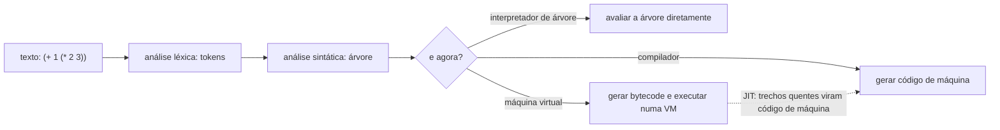

# Avaliação, escopo léxico e como um interpretador funciona

## Por que isso importa

Toda linguagem que você usa é, no fim, um programa que lê o seu programa. Saber como ele faz isso tira muito "mistério" do dia a dia: por que uma variável é visível aqui e não ali, por que a closure lembrou do valor antigo, por que `f(lista)` alterou a sua lista e `f(numero)` não alterou o número, por que `a and b()` às vezes não chama `b`, por que o Python é mais lento que o C e o JavaScript é mais rápido do que "deveria". E escrever um interpretador pequeno é um dos exercícios mais formadores da computação: ele junta parsing (TC-02), recursão, estruturas de dados e o modelo de execução de uma linguagem em poucas dezenas de linhas. Linguagens de configuração, motores de regras, fórmulas de planilha e DSLs internas de empresas são interpretadores desse tipo.

## Intuição

Pense num chef lendo uma receita. Primeiro ele **lê** o texto e entende a estrutura: "bata os ovos, depois misture com a farinha". Depois **executa** cada passo, de dentro para fora: para "misture (ovos batidos) com farinha", precisa antes ter os ovos batidos.

Quando a receita diz "use o molho", o chef procura o molho: primeiro na bancada (escopo local); se não estiver, na geladeira da cozinha (escopo de fora); por fim, na despensa do restaurante (escopo global). Essa busca por camadas é o **ambiente**. E quando um sous-chef leva para casa uma receita que diz "use o molho", a pergunta é: o molho **da cozinha onde a receita foi escrita** (escopo léxico) ou **da cozinha onde ela está sendo feita agora** (escopo dinâmico)?

## Visual

As etapas de uma implementação de linguagem:



Ambientes encadeados, com sombreamento:

```text
  x = 1                    global   ┌─────────────┐
  def f(y):                         │ x = 1       │
      x = 10                        │ f = <fn>    │
      def g():                      └─────▲───────┘
          return x + y                    │ pai
      return g                      f     ┌─────┴───────┐
                                          │ y = 5       │
  g = f(5)                                │ x = 10      │  ← sombreia o x global
  g()  →  15                              │ g = <fn>    │
                                          └─────▲───────┘
                                                │ pai
                                    g     ┌─────┴───────┐
                                          │ (vazio)     │  busca x: não tem → pai → 10
                                          └─────────────┘  busca y: não tem → pai → 5
```

## Conceito técnico

### Do texto à árvore

O interpretador primeiro transforma o texto numa **árvore sintática abstrata** (AST): a **análise léxica** quebra o texto em tokens (números, nomes, parênteses, operadores) e a **análise sintática** organiza os tokens segundo a gramática (TC-02, TC-05). Em Lisp, a sintaxe já é a árvore escrita com parênteses (`(+ 1 (* 2 3))`), por isso é a linguagem favorita para escrever o primeiro interpretador. Em Python, você pode ver a árvore de qualquer código com `ast.dump(ast.parse("1 + 2 * 3"))`.

### Avaliar: eval e apply

O coração do interpretador é uma função recursiva `avaliar(expressão, ambiente)`, com um caso por tipo de nó:

- **Literal** (número, texto): vale ele mesmo.
- **Variável**: procure o nome no ambiente.
- **Formas especiais** (`if`, `def`, `fn`/`lambda`): têm regras próprias. O `if` avalia a condição e **só um** dos ramos; por isso `if` não pode ser uma função comum.
- **Aplicação** `(f a b)`: avalie `f`, avalie os argumentos, e **aplique**: crie um ambiente novo com os parâmetros ligados aos argumentos, cujo pai é o ambiente da função, e avalie o corpo nele.

Essa dança entre **eval** (avaliar uma expressão num ambiente) e **apply** (aplicar uma função a argumentos) é o "avaliador metacircular" do SICP, e todo interpretador tem essa forma.

### Ambientes e escopo

Um **ambiente** é um dicionário de nomes para valores **mais uma referência para o ambiente pai**. Buscar uma variável é subir a cadeia até achar o nome (ou dar erro no global). Definir uma variável com o mesmo nome num ambiente interno **sombreia** a de fora sem alterá-la. Atribuir (`nonlocal`, ou `x = ...` em JS para uma variável existente) altera a **mais próxima** que tem aquele nome.

**Escopo léxico** (ou estático): o pai do ambiente de uma chamada é o ambiente **onde a função foi definida**. Basta ler o código para saber a que variável cada nome se refere. É por isso que uma função precisa guardar o ambiente onde nasceu: isso é exatamente a **closure** (LP-02), um par (código, ambiente).

**Escopo dinâmico**: o pai é o ambiente **de quem chamou**. O mesmo nome pode significar coisas diferentes dependendo de quem chama, o que torna o código difícil de entender e de otimizar. Lisps antigos, o Emacs Lisp (por padrão até hoje), o Bash e as variáveis `local` do Perl usam escopo dinâmico. Quase todas as linguagens modernas usam o léxico; o dinâmico sobrevive em casos controlados, como variáveis de ambiente de processos e o *context* do React.

Detalhes das linguagens reais: em Python, uma atribuição dentro da função torna o nome **local** à função inteira (daí o `UnboundLocalError` e o `nonlocal`/`global`); em JavaScript, `let` e `const` têm escopo de **bloco** e `var` tem escopo de função com *hoisting*.

### Estratégias de avaliação

**Quando** os argumentos são avaliados:

- **Estrita** (eager, call-by-value): antes de chamar a função. Quase todas as linguagens.
- **Preguiçosa** (lazy, call-by-need): só quando (e se) o valor for usado, e uma vez só. É o padrão do Haskell; permite estruturas infinitas (`take 5 [1..]`). Outras linguagens têm preguiça opcional: geradores (`yield`), iteradores, `range` do Python, streams.
- **Curto-circuito**: `and`, `or`, `&&`, `||` e `??` só avaliam o lado direito se precisarem. `usuario and usuario.nome` é seguro por isso. São, como o `if`, formas especiais.

**Como** os argumentos chegam:

- **Por valor**: a função recebe uma cópia (C para tipos simples e structs).
- **Por referência**: a função recebe a própria variável e pode reatribuí-la (`&` em C++, `ref` em C#).
- **Por compartilhamento** (call-by-sharing, ou "por valor de referência"): Python, JavaScript, Java (para objetos), Ruby. A função recebe uma referência para o **mesmo objeto**: pode **mutá-lo** (`lista.append(1)` aparece para quem chamou), mas **reatribuir** o parâmetro (`lista = []`) não afeta a variável de quem chamou.

### Interpretadores, máquinas virtuais, compiladores e JIT

- **Interpretador de árvore**: percorre a AST a cada execução, como nesta aula. Simples, mas lento (muitas indireções por operação).
- **Máquina virtual de bytecode**: compila a AST para instruções simples de uma máquina imaginária (geralmente de pilha, como no TC-05) e as executa num laço. É o que fazem o CPython (`dis.dis(f)` mostra o bytecode), a JVM, o Lua e o Ruby.
- **Compilador para código nativo**: traduz antes de rodar para instruções do processador (C, C++, Rust, Go). Execução rápida, compilação mais demorada.
- **JIT** (just-in-time): começa interpretando, observa quais trechos rodam muito ("quentes") e quais tipos de fato aparecem, e compila esses trechos para código nativo especializado durante a execução. É o que faz o V8 do JavaScript, a JVM HotSpot, o PyPy e, de forma experimental, o próprio CPython desde a 3.13. Por isso JavaScript pode ser surpreendentemente rápido.

"Linguagem interpretada" e "linguagem compilada" são, a rigor, propriedades da **implementação**, não da linguagem: existem compiladores de Python e interpretadores de C.

## Código

Um interpretador completo de uma linguagem estilo Lisp: leitor, ambientes encadeados, `se`, `def`, funções com closures (e recursão) e um interruptor para trocar escopo léxico por dinâmico e ver a diferença.

```python
import operator

# ---------- 1) leitor: texto -> árvore (listas aninhadas) ----------
def tokenizar(texto):
    return texto.replace("(", " ( ").replace(")", " ) ").split()

def ler(tokens):
    token = tokens.pop(0)
    if token == "(":
        lista = []
        while tokens[0] != ")":
            lista.append(ler(tokens))
        tokens.pop(0)  # descarta o ")"
        return lista
    try:
        return int(token)
    except ValueError:
        return token  # um símbolo (nome)

# ---------- 2) ambientes: um dicionário + o ambiente "pai" ----------
class Ambiente:
    def __init__(self, nomes, valores, pai=None):
        self.vars = dict(zip(nomes, valores))
        self.pai = pai

    def buscar(self, nome):
        amb = self
        while amb is not None:
            if nome in amb.vars:
                return amb.vars[nome]
            amb = amb.pai
        raise NameError(f"'{nome}' não está definido")

global_ = Ambiente(
    ["+", "-", "*", "<", "=", "print"],
    [operator.add, operator.sub, operator.mul, operator.lt, operator.eq, print],
)

# ---------- 3) closures: parâmetros + corpo + o ambiente onde a função NASCEU ----------
class Funcao:
    def __init__(self, params, corpo, amb):
        self.params, self.corpo, self.amb = params, corpo, amb

    def __call__(self, *args, amb_chamada=None):
        pai = amb_chamada if ESCOPO_DINAMICO else self.amb
        return avaliar(self.corpo, Ambiente(self.params, args, pai))

ESCOPO_DINAMICO = False

# ---------- 4) o avaliador ----------
def avaliar(x, amb):
    if isinstance(x, int):                 # número: vale ele mesmo
        return x
    if isinstance(x, str):                 # símbolo: procura nos ambientes
        return amb.buscar(x)
    op, *resto = x
    if op == "se":                         # (se cond entao senao): só avalia um ramo
        cond, entao, senao = resto
        return avaliar(entao if avaliar(cond, amb) else senao, amb)
    if op == "def":                        # (def nome valor)
        nome, valor = resto
        amb.vars[nome] = avaliar(valor, amb)
        return None
    if op == "fn":                         # (fn (params) corpo): cria uma closure
        params, corpo = resto
        return Funcao(params, corpo, amb)
    if op == "faca":                       # (faca e1 e2 ...): avalia em ordem, devolve o último
        valor = None
        for e in resto:
            valor = avaliar(e, amb)
        return valor
    funcao = avaliar(op, amb)              # aplicação: avalia a função e os argumentos...
    args = [avaliar(a, amb) for a in resto]
    if isinstance(funcao, Funcao):         # ...e aplica
        return funcao(*args, amb_chamada=amb)
    return funcao(*args)

def rodar(programa):
    return avaliar(ler(tokenizar(programa)), global_)

print(rodar("(+ 1 (* 2 3))"))
rodar("(def fatorial (fn (n) (se (< n 2) 1 (* n (fatorial (- n 1))))))")
print("fatorial de 20:", rodar("(fatorial 20)"))

rodar("(def somador (fn (n) (fn (x) (+ x n))))")
rodar("(def mais10 (somador 10))")
print("closure:", rodar("(mais10 5)"))

# léxico x dinâmico: qual 'y' a função enxerga?
rodar("(def y 1)")
rodar("(def ler-y (fn () y))")
rodar("(def chamar-com-y-local (fn (y) (ler-y)))")
print("escopo léxico:  ", rodar("(chamar-com-y-local 99)"))
ESCOPO_DINAMICO = True
print("escopo dinâmico:", rodar("(chamar-com-y-local 99)"))
```

São cerca de 80 linhas. Repare em três coisas: o `se` é tratado antes da aplicação, porque não pode avaliar os dois ramos (senão o fatorial nunca pararia); a `Funcao` guarda `amb`, o ambiente onde nasceu, e é isso que faz `somador` funcionar; e trocar uma única linha (`pai = amb_chamada`) transforma o escopo em dinâmico, fazendo `ler-y` enxergar o `y` de quem a chamou.

## Erros comuns

- **Implementar `if`, `and` ou `or` como funções comuns**: os argumentos são avaliados antes da chamada, e o curto-circuito (e a recursão com caso base) quebra.
- **Esquecer de guardar o ambiente de definição na função**: o resultado é escopo dinâmico por acidente, e closures deixam de funcionar.
- **Criar a variável no ambiente errado**: `def` cria no ambiente atual; atribuir a uma variável existente deve alterar a mais próxima.
- **Achar que Python passa listas "por referência"**: mutar o objeto aparece para quem chamou, mas reatribuir o parâmetro não.
- **Argumento padrão mutável em Python** (`def f(x=[])`): o valor padrão é avaliado **uma vez**, na definição, e compartilhado entre as chamadas.
- **Confundir "interpretada" com "lenta"**: a implementação (JIT, VM, nativo) importa mais que o rótulo.
- **Recursão profunda num interpretador recursivo**: o interpretador herda o limite de pilha da linguagem hospedeira (por isso interpretadores reais usam laços e pilhas explícitas, ou otimização de chamada de cauda).

## Pratique

```quiz
id: LP-03-q1
tipo: multipla_escolha
pergunta: "Com escopo léxico, o que imprime `chamar()`? No módulo há `x = 'global'`. A função `mostrar()` faz `print(x)`. A função `chamar()` faz `x = 'local de chamar'` e depois chama `mostrar()`."
opcoes: ["global", "local de chamar", "Um erro, x não está definido em mostrar", "None"]
resposta: 0
explicacao: "No escopo léxico, mostrar procura x onde foi definida: no módulo, onde x vale 'global'. O x de chamar é local a chamar e invisível para mostrar. Com escopo dinâmico (como no Bash), a resposta seria 'local de chamar'."
dificuldade: 2
```

```quiz
id: LP-03-q2
tipo: multipla_escolha
pergunta: "Por que o if não pode ser implementado como uma função comum numa linguagem de avaliação estrita?"
opcoes: ["Porque funções não podem devolver valores booleanos", "Porque os argumentos seriam todos avaliados antes da chamada: os dois ramos executariam, e uma recursão com caso base nunca pararia", "Porque o if precisa de chaves", "Pode, sem nenhum problema"]
resposta: 1
explicacao: "Numa linguagem estrita, se(cond, a, b) avaliaria a e b antes de entrar. Em fatorial, o ramo recursivo seria avaliado mesmo com n = 0, para sempre. Por isso if, and, or são formas especiais. Numa linguagem preguiçosa, como Haskell, o if poderia ser uma função comum."
dificuldade: 2
```

```quiz
id: LP-03-q3
tipo: verdadeiro_falso
pergunta: "Em Python, se uma função faz lista.append(4) no parâmetro lista, quem chamou vê o 4 na sua lista; mas se a função faz lista = [4], quem chamou não vê mudança."
resposta: true
explicacao: "Python passa por compartilhamento: o parâmetro é um novo nome para o mesmo objeto. Mutar o objeto (append) é visível para todos que o referenciam; reatribuir o nome (lista = [4]) só faz o nome local apontar para outro objeto."
dificuldade: 2
```

```quiz
id: LP-03-q4
tipo: multipla_escolha
pergunta: "O que um compilador JIT (como o V8 do JavaScript) faz?"
opcoes: ["Compila o programa inteiro para código de máquina antes de rodar", "Interpreta tudo, sem nunca gerar código de máquina", "Começa interpretando, detecta os trechos que rodam muito e os compila para código de máquina durante a execução, especializando para os tipos observados", "Traduz JavaScript para Python"]
resposta: 2
explicacao: "O JIT combina partida rápida (interpretar) com desempenho (compilar o que importa). Como ele vê os tipos que de fato aparecem, pode gerar código especializado; se a suposição falhar (um tipo novo aparece), ele 'desotimiza' e volta a interpretar aquele trecho."
dificuldade: 2
```

```quiz
id: LP-03-q5
tipo: resposta_curta
pergunta: "Num interpretador, por que um valor de função precisa guardar o ambiente onde foi criado?"
resposta: "Para implementar escopo léxico: quando a função for chamada, o ambiente novo dos parâmetros terá como pai o ambiente da definição, e as variáveis livres do corpo serão buscadas lá. Sem isso, a busca usaria o ambiente de quem chamou (escopo dinâmico), e closures como um somador que lembra o n não funcionariam."
palavras_chave: ["léxico", "definição", "closure", "pai"]
dificuldade: 2
```

```quiz
id: LP-03-q6
tipo: codigo
linguagem: python
pergunta: |
  **O leitor.** Escreva `ler(texto)`, que transforma uma expressão no estilo Lisp em listas aninhadas: parênteses viram listas, inteiros viram `int` e o resto vira `str`.

  Exemplo: `"(+ 1 (* 2 x))"` vira `['+', 1, ['*', 2, 'x']]`. Um texto sem parênteses, como `"42"` ou `"nome"`, vira o próprio átomo.
codigo_inicial: |
  def ler(texto):
      return texto.split()
usa: [def, while, return]
testes:
  - chamada: "ler('(+ 1 2)')"
    saida: "['+', 1, 2]"
  - chamada: "ler('(+ 1 (* 2 x))')"
    saida: "['+', 1, ['*', 2, 'x']]"
  - chamada: "ler('42')"
    saida: "42"
  - chamada: "ler('(def f (fn (n) (* n -3)))')"
    saida: "['def', 'f', ['fn', ['n'], ['*', 'n', -3]]]"
  - chamada: "ler('()')"
    visivel: false
    saida: "[]"
  - chamada: "ler('((a) (b c) ((d)))')"
    visivel: false
    saida: "[['a'], ['b', 'c'], [['d']]]"
  - chamada: "ler('  (  soma   10\\n  20 )  ')"
    visivel: false
    saida: "['soma', 10, 20]"
dica: "Separe os tokens com texto.replace('(', ' ( ').replace(')', ' ) ').split(). Escreva uma função auxiliar que consome tokens: se o token é '(', leia elementos (recursivamente) enquanto o próximo não for ')'; senão, tente int(token) e, se der ValueError, devolva o texto."
solucao: |
  def ler(texto):
      tokens = texto.replace('(', ' ( ').replace(')', ' ) ').split()
      return _ler(tokens)

  def _ler(tokens):
      token = tokens.pop(0)
      if token == '(':
          lista = []
          while tokens[0] != ')':
              lista.append(_ler(tokens))
          tokens.pop(0)
          return lista
      try:
          return int(token)
      except ValueError:
          return token
explicacao: "Um analisador recursivo descendente (TC-02) para a gramática mais simples possível: expressão = átomo | '(' expressão* ')'. A recursão espelha o aninhamento. Repare que '-3' vira o inteiro -3, e '-' sozinho continua sendo o símbolo de subtração, porque int('-') falha."
dificuldade: 2
```

```quiz
id: LP-03-q7
tipo: codigo
linguagem: python
pergunta: |
  **O avaliador.** Expressões já lidas são listas aninhadas. Escreva `avaliar(x, amb)`, em que `amb` é um dicionário de nomes para valores:

  - um `int` vale ele mesmo; uma `str` é buscada em `amb` (se não existir, devolva `'erro: <nome>'`);
  - `['+', a, b]`, `['-', a, b]`, `['*', a, b]` e `['<', a, b]` fazem a conta;
  - `['se', c, a, b]` avalia **só** `a` se `c` for verdadeiro, senão **só** `b`;
  - `['seja', nome, valor, corpo]` avalia `valor`, e avalia `corpo` num ambiente **novo** em que `nome` tem esse valor (sem alterar `amb`).

  Os testes nunca usam o resultado de um erro dentro de outra conta.
codigo_inicial: |
  def avaliar(x, amb):
      return x
usa: [def, if, return]
testes:
  - chamada: "avaliar(['+', 1, ['*', 2, 3]], {})"
    saida: "7"
  - chamada: "avaliar(['*', 'x', 'x'], {'x': 9})"
    saida: "81"
  - chamada: "avaliar(['seja', 'a', 5, ['-', 'a', 2]], {})"
    saida: "3"
  - chamada: "avaliar(['se', ['<', 1, 2], 10, 20], {})"
    saida: "10"
  - chamada: "avaliar('z', {})"
    saida: "'erro: z'"
  - chamada: "avaliar(['se', ['<', 2, 1], 'nao_existe', 0], {})"
    visivel: false
    saida: "0"
  - chamada: "avaliar(['seja', 'x', 1, ['seja', 'x', ['+', 'x', 10], ['*', 'x', 2]]], {})"
    visivel: false
    saida: "22"
  - chamada: "(lambda amb: (avaliar(['seja', 'y', 7, 'y'], amb), amb))({'y': 1})"
    visivel: false
    saida: "(7, {'y': 1})"
dica: "Trate os casos na ordem: int, str, depois olhe o primeiro elemento da lista. Para 'seja', crie o ambiente novo com {**amb, nome: valor} (uma cópia com o nome a mais) e avalie o corpo nele."
solucao: |
  def avaliar(x, amb):
      if isinstance(x, int):
          return x
      if isinstance(x, str):
          return amb[x] if x in amb else 'erro: ' + x
      op = x[0]
      if op == 'se':
          if avaliar(x[1], amb):
              return avaliar(x[2], amb)
          return avaliar(x[3], amb)
      if op == 'seja':
          novo = {**amb, x[1]: avaliar(x[2], amb)}
          return avaliar(x[3], novo)
      a, b = avaliar(x[1], amb), avaliar(x[2], amb)
      if op == '+':
          return a + b
      if op == '-':
          return a - b
      if op == '*':
          return a * b
      if op == '<':
          return a < b
      return 'erro: ' + str(op)
explicacao: "O teste com 'nao_existe' só passa porque o 'se' não avalia o ramo descartado. O 'seja' aninhado mostra o sombreamento: o x de dentro (11) esconde o de fora (1), e o valor do x interno é calculado no ambiente de fora (x + 10 com x = 1). O último teste confirma que o ambiente de fora não é alterado. Copiar o dicionário é simples; o interpretador da aula usa o encadeamento com pai, que não copia nada."
dificuldade: 3
```

```quiz
id: LP-03-q8
tipo: codigo
linguagem: javascript
pergunta: |
  **Ambientes encadeados.** Escreva `executar(instrucoes)`, que roda uma lista de instruções com escopo de bloco e devolve a lista do que foi impresso:

  - `['bloco']` abre um ambiente novo, filho do atual; `['fim']` fecha e volta ao pai;
  - `['var', nome, valor]` **cria** `nome` no ambiente atual (sombreando um de fora);
  - `['set', nome, valor]` **altera** o `nome` no ambiente mais próximo que o tenha; se nenhum tiver, imprime `'erro: ' + nome`;
  - `['print', nome]` imprime o valor do `nome` mais próximo, ou `'erro: ' + nome`.
codigo_inicial: |
  function executar(instrucoes) {
    const vars = {};
    const saida = [];
    for (const [op, nome, valor] of instrucoes) {
      if (op === "var" || op === "set") vars[nome] = valor;
      if (op === "print") saida.push(vars[nome]);
    }
    return saida;
  }
usa: [function, for, while, return]
testes:
  - chamada: "executar([['var', 'x', 1], ['print', 'x']])"
    saida: "[ 1 ]"
  - chamada: "executar([['var', 'x', 1], ['bloco'], ['var', 'x', 2], ['print', 'x'], ['fim'], ['print', 'x']])"
    saida: "[ 2, 1 ]"
  - chamada: "executar([['var', 'x', 1], ['bloco'], ['set', 'x', 5], ['fim'], ['print', 'x']])"
    saida: "[ 5 ]"
  - chamada: "executar([['bloco'], ['var', 'y', 3], ['fim'], ['print', 'y']])"
    saida: "[ 'erro: y' ]"
  - chamada: "executar([['set', 'z', 1], ['var', 'a', 0], ['bloco'], ['bloco'], ['print', 'a'], ['var', 'a', 9], ['set', 'a', 7], ['fim'], ['print', 'a'], ['fim']])"
    visivel: false
    saida: "[ 'erro: z', 0, 0 ]"
  - chamada: "executar([['var', 'n', 1], ['bloco'], ['var', 'm', 2], ['bloco'], ['set', 'n', 10], ['set', 'm', 20], ['print', 'n'], ['print', 'm'], ['fim'], ['fim'], ['print', 'n'], ['print', 'm']])"
    visivel: false
    saida: "[ 10, 20, 10, 'erro: m' ]"
dica: "Represente cada ambiente como { vars: {}, pai }. Escreva uma função que, a partir do ambiente atual, sobe por amb.pai num while até achar um com o nome (use 'nome in amb.vars') e devolve esse ambiente, ou null. 'bloco' faz atual = { vars: {}, pai: atual }; 'fim' faz atual = atual.pai."
solucao: |
  function executar(instrucoes) {
    let atual = { vars: {}, pai: null };
    const saida = [];
    const achar = (nome) => {
      let amb = atual;
      while (amb !== null) {
        if (nome in amb.vars) return amb;
        amb = amb.pai;
      }
      return null;
    };
    for (const [op, nome, valor] of instrucoes) {
      if (op === "bloco") {
        atual = { vars: {}, pai: atual };
      } else if (op === "fim") {
        atual = atual.pai;
      } else if (op === "var") {
        atual.vars[nome] = valor;
      } else {
        const amb = achar(nome);
        if (amb === null) saida.push("erro: " + nome);
        else if (op === "set") amb.vars[nome] = valor;
        else saida.push(amb.vars[nome]);
      }
    }
    return saida;
  }
explicacao: "É exatamente o que acontece com let e blocos em JavaScript: var cria no bloco atual (sombreando), set altera a variável mais próxima, e quando o bloco fecha, as variáveis dele somem. No penúltimo teste, o 'set a 7' altera o a recém-criado no bloco interno, não o de fora, que continua 0. Num interpretador real, cada chamada de função também cria um ambiente, cujo pai é o ambiente da definição (escopo léxico)."
dificuldade: 3
```

## Resumo

- Um interpretador **lê** (tokens → árvore) e **avalia** a árvore recursivamente: literais, variáveis, **formas especiais** (`if`, `def`, `fn`) e **aplicação** (eval/apply).
- **Ambiente** = dicionário + pai. Buscar sobe a cadeia; definir cria no atual (**sombreia**); atribuir altera o mais próximo.
- **Escopo léxico**: o pai é o ambiente da **definição** (closures); **dinâmico**: o de quem **chamou**.
- Avaliação **estrita** × **preguiçosa**; **curto-circuito** em `and`/`or`; passagem **por valor**, **por referência** e **por compartilhamento** (Python, JS, Java).
- Implementações: **interpretador de árvore**, **VM de bytecode**, **compilador nativo**, **JIT**. "Interpretada" é propriedade da implementação.

## Para ir além

- Leia o "lis.py" do Peter Norvig e adicione ao interpretador da aula: listas, `and`/`or` com curto-circuito e `seja` (let).
- Siga a primeira parte do Crafting Interpreters (o jlox) e implemente uma linguagem com sintaxe própria.
- Rode `import dis; dis.dis(minha_funcao)` em funções suas e tente ler o bytecode do CPython.
- Este é o último módulo da trilha de paradigmas. Para continuar, faça as partes B e C do curso de Grossman (Racket e Ruby) e o capítulo 4 do SICP.
